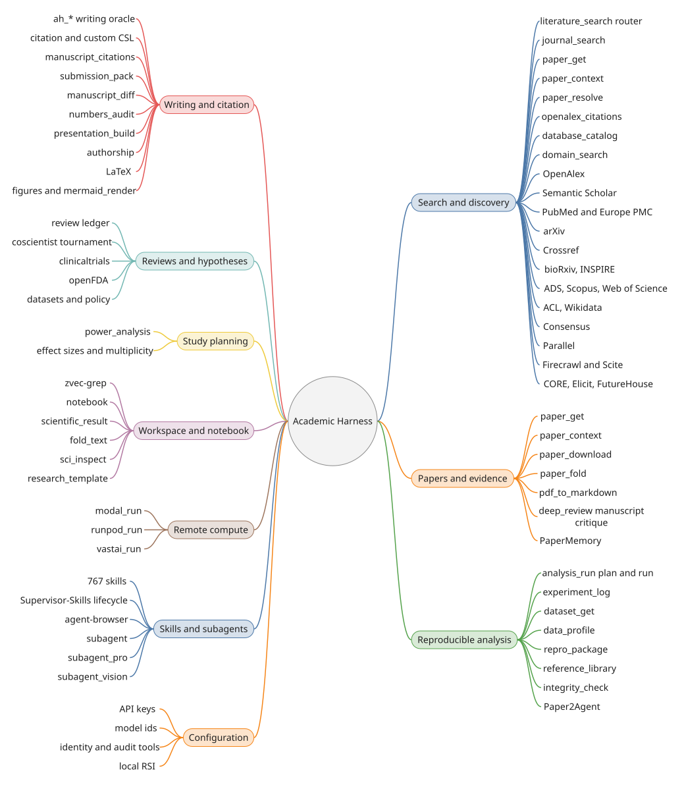

# Academic Harness

[](https://github.com/raktim-mondol/academic-harness/actions/workflows/verify.yml)


**A research workbench for DeepSeek Harness (DSH).** Academic Harness adds literature discovery, evidence-linked paper memory, scientific writing and review tools, research ledgers, and 790 bundled skills to the DSH web UI.

It installs as a DSH plugin and provides an **Academic Harness** preset. Its tools support human-directed research; advisory reviews and audit results are not substitutes for expert judgment.



## Quick start

Academic Harness requires **Linux** and **DeepSeek Harness >=0.2.1-rc.5 <0.3.0**. It is a Linux-only plugin: the npm package declares `"os": ["linux"]`, and Windows and macOS are not supported. See [installation requirements](docs/INSTALL.md#requirements) for validated versions and optional runtimes.

```sh
npm install -g @deepseek-ai/dsh@0.2.1-rc.5
dsh web
```

In the web UI:

1. Open **Plugins → Add plugin**.
2. Enter `github:raktim-mondol/academic-harness` and click **Install**.
3. Start a new chat and select the **Academic Harness** preset.

No API key is required to install or start; some connectors and compute services require their own credentials. For a dedicated CLI profile, troubleshooting, and setup details, see [Install and run](docs/INSTALL.md) and [Configuration](docs/CONFIGURATION.md).

## What you can do

- **Find and assess literature:** search scholarly sources, retrieve papers, check claims against stored quotations, and triage prior art with explicit coverage limits. [Search](docs/SEARCH.md) · [Papers and evidence](docs/PAPERS.md) · [Prior-art triage](docs/IDENTITY-AND-AUDIT-TOOLS.md#prior_art)
- **Investigate research questions:** run deep research, systematic reviews, meta-analyses, and hypothesis tournaments; follow the approval-gated research cycle from scope and prior art to review and export. [Research](docs/RESEARCH.md#guided-research-cycle)
- **Write and revise:** use the LaTeX writing oracle, citation tools, manuscript reviews, and reviewer-response ledgers. [Writing](docs/WRITING.md) · [Deep review](docs/PAPERS.md#deep-review)
- **Keep work auditable:** record scoped experiment comparisons, repeated-seed summaries, and read-only branch views; attribute components with ablation; and trace figures back to their declared generating runs. [Analysis](docs/ANALYSIS.md) · [Provenance](docs/PROVENANCE.md) · [Workspace](docs/WORKSPACE.md)
- **Extend your workflow:** use scientific data tools, specialist agents, bundled skills, and remote compute. [Scientific data](docs/SCIENCE-DATA.md) · [Agents](docs/AGENTS.md) · [Skills](docs/SKILLS.md) · [Compute](docs/COMPUTE.md)

## Documentation

The [documentation home](docs/README.md) lists all guides and diagrams. Start with the links below:

| Topic | Guides |
|---|---|
| Getting started | [Install and run](docs/INSTALL.md) · [Configuration](docs/CONFIGURATION.md) · [Architecture](docs/ARCHITECTURE.md) |
| Research workflow | [Search](docs/SEARCH.md) · [Papers and evidence](docs/PAPERS.md) · [Research](docs/RESEARCH.md) · [Writing](docs/WRITING.md) |
| Data and reproducibility | [Analysis](docs/ANALYSIS.md) · [Provenance](docs/PROVENANCE.md) · [Scientific data](docs/SCIENCE-DATA.md) · [Workspace](docs/WORKSPACE.md) |
| More capabilities | [Discovery and reference checks](docs/DISCOVERY.md) · [Identity and audit tools](docs/IDENTITY-AND-AUDIT-TOOLS.md) · [Compute](docs/COMPUTE.md) · [Agents](docs/AGENTS.md) · [Skills](docs/SKILLS.md) · [Local self-improvement](docs/RSI.md) |
| Reference | [Tool index](docs/TOOLS.md) · [Development](docs/DEVELOPMENT.md) · [Changelog](docs/CHANGELOG.md) · [Engine notes](docs/ACADEMIC-HARNESS-ENGINE.md) · [Human-directed research cycle](docs/HUMAN-DIRECTED-RESEARCH-CYCLE-PLAN.md) · [ScientistTwo roadmap](docs/SCIENTISTTWO-ROADMAP.md) |

## License

MIT — see [LICENSE](LICENSE). Some bundled skills have different license terms, including non-commercial terms; see [NOTICE](NOTICE) for attribution and details.
