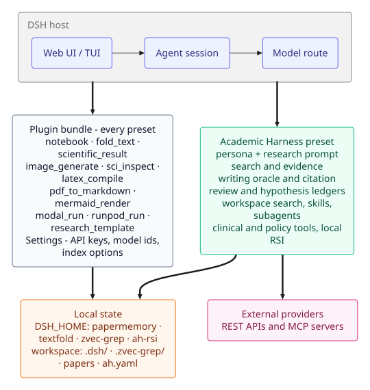
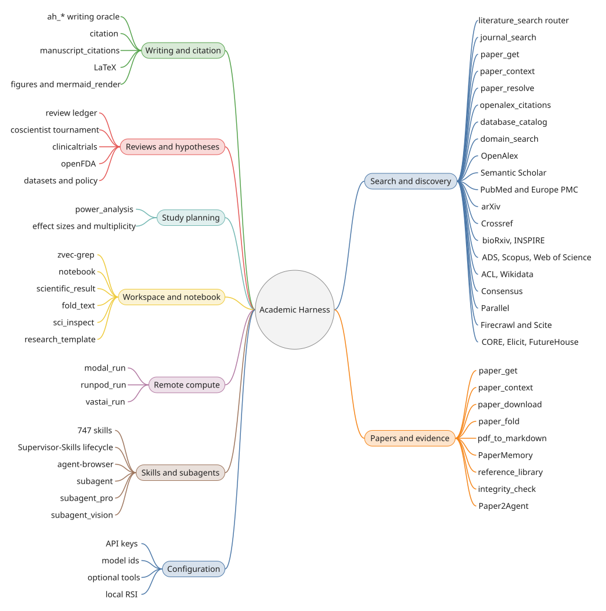
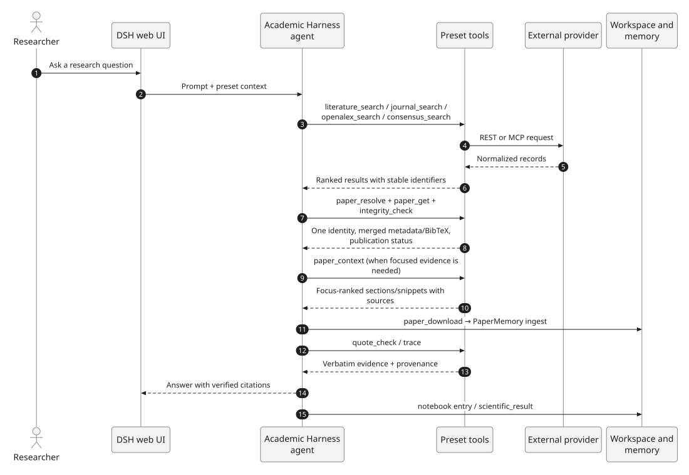

# Academic Harness

[](https://github.com/raktim-mondol/academic-harness/actions/workflows/verify.yml)


**A research workbench for DeepSeek Harness** — literature and web discovery, verbatim paper memory, a writing oracle for LaTeX, systematic-review and hypothesis ledgers, 730 scientific skills, and local self-improvement, all inside the DSH web UI.

Academic Harness is a **DSH profile**: it installs as a plugin, adds a preset with a research persona and academic tools, and keeps the general-purpose tools available on every preset.



## Why Academic Harness

| Principle | What it means in practice |
|---|---|
| **Evidence, not citation-shaped guesses** | PaperMemory stores papers as content-addressed Markdown and anchors claims to exact quote spans. `quote_check` and `trace` verify a quotation before it becomes a citation; an empty `cite` means *do not invent one*. [Read more](docs/PAPERS.md#paper-memory) |
| **A writing oracle with a gate** | The vendored `ah_*` engine inventories every number, citation, unit, and claim in a LaTeX tree. A turn closes only when it introduced no open blocker or major. [Read more](docs/WRITING.md#academic-harness-engine) |
| **Auditable research ledgers** | Systematic reviews and hypothesis tournaments live in append-only logs under the workspace, so a resumed session sees the same protocol, screening decisions, and ratings. [Reviews](docs/RESEARCH.md#systematic-reviews) · [Tournaments](docs/RESEARCH.md#hypothesis-tournaments) |
| **Discovery across the real literature** | OpenAlex, Semantic Scholar, PubMed/Europe PMC, arXiv, and Crossref through one `literature_search` entry point, plus Consensus, Parallel, Firecrawl, Scite, CORE, Elicit, and FutureHouse. [Read more](docs/SEARCH.md) |
| **A lab notebook that survives context loss** | A JSONL notebook shared across the delegation tree, a schema-validated `scientific_result` card, and deletion-only reply folding at five levels. [Read more](docs/WORKSPACE.md) |
| **Local-first by design** | Workspace search (zvec-grep), PaperMemory, TextFold, ledgers, and the RSI store stay on disk. No key is required to boot. [Read more](docs/ARCHITECTURE.md#runtime-installs) |

## Install

Requires **DeepSeek Harness 0.2.1 or later**.

```sh
npm install -g @deepseek-ai/dsh
```

Then either:

**A — from the DSH Web UI (recommended):** open **Plugins → Add plugin**, paste `github:raktim-mondol/academic-harness`, click **Install**, and start a new chat.

**B — a dedicated CLI profile:**

```sh
dsh plugin --profile academic-harness add github:raktim-mondol/academic-harness
dsh --profile academic-harness
```

Confirm the preset selector at the top of the message box reads **Academic Harness**. The academic tools are preset-only; a session left on Standard/PTC will fail with `tools[name] is not a function`.

Full instructions, migration from `researchcraft`, troubleshooting, and the "one DSH surface at a time" rule are in **[Install and run](docs/INSTALL.md)**.

## What is inside



| Surface | Highlights | Guide |
|---|---|---|
| **Search and discovery** | `literature_search` router, OpenAlex, Semantic Scholar, PubMed, arXiv, Crossref, Consensus, Parallel, Firecrawl, Scite, Tavily, Exa, Perplexity, Jina, CORE, Elicit, FutureHouse | [Search](docs/SEARCH.md) |
| **Papers and evidence** | `paper_download`, `paper_fold`, `pdf_to_markdown`, PaperMemory's 14 tools, `integrity_check`, Paper2Agent | [Papers](docs/PAPERS.md) |
| **Writing and citation** | `ah_*` writing oracle and gate, `citation`, `manuscript_citations`, LaTeX, `scientific-figure-making`, `diagram-design`, `image_generate`, `mermaid_render` (Pele) | [Writing](docs/WRITING.md) |
| **Reviews and hypotheses** | `review` PRISMA-style ledger, `coscientist` Glicko-2 tournament, published-results feedback, cross-session priors | [Research](docs/RESEARCH.md) |
| **Clinical and policy records** | `clinicaltrials`, `openfda`, `dataset_search`, `journal_policy`, `funder_policy` | [Research](docs/RESEARCH.md) |
| **Workspace and notebook** | zvec-grep semantic search, lab notebook, `scientific_result`, `fold_text`, `research_template`, `sci_inspect` | [Workspace](docs/WORKSPACE.md) |
| **Compute and delegation** | `runpod_run`/`modal_run`/`vastai_run`, `subagent_pro`, `subagent_vision`, specialist briefs, `agent-browser` | [Compute](docs/COMPUTE.md) · [Agents](docs/AGENTS.md) |
| **Skills** | 730 bundled skills: 140 domain, 16 methodology, 503 expert profiles, 23 drug-discovery, plus writing, figures, agents, and compute | [Skills](docs/SKILLS.md) |
| **Self-improvement** | Local RSI: capture, diagnose, admit, inject, compare against control, promote or quarantine | [RSI](docs/RSI.md) |
| **Configuration** | Settings → Academic Harness API keys; every credential is optional at install | [Configuration](docs/CONFIGURATION.md) |

The complete tool list, with scope and links, is the **[tool index](docs/TOOLS.md)**. The [architecture guide](docs/ARCHITECTURE.md) explains which tools are available on every preset and which are preset-only.

## How a request works



Discovery finds candidate papers, `paper_resolve` collapses their identifiers, and `integrity_check` reports retraction status. A downloaded PDF is stored as content-addressed Markdown in PaperMemory, and a quotation must pass `quote_check` or `trace` before the agent treats it as evidence. The notebook records the work; `scientific_result` records the final finding.

## Documentation

| Start here | Go deeper | Reference |
|---|---|---|
| [Install and run](docs/INSTALL.md) | [Search](docs/SEARCH.md) | [Tool index](docs/TOOLS.md) |
| [Architecture](docs/ARCHITECTURE.md) | [Papers and evidence](docs/PAPERS.md) | [Configuration](docs/CONFIGURATION.md) |
| [Documentation home](docs/README.md) | [Writing](docs/WRITING.md) | [Changelog](docs/CHANGELOG.md) |
| | [Research](docs/RESEARCH.md) | [Development](docs/DEVELOPMENT.md) |
| | [Workspace](docs/WORKSPACE.md) | [Optional tools](docs/OPTIONAL-TOOLS.md) |
| | [Compute](docs/COMPUTE.md) · [Agents](docs/AGENTS.md) · [Skills](docs/SKILLS.md) · [RSI](docs/RSI.md) | [Engine notes](docs/ACADEMIC-HARNESS-ENGINE.md) |

## Requirements and scope

- **DSH 0.2.1+.** The plugin's bundle patches the web-app layer, so the profile must include `@deepseek-ai/dsh-web-app`; the standard `web` profile does.
- **A preset check matters.** The research persona, search connectors, PaperMemory, zvec-grep, paper tools, citation/review/tournament tools, and the `subagent_pro`/`subagent_vision` routes are scoped to the Academic Harness preset. Only the general-purpose tools (notebook, fold, images, LaTeX, PDF, Mermaid, compute, templates) are on every preset.
- **Keys are optional.** No credential is needed to install or start; each connector stays disabled until its key is present. Some runtimes install in the background on first use — see [Architecture](docs/ARCHITECTURE.md#runtime-installs).
- **One DSH surface at a time.** `dsh-web`, `dsh-tui`, `dsh-martty`, and `academic-harness` share `$DSH_HOME`, port `3080`, and the zvec-grep daemon. Stop the previous one before starting another; see [Install](docs/INSTALL.md#one-dsh-surface-at-a-time).
- **Renamed in v0.16.0** from `dsh-researchcraft` / ResearchCraft. Old env names are still honored; migration is in [Install](docs/INSTALL.md#renamed-in-v0160).

## Development

```sh
npm install       # once, for the Settings page build
npm run build     # after any client/ change
npm run docs:diagrams   # regenerate the SVG figures from docs/diagrams/*.mmd
```

Server-side code is plain ESM JS with no build step. Tests are plain Node scripts; see [Development](docs/DEVELOPMENT.md) for the full suite and the `paper_fold` live test.

## License

MIT — see [LICENSE](LICENSE). Scientific skills are vendored or adapted from several open-source catalogues; [NOTICE](NOTICE) records exactly what was copied, renamed, or adapted from each.
