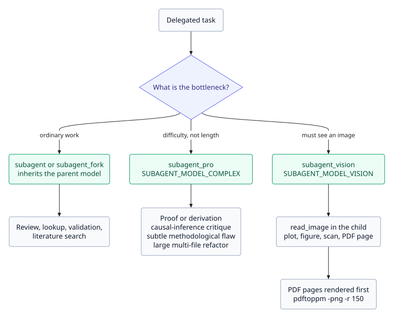

# Agents and browsing

The Academic Harness preset adds a specialist roster and two model-pinned delegation tools on top of DSH's normal delegation. The goal is to route a task to the model that fits it instead of running everything on whatever model the current chat session happens to be on.

## Subagent model routing

Besides the plain `subagent`/`subagent_fork` delegation tools, the `academic-harness` preset adds two more that pin a delegated child to a specific model via `agentOptions.model`:

| Tool | Use it for | Model (Settings or env) | Default |
|---|---|---|---|
| `subagent` | Ordinary delegated work — most specialist calls | — (inherits the parent session's model) | — |
| `subagent_fork` | Forked delegation that inherits the parent preset and history | — (inherits the parent) | — |
| `subagent_pro` | Tasks where difficulty, not length, is the bottleneck: a hard proof/derivation, a causal-inference or experimental-design critique, tracing a subtle methodological flaw, multi-step reaction/pathway reasoning, a large multi-file refactor | `SUBAGENT_MODEL_COMPLEX` | `deepseek-flash` |
| `subagent_vision` | Delegated tasks that need to *see* something with `read_image` — a figure, scan, diagram, screenshot, or a rendered LaTeX PDF page | `SUBAGENT_MODEL_VISION` | `deepseek-flash` |

Both pinned tools default to `deepseek-flash` (DeepSeek-V4.1-Flash). The legacy names `deepseek-v4-flash` and `deepseek-v4-flash-vision-exp` are still accepted by the API, but those models have been retired and their requests are served by Flash.

All four delegation tools use DSH 0.2.1's managed activations: a call returns a `subagentId` immediately, the child's final answer arrives as a completion notice, and `send_message` / `interrupt_agent` handle follow-ups and stops.

`subagent` is deliberately left without a pinned model: forcing every routine delegation onto a hardcoded model id would break delegation outright wherever that id isn't registered under the session's provider. Only the two escalation paths are pinned, and only where the agent is choosing to opt into a specific model rather than falling back to whatever it's already using.

### What gets routed to `subagent_pro`

The system prompt steers `subagent_pro` toward difficulty, not length:

- verifying a mathematical derivation step-by-step,
- propagating uncertainty through a multi-stage calculation,
- a causal-inference critique (spotting a hidden confounder, weighing conflicting evidence across several studies),
- tracing a subtle methodological flaw through many interacting parts (data leakage in a multi-stage ML pipeline, a silently-wrong nested cross-validation setup),
- multi-step reaction-mechanism or pathway reasoning,
- large multi-file refactors that need many call sites kept consistent.

It explicitly steers away from routine review, lookup, simple data validation, or literature search, since those get the same quality on plain `subagent` for a fraction of the cost and latency.

### What gets routed to `subagent_vision`

`subagent_vision` only routes the child to a model; the child still calls `read_image` (`@deepseek-ai/dsh-tool-fs`) itself, which refuses to read an image unless the calling route's resolved model actually declares `image` input in this deployment's model catalog — pick a `SUBAGENT_MODEL_VISION` value that's registered that way.

Beyond a plain "look at this image" request, the system prompt steers the agent to delegate to `subagent_vision` for scientific reading tasks specifically:

- interpreting a plot or trend,
- comparing panels in a multi-panel figure,
- reviewing a microscopy/gel/medical-imaging scan for qualitative features,
- checking a chemical structure/phylogenetic tree/pathway diagram for correctness,
- comparing a generated figure against what was asked for.

It also covers a case text tools can't: auditing a compiled LaTeX PDF's page layout — a table split across a page break, a table or figure that drifted into the references section, an overfull line, a caption stranded from its figure. Since `read_image` only accepts PNG/JPEG/WebP/GIF, the agent renders the PDF pages first with `pdftoppm -png -r 150 file.pdf page` (poppler, usually already present alongside TeX Live) before delegating.

### Configuration

Set `SUBAGENT_MODEL_COMPLEX`/`SUBAGENT_MODEL_VISION` via Settings → Academic Harness API keys (two dropdowns beside Image model) or the matching env var — env wins when both are set, same resolution order as the API keys above. Unlike Image model, these two need a `dsh` restart to take effect (see [Configuration](CONFIGURATION.md#when-a-change-takes-effect)).

## Specialist briefs and skills

The preset carries specialist briefs for the `subagent` tool (code-reviewer, literature-researcher, and others) and the full skill catalogue. The 730 bundles in `skills/` include research-discipline workflows, domain skills, expert-reasoning profiles, and the local tools' workflow skills; see [Skills](SKILLS.md).

## Browsing the web

Built-in `web_search` works (DeepSeek search provider). Built-in `web_fetch` retrieves public HTTP(S) pages through the local HTTP provider; if a page is blocked, needs JavaScript, or returns `WEB_PROVIDER_UNAVAILABLE`, the agent falls back to `mcp__parallel__web_fetch`, `parallel_extract`, or `mcp__firecrawl__firecrawl_scrape` (Firecrawl needs `FIRECRAWL_API_KEY`). DeepSeek's Search and Fetch APIs can be enabled in Web Search settings.

For anything that needs a real rendered browser — exploring a site interactively, logging in, filling out a form, clicking through to a dataset download, or verifying a page actually renders correctly — the agent loads the bundled `agent-browser` skill (`skills/agent-browser`, shipped and seeded the same way as the other skills) and drives the [agent-browser](https://github.com/vercel-labs/agent-browser) CLI directly via `bash`.

The CLI isn't bundled with this plugin's package, but the agent installs it itself when missing (`npm i -g agent-browser && agent-browser install`, or `npx agent-browser@latest ...` for a one-off task) rather than asking the user to.

Most of what it does — navigating, reading, filling forms, extracting data, downloading files — works off an accessibility-tree snapshot and needs no image at all. The one exception is `screenshot`: since the session's own model isn't guaranteed to have vision input, the skill steers the agent to delegate reading any screenshot to `subagent_vision` (see above) instead of guessing at its content.

## Related

- [Search](SEARCH.md) — the connectors behind the fallback paths.
- [Compute](COMPUTE.md) — GPU work that should not run locally.
- [Skills](SKILLS.md) — the complete catalogue.
- [Configuration](CONFIGURATION.md) — model ids and keys.
