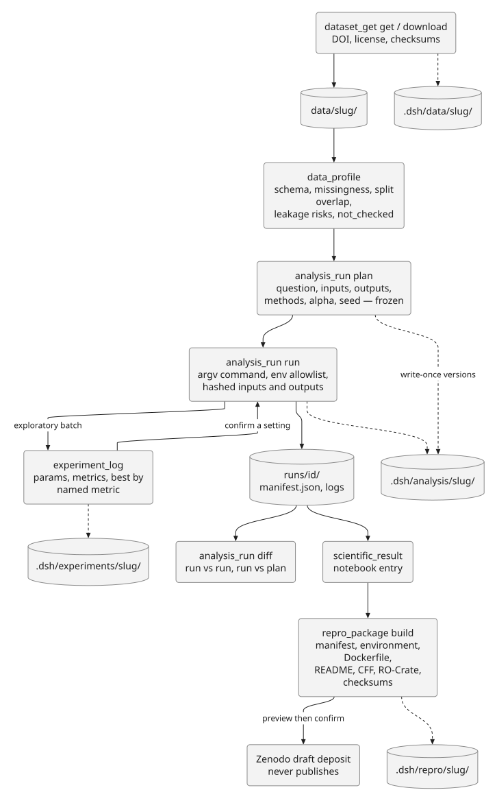

# Reproducible analysis and data

Phase 2 of the [scientific expansion](SCIENTIFIC-EXPANSION-PLAN.md) turns
reproducibility from a habit into ledgers. Five preset-only tools record the
analysis that produced a number, the experiments that explored it, the data it
runs on, and the package a reader needs to rebuild it. All state is local,
append-only where it matters, and confined to the workspace. The standing rule
across every tool: **the manifest is the evidence; the tool never interprets
the science.**

## `analysis_run`

Freezes a plan, then executes against it. State lives under
`<cwd>/.dsh/analysis/<slug>/`: `plan.jsonl` (append-only plan versions),
`runs.jsonl` (one immutable manifest per run), and `runs/<id>/` (stdout,
stderr, manifest, artifacts).

| Action | What it does |
|---|---|
| `plan` | Freeze question, hypotheses, inputs, outputs, methods, alpha, corrections, missing-data rules, exclusions, stopping rules, software, seed. Re-submitting the same plan is a no-op; changing it needs `new_version: true` plus a reason, and the old versions stay. |
| `run` | Execute an **argv array** (never a shell) with an environment allowlist plus explicit `env`, hashed inputs before and outputs after, a hard `timeout_ms`, and a lab-notebook entry. `kind: notebook` executes via jupyter or papermill and stores the executed notebook. |
| `status` / `list` / `show` | Ledger state; a run's manifest with log tails. |
| `diff` | Run vs run, or run vs the current plan and input hashes: plan, command, seed, environment, inputs, outputs, exit status. |
| `export` | Markdown or JSON run report with the "reproducibility evidence, not a guarantee" note. |

Execution guardrails: ambient secrets are not forwarded and explicit values
are redacted from stored logs (along with key-looking text); output paths
outside the workspace are rejected; a nonzero exit or timeout is recorded, not
hidden; network is off by convention (`no_proxy=*` — a guardrail, not a
firewall) and `network: true` is recorded in the manifest. The tool uses the
host's existing permission model; it is not a privilege boundary.

## `experiment_log`

A run registry for sweeps, simulations, pilots, and model comparisons under
`<cwd>/.dsh/experiments/<slug>/`. `start` freezes the question and named
metrics with `higher`/`lower` directions; `log` appends params, metrics,
hashed workspace artifacts, seed, parent, and captured environment — a rerun
is a new run, nothing is deduplicated, and missing metrics stay blank rather
than zero. `compare` tables all runs (optionally grouped by a param), `best`
selects by a **named metric and direction** (ties are listed), `link` connects
a run to a notebook entry, analysis run, paper, or review, and `export` writes
CSV/JSON/Markdown or an MLflow-compatible JSON.

## `dataset_get`

The download layer under `data/<slug>/` with a manifest at
`.dsh/data/<slug>/manifest.jsonl`. `get` resolves a DOI through DataCite (plus
Zenodo/Figshare file listings) and returns files, sizes, checksums, and
licenses without downloading; `download` fetches selected files with per-file
and total size caps, verifies checksums when the record supplies them (a
mismatch is recorded `verification_failed` and the file kept for inspection),
and records DOI, version, license, landing page, and retrieval time; `verify`
re-hashes against the manifest; `status` summarizes history, sizes, licenses,
and missing checksums. `dataset_search` stays search-only. Unknown licenses
are flagged as not stated, never guessed; no auth is forwarded to download
URLs.

## `data_profile`

Profiles one local file (CSV/TSV/Parquet/Arrow/Excel/JSON/JSONL) through
`python-helpers/data_profile.py` (pandas): dtypes, missingness, uniques,
ranges, top categories, duplicate rows/columns, constant and high-cardinality
columns, ID/date heuristics, target balance, per-column association with the
target, split overlap, and small categorical cells. Near-deterministic target
association, ID-like columns that track the target, and rows appearing in two
splits are flagged as leakage **risks** for review — never automatic
exclusions. Large files are sampled with `max_rows` and the report says so.
Checks the tool cannot run (PHI content, provenance, consent, temporal
validity) are listed under `not_checked`; profiling a file is never a claim
that it is safe. `write: true` saves `report.md`, `report.json`, and
`data-dictionary.csv`.

## `repro_package`

Builds a reader-facing package from the other ledgers, under
`.dsh/repro/<slug>/plan.json` (frozen inventory) and an output directory
(default `package/<slug>/`):

- `manifest.json` — every file with role, size, SHA-256, and source ledger
- `environment/` — node/os/git snapshot plus captured `pip freeze`
- `Dockerfile` — generated from the recorded environment, not built or tested
- `README.md` — run order, expected outputs, data availability, license, citation
- `CITATION.cff`, `codemeta.json`, `ro-crate-metadata.json` (RO-Crate 1.1)
- `checksums.sha256`

`build` never uploads and copies data only with `include_data: true`; failed
runs, missing licenses, and uncopied datasets are surfaced as warnings.
`verify` re-hashes the package against its manifest. `deposit` is Zenodo-only
and two-step: it returns a preview (files, blockers, `preview_hash`) until
re-called with `confirm: true` and the unchanged hash plus a configured
`ZENODO_API_KEY`; it creates a **draft** deposition and never publishes.

## How they fit together

`dataset_get` acquires → `data_profile` inspects → `analysis_run` executes the
frozen plan (or `experiment_log` tracks the sweep that found the setting) →
`scientific_result`/`notebook` report the finding → `repro_package` ships the
evidence. The `reproducible-analysis` and `experiment-tracking` skills carry
the workflow detail.

None of those ledgers can answer "what supports this claim?" on its own.
`provenance_audit` joins them — plus `review`, `reporting_check`, `deep_review`,
`meta_analysis`, and Academic Harness claim sidecars — into one read-only index;
see [Provenance audit](PROVENANCE.md).

---

*Phase 2 of the [expansion plan](SCIENTIFIC-EXPANSION-PLAN.md).*
