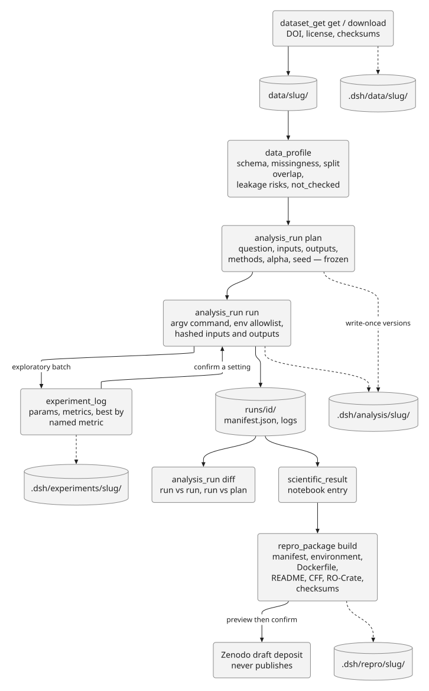

# Reproducible analysis and data

Five preset-only tools turn
reproducibility from a habit into ledgers. Five preset-only tools record the
analysis that produced a number, the experiments that explored it, the data it
runs on, and the package a reader needs to rebuild it. All state is local,
append-only where it matters, and confined to the workspace. The standing rule
across every tool: **the manifest is the evidence; the tool never interprets
the science.**



## `analysis_run`

Freezes a plan, then executes against it. State lives under
`<cwd>/.dsh/analysis/<slug>/`: `plan.jsonl` (append-only plan versions),
`runs.jsonl` (one immutable manifest per run), `expectations.jsonl` and
`verifications.jsonl` (the re-execution ledger), `compliance.jsonl` (frozen-rule
readings), and `runs/<id>/` (stdout, stderr, manifest, artifacts, plus
`repro_check.json` and `compliance.json` when those checks ran).

| Action | What it does |
|---|---|
| `plan` | Freeze question, hypotheses, inputs, outputs, methods, alpha, corrections, missing-data rules, exclusions, stopping rules, software, seed, and optional `task_rules`. Re-submitting the same plan is a no-op; changing it needs `new_version: true` plus a reason, and the old versions stay. |
| `run` | Execute an **argv array** (never a shell) with an environment allowlist plus explicit `env`, hashed inputs before and outputs after, a hard `timeout_ms`, and a lab-notebook entry. `kind: notebook` executes via jupyter or papermill and stores the executed notebook. |
| `expect` | Declare the **reported** numbers on the frozen plan: each metric has a name, value, output path, parse format (`json`, `csv`, `tsv`, `kv`, `regex`), optional key/column/pattern, and absolute or relative tolerance. `reference: reported|reproduced` names which number it is, and the reference run's command and interpreter environment are captured so "the same re-execution" is checkable. |
| `verify_scores` | Re-hash and parse a later run's **hashed** outputs, compare them with the expectation, and write `runs/<id>/repro_check.json` with `reproduction: true|false|null`. It is `not_checked` when the bytes changed after the run, the run failed or timed out, followed a different plan, changed its entrypoint, or the interpreter environment changed — never a silent mismatch. |
| `compliance` | Check a run against the plan's frozen `task_rules`. A rule can carry a machine `check` (`equals`, `not_equals`, `greater_than`, `less_than`, `min`, `max`, `contains`, `not_contains`, `matches`, `exists`, `absent`) over a hashed output of **that run** (`exists`/`absent` take a path only), or accept caller-supplied evidence. A changed or foreign file is `not_checked`. A `violated` run is excluded from `experiment_log` best/dominance and from `repro_package` build and deposit; it is never "refined", and the exclusion is sticky. |
| `status` / `list` / `show` | Ledger state; a run's manifest with log tails, plus its stored `repro_check` and compliance reading. |
| `diff` | Run vs run, or run vs the current plan and input hashes: plan, command, seed, environment, inputs, outputs, exit status. |
| `export` | Markdown or JSON run report with the "reproducibility evidence, not a guarantee" note, including the reported-vs-recomputed and compliance sections when present. |

Execution guardrails: ambient secrets are not forwarded and explicit values
are redacted from stored logs (along with key-looking text); output paths
outside the workspace are rejected; a nonzero exit or timeout is recorded, not
hidden; network is off by convention (`no_proxy=*` — a guardrail, not a
firewall) and `network: true` is recorded in the manifest. The tool uses the
host's existing permission model; it is not a privilege boundary.

### How a run executes

A run is asynchronous and holds no lock while the command runs. It happens in three steps:

1. **Prepare** (a short lock): choose the run id, make the run directory, hash the inputs, snapshot the declared outputs, and write a `running.json` marker.
2. **Execute** (no lock): the command runs in its own process group with the allowlisted environment. Nothing else in the plugin or the host waits for it, and another run of the same slug can start meanwhile.
3. **Record** (a short lock): write the manifest, the ledger line and the notebook entry, and remove the marker.

With the host job service the run is a **job**: it shows in the jobs panel with its output as it arrives, and killing the job (or cancelling the call) stops the command. The tool call still waits for the run and returns the same manifest, with a `job_id`. Without a job service the run happens inline and still honours the call's cancel signal.

- **Cancelled** runs are recorded (`cancelled: true`, `exit_code: null`). On a cancel or a timeout the whole process group is stopped (a polite stop, then a kill after three seconds), so a command's own child processes do not outlive it.
- **In progress.** `status` lists runs that are executing now.
- **Abandoned.** If the process that started a run ends before it records a result (a crash, a killed host), the marker remains. The next `status`, `list`, `show`, `diff`, `verify_scores`, `compliance` or `export` records that run as `abandoned: true` with no exit code, instead of leaving a directory nothing mentions. A run still executing in this process, or owned by another live process inside its time limit plus ten minutes, is never touched. An abandoned manifest says it does not know whether the command finished.
- **Logs** still keep the first 4 MiB of each stream with a `[truncated at ...]` note, but a chatty command is no longer killed for exceeding a buffer.

### Re-execution and compliance

The ledger distinguishes **what was reported** from **what a re-run produced**.
`expect` binds the reported numbers to the frozen plan hash and to a reference
run's command and interpreter fingerprint. `verify_scores` reads only outputs
the run itself hashed: it re-hashes the file and, if the bytes changed after
the run, reports `not_checked` rather than judging different bytes as the
run's result. It writes the paper-style `repro_check.json` beside the run
(`"reproduction": true` only when every declared value matched within
tolerance) and appends a verification event. A mismatch is `reproduction:
false`; a timeout, a failed process, a different plan version, a changed
entrypoint, or a changed interpreter turns the whole reading into
`not_checked` with the reason, unless `allow_environment_drift` /
`allow_entrypoint_change` explicitly overrides it. Notebook fingerprints
ignore the per-run executed-notebook path but still compare the notebook and
engine. Tolerances get a tiny floating-point allowance (`1e-9 × max(1,
|expected|)`), so `0.25 ± 0.01` is not split by binary representation.

`compliance` reads the frozen `task_rules` and evaluates what it can. A rule
with a `check` is machine-checked against a **hashed output of that run**: a
path the run did not write, or bytes that changed since the run, is
`not_checked`, never a pass. `exists`/`absent` rules take a path only and read
the manifest's recorded write status, so a later deletion cannot rewrite
history. A rule without a check needs caller evidence (`{rule_id, satisfied}`
or a status). The overall verdict is `violated` if any rule was violated,
`not_checked` if any rule could not be decided, and `compliant` only when every
rule was satisfied. A violating run is **excluded**, the paper's only discard
action: `experiment_log` drops it from `best`, `dominance`, and grouping when a
run links to it, and `repro_package` leaves it out of the built package and the
deposit (re-checked at deposit time), recording it under `excluded_runs`. A
recorded violation is **sticky**: a later reading cannot launder the run back
into a selection, and a corrupt compliance ledger fails closed rather than
silently clearing exclusions. A non-zero exit is `not_checked`, not a
violation; the rules are the only thing being read.

Neither check is a verdict on the science. `reproduction: true` is evidence for
the declared numbers only, and a compliance reading is a reading of the declared
rules — not misconduct. The matching precursors are `repo_audit action=probe`
(does a runnable benchmark entrypoint exist?) and `repo_audit action=align`
(which `file:line` implements each method anchor?), both of which execute
nothing. The ordered record across ideation, these runs, ablation, and review is
[`provenance_audit action=rollup`](PROVENANCE.md#actions).

## `experiment_log`

A run registry for sweeps, simulations, pilots, and model comparisons under
`<cwd>/.dsh/experiments/<slug>/`: `experiment.json` (write-once definition),
`runs.jsonl`, `links.jsonl`, `verdicts.jsonl`, and `exports/`. There is no
parallel store.

`start` freezes the question and named metrics with `higher`/`lower`
directions. For a staged comparison it also declares a **benchmark spec** —
`datasets`, `splits`, `baseline_arm`, and `task_rules` — and may declare a
**protocol** (`eval_script` plus `metric_params`). `log` appends params,
metrics, hashed workspace artifacts, seed, parent, and captured environment; a
rerun is a new run, nothing is deduplicated, and missing metrics stay blank
rather than zero.

**Staged runs.** `log` accepts `role: baseline|variant`,
`baseline_ref: reproduced|reported`, `stage: subset|slice|full`, and a
`sampling` rule (a rule string or `{rule, size, seed, stratification}`).
Subset and slice stages require a sampling rule; the rule is ours to declare,
not a claim that the slice is representative.

Each `baseline` run captures a **`protocol_digest`**: SHA-256 of the
evaluated script hash plus the canonical metric parameters. Every new staged
`variant` must supply `baseline_run_id` explicitly, naming a baseline in the
same ledger with the same `baseline_ref`, stage, and sampling rule; its protocol is
hashed the same way and compared. A changed eval script or metric parameters
is recorded as **`spec_drift`** with the expected/actual digests and the
changed components, not silently accepted. An unknown or incompatible baseline
is refused. Older recorded baseline references are never rewritten.

**Comparison identity.** Ranking additionally requires a user-declared
`comparison_identity` on each staged run:

```json
{
  "dataset": { "id": "D1", "version_or_hash": "v1" },
  "split": { "id": "test", "version_or_hash": "split-v1" },
  "baseline_cohort_id": "reference-v1",
  "metric_definitions": {
    "accuracy": { "unit": "fraction", "implementation": "accuracy-v1", "parameters": {} },
    "latency": { "unit": "ms", "implementation": "timer-v1", "parameters": {} }
  }
}
```

The dataset and split IDs must appear in the benchmark, and every declared
metric needs a unit, implementation identifier, and parameters object. Identity
version 1 hashes the canonical JSON of these declarations together with stage,
normalized sampling rule, protocol digest, baseline reference, metric names and
directions. The resulting `scope_id` is returned on `log` and `compare`. The
scope is **user-declared**, not proof of dataset integrity, equivalent random
streams, or scientific validity. A variant carrying an identity must match its
explicit baseline's identity except for protocol changes, which are recorded as
drift and excluded from rankings.

**Selection.** First call `compare` without a `scope_id` to inspect all raw runs,
available scope IDs, and per-run assessments. No ranking is returned without a
scope. Pass the desired `scope_id` to `compare`, `best`, `dominance`, or
`export` to rank only that scope. `best` requires a declared metric and uses its
declared direction (ties are listed). With `dominance: true` it returns the **Pareto front** over all
declared metrics: a run dominates only when it is at least as good on every
declared metric and strictly better on one. Runs missing a declared metric are
listed as incomplete and not ranked. This is the plugin's specification of the
paper's undefined "preferred" relation, not a scientific claim. Drifted,
incompatible, unresolved, failed linked analysis runs, and compliance-excluded runs are reported separately.
Historical or unstaged runs without a complete identity remain readable but are
`not_checked` and cannot be ranked; no historical record is silently migrated.
To compare them, log new runs with the required scope rather than editing old
ledger entries. CSV/JSON/Markdown/MLflow exports retain the raw runs and include
scope assessments. MLflow and other external consumers do not enforce these
rules after import.

**Compliance exclusion.** An experiment run linked to an `analysis_run` whose
compliance ledger contains a `violated` verdict is excluded from `best`, `dominance`,
and grouping. The exports still list it, marked as excluded (a `compliance`
column in `runs.csv`, a `compliance: excluded` tag in `mlflow.json`, the
`compliance.details` entry in `experiment.json`, and a Compliance-exclusions
section in `report.md`), so an export is an audit trail rather than a curated
ranking. The run stays visible with its `excluded` record naming the analysis
run and the violated rule ids — the analysis ledger owns the rule evaluation,
and this is a ledger join, not a second compliance implementation.
`repro_package` applies the same join when it filters analysis and experiment
runs.

**Verdicts.** `verdict` records an advisory human decision on a run:
`good`, `engineer`, or `bad`, with a required reason, an optional
`engineering_round`, and a `budget` (`{max_rounds, used, exhausted}`). Engineer
is not a terminal state: a budget-exhausted engineer is recorded as
**force-`bad`**, preserving both the requested verdict and the forced final
one. Verdicts are append-only; the latest per run is shown in `compare`,
`show`, `status`, and the exports.

`link` connects a run to a notebook entry, analysis run, paper, or review, and
`export` writes CSV/JSON/Markdown or an MLflow-compatible JSON, including the
staged fields and verdicts. The tool records logged values and human
decisions; none of it is a scientific claim.

### Repeated seeds and paired comparisons

`experiment_log action=replicates` is a **read-only** descriptive report over
one explicit comparison scope. It does not run jobs, edit ledgers, select a
winner, calculate p-values, or produce confidence intervals. First log the
actual seed on each run and put a consistent candidate label in `params` (for
example, `{"method":"base"}` or `{"method":"variant"}`). A variant's
`baseline_run_id` must identify the particular baseline run it is compared
against; equal seed numbers alone do not establish that relationship.

After `compare` shows the scope ID:

```text
experiment_log action=replicates slug=bench scope_id=<scope-id> metric=accuracy
  candidate_field=method candidates=["base","variant"] baseline_candidate=base
  replicate_unit="one independent training run" expected_seeds=[1,2,3]
  selection_history=unknown
```

Alternatively, omit `expected_seeds` and pass `coverage_unknown=true`; missing
and unexpected seed coverage is then unknown, not zero. `candidate_field`, the
explicit candidate list, and `replicate_unit` are researcher declarations, not
evidence that the runs are independent or that grouping is correct. The optional
`selection_history` is `unknown` (default), `exploratory`, or
`declared_preplanned`; the tool does not verify a preplanning claim.

For each candidate, the JSON and text outputs show the raw run IDs, seed,
metric value, parameters, baseline ID, scope assessment and inclusion reasons;
expected/observed/missing/unexpected seeds; duplicates; and the mean and sample
standard deviation. Mean is `sum(x) / n`; sample SD is
`sqrt(sum((x - mean)^2) / (n - 1))`. SD is `not_checked` for fewer than
two eligible values. Per-candidate `counts` summarize total, included, and
excluded runs, eligibility states, missing or non-finite metrics, missing,
duplicate, or unexpected seeds, and failed linked analyses. Duplicate seeds within the same candidate and scope are
ambiguous, even when one attempt failed or lacks a metric: none of those
duplicates are averaged. Missing seeds or metrics, unexpected seeds when an
expected list was supplied, mixed baseline/variant candidate roles, incompatible
scope, failed linked analyses, and compliance exclusions are visible but not
included. Runs in the scope with an unselected or missing candidate label are
listed separately. To distinguish reruns from independent replicates, record
appropriate candidate labels and seeds; the tool will not choose among retries.

When a `baseline_candidate` is supplied, only unambiguous included variant runs
with the **same seed** as their explicitly linked included baseline are paired.
The report lists every `variant − baseline` difference, unmatched runs on both
sides, and the mean and sample SD of the paired differences. Direction is shown
separately; a negative difference is not automatically called an improvement.
Matching seeds do not guarantee identical random streams or independent samples,
and matching declarations do not verify the science. The report is descriptive
and must not be presented as a statistical significance or acceptance decision.

### Branch view

`experiment_log action=branches` is a **read-only** view over the same ledger:
it follows recorded `parent` IDs and joins recorded runs, verdicts, links, and
linked analysis manifests. It never executes anything, never creates a second
experiment ledger, and writes nothing unless a Mermaid export is explicitly
requested. `format` is `text` (default), `json`, or `mermaid`:

```text
experiment_log action=branches slug=bench
experiment_log action=branches slug=bench format=json
experiment_log action=branches slug=bench format=mermaid write=true
```

Only `format: mermaid` with `write: true` writes
`.dsh/experiments/<slug>/exports/branches.mmd`; `overwrite: true` replaces an
existing file. Every other call leaves the ledgers and the workspace untouched.

The structured report contains `nodes` (run id, `parent` and `parent_state`,
role/stage/seed, `scope_id` and `comparison_state`, metrics and
`metrics_state`, protocol digest and `spec_drift`, latest verdict, compliance
state, artifact paths and hashes, and resolved `links`), `edges` (recorded
parent ancestry), `roots`, `orphans`, `cycles`, `counts`, `limits`,
`anomalies`, and `notes`. A parent edge is recorded ancestry, not proof of
scientific causality.

Link resolution is explicit. An `analysis_run` link reports the owning analysis
slug, exit code, timeout, spawn error, duration, and manifest path/state.
Notebook, review, and experiment-run links resolve against their ledgers where
present. `paper` links are `not_checked` because PaperMemory is not opened by
this view, and `scientific_result` links are `unknown` because those cards are
not persisted. A missing target is `not_found`; an ambiguous bare id is
`ambiguous`; a malformed target is `invalid`. No unresolved link is treated as
success.

Node status is derived **only from recorded evidence**:

| Status | Evidence |
|---|---|
| `good` | the latest recorded human verdict is `good` |
| `engineering` | the latest recorded human verdict is `engineer` |
| `pruned` | the latest recorded human verdict is `bad` (including a forced-bad exhausted engineer) |
| `failed` | a resolved linked `analysis_run` recorded a non-zero exit, timeout, or spawn error |
| `unknown` | an `analysis_run` link could not be resolved, so execution is not known |
| `not_recorded` | no verdict and no linked execution failure is recorded |

Missing metrics alone never make a run `failed`; they are shown as
`metrics_state: not_recorded`. A compliance exclusion is reported separately
(`excluded: true`, `compliance.state: excluded`) and inherits the linked
analysis ledger's violated rule ids. When a linked analysis run cannot be
resolved, compliance is `unknown` because an exclusion cannot be ruled out.

Defensive behaviour is part of the contract. Multiple roots, missing, self, or
non-string parents, parent cycles, duplicate run ids, duplicate links, links to
unknown runs, verdicts for unknown runs, and corrupt JSONL lines are reported
in `anomalies` and do not abort the view. `max_nodes` (default 500, max 5000),
`max_edges` (default 1000, max 10000), and `max_links_per_run` (default 50, max
500) bound the output; omitted runs, edges, and links remain counted. Every
source file is hashed into `source_snapshot` and re-read, so
`changed_during_read` distinguishes the view from a ledger that changed
afterwards. Mermaid labels escape markup, and run params, notes, environment,
and link notes are excluded from the report, so secrets are not copied into
text, JSON, or diagram labels.

## `ablation`

A component-attribution ledger under `<cwd>/.dsh/ablation/<slug>/`:
`ablation.json` (method spec plus the champion idea id from `coscientist`),
`plan.json` (the frozen grid), `records.jsonl`, `verdicts.jsonl`,
`pruned.jsonl`, and `exports/`. It **never runs an experiment**.

`start` binds the method and `idea_id`; `plan` freezes a grid of arms,
datasets, metrics with directions, and replicates. One arm is the reference
(typically `full`); every other arm names the `component` and `code_path` it
removes, plus the metric changes it expects (`increase`, `decrease`, `tie`, or
`any`).

`record` links one `arm × dataset × replicate` cell to a run that already
exists. An `experiment_log` link supplies the run's metrics directly; an
`analysis_run` link must have hashed outputs or artifacts and the caller
supplies the metric reading. The record stores the source ledger, run id, a
digest of the source run, artifacts, and the metric values — a duplicate cell
is refused.

`report` pairs every removal arm with the reference on the same dataset and
replicate. It reports each metric's reference value, arm value, delta, percent
delta, observed change, expected change, and whether the expectation was met;
ties and missing cells are listed rather than dropped. The advisory
**attribution reading** marks a component `attributed` only when every paired
expected metric moves in the declared direction, `unattributed` when none
does, `partial` when coverage or expectations are mixed, and `not_checked`
when there is no paired evidence. Pruned arms are excluded from that reading
and listed separately.

`verdict` records a human `good`, `refine`, or `unattributed` decision with a
reason; `prune` appends an arm-pruning event rather than rewriting the plan.
`show` reads a record, an arm, or the whole ledger; `status` summarizes the
plan, records, missing cells, ties, pruning, and latest verdict; `export`
writes Markdown, JSON, or CSV. The attribution reading and every number are
advisory, and the export is the artifact a later attribution check can read.

## `dataset_get`

The download layer under `data/<slug>/` with a manifest at
`.dsh/data/<slug>/manifest.jsonl`. `get` resolves a DOI through DataCite (plus
Zenodo/Figshare file listings) and returns files, sizes, checksums, and
licenses without downloading; `download` fetches selected files with per-file
and total size caps, verifies checksums when the record supplies them (a
mismatch is recorded `verification_failed` and the file kept for inspection),
and records DOI, version, license, landing page, and retrieval time; `verify`
re-hashes against the manifest; `status` summarizes history, sizes, licenses,
and missing checksums. `dataset_search` stays search-only. Unknown licenses
are flagged as not stated, never guessed; no auth is forwarded to download
URLs.

## `data_profile`

Profiles one local file (CSV/TSV/Parquet/Arrow/Excel/JSON/JSONL) through
`python-helpers/data_profile.py` (pandas): dtypes, missingness, uniques,
ranges, top categories, duplicate rows/columns, constant and high-cardinality
columns, ID/date heuristics, target balance, per-column association with the
target, split overlap, and small categorical cells. Near-deterministic target
association, ID-like columns that track the target, and rows appearing in two
splits are flagged as leakage **risks** for review — never automatic
exclusions. Large files are sampled with `max_rows` and the report says so.
Checks the tool cannot run (PHI content, provenance, consent, temporal
validity) are listed under `not_checked`; profiling a file is never a claim
that it is safe. `write: true` saves `report.md`, `report.json`, and
`data-dictionary.csv`.

## `repro_package`

Builds a reader-facing package from the other ledgers, under
`.dsh/repro/<slug>/plan.json` (frozen inventory) and an output directory
(default `package/<slug>/`):

- `manifest.json` — every file with role, size, SHA-256, and source ledger
- `environment/` — node/os/git snapshot plus captured `pip freeze`
- `Dockerfile` — generated from the recorded environment, not built or tested
- `README.md` — run order, expected outputs, data availability, license, citation
- `CITATION.cff`, `codemeta.json`, `ro-crate-metadata.json` (RO-Crate 1.1)
- `checksums.sha256`

When selected code files were copied, the generated README shows each recorded
command as `(cd code && <command>)` so it can be pasted from the package root.
Those commands were recorded in the original workspace, not replayed by `build`
or `verify`: restore any missing inputs at their original relative paths first.
Copied `dataset_get` files live under the package's separate `data/` directory
and are not staged automatically. Copy `code/` to a separate workspace before
running to avoid modifying the verified package.

`build` never uploads and copies data only with `include_data: true`; failed
runs, missing licenses, and uncopied datasets are surfaced as warnings.
`verify` re-hashes the package against its manifest. `deposit` is Zenodo-only
and two-step: it returns a preview (files, blockers, `preview_hash`) until
re-called with `confirm: true` and the unchanged hash plus a configured
`ZENODO_API_KEY`; it creates a **draft** deposition and never publishes.

## How they fit together

`dataset_get` acquires → `data_profile` inspects → `analysis_run` executes the
frozen plan (or `experiment_log` tracks the sweep that found the setting) →
`scientific_result`/`notebook` report the finding → `repro_package` ships the
evidence. The `reproducible-analysis` and `experiment-tracking` skills carry
the workflow detail.

None of those ledgers can answer "what supports this claim?" on its own.
`provenance_audit` joins them — plus `review`, `reporting_check`, `deep_review`,
`meta_analysis`, and Academic Harness claim sidecars — into one read-only index;
see [Provenance audit](PROVENANCE.md).
