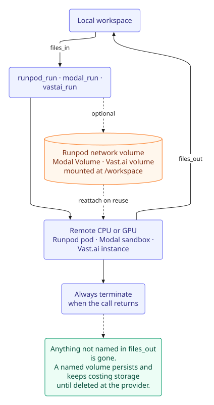

# Remote compute

`runpod_run`, `modal_run`, and `vastai_run` offload a command to a remote CPU/GPU instance — upload inputs, run, download outputs, and always terminate when done.

| Tool | Provider | Default instance | Persistent storage | Credentials |
|---|---|---|---|---|
| `runpod_run` | Runpod on-demand Pods (REST v2) | `rtx4090` | `volume_name` (network volume) | `RUNPOD_API_KEY` |
| `modal_run` | Modal Sandboxes | `cpu` | `volume_name` (Modal Volume) | `MODAL_TOKEN_ID`, `MODAL_TOKEN_SECRET` |
| `vastai_run` | Vast.ai marketplace | `rtx4090` | `volume_id` (pre-created volume) | `VAST_API_KEY` |

Pick by job shape: Runpod for a predictable pod and a curated GPU list; Modal for Python-friendly sandboxes and Modal Volumes; Vast.ai when cost matters — it searches live offers and rents the cheapest verified machine, with spot bidding and offer pinning.

## Credentials

| Tool | Key (Settings or env) | Get credentials |
|---|---|---|
| `runpod_run` | `RUNPOD_API_KEY` | <https://console.runpod.io/user/settings> |
| `modal_run` | `MODAL_TOKEN_ID`, `MODAL_TOKEN_SECRET` | <https://modal.com/settings> |
| `vastai_run` | `VAST_API_KEY` | <https://cloud.vast.ai/manage-keys/> |

`runpod_run` and `vastai_run` also need `ssh`, `scp`, and `ssh-keygen` on `PATH` (OpenSSH client tools).

`modal_run` also needs the Modal SDK, but no manual step is required: on first use it loads the SDK from the profile if present, otherwise installs a pinned copy into `$DSH_HOME/modal-sdk` (with pnpm's build-script policy pre-configured) and uses it immediately — no DSH restart. The first call therefore takes a few extra seconds while npm/pnpm fetches it.

Set `ACADEMIC_HARNESS_MODAL_SKIP_INSTALL=1` to disable that managed install. If the SDK is unavailable, `modal_run` returns an `sdk_missing`/`sdk_install_failed` message with the manual command (`dsh plugin --profile <profile> add modal`, then restart); the other two tools remain available. Academic Harness also writes `allowBuilds: {cbor-extract: false, protobufjs: false}` into each profile that depends on it, so a manual profile install exits 0 under pnpm 11 instead of failing with `ERR_PNPM_IGNORED_BUILDS`.

Vast.ai requires an SSH key on the account **before** an instance exists. `vastai_run` handles that itself: it registers a temporary per-call key and removes it during teardown. Pass `ssh_key_path` to use an already-registered key instead.

### Base URL overrides

Both HTTP clients accept a base-URL override for proxies or a future API version:

| Variable | Default |
|---|---|
| `RUNPOD_API_BASE_URL` | `https://api.runpod.io/v2` (`RUNPOD_REST_API_URL` is still honored) |
| `VAST_API_BASE_URL` | `https://console.vast.ai/api/v0` |

## Instance catalogs

Each tool takes an `instance` id. Defaults are shown in the table above; an unknown id fails loudly with the full valid list instead of silently falling back.

- **Runpod** — `cpu`, `rtx4090`, `l4`, `a40`, `a6000`, `a100-80gb`, `h100`. CPU pods use the `cpu5c` flavor with 2 vCPUs; GPU images are official Runpod PyTorch builds.
- **Modal** — `cpu`, `t4`, `l4`, `a10g`, `l40s`, `a100-40gb`, `a100-80gb`, `h100`, `h200`, `b200`. CPU instances default to a slim Python image; GPU instances default to a CUDA/PyTorch image, so the GPU is usable without `image_base`.
- **Vast.ai** — `rtx3090`, `rtx4090`, `l4`, `a40`, `a6000`, `a100-80gb`, `h100`, `h200`. These are GPU *classes*; the tool searches offers and rents the cheapest verified one. Prices are per-offer (`dph_total`), not fixed.

## Persistent storage

By default every call is a brand-new disposable instance — `/workspace` is gone once it terminates, so only what's named in `files_out` comes back. Each provider has a different persistent-storage path:

- **Runpod** — `volume_name` mounts a [network volume](https://docs.runpod.io/pods/storage/create-network-volumes) at `/workspace`. Reusing the same name reattaches the same data. The first use must pass `data_center_id`; the pod is then placed in that volume's data center automatically. `volume_size_gb` (default 20) applies only when creating.
- **Modal** — `volume_name` mounts a [Modal Volume](https://modal.com/docs/guide/volumes) at `/workspace`, created if missing.
- **Vast.ai** — `volume_id` attaches an existing volume, always at `/workspace`. Volumes must be created first with the CLI or API; the tool does not create them.

Compute is always torn down after the call; named volumes are not, and keep costing storage until deleted. Each tool deliberately has no delete-volume path, so it cannot silently remove a dataset.

## Uploads and downloads

`files_in` and `files_out` accept workspace-relative paths, files or directories. Directories are streamed as tar archives on every backend, so a large tree is transferred in one pass and a failed transfer never leaves a half-written local directory. Paths are resolved through symlinks and confined to the workspace; `..`, symlink escapes, and the workspace root itself are rejected.

Output is truncated from the front (last 16,000 characters per stream, with only the tail kept in memory), so a long training log keeps its tail. Outputs that fail to transfer are reported under `files_out_failed`, separately from files that genuinely do not exist (`files_out_missing`). Each result reports `exit_code`, `duration_ms`, an estimated `cost_usd`, and the resource id (`pod_id`, `sandbox_id`, or `instance_id`).

On Vast.ai never copy to `/` or `/root` — it breaks SSH key permissions. The tool always works under `/workspace`.

## Teardown and failures

Every call tears down its compute in a `finally` block, including aborts and command failures. Deletes are retried; if the final delete still fails, the tool returns `runpod_teardown_failed`, `modal_teardown_failed`, or `vastai_teardown_failed` with the resource id and the console command to remove it (the original run result is preserved alongside the error). If Vast.ai's temporary SSH key cannot be removed after its instance is gone, the call reports `vastai_ssh_key_cleanup_failed`. Modal sandboxes also self-destruct at their timeout.

Vast.ai placement is marketplace-driven: a host can be unreachable or disappear. The tool polls `actual_status`, fails fast on `exited`/`unknown`/`offline`, and its error suggests retrying or raising `max_price_dph`. Offers are matched on the exact GPU count, and volumes are always mounted at `/workspace`.

## Runpod API version

`runpod_run`/`runpod-client.js` target **REST API v2** (`https://api.runpod.io/v2`). REST v1 (`https://rest.runpod.io/v1`) retires on **2026-11-15**; there is no v1 code path left. v2 wraps list responses, nests the GPU/CPU request, uses `PATCH` for updates and `POST /v2/pods/{id}/action` for state changes, and returns RFC 9457 errors.

## Beyond the tools

For anything beyond what the three tools cover — Serverless endpoints, Hub templates, direct volume/secret management, deployed apps, GPU availability, changing a bid — the agent loads the matching `runpod`/`modal`/`vastai` skill (`skills/runpod`, `skills/modal`, `skills/vastai`) and drives the provider CLIs directly via `bash`.

None of the CLIs ships inside this plugin's package, but the agent installs whichever it needs itself, user-locally and without root, per the steps baked into each skill:

- `runpodctl` as a plain release binary into `~/.local/bin`,
- `modal` via `uvx modal ...` (no persistent install needed) or `uv tool install modal` for a longer session,
- `vastai` via `uv tool install vastai` or `pip install --user vastai`.

The agent does this rather than asking you to set it up first.

## Related

- [Agents](AGENTS.md) — when to delegate work instead of running it locally.
- [Configuration](CONFIGURATION.md) — keys and restart behavior.
- [Skills](SKILLS.md) — the `runpod`, `modal`, and `vastai` skills.
