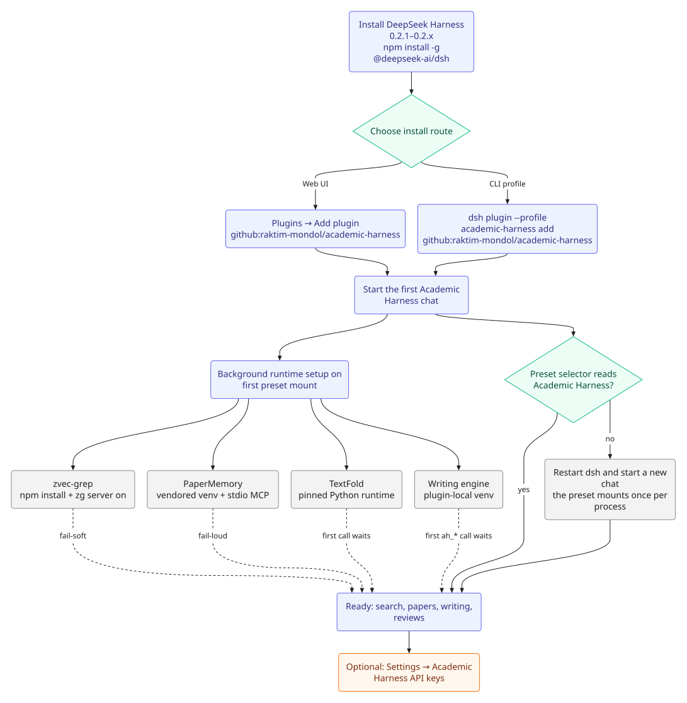

# Install and run

Academic Harness is a **DeepSeek Harness (DSH) profile**: the DSH web UI and DSH agent, plus this plugin's scientific skills, living lab notebook, specialist subagents, search connectors, and local research ledgers.



## Requirements

- **Linux** (x86_64 or ARM64). This is a Linux-only plugin: `package.json` declares `"os": ["linux"]`, so npm and pnpm refuse installation on Windows and macOS. The plugin runtime uses POSIX paths, shell commands, and Linux filesystem semantics. Bundled skills may describe external tools on other platforms, but those are not supported by this plugin.
- **DeepSeek Harness `>=0.2.1-rc.5 <0.3.0`**; the validated versions are `0.2.2-rc.1` (npm's `latest`) and `0.2.2-rc.3` (npm's `next`). Isolated tests cover preset sessions, a non-secret Settings write, selected tools, and delegation on both channels under npm and pnpm; a [daily canary](../.github/workflows/dsh-compat.yml) re-runs them. Newer DSH releases are adopted after the canary passes, not before. One DSH packaging quirk is documented by this repo's canary: pnpm omits the `@deepseek-ai/dsh-ptc-runtime` peer of `dsh-ptc-runtime-node`, which blocks preset sessions on 0.2.2 with `workflow-ptc ... waiting for ptcRuntime`; npm resolves it natively, and a channel-matched profile dependency fixes pnpm.
- Optional Python runtimes are installed automatically on first use, with one exception: the `sci_inspect`/`power_analysis` helpers and the `rob-figure` appraisal export need a one-time `cd python-helpers && uv sync` (matplotlib). See [Architecture](ARCHITECTURE.md#runtime-installs).
- `modal_run` needs the Modal SDK, which the plugin installs into `$DSH_HOME/modal-sdk` on first use (no restart; set `ACADEMIC_HARNESS_MODAL_SKIP_INSTALL=1` to manage it yourself). `runpod_run` and `vastai_run` need only their API key plus OpenSSH client tools; see [Remote compute](COMPUTE.md).

## 1. Install DSH

```sh
npm install -g @deepseek-ai/dsh@0.2.2-rc.1
dsh --version   # 0.2.2-rc.1 — or 0.2.2-rc.3 with `npm install -g @deepseek-ai/dsh@next`
```

The explicit version avoids silently switching to a newer, unverified DSH release when npm's `latest` tag changes. All plugin examples below work the same under both versions. Without a global install, `npx @deepseek-ai/dsh@0.2.2-rc.1 web` also works. You need a working `dsh` CLI for either installation option below.

## 2. Install Academic Harness

### Option A — from the DSH Web UI (recommended)

1. Start the DSH web UI (`dsh web`).
2. Open **Plugins → Add plugin**.
3. Paste one of these into the package field:

   | Source | Paste this |
   |---|---|
   | GitHub (recommended) | `github:raktim-mondol/academic-harness` |
   | npm registry | `academic-harness` — not currently published; install from GitHub or a local checkout |
   | Local checkout | the absolute path, e.g. `/home/you/academic-harness` |

4. Click **Install**. Academic Harness is installed into the profile you are currently running, enabled by default, and appears under **Installed plugins**.
5. Start a new chat and confirm the preset selector reads **Academic Harness**.

The bundle patches the web-app layer, so the profile must already include `@deepseek-ai/dsh-web-app`; the standard `web` profile does. A local path must be absolute — the dialog does not expand `~` or resolve relative paths. Installing this way adds Academic Harness to your current profile; use Option B for a dedicated `academic-harness` profile. DSH only offers **Update** for its on-demand Official plugins, so update a UI-installed Academic Harness by removing and reinstalling it.

### Option B — dedicated profile from the CLI

```sh
dsh plugin --profile academic-harness add github:raktim-mondol/academic-harness
```

This creates the `academic-harness` profile if it does not exist yet and adds Academic Harness to it. DSH's freshly-created profile templates omit the web-app bundle the preset selector needs, so add it once:

```sh
dsh plugin --profile academic-harness add github:raktim-mondol/academic-harness
f="${DSH_HOME:-$HOME/.dsh}/profiles/academic-harness/package.json"
node -e 'const fs=require("fs"),f=process.argv[1],j=JSON.parse(fs.readFileSync(f));const b=j.dsh.profile.bundles;if(!b.includes("@deepseek-ai/dsh-web-app"))b.splice(1,0,"@deepseek-ai/dsh-web-app");fs.writeFileSync(f,JSON.stringify(j,null,2)+"\n")' "$f"
```

Start it with:

```sh
dsh --profile academic-harness
```

To update this profile later:

```sh
dsh plugin --profile academic-harness update academic-harness
```

For local plugin development, the same command accepts an absolute checkout path:

```sh
dsh plugin --profile academic-harness add /absolute/path/to/academic-harness
```

## 3. Run

```sh
dsh --profile academic-harness
# or, if you use the shared launcher:
academic-harness
```

Opens the Harness web UI (typically `http://127.0.0.1:3080`).

## 4. Confirm the preset

The Academic Harness profile's bundle patch sets `agent-preset-registry` `default: academic-harness` and inserts only `preset-academic-harness` (DSH 0.2+ no longer reads `$DSH_HOME/.agent-presets/`). New chats on this profile start on **Academic Harness**, and the selector lists no legacy preset.

Confirm the preset selector at the top of the message box reads **Academic Harness**. If it still says Standard/PTC, the profile patch did not apply.

The persona, the longer research system prompt (notebook discipline, specialist roster, connector guidance, …), academic search (`parallel_search`, `mcp__firecrawl__*`, `mcp__scite__*`, `consensus_search`), `paper_fold`, PaperMemory (`mcp__papermemory__*`), workspace semantic search (`mcp__zvec_grep__zvec_grep_search`), `paper_mcp` (Paper2Agent stdio mounts), `citation`, `manuscript_citations`, `review` (systematic-review ledger), `clinicaltrials`/`openfda` (trial and regulatory records), `dataset_search`/`journal_policy`/`funder_policy` (datasets and venue/funder policy), and the optional `author_lookup`/`openreview` are only present on this preset. A session left on Standard/PTC won't have them, and asking it to use e.g. the Parallel connector will fail with `tools[name] is not a function`.

The general-purpose tools below (notebook, fold_text, scientific_result, image_generate, sci_inspect, latex_compile, mermaid_render, pdf_to_markdown, modal_run/runpod_run/vastai_run, research_template) are available on every preset regardless, since they're registered at the plugin/bundle level rather than inside the Academic Harness preset. Native `grep` / `glob` come from the Academic Harness preset's filesystem-search row.

See [Architecture](ARCHITECTURE.md) for the host/bundle/preset split and the full tool index in [Tools](TOOLS.md).

## One DSH surface at a time

`dsh-web`, `dsh-tui`, `dsh-martty`, and `academic-harness` share `$DSH_HOME` (including port `3080` and the zvec-grep daemon). Ctrl+C does not always wait for those to exit, so starting another launcher while one is still in the background will fail or pick up the wrong process.

The shared launcher (`scripts/dsh-launch`, installed as those four commands) stops leftover DSH processes and `zg server off` before exec. If you invoke `dsh --profile …` directly, stop the previous one first:

```sh
# leftover web UI
ss -ltnp | grep 3080
# leftover zg daemon
zg server off
```

## Configuration

API keys can be entered in **Settings → Academic Harness API keys** or set as shell environment variables. No key is required to start; each connector stays disabled until its key is present. See [Configuration](CONFIGURATION.md) for the complete key list and which changes need a `dsh` restart.

On the first Academic Harness start, the plugin prepares optional runtimes in the background:

| Runtime | Location | On failure |
|---|---|---|
| zvec-grep (`zg`) | `~/.dsh/zvec-grep` | fail-soft: semantic search is absent, a warning is logged |
| PaperMemory | `~/.dsh/papermemory` | fail-loud: the broken memory server is surfaced |
| TextFold for `paper_fold` | `$DSH_HOME/textfold` | first `paper_fold` call reports the failure |
| Academic Harness engine venv | `vendor/academic-harness/.venv` | `ah_*` calls wait for or report the failure |

See [Architecture](ARCHITECTURE.md#runtime-installs) for details and overrides.

## Troubleshooting

| Symptom | Check |
|---|---|
| Preset selector says Standard/PTC | Restart `dsh`, start a new chat, and confirm the profile patch applied. A preset mounts once per process. |
| `tools[name] is not a function` | The session is on the wrong preset; the academic tools are preset-only. |
| Search connector missing | Add its key in Settings and restart `dsh` for MCP connectors. Native REST tools pick up a Settings change on the next call. |
| Port 3080 already in use | Stop the other DSH surface or run `zg server off`; see [One DSH surface at a time](#one-dsh-surface-at-a-time). |
| Local checkout will not install | Use an absolute path; `~` and relative paths are not expanded. |
| Semantic search tool absent | The zg install or daemon failed (fail-soft). Check the warning and `~/.dsh/zvec-grep`. |
| PaperMemory is empty or missing | PaperMemory is fail-loud by design; read the startup error rather than assuming an empty store. |
| Repeated `[llm-deepseek-api-key] model listing` lines | Informational: one line per mounted preset world following the official `/models` listing. Pin the catalog (below) to stop the requests and the lines. |

### Repeated DeepSeek model-listing lines

DSH mounts the DeepSeek provider once per agent-preset world, and each instance follows the official `/models` listing while its catalog equals the built-in list. A normal `academic-harness` start therefore prints one `[llm-deepseek-api-key] model listing ...` line per mounted preset (five presets plus the web app in the default profile). It is informational, not an error.

To stop the listing request and its lines, pin the catalog in the profile patch layer (`$DSH_HOME/profiles/academic-harness/cordis.patch.yml`):

```yaml
- id: llm-deepseek
  name: '@deepseek-ai/dsh-llm-deepseek-api-key'
  config:
    models:
      - id: deepseek-flash
        name: DeepSeek-V4.1-Flash
        description: Fast text-and-image agent model; pinned catalog.
        contextWindow: 1048576
        inputModalities: [text, image]
        systemPromptUpdate: in-history
        toolUpdate: addition-only
      - id: deepseek-v4-pro
        name: DeepSeek-V4-Pro
        description: Stronger agentic coding, knowledge, and difficult reasoning; suited to complex or quality-critical tasks at higher cost.
        contextWindow: 1048576
        inputModalities: [text]
```

A `models` list that differs from the built-in catalog replaces it and stops the official listing. The tradeoff is that new DeepSeek models are not discovered automatically; remove the `models` block (or use **Restore defaults** on the Models page) to resume discovery. The `dsh web:` lines are the server URL and the auto-open notice; pass `--no-open` to suppress the second.

For the full list of components and data locations, see [Architecture](ARCHITECTURE.md).
