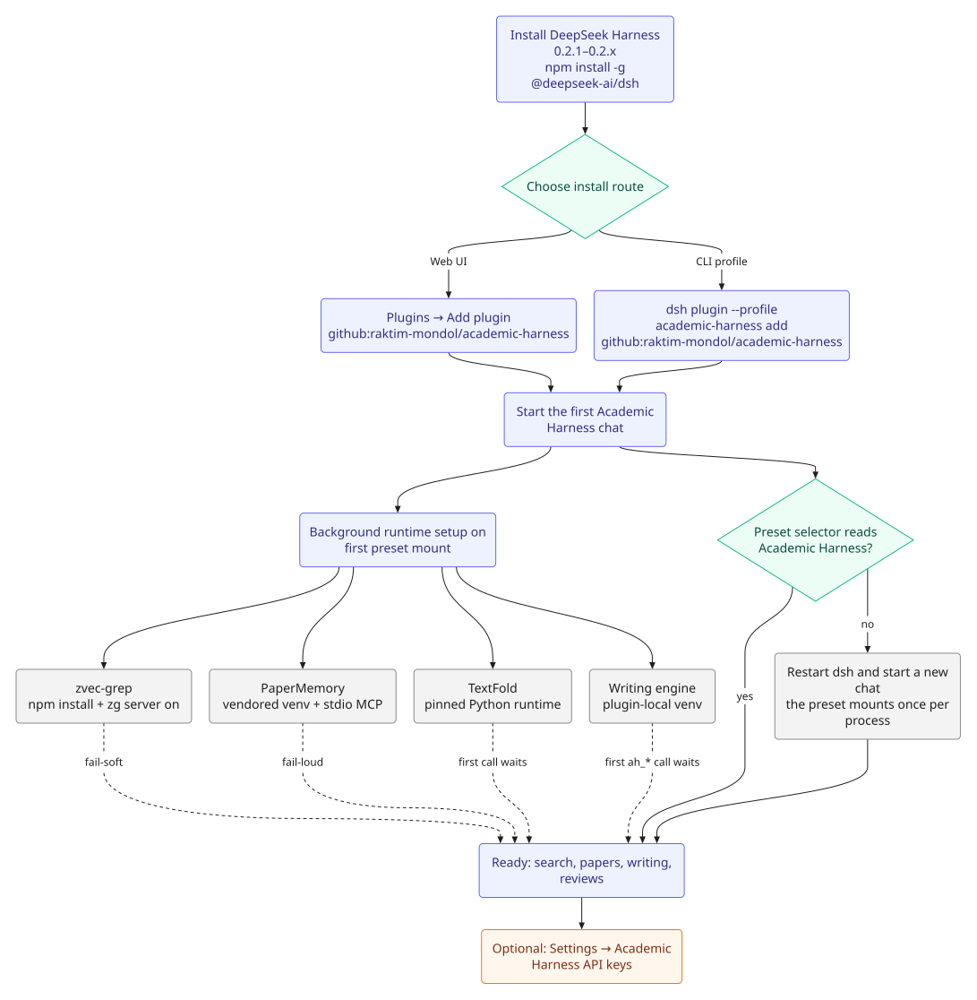

# Install and run

Academic Harness is a **DeepSeek Harness (DSH) profile**: the DSH web UI and DSH agent, plus this plugin's scientific skills, living lab notebook, specialist subagents, search connectors, and local research ledgers.



## Requirements

- **DeepSeek Harness 0.2.1–0.2.x** (`dsh --version` should report 0.2.1 to 0.2.x; the plugin's engine range is `>=0.2.1-rc.2 <0.3.0`).
- Optional Python runtimes are installed automatically on first use, with one exception: the `sci_inspect`/`power_analysis` helpers need a one-time `cd python-helpers && uv sync`. See [Architecture](ARCHITECTURE.md#runtime-installs).
- `modal_run` needs the Modal SDK, which the plugin installs into `$DSH_HOME/modal-sdk` on first use (no restart; set `ACADEMIC_HARNESS_MODAL_SKIP_INSTALL=1` to manage it yourself). `runpod_run` and `vastai_run` need only their API key plus OpenSSH client tools; see [Remote compute](COMPUTE.md).

## 1. Install DSH

```sh
npm install -g @deepseek-ai/dsh
dsh --version   # should report 0.2.1 to 0.2.x
```

Without a global install, `npx @deepseek-ai/dsh web` also works. You need a working `dsh` CLI for either installation option below.

## 2. Install Academic Harness

### Option A — from the DSH Web UI (recommended)

1. Start the DSH web UI (`dsh web`).
2. Open **Plugins → Add plugin**.
3. Paste one of these into the package field:

   | Source | Paste this |
   |---|---|
   | GitHub (recommended) | `github:raktim-mondol/academic-harness` |
   | npm registry | `academic-harness` — not currently published; install from GitHub or a local checkout |
   | Local checkout | the absolute path, e.g. `/home/you/academic-harness` |

4. Click **Install**. Academic Harness is installed into the profile you are currently running, enabled by default, and appears under **Installed plugins**.
5. Start a new chat and confirm the preset selector reads **Academic Harness**.

The bundle patches the web-app layer, so the profile must already include `@deepseek-ai/dsh-web-app`; the standard `web` profile does. A local path must be absolute — the dialog does not expand `~` or resolve relative paths. Installing this way adds Academic Harness to your current profile; use Option B for a dedicated `academic-harness` profile. DSH only offers **Update** for its on-demand Official plugins, so update a UI-installed Academic Harness by removing and reinstalling it.

### Option B — dedicated profile from the CLI

```sh
dsh plugin --profile academic-harness add github:raktim-mondol/academic-harness
```

This creates the `academic-harness` profile if it does not exist yet and adds Academic Harness to it. Start it with:

```sh
dsh --profile academic-harness
```

To update this profile later:

```sh
dsh plugin --profile academic-harness update academic-harness
```

For local plugin development, the same command accepts an absolute checkout path:

```sh
dsh plugin --profile academic-harness add /absolute/path/to/academic-harness
```

## 3. Run

```sh
dsh --profile academic-harness
# or, if you use the shared launcher:
academic-harness
```

Opens the Harness web UI (typically `http://127.0.0.1:3080`).

## 4. Confirm the preset

The Academic Harness profile's bundle patch sets `agent-preset-registry` `default: academic-harness` and inserts only `preset-academic-harness` (DSH 0.2+ no longer reads `$DSH_HOME/.agent-presets/`). New chats on this profile start on **Academic Harness**, and the selector lists no legacy preset.

Confirm the preset selector at the top of the message box reads **Academic Harness**. If it still says Standard/PTC, the profile patch did not apply.

The persona, the longer research system prompt (notebook discipline, specialist roster, connector guidance, …), academic search (`mcp__parallel__*`, `parallel_search`, `mcp__firecrawl__*`, `mcp__scite__*`, `consensus_search`), `paper_fold`, PaperMemory (`mcp__papermemory__*`), workspace semantic search (`mcp__zvec_grep__zvec_grep_search`), `paper_mcp` (Paper2Agent stdio mounts), `citation`, `manuscript_citations`, `review` (systematic-review ledger), `clinicaltrials`/`openfda` (trial and regulatory records), `dataset_search`/`journal_policy`/`funder_policy` (datasets and venue/funder policy), and the optional `author_lookup`/`openreview` are only present on this preset. A session left on Standard/PTC won't have them, and asking it to use e.g. the Parallel connector will fail with `tools[name] is not a function`.

The general-purpose tools below (notebook, fold_text, scientific_result, image_generate, sci_inspect, latex_compile, mermaid_render, pdf_to_markdown, modal_run/runpod_run/vastai_run, research_template) are available on every preset regardless, since they're registered at the plugin/bundle level rather than inside the Academic Harness preset. Native `grep` / `glob` come from the Academic Harness preset's filesystem-search row.

See [Architecture](ARCHITECTURE.md) for the host/bundle/preset split and the full tool index in [Tools](TOOLS.md).

## Renamed in v0.16.0

The repo, npm package, plugin, preset, profile, launcher, and product name were renamed from `dsh-researchcraft` / ResearchCraft to **Academic Harness**.

| Old | New |
|---|---|
| repo / package `dsh-researchcraft` | `academic-harness` |
| profile `researchcraft` | `academic-harness` |
| launcher `dsh-researchcraft` | `academic-harness` (old command stays as a transition alias) |
| preset `researchcraft` | `academic-harness` (legacy preset removed) |
| Settings → ResearchCraft API keys | Settings → Academic Harness API keys |
| env `RESEARCHCRAFT_*` | `ACADEMIC_HARNESS_*` (old names still honored) |

### Migrate an existing dedicated profile

```sh
node scripts/migrate-profile.mjs --profile researchcraft --to academic-harness --apply
dsh plugin --profile academic-harness install
```

The migration backs up the old profile, moves the dependency/bundle entries, merges the API-key config into the new entry, updates the preset default, and renames the profile directory. Sessions pinned to the removed legacy `researchcraft` preset do not resolve; start a new chat on Academic Harness. `dsh plugin --profile academic-harness update academic-harness` is the new update command.

## One DSH surface at a time

`dsh-web`, `dsh-tui`, `dsh-martty`, and `academic-harness` share `$DSH_HOME` (including port `3080` and the zvec-grep daemon). Ctrl+C does not always wait for those to exit, so starting another launcher while one is still in the background will fail or pick up the wrong process.

The shared launcher (`scripts/dsh-launch`, installed as those four commands plus the transition alias `dsh-researchcraft`) stops leftover DSH processes and `zg server off` before exec. If you invoke `dsh --profile …` directly, stop the previous one first:

```sh
# leftover web UI
ss -ltnp | grep 3080
# leftover zg daemon
zg server off
```

## Configuration

API keys can be entered in **Settings → Academic Harness API keys** or set as shell environment variables. No key is required to start; each connector stays disabled until its key is present. See [Configuration](CONFIGURATION.md) for the complete key list and which changes need a `dsh` restart.

On the first Academic Harness start, the plugin prepares optional runtimes in the background:

| Runtime | Location | On failure |
|---|---|---|
| zvec-grep (`zg`) | `~/.dsh/zvec-grep` | fail-soft: semantic search is absent, a warning is logged |
| PaperMemory | `~/.dsh/papermemory` | fail-loud: the broken memory server is surfaced |
| TextFold for `paper_fold` | `$DSH_HOME/textfold` | first `paper_fold` call reports the failure |
| Academic Harness engine venv | `vendor/academic-harness/.venv` | `ah_*` calls wait for or report the failure |

See [Architecture](ARCHITECTURE.md#runtime-installs) for details and overrides.

## Troubleshooting

| Symptom | Check |
|---|---|
| Preset selector says Standard/PTC | Restart `dsh`, start a new chat, and confirm the profile patch applied. A preset mounts once per process. |
| `tools[name] is not a function` | The session is on the wrong preset; the academic tools are preset-only. |
| Search connector missing | Add its key in Settings and restart `dsh` for MCP connectors. Native REST tools pick up a Settings change on the next call. |
| Port 3080 already in use | Stop the other DSH surface or run `zg server off`; see [One DSH surface at a time](#one-dsh-surface-at-a-time). |
| Local checkout will not install | Use an absolute path; `~` and relative paths are not expanded. |
| Semantic search tool absent | The zg install or daemon failed (fail-soft). Check the warning and `~/.dsh/zvec-grep`. |
| PaperMemory is empty or missing | PaperMemory is fail-loud by design; read the startup error rather than assuming an empty store. |

For the full list of components and data locations, see [Architecture](ARCHITECTURE.md).
