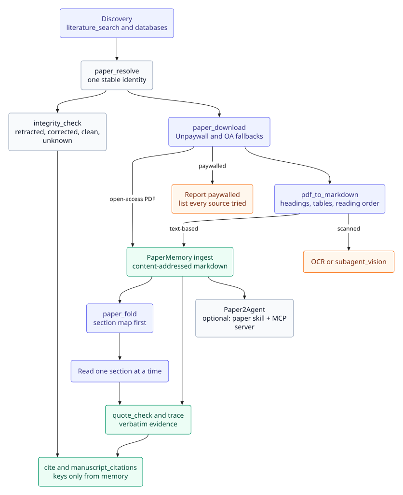

# Papers and evidence

The reading loop has four separate jobs:

1. **Discover** a paper and collapse its identifiers — [Search](SEARCH.md).
2. **Download** an open-access PDF — `paper_download`.
3. **Orient** yourself in it — `paper_fold` (map first) or `pdf_to_markdown` (full text).
4. **Prove** what it says — PaperMemory `get`, `quote_check`, `trace`, `cite`.

`paper_fold` is an orientation layer, not evidence. A `paper_fold` line is not a quote. Numbers, claims, quotations, and citation keys come from PaperMemory.



## Download a paper

`paper_download` is a preset-only native REST tool, not an MCP connector. Given a DOI it tries:

1. **[Unpaywall](https://unpaywall.org)** (when `UNPAYWALL_EMAIL` is set),
2. OpenAlex's publisher open-access PDF,
3. Europe PMC open-access links,
4. CORE repository downloads,
5. arXiv when the DOI is a `10.48550/arXiv.*` DOI.

An `arxiv_id` or a direct `url` also works, and a direct URL is tried first. Without `UNPAYWALL_EMAIL` the other fallbacks still run, so the email is recommended but not required; the tool never invents one.

When no open-access PDF is found, it returns a plain **"paywalled"** result listing every source tried (with the landing-page URL) rather than an error — the agent is steered to report that honestly instead of inferring the paper's content from a search snippet.

The response is checked against the PDF magic bytes before being saved, so a login/CAPTCHA page returned instead of the real file surfaces as a clear error rather than a corrupt "PDF."

A successful download is ingested into PaperMemory (see [Paper memory](#paper-memory)); ingest failure does not fail the download.

## Read at the right level

`paper_fold` turns a known paper (DOI, arXiv/PMC/bioRxiv ID, URL, or workspace file) into a section map, then lets the agent open one section at a time. It is powered by [TextFold](https://github.com/chenxiachan/textfold); the Python package is an optional runtime, not vendored.

| Action | What it returns |
|---|---|
| `map` | the whole document's section map: titles, section ids, and first-sentence takeaways (default `level: "takeaway"`) |
| `section` | one section at `topic`/`takeaway`/`key`/`brief`/`full` (default `key`); use an id or number from the map |
| `doc` | TextFold's `textfold/doc` JSON, written to `write_to` |
| `export` | Markdown at the requested level, written to `write_to` |
| `status` | the installed version, data directory, and install state |

```text
paper_fold action=map ref=2501.12345
paper_fold action=section ref=2501.12345 section=S2 level=key
paper_fold action=doc ref=2501.12345 write_to=literature/paper.json
```

### Local levels are the default

TextFold builds levels from the author's own first sentences, so `map` and `section` work with **no model call and no quota spend**. `generate: true` is opt-in and asks TextFold to write its five levels; that needs TextFold's own provider (Claude Code, Codex, Pi, or an OpenAI-compatible endpoint in `~/.textfold/settings.json`). DSH's model route is not automatically visible to TextFold, so the tool never assumes it and returns `model-required` if no provider answers.

### Runtime and storage

The first preset start installs `textfold==0.10.31` into `$DSH_HOME/textfold/venv` with `uv` (else `python -m venv` + pip). Documents live in `$DSH_HOME/textfold/data`. The install runs in the background; the first `paper_fold` call waits for it. The managed runtime forwards `DEEPSEEK_API_KEY`, `OPENAI_API_KEY`, `ANTHROPIC_API_KEY`, `OPENROUTER_API_KEY`, and the Settings/env `GEMINI_API_KEY` to TextFold, which can also read its own `~/.textfold/settings.json`. Overrides are environment-only:

| Variable | Effect |
|---|---|
| `TEXTFOLD_SKIP_INSTALL=1` | never install the managed runtime |
| `TEXTFOLD_PYTHON=/path/to/python` | use an interpreter that already has `textfold` |
| `TEXTFOLD_CLI=/path/to/textfold` | use a TextFold executable directly |
| `TEXTFOLD_DATA=/path` | a different document store (absolute path recommended) |

### Boundaries

- `paper_fold` is **orientation, not evidence**: `paper_fold` lines are not quotes.
- Quotes, numbers, claims, and citation keys come from PaperMemory (`quote_check`, `trace`, `cite`).
- Use `pdf_to_markdown` for the full text, for a scanned PDF, for a PaperMemory ingest, or when a PDF's map is shallow.
- HTML/JATS sources (arXiv, PMC) produce better maps than PDFs.
- Scanned PDFs are not handled by `paper_fold`: it returns `scanned-pdf` and the agent routes them to `pdf_to_markdown`'s OCR path or `subagent_vision`.
- `paper_fold` is **not a discovery tool** — use `literature_search`, `openalex_search`, `s2_search`, and the other academic databases.

## PDF to Markdown

`pdf_to_markdown` converts a PDF to Markdown using [pdf-inspector](https://github.com/firecrawl/pdf-inspector) (`@firecrawl/pdf-inspector`, native Rust/napi) — built for literature-survey workflows where a lot of downloaded papers need converting. It classifies the PDF (text-based/scanned/image-based/mixed) and, for text-based PDFs, extracts headings, lists, tables, and reading order locally in milliseconds without OCR.

| Argument | Meaning |
|---|---|
| `path` | the PDF to convert |
| `pages` | optional 1-indexed page numbers to limit conversion to |
| `write_to` | workspace-relative output path for the Markdown. Recommended for anything but a short excerpt; converting many papers with `write_to` set keeps each paper's full text out of the conversation and on disk instead (e.g. `literature/<author>-<year>.md`) |
| `ocr` | selectively OCR pages flagged as low quality (mode `Auto`). Requires the PDFium and ONNX Runtime shared libraries installed locally (set `PDFIUM_LIB_PATH`/`ORT_DYLIB_PATH` if they're not on the library search path — see [pdf-inspector's OCR runtime guide](https://github.com/firecrawl/pdf-inspector/blob/main/docs/ocr-runtime.md)); without them, a scanned PDF still comes back with `pages_needing_ocr` populated, so the agent knows to fall back to `subagent_vision` on rendered page images instead |

Prebuilt native binaries ship as `optionalDependencies` for Linux (x64/ARM64, glibc and musl), macOS (ARM64), and Windows (x64) — a plain `npm install` picks up the right one, no Rust toolchain needed.

`pdf_to_markdown write_to` auto-ingests the converted Markdown into PaperMemory (page-subset conversions are deliberately not ingested) and forwards converter/OCR signals.

## Deep review

`deep_review` runs a full Deep-Review-style pass over one manuscript with the vendored [open-deepreview](https://github.com/raktim-mondol/open-deepreview) engine. The paper is segmented, each segment is reviewed in parallel passes with the whole manuscript in context, comments are anchored to a page or quote, and a scholar-peer pass adds a summary, strengths and weaknesses, a claim-evidence map, a nine-item reproducibility checklist, and questions for the authors. Reference verification runs against OpenAlex and Crossref, with optional LLM search grounding.

| Action | Meaning |
|---|---|
| `estimate` | Optional engine-run estimate for the current model, topology, and thinking level. No model call; not required before `review` |
| `review` | Run the pipeline and store the result. Slow and token-expensive; asks the model once per segment and pass |
| `pdf2md` | Parse a PDF and store its Markdown plus page and OCR metadata |
| `verify_citations` | Check bibliography entries without running a full review |
| `status` | Stored state for a manuscript, including whether it is stale |
| `show` | Read back `summary`, `comments`, `questions`, `checklist`, `claims`, `citations`, or `markdown` |
| `list` | Stored deep reviews under `.dsh/deep-review/` |

`review` returns a compact summary (severity counts, top comments, question and flagged-citation counts, quality-audit scores) and never the full report. Use `show` for details; `show comments` pages with `limit`/`offset` and only includes comment bodies with `include_body: true`. `show citations` covers only references the engine flagged — clean references are omitted upstream, so "no flagged references" is the accurate phrasing.

While a review runs, it appears as a session background job: the header shows the latest stage/percentage, and expanding the job streams the engine log and each model call's route, duration, and token usage. The finished job stays under **Finished** for later inspection; the tool result includes `job_id`.

Topology controls the review depth: `LOW` (1 pass), `MID` (2, default), `HIGH` (3), `EXTRA_HIGH` (4). `thinking_level` controls the model's reasoning budget. Both add model work and time, and a long paper is re-sent once per segment and pass, so confirm the scope with the user before running `HIGH` or `EXTRA_HIGH`.

Artifacts live under `<cwd>/.dsh/deep-review/<key>/`: `review.json`, `review.md`, `paper.md`, `pdf-meta.json`, `citations.json`, `estimate.json`, `meta.json`, and append-only `runs.jsonl`. The key is derived from the workspace-relative path, so a manuscript keeps one directory across edits; `status` compares hashes and reports staleness. The engine runs under Node (no Bun) and calls the host's LLM service through a loopback OpenAI-compatible bridge. `review` and `verify_citations` therefore run on the **session model** — the same provider and model as the chat — with no separate API key or endpoint; switching the session model switches the reviewer. `estimate`, `pdf2md`, `status`, `show`, and `list` make no model call.

## Paper memory

[PaperMemory](https://github.com/raktim-mondol/papermemory) is the local academic-memory layer on the Academic Harness preset: papers (title, authors, year, venue, DOI, arXiv, bibtex key), claims with quoted evidence, citation graphs, manuscript recap, and cite-check. It is how the agent remembers papers it has read and cites without inventing references — open-web and peer-reviewed discovery stays on Parallel / Consensus / Firecrawl / Scite.

You do **not** install PaperMemory yourself. The first time the Academic Harness preset mounts after `dsh plugin add`, the plugin uses `papermemory` already on `PATH` if present, otherwise installs the vendored package (with `pypdf`) into `~/.dsh/papermemory` via `uv` (or `python -m venv` + pip). It then mounts `mcp__papermemory__*` over stdio (`papermemory mcp`) — no second restart. Startup is **fail-loud**: a missing or broken memory server, or any drift from the expected 14-tool MCP surface (the library is the native `reference_library` tool), is logged/surfaced instead of silently reading as an empty store. Override with `PAPERMEMORY_CLI` if you already have a binary you want to keep; `PAPERMEMORY_SKIP_INSTALL=1` skips the bundled venv.

The SQLite store is PaperMemory's default: `~/.local/share/papermemory/papermemory.db` (override `PAPERMEMORY_DB` or `PAPERMEMORY_DATA_DIR`). A standalone `papermemory` CLI, Grok, and Academic Harness share that same database. No API key.

### Memory v2 (markdown-first, verbatim)

Each paper is stored as content-addressed markdown; chunks are byte slices, sections carry heading paths and deterministic roles, and claims are anchored to exact quote spans.

- `papermemory_claim` requires an `evidence` quote from the stored text; an absent quote is refused and a whitespace-only mismatch stays `unverified-quote` (`asserted-quote-differs`).
- Only a passing byte re-slice (`papermemory verify`, or `papermemory_trace`'s walk) promotes a claim to `verified`; OCR-derived papers are capped at `extracted` (`channel-capped:ocr-recovered`).
- Search returns typed `empty_reason`/`suppressed`/`legs` instead of an unqualified empty list.
- Existing stores migrate once with `papermemory migrate` (schema 2000); legacy chunks/claims are quarantined, not promoted — re-ingest papers as markdown to make them citable.
- A 104-paper scale run (28/28 checks, bm25 top-N 20/20, scoped p95 11.7 ms) is documented in [`reports/papermemory-v2-scale-test.md`](../reports/papermemory-v2-scale-test.md).

### The tools

PaperMemory has 15 tools. In this plugin 14 are mounted as `mcp__papermemory__*`; the fifteenth, the reference library, is the native `reference_library` tool (see below).

| Tool | What it does |
|---|---|
| `mcp__papermemory__papermemory_recap` | Writing-project briefing: venue, sections, contributions, citation gaps |
| `mcp__papermemory__papermemory_search` | bm25-ordered chunk leg + claim/paper/notes legs; typed `empty_reason`, `suppressed`, `legs` |
| `mcp__papermemory__papermemory_ingest` | Ingest a local PDF/BibTeX/markdown/manuscript path, or an arXiv id / DOI |
| `mcp__papermemory__papermemory_get` | Paper by id or bibtex key, with claims and chunks |
| `mcp__papermemory__papermemory_cite` | Find a stored paper to cite. Empty result means do not invent a citation |
| `mcp__papermemory__papermemory_cite_check` | Compare a manuscript's in-text keys against memory |
| `mcp__papermemory__papermemory_remember` | Save a writing/reading decision |
| `mcp__papermemory__papermemory_claim` | Store a verbatim-anchored claim (evidence required); supersede/contradict/rebind/bind actions |
| `mcp__papermemory__papermemory_quote_check` | Exact-substring quote check with occurrences and locators |
| `mcp__papermemory__papermemory_trace` | Provenance walk for a claim, or paper → docs → claims → citations |
| `mcp__papermemory__papermemory_outline` | Derived section outline (roles, spans, DOI, source filename) |
| `mcp__papermemory__papermemory_list` | Enumerate papers/claims/lessons/coverage with totals |
| `mcp__papermemory__papermemory_register_to_ah` | Register stored markdown into an Academic Harness project |
| `mcp__papermemory__papermemory_lesson` | Save a durable academic writing/reading rule |
| `reference_library` (native) | Reference library, one `action` argument: `list get resolve import export tag collection note keys dedupe merge doctor set_integrity` (see below). Standalone PaperMemory exposes it as the MCP tool `papermemory_library`. |

`paper_download` calls ingest on the saved PDF (and DOI metadata when a DOI was given). The agent is steered to `recap` on paper-writing tasks, to cite only memory hits, to check `supports_statement`/`degradation`, and to `cite_check` before treating a section as finished. Load the bundled `papermemory` skill (`skills/papermemory`) for the full workflow.

### Reference library

PaperMemory is also the reference manager. One tool, `reference_library`, keeps a lossless record of every paper (so a `.bib` entry's `volume`, `pages`, `mrnumber`, ... survive), gives it a unique, stable citation key, and lets you organise and export it.

| Task | How |
|---|---|
| Add references | `import` BibTeX, BibLaTeX, RIS (Zotero/EndNote-style and publisher exports, including Scopus and Web of Science exports) or CSL-JSON; `paper_download` and `papermemory_ingest` add papers automatically. `dry_run` first for a big file. |
| Find | `list` with filters — `tag:ml year:2020..2024 has:pdf !tag:skip graph` — or `get` / `resolve` by key, DOI, or id. |
| Organise | `tag`; `collection` (one level of nesting; can be bound to a project and a `.bib`; its project scopes exports); `note` (an edit keeps the old text). |
| Write a bibliography | `export` to BibTeX, BibLaTeX, RIS, CSL-JSON, JSON, or CSV. `cited_only: <manuscript>` exports exactly what a manuscript cites, under that project's own keys. A collection created under a project does the same, even when an explicit `out` is given; pass `project` to override, and use a collection with no project for canonical keys. Only BibTeX/BibLaTeX defaults to the collection's bound `.bib`. A project `.bib` is **managed**: re-export rewrites only the managed block, keeps what you wrote after the `hand-added` marker, and refuses to overwrite hand edits unless forced (a backup is kept). |
| Keep keys stable | A key is set once. `keys` `check` reports problems; `rekey` is a dry run listing the manuscripts that cite the old key, and applying it needs a reason. The old key keeps resolving. |
| Clean up | `dedupe` lists candidate duplicates (it recognises a preprint and its published version, and does not flag "Part one/two", "Addendum", or yearly items); `merge` previews field by field and applies only with a reason. |
| Health | `doctor` reports missing required fields, unsafe keys, unverified DOIs, duplicates, retracted papers a manuscript still cites, and `.bib` files out of sync. A paper never integrity-checked is *unknown*, not clean. |

Scopus and Web of Science are import formats here, not live databases: `reference_library` reads the RIS files those services export, does not query their APIs, and needs no Scopus or Web of Science key.

The harness tools use it: `citation` accepts `library: { cited_only | project | collection | query | all }` as a record source, `manuscript_citations` accepts `library: true` (and `project`) to compare cited keys with the library, `literature_search` marks results already stored (`in_library`), and `integrity_check` accepts `library` to check the DOIs of library papers and record each result. `reference_library` is a native tool, not an MCP tool, so it knows each session's workspace: import paths and export targets are relative to it and cannot leave it, and nothing has to be passed. (An MCP server is one process with one fixed working directory, and the host freezes tool arguments, so an MCP tool cannot learn the session's workspace; the plugin hides `papermemory_library` from the MCP surface with `PAPERMEMORY_HIDE_TOOLS` so the model sees one tool.)

The first start after upgrading migrates an existing store (schema 2000 → 2100) after taking a backup (`backups/` next to the database). If another DSH session still holds the database the migration waits; close it and restart. Details and the standalone CLI (`papermemory library ...`) are in the [PaperMemory README](../vendor/papermemory/README.md).

### Auto-ingest project scope

Both auto-ingest paths pass the workspace root (`cwd`) to PaperMemory and let it resolve the project, in this order:

1. `PAPERMEMORY_PROJECT` (slugified),
2. nearest `ah.yaml` ancestor,
3. a manuscript whose `root_path` equals the workspace,
4. `unassigned`.

Explicit ingest uses the same resolution (`papermemory_ingest` with `cwd`, or CLI `papermemory ingest --cwd PATH`); an explicit `--project` wins over `cwd` and is slugified. Set `PAPERMEMORY_PROJECT` to override the detected project.

#### Project-key migration

Papers ingested before v0.15.0 were tagged with the workspace directory slug. After upgrading, a new auto-ingest in the same workspace may land under the manuscript or `ah.yaml` slug instead, so one project can temporarily split across two keys. Set `PAPERMEMORY_PROJECT` to the old slug for new ingests, or re-ingest the affected papers under the canonical project; there is no automatic `project rekey` command.

### PaperMemory configuration

| Setting / env | What it does |
|---|---|
| `PAPERMEMORY_CLI` | Absolute path to a `papermemory` binary. Env only. |
| `PAPERMEMORY_DB` / `PAPERMEMORY_DATA_DIR` | Override the SQLite store location. Env only. |
| `PAPERMEMORY_PROJECT` | Override the project for `paper_download` / `pdf_to_markdown` auto-ingest (slugified). Env only; otherwise PaperMemory resolves `ah.yaml` → manuscript `root_path` → `unassigned`. |
| `PAPERMEMORY_SKIP_INSTALL` | `1` to skip installing the bundled venv (PATH / `PAPERMEMORY_CLI` still work). |

## Paper agents (Paper2Agent)

The bundled `paper2agent` skill ([jmiao24/Paper2Agent](https://github.com/jmiao24/Paper2Agent), MIT) turns a paper and/or its code repository into:

1. a reviewed, compact paper skill, and
2. a tested FastMCP server of that paper's methods.

Load it with the `skill` tool when the user asks to agentify a paper. It is not a replacement for `pdf_to_markdown` (fast unreviewed extract) or for catalogue skills such as `scanpy` (how-to).

A full repository conversion is long (many `subagent` specialists plus independent verifiers). The agent should confirm scope first. After a verified ZIP, connect the server **only when asked**, with native `paper_mcp` (`register` / `status` / `unregister`) on the Academic Harness preset.

`paper_mcp` writes `<cwd>/.dsh/paper-mcps.json` (interpreter, server script, env **names** — never secrets) and tries to mount the server over stdio so tools appear as `mcp__<serverName>__*`. Those mounts are standing for the life of `dsh`, same as Parallel/Scite: if tools do not appear, restart `dsh`. A different workspace that reuses the same `serverName` also needs a restart.

Do not run `claude mcp add`. GPU papers use `runpod_run` / `modal_run` / `vastai_run` rather than a silent CPU fallback.

## Scope summary

| Action | Tool | Scope | Evidence? |
|---|---|---|---|
| Discover | `literature_search` and databases | Academic Harness preset | No |
| Resolve identifiers | `paper_resolve` | Academic Harness preset | No |
| Check status | `integrity_check` | Academic Harness preset | No (status only) |
| Get PDF | `paper_download` | Academic Harness preset | No |
| Orient | `paper_fold` | Academic Harness preset | No |
| Full text | `pdf_to_markdown` | Every preset | No |
| Critique manuscript | `deep_review` | Academic Harness preset | Quote-anchored comments; verify before use |
| Store | PaperMemory `ingest` | Academic Harness preset | Yes, after verification |
| Quote / trace | PaperMemory `quote_check` / `trace` | Academic Harness preset | Yes |
| Cite | `cite` + `citation` | Academic Harness preset | Key only from memory |
| Agentify | `paper2agent` skill + `paper_mcp` | Academic Harness preset + skill | No |

For the writing side, see [Writing and citation](WRITING.md). For the workspace search layer, see [Workspace](WORKSPACE.md#workspace-search).
