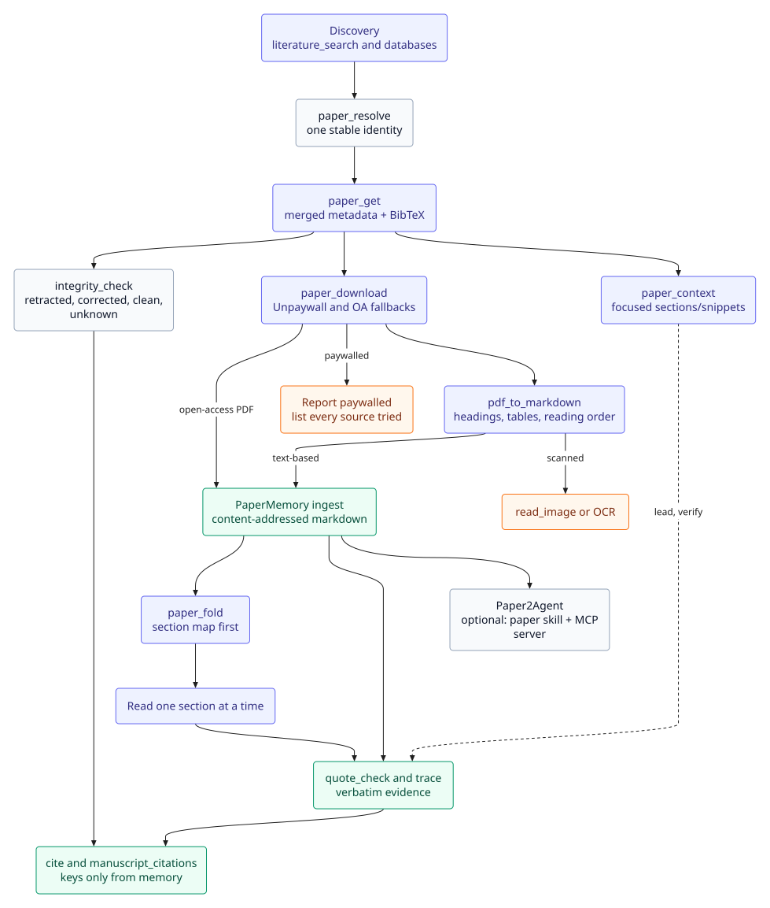
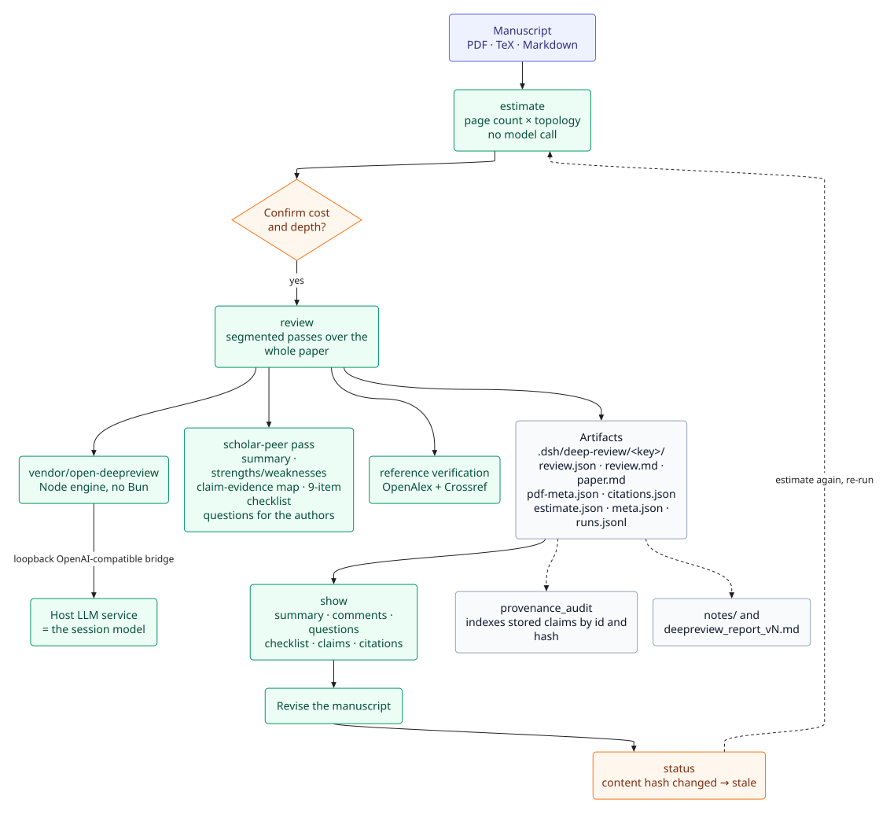

# Papers and evidence

The reading loop has five separate jobs:

1. **Discover** a paper and collapse its identifiers — [Search](SEARCH.md).
2. **Merge** its metadata and canonical BibTeX — `paper_get`.
3. **Download** an open-access PDF — `paper_download`, or pull focused sections/snippets with `paper_context`.
4. **Orient** yourself in it — `paper_fold` (map first) or `pdf_to_markdown` (full text).
5. **Prove** what it says — PaperMemory `get`, `quote_check`, `trace`, `cite`.

`paper_fold` is an orientation layer, not evidence. A `paper_fold` line is not a quote. Numbers, claims, quotations, and citation keys come from PaperMemory.



## Metadata, context, or full text?

These tools answer different questions:

| Need | Tool |
|---|---|
| One merged record with IDs, abstract/TLDR, OA URL, and BibTeX | `paper_get` |
| Focused sections/snippets to verify a method, number, or claim | `paper_context` |
| A saved, ingested PDF | `paper_download` |
| Map-first reading of a whole paper already on disk | `paper_fold` |
| Markdown conversion of a local PDF | `pdf_to_markdown` |

`paper_context` reads remote free tiers (Semantic Scholar snippets, arXiv HTML, PMC BioC/PubTator3), optional keyed publisher TDM, and an OA PDF. It is not a substitute for PaperMemory evidence: a returned snippet is a lead, not a verified quote. It never writes a PDF or ingests content.

## Download a paper

`paper_download` is a preset-only native REST tool, not an MCP connector. Given a DOI it tries:

1. **[Unpaywall](https://unpaywall.org)** (when `UNPAYWALL_EMAIL` is set),
2. OpenAlex's publisher open-access PDF,
3. Europe PMC open-access links,
4. CORE repository downloads,
5. arXiv when the DOI is a `10.48550/arXiv.*` DOI.

An `arxiv_id` or a direct `url` also works, and a direct URL is tried first. Without `UNPAYWALL_EMAIL` the other fallbacks still run, so the email is recommended but not required; the tool never invents one.

When no open-access PDF is found, it returns a plain **"paywalled"** result listing every source tried (with the landing-page URL) rather than an error — the agent is steered to report that honestly instead of inferring the paper's content from a search snippet.

The response is checked against the PDF magic bytes before being saved, so a login/CAPTCHA page returned instead of the real file surfaces as a clear error rather than a corrupt "PDF."

A successful download is ingested into PaperMemory (see [Paper memory](#paper-memory)); ingest failure does not fail the download.

## Read at the right level

`paper_fold` turns a known paper (DOI, arXiv/PMC/bioRxiv ID, URL, or workspace file) into a section map, then lets the agent open one section at a time. It is powered by [TextFold](https://github.com/chenxiachan/textfold); the Python package is an optional runtime, not vendored.

| Action | What it returns |
|---|---|
| `map` | the whole document's section map: titles, section ids, and first-sentence takeaways (default `level: "takeaway"`) |
| `section` | one section at `topic`/`takeaway`/`key`/`brief`/`full` (default `key`); use an id or number from the map |
| `doc` | TextFold's `textfold/doc` JSON, written to `write_to` |
| `export` | Markdown at the requested level, written to `write_to` |
| `status` | the installed version, data directory, and install state |

```text
paper_fold action=map ref=2501.12345
paper_fold action=section ref=2501.12345 section=S2 level=key
paper_fold action=doc ref=2501.12345 write_to=literature/paper.json
```

### Local levels are the default

TextFold builds levels from the author's own first sentences, so `map` and `section` work with **no model call and no quota spend**. `generate: true` is opt-in and asks TextFold to write its five levels; that needs TextFold's own provider (Claude Code, Codex, Pi, or an OpenAI-compatible endpoint in `~/.textfold/settings.json`). DSH's model route is not automatically visible to TextFold, so the tool never assumes it and returns `model-required` if no provider answers.

### Runtime and storage

The first preset start installs `textfold==0.10.31` into `$DSH_HOME/textfold/venv` with `uv` (else `python -m venv` + pip). Documents live in `$DSH_HOME/textfold/data`. The install runs in the background; the first `paper_fold` call waits for it. The managed runtime forwards `DEEPSEEK_API_KEY`, `OPENAI_API_KEY`, `ANTHROPIC_API_KEY`, `OPENROUTER_API_KEY`, and the Settings/env `GEMINI_API_KEY` to TextFold, which can also read its own `~/.textfold/settings.json`. Overrides are environment-only:

| Variable | Effect |
|---|---|
| `TEXTFOLD_SKIP_INSTALL=1` | never install the managed runtime |
| `TEXTFOLD_PYTHON=/path/to/python` | use an interpreter that already has `textfold` |
| `TEXTFOLD_CLI=/path/to/textfold` | use a TextFold executable directly |
| `TEXTFOLD_DATA=/path` | a different document store (absolute path recommended) |

### Boundaries

- `paper_fold` is **orientation, not evidence**: `paper_fold` lines are not quotes.
- Quotes, numbers, claims, and citation keys come from PaperMemory (`quote_check`, `trace`, `cite`).
- Use `pdf_to_markdown` for the full text, for a scanned PDF, for a PaperMemory ingest, or when a PDF's map is shallow.
- HTML/JATS sources (arXiv, PMC) produce better maps than PDFs.
- Scanned PDFs are not handled by `paper_fold`: it returns `scanned-pdf` and the agent routes them to `pdf_to_markdown`'s OCR path or `subagent_vision`.
- `paper_fold` is **not a discovery tool** — use `literature_search`, `openalex_search`, `s2_search`, and the other academic databases.

## PDF to Markdown

`pdf_to_markdown` converts a PDF to Markdown using [pdf-inspector](https://github.com/firecrawl/pdf-inspector) (`@firecrawl/pdf-inspector`, native Rust/napi) — built for literature-survey workflows where a lot of downloaded papers need converting. It classifies the PDF (text-based/scanned/image-based/mixed) and, for text-based PDFs, extracts headings, lists, tables, and reading order locally in milliseconds without OCR.

| Argument | Meaning |
|---|---|
| `path` | the PDF to convert |
| `pages` | optional 1-indexed page numbers to limit conversion to |
| `write_to` | workspace-relative output path for the Markdown. Recommended for anything but a short excerpt; converting many papers with `write_to` set keeps each paper's full text out of the conversation and on disk instead (e.g. `literature/<author>-<year>.md`) |
| `ocr` | selectively OCR pages flagged as low quality (mode `Auto`). Requires the PDFium and ONNX Runtime shared libraries installed locally (set `PDFIUM_LIB_PATH`/`ORT_DYLIB_PATH` if they're not on the library search path — see [pdf-inspector's OCR runtime guide](https://github.com/firecrawl/pdf-inspector/blob/main/docs/ocr-runtime.md)); without them, a scanned PDF still comes back with `pages_needing_ocr` populated, so the agent knows to fall back to `subagent_vision` on rendered page images instead |

Prebuilt native binaries ship as `optionalDependencies` for Linux (x64/ARM64, glibc and musl), macOS (ARM64), and Windows (x64) — a plain `npm install` picks up the right one, no Rust toolchain needed.

`pdf_to_markdown write_to` auto-ingests the converted Markdown into PaperMemory (page-subset conversions are deliberately not ingested) and forwards converter/OCR signals.

## Deep review



`deep_review` runs a full Deep-Review-style pass over one manuscript with the vendored [open-deepreview](https://github.com/raktim-mondol/open-deepreview) engine. The paper is segmented, each segment is reviewed in parallel passes with the whole manuscript in context, comments are anchored to a page or quote, and a scholar-peer pass adds a summary, strengths and weaknesses, a claim-evidence map, a nine-item reproducibility checklist, and questions for the authors. Reference verification runs against OpenAlex and Crossref, with optional LLM search grounding.

| Action | Meaning |
|---|---|
| `estimate` | Optional engine-run estimate for the current model, topology, and thinking level. No model call; not required before `review` |
| `review` | Run the pipeline and store the result. Slow and token-expensive; asks the model once per segment and pass |
| `pdf2md` | Parse a PDF and store its Markdown plus page and OCR metadata |
| `verify_citations` | Check bibliography entries without running a full review |
| `status` | Stored state for a manuscript, including whether it is stale and the round ladder |
| `show` | Read back `summary`, `comments`, `questions`, `checklist`, `claims`, `citations`, `markdown`, `rounds`, `validity`, or `score` |
| `compare` | Diff two stored review rounds: which findings closed, reopened, changed severity, and which claims, checklist items, or citations moved |
| `validity` | Four advisory evaluation-validity checks over a stored round plus a deterministic inventory of the manuscript; `round` picks the round, `critic: false` makes no model call |
| `score` | Advisory `soundness`, `originality`, `clarity`, and `significance` readings on a declared scale, each citing stored comment ids; one bounded model call |
| `list` | Stored deep reviews under `.dsh/deep-review/` |

`review` returns a compact summary (severity counts, top comments, question and flagged-citation counts, quality-audit scores) and never the full report. Use `show` for details; `show comments` pages with `limit`/`offset` and only includes comment bodies with `include_body: true`. `show citations` covers only references the engine flagged — clean references are omitted upstream, so "no flagged references" is the accurate phrasing.

While a review runs, it appears as a session background job: the header shows the latest stage/percentage, and expanding the job streams the engine log and each model call's route, duration, and token usage. The finished job stays under **Finished** for later inspection; the tool result includes `job_id`.

### Review rounds

Every `review` is kept as a numbered round: the digest of its findings goes to `rounds/<run_id>.json` and its report to `rounds/<run_id>.md`, while `review.json` and `review.md` keep holding the latest pass. Reviewing again after a revision therefore does not erase the earlier round, which is what makes the revision measurable rather than remembered.

The loop is `review` → revise → `review` → `compare`. `compare` pairs findings across rounds by wording, then by wording similarity (a token-overlap floor of 0.6), then by the quoted span. Comment ids are tried first, but the current engine re-issues them on every run, so id matching rarely fires. The result prints a `Matched by` line naming which rule paired the findings — that is how you tell a genuine closure from a reworded one. It reports closed, opened, and persisting findings with their severity moves, claim-evidence status changes, reproducibility-checklist transitions, and citation verdicts that became clean or newly flagged.

Two honest limits, both printed with the result. A reworded criticism can still slip past pairing, so a closed finding is a lead, not proof the science improved. And when `compare` says `input_changed: false`, the two rounds reviewed identical bytes: everything that moved between them is reviewer variance, which is the floor any "closed" claim has to clear before it means anything. Measured live at `LOW` topology on an unchanged manuscript, one pass closed 9 findings and opened 6 new ones, and the critical count itself moved. `deep_review` reports readings and never accepts or rejects a paper.

Topology controls the review depth: `LOW` (1 pass), `MID` (2, default), `HIGH` (3), `EXTRA_HIGH` (4). `thinking_level` controls the model's reasoning budget. Both add model work and time, and a long paper is re-sent once per segment and pass, so confirm the scope with the user before running `HIGH` or `EXTRA_HIGH`. Each round records its own model-call and token tally, and `status` sums them across the ladder so the cost of a review-revise-review loop is visible instead of assumed.

The deep engine is offered, never assumed: for any review request the agent asks whether the user wants `deep_review` or a normal session review, and after finishing a paper or technical document it delivers the draft and offers `deep_review` as a next step — running it only when the user agrees.

Artifacts live under `<cwd>/.dsh/deep-review/<key>/`: `review.json`, `review.md`, `paper.md`, `pdf-meta.json`, `citations.json`, `estimate.json`, `extra_checks.json`, `meta.json`, `rounds/<run_id>.json`, `rounds/<run_id>.md`, and append-only `runs.jsonl`. The key is derived from the workspace-relative path, so a manuscript keeps one directory across edits; `status` compares hashes and reports staleness. A store written before rounds (schema v1) is read as a single round without being rewritten, and the next `review` materializes that first pass into `rounds/` before adding the second. The engine runs under Node (no Bun) and calls the host's LLM service through a loopback OpenAI-compatible bridge. `review` and `verify_citations` therefore run on the **session model** — the same provider and model as the chat — with no separate API key or endpoint; switching the session model switches the reviewer. `estimate`, `pdf2md`, `status`, `show`, `compare`, and `list` make no model call. `validity` makes at most one — the critic pass — and `critic: false` makes none.

### Evaluation-validity checks

`validity` asks the questions the engine's critique does not ask, and it asks them of a stored review: with none on disk it says so and tells you to run `review` first. It reads the round named by `round` (a round number or a `run_id`; the latest by default) from `review.json` when that round is the latest and the full report is still stored, otherwise from `rounds/<run_id>.json`, and records which one it used. Against that it takes a deterministic inventory of the manuscript itself — its text (for a PDF, the stored `paper.md` when its recorded source hash matches the current PDF, else a fresh conversion), the results grids parsed out of LaTeX `table`/`tabular`/`array`/`longtable` bodies and Markdown pipe rows, and the numeric half from `numbers_audit`, whose own row counter is blind to multi-column grids and so is not used for counting them.

The four checks are the four cases the source paper's own comparison caught. `attribution` asks whether a gain survives removal of the named mechanism: a gain claim beside generic training controls (EMA, label smoothing, dropout, AdamW, a larger backbone) with no removal arm in a grid, no removal statement, and no ablation mention backed by a table or figure is flagged. A bare "we validated this through ablation studies" with no table or result is an absence, not evidence. A review or synthesis with no mechanism of its own is `not_checked` rather than flagged, because cited gains are not its own ablation evidence. `evaluator_drift` asks whether the change is in the harness rather than the model: a stated before-and-after value pair sitting in an evaluation context — judge, threshold, or display wording, or an evaluator-shaped snake_case parameter (threshold, frac, judge, eval, max tokens, …) in monospace — is flagged. `benchmark_coverage` asks how wide the widest results grid is: labelled metric/dataset axes when the headers carry them, otherwise numeric value columns; a single-axis grid, or a gain with no comparator arm, is flagged, and two metric axes with a dataset-like axis, or three numeric columns, with a baseline or comparator arm clear it. Counts aggregate across parsed grids, so a second table can widen a thin first one. `unmeasured_trade_off` asks whether a counter-metric sits beside a headline gain: a latency, runtime, memory, iteration, throughput, or energy claim with a magnitude, whose surrounding lines and nearby baseline grid carry no quality or feasibility counter-metric, is flagged.

A check answers `clear`, `flagged`, or `not_checked`, and always carries a reason string, line-level evidence, and its tallies. A `flagged` state names an absence in the text, not a flaw in the work: a paper that ablates off-line has nothing here to find. `not_checked` is the honest third answer — no locatable gain claim, no stated value change, no parseable grid, a grid whose axis counts match neither the thin shape the rule flags nor the wide shape it clears, or no speed-or-resource claim with a number attached — and it is never a pass; when the manuscript cannot be read at all, all four say `not_checked` with the read error as the reason rather than quietly passing. Counting is keyword and grid based over the manuscript's own words: LaTeX prose is matched through a mask that drops comments, math, and commands so a commented-out "ablation" cannot clear a check. The evaluator-drift pass instead reads comment-masked raw lines: commands and math survive so a `\texttt` parameter change is visible, while a commented-out threshold change is not. Markdown HTML comments and fenced code blocks are masked for every check, so a provenance note or a documented example table cannot manufacture a state. Reference lists are masked from the bibliography heading to an appendix/supplementary heading (or the end), and leading line numbers in PDF-converted text are stripped before counting; without that, citation lists read as results grids and "throughput"/"training time" in a title would count as claims. The vocabularies and the cut-offs are the plugin's own — the paper states the four criteria and no lexicon or threshold — and every cap the inventory hits (characters, grids, rows, evidence per check) is disclosed in the artifact instead of silently shortening the read.

The critic is at most one model call, on temperature 0 with a small output budget, made on the same session route as `review` — no new key, no new endpoint, no new Settings field — and it can only annotate. Its reply is validated and attached as advisory notes beside the deterministic states, plus any counter-metrics and generic controls it spots; **it cannot change a state**. If the session has no model route, the call fails, or the reply is not JSON, the pass still completes and records the critic as `not_checked` with the reason. `critic: false` makes no model call at all.

The pass writes `extra_checks.json` beside the review, a `meta.validity` summary that `status` reports with whether it still matches the current manuscript, a row in `runs.jsonl`, and its own notebook entry tagged `validity`. Read it back with `show section=validity`; `provenance_audit` indexes `extra_checks.json` — a `flagged` check becomes an `unverified` claim with the check's reason, a `not_checked` check stays `not_checked`, and `arms` reports the validity flags beside the citation column. The four states are readings from counting, not a judgement of the paper: they name what was absent from the text, nothing here gates, and only `ah_check` blocks.

### Advisory score and evaluator provenance

`score` reads one stored review round and makes **one bounded model call** on the session route. It returns four dimension readings on a declared numeric scale — `soundness`, `originality`, `clarity`, and `significance` — and every dimension cites one to four comment ids from that stored review. A dimension with no numeric reading or no valid stored comment id is `not_checked`, never guessed; the overall reading is the model's score or the mean of the scored dimensions, with the source recorded, plus confidence and limitations. `score.json` (schema version 1) and `meta.score` sit beside the review, `show section=score` reads them back, and `status` reports the latest overall, scale, round, and whether it still matches the manuscript. The one call is the whole cost; a missing model route, failed call, or non-JSON reply completes with `not_checked` and a reason.

The score's scale and rubric source are named in the artifact: `caller` (a `rubric` argument), `setting` (`DEEP_REVIEW_DEFAULT_RUBRIC`), or `default` (a 1–5 rubric with dimension definitions). A numeric range in the rubric text (`1–5`, `1–10`) sets the declared scale; otherwise 1–5 applies.

**Evaluator provenance is recorded per round.** `evaluator_kind` is `held_out` by default and becomes `in_distribution` when a `review` is given `rubric_round`, naming a prior round whose rubric or report fed the revision. Old rounds and v1 stores are read as `held_out` with `evaluator_kind_source: inferred`; a declared round records the referenced round. This is the paper's own distinction between the reviewer that guided the revision and a held-out reviewer that did not, and it is the honest half of any "reviewer threshold" claim. `show rounds`, `compare`, and `status` expose the kind; the score records the selected round's kind.

Settings:

| Field | Default | Effect |
|---|---|---|
| `DEEP_REVIEW_DEFAULT_RUBRIC` | built-in 1–5 rubric | Rubric text and declared range for `score`; a `rubric` argument wins |
| `DEEP_REVIEW_MAX_ROUNDS` | unset (no limit) | Refuse a new `review` once that many rounds are stored for one manuscript |
| `DEEP_REVIEW_COST_CEILING_USD` | unset (no ceiling) | Check the engine's median estimate before a review and refuse if it exceeds the amount |

Read the score as **an automated reviewer's reading, not a decision**: it is not an acceptance decision, a venue outcome, or a gate; nothing keys off the number. `not_checked` dimensions are not passes. The Phase 0 calibration report joins stored scores to accepted/rejected decisions and reports point-biserial `r`, AUC, mean scores by bucket, evaluator-kind counts, and a held-out subset; below its sample floor it says `not_checked` rather than inventing a correlation.

### Calibration

`scripts/deep-review-calibration.mjs` measures the reviewer instead of trusting it. `--collect` builds a sample manifest from OpenReview (real ratings and decisions, no model call); `--report` reads the stored rounds in a workspace and reports reviewer variance — finding overlap between two rounds of an unchanged manuscript — agreement between severity counts and accepted versus rejected decisions, and the correlation between stored overall scores and those decisions (point-biserial `r`, AUC, mean scores by bucket, evaluator-kind counts, and a separate held-out subset). Both say `not_checked` below their sample floor rather than producing a number that the data does not support. It is not named `test-*.mjs` on purpose: `npm test` globs that prefix, and the collector needs the network.

`scripts/deep-review-validity-calibration.mjs` is the corpus measurement Phase 2 owed. It takes a manifest of papers, converts PDFs with the simple text converter (no OCR; pages the converter flags for OCR are noted, not processed), runs the same `evaluateValidity` function `deep_review action=validity` uses, and writes `reports/deep-review-validity-<stamp>.{md,json}`. Per check it reports labeled examples, state agreement, flag rate, precision and recall, missed clears (the dangerous error), abstentions, false alarms, and false-positive papers among well-formed studies; it also fails a determinism check if identical bytes produce different states or evidence. Labels are an independent reader's reading, not ground truth, and attribution in corpus mode is text/grid-side unless a manifest row supplies stored-review `claims`/`comments`. The main harness exposes the mode as `--validity --corpus <manifest>`, and `scripts/fixtures/deep-review/validity/corpus.json` is the offline self-test. A manifest row is:

```json
{"id": "paper-id", "path": "paper.pdf", "format": "pdf",
 "labels": {"attribution": "clear", "evaluator_drift": "not_checked",
            "benchmark_coverage": "flagged", "unmeasured_trade_off": "clear"}}
```

The report is advisory measurement, not a verdict on any paper. A `missed clear` says the counters returned `clear` where a reader found a failure; an `abstained` says `not_checked`, which is honest but not a pass.

The local 14-paper corpus manifest (kept outside the package because it carries absolute paths) uses two independent readers per paper; 9/14 agreed and the rest were adjudicated. The final report (`reports/deep-review-validity-20261103T235613.md`) has **0 false-positive papers and 0 false alarms on every check**, 43/56 overall state agreement, and 0 determinism mismatches: `attribution` 14/14, `evaluator_drift` 8/14 (one missed clear), `benchmark_coverage` 10/14 and `unmeasured_trade_off` 11/14 (no false alarms; abstentions dominate). The sample has no reader-flagged coverage or trade-off failures, so their positive cases are still measured by the fixtures rather than by this corpus. The first pass, before the reference/PDF/coverage/removal calibration described above, had 10 false-positive papers and 39.3% agreement; the report keeps the final state, and the CHANGELOG records the delta.

## Paper memory

[PaperMemory](https://github.com/raktim-mondol/papermemory) is the local academic-memory layer on the Academic Harness preset: papers (title, authors, year, venue, DOI, arXiv, bibtex key), claims with quoted evidence, citation graphs, manuscript recap, and cite-check. It is how the agent remembers papers it has read and cites without inventing references — open-web and peer-reviewed discovery stays on Parallel / Consensus / Firecrawl / Scite.

You do **not** install PaperMemory yourself. The first time the Academic Harness preset mounts after `dsh plugin add`, the plugin installs the vendored package (with `pypdf`) into `~/.dsh/papermemory` via `uv` (or `python -m venv` + pip), and updates it when the bundled version changes. A compatible `papermemory` on `PATH` is a fallback if that install fails; an older one is refused. It then mounts `mcp__papermemory__*` over stdio (`papermemory mcp`) — no second restart. Startup is **fail-loud**: a missing or broken memory server, or any drift from the expected 14-tool MCP surface (the library is the native `reference_library` tool), is logged/surfaced instead of silently reading as an empty store. An explicit `PAPERMEMORY_CLI` override wins, so keep that binary current yourself; `PAPERMEMORY_SKIP_INSTALL=1` skips installation. The harness-managed update does not replace a separate standalone executable on `PATH`.

The SQLite store is PaperMemory's default: `~/.local/share/papermemory/papermemory.db` (override `PAPERMEMORY_DB` or `PAPERMEMORY_DATA_DIR`). A standalone `papermemory` CLI, Grok, and Academic Harness share that same database. No API key.

### Memory v2 (markdown-first, verbatim)

Each paper is stored as content-addressed markdown; chunks are byte slices, sections carry heading paths and deterministic roles, and claims are anchored to exact quote spans.

- `papermemory_claim` requires an `evidence` quote from the stored text; an absent quote is refused and a whitespace-only mismatch stays `unverified-quote` (`asserted-quote-differs`).
- Quote checks and claims accept paper IDs or resolvable citation keys. A missing paper or paper without stored text is reported separately from a quote that is absent from a successfully read document.
- Only a passing byte re-slice (`papermemory verify`, or `papermemory_trace`'s walk) promotes a claim to `verified`; OCR-derived papers are capped at `extracted` (`channel-capped:ocr-recovered`).
- Search returns typed `empty_reason`/`suppressed`/`legs` instead of an unqualified empty list.
- Existing stores migrate once with `papermemory migrate` (schema 2000); legacy chunks/claims are quarantined, not promoted — re-ingest papers as markdown to make them citable.
- A 104-paper scale run (28/28 checks, bm25 top-N 20/20, scoped p95 11.7 ms) is documented in [`reports/papermemory-v2-scale-test.md`](../reports/papermemory-v2-scale-test.md).

### Notes, recap and dreaming

Claims are checked against the paper text when they are written. The notes around them (`papermemory_remember` observations and `papermemory_lesson` rules) used to be plain inserts, so copies piled up and a note derived from a file kept being believed after the file changed. Three changes:

- **`papermemory dream`** (CLI; the 14-tool MCP surface is unchanged) is a background consolidation pass. It reports by default and only changes anything with `--apply`; it never deletes a row or edits a note's text, and each change is a status flip with its reason in the event log (`SWEEP`). It does three things:
  1. *Dedupe.* A near-duplicate (same whitespace-folded text, or token Jaccard of at least `--similarity`, default 0.9) of a newer note in the same project, tier, paper and manuscript is marked `superseded` by it. Notes in different projects or tiers are never merged.
  2. *Re-check against ground truth.* A manuscript note is re-derived from the outline/protocol files on disk; if the files changed or are gone it is marked `stale`. A note about a deleted paper or manuscript is `stale`. A manuscript root that is not on this machine is *unknown*, not stale.
  3. *Recover quarantined claims.* Claims the v2 migration put aside are re-submitted through `papermemory_claim`'s own path once their paper has markdown, so the verbatim check decides. A recovered claim comes back `extracted`, never `verified`. A quote that is not in the paper is marked `unrecoverable:quote-not-verbatim`. Papers that still have no markdown are listed with their waiting claim counts.
- **Recap picks half by importance, half by recency.** Importance is tier (semantic first), then how often a note was looked up, then confidence. Each note carries `why: "salient" | "recent"`. Only a `papermemory_search` hit counts as a lookup; showing a note in recap does not, so a note cannot make itself important by being shown. `stale` and `superseded` notes are hidden from recap and search, and recap reports `stale_notes_hidden`.
- **Re-ingesting a manuscript replaces its auto-generated notes** instead of adding another copy; the old copies stay as `superseded` history.

Run `papermemory dream --project <slug>` after a writing session or when recap reports `stale_notes_hidden`; add `--apply` once the report looks right. `papermemory dream --restore NOTE_ID` undoes one retired note, and later passes leave it alone.

**At session end.** The plugin runs `papermemory dream` when an agent is disposed, at most once an hour, only on the plugin-managed CLI (never a CLI found on `PATH`), and appends one line per run to `$DSH_HOME/papermemory/dream-log.jsonl`. `PAPERMEMORY_DREAM=apply` (default) consolidates, `report` is a dry run that only writes the log, `off` does nothing; an unreadable value means `report`. A locked database or a timeout is logged and retried at the next disposal.

### Giving text-less papers their text (`paper_backfill`)

A paper added from a bibliography, a literature search or a bare DOI is only a bibliographic row (`cite_state: chunkless`). Nothing can be searched, quoted or cited from it, so every `papermemory_cite` answers `supports_statement: false`. `paper_backfill` fixes that for a whole project. In one real library 136 of 144 papers had no text, and OpenAlex listed 78 of the 85 DOI-only papers in the largest project as open access.

For each text-less paper that has a DOI or arXiv id it tries, in order:

1. an open-access PDF (Unpaywall, OpenAlex, Europe PMC, CORE, arXiv), converted to markdown;
2. when a publisher refuses the direct download (HTTP 403, common), the same open-access URL read through Exa or Firecrawl, which parse PDFs themselves;
3. an open-access landing page read as markdown through Exa, then Firecrawl.

It ingests the result only when it passes a quality gate: long enough, shaped like an article, **at least 5,000 characters before the reference list** (an abstract page with a hundred references is long but is not the paper), a title that matches the stored one, and not a paywall stub. The first real run caught aggregator pages that were an abstract plus references; they are refused and the next source is tried. Text is stored with `origin_channel` `oa-pdf` or `oa-html` and the converter details, so a claim can be traced to how its text was obtained.

- **Open access only.** A paper OpenAlex does not list as open access is `paywalled` and never scraped. A paper with neither DOI nor arXiv id is skipped instead of being matched by title.
- **Dry run by default.** It reports, from metadata alone, how many papers have a PDF route, an HTML route, or neither. `dry_run: false` downloads and ingests. `limit` defaults to 10 (max 100).
- **Ledger.** Every outcome is appended to `$DSH_HOME/papermemory-backfill/ledger.jsonl` (override `PAPERMEMORY_BACKFILL_DIR`). Paywalled and gate-failed papers are not retried for 30 days, unreachable ones for 7, errors for 1; `retry: true` overrides. Three rate-limit answers stop the run early.
- **Keys.** Works with no key beyond the keyless sources. `UNPAYWALL_EMAIL`, `OPENALEX_API_KEY`, `EXA_API_KEY` and `FIRECRAWL_API_KEY` (Settings) add routes; without Exa or Firecrawl only PDF routes run.

Reference lists are marked as a bibliography section and left out of search, even when the converted text has a bare `References` line rather than a heading. For documents stored before that fix, `papermemory reindex --from-raw --paper ID` re-derives their chunks (new chunk ids, so skip papers that already have claims).

After a backfill, `papermemory dream` can bring back quarantined claims whose paper now has text, and `papermemory_recap` shows the new `citable` count.

### The tools

PaperMemory has 15 tools. In this plugin 14 are mounted as `mcp__papermemory__*`; the fifteenth, the reference library, is the native `reference_library` tool (see below).

| Tool | What it does |
|---|---|
| `mcp__papermemory__papermemory_recap` | Writing-project briefing: venue, sections, contributions, citation gaps |
| `mcp__papermemory__papermemory_search` | bm25-ordered chunk leg + claim/paper/notes legs; typed `empty_reason`, `suppressed`, `legs` |
| `mcp__papermemory__papermemory_ingest` | Ingest a local PDF/BibTeX/markdown/manuscript path, or an arXiv id / DOI |
| `mcp__papermemory__papermemory_get` | Paper by id or bibtex key, with claims and chunks |
| `mcp__papermemory__papermemory_cite` | Find a stored paper to cite. Empty result means do not invent a citation |
| `mcp__papermemory__papermemory_cite_check` | Compare a manuscript's in-text keys against memory |
| `mcp__papermemory__papermemory_remember` | Save a writing/reading decision |
| `mcp__papermemory__papermemory_claim` | Store a verbatim-anchored claim (evidence required); supersede/contradict/rebind/bind actions |
| `mcp__papermemory__papermemory_quote_check` | Exact-substring quote check with occurrences and locators |
| `mcp__papermemory__papermemory_trace` | Provenance walk for a claim, or paper → docs → claims → citations |
| `mcp__papermemory__papermemory_outline` | Derived section outline (roles, spans, DOI, source filename) |
| `mcp__papermemory__papermemory_list` | Enumerate papers/claims/lessons/coverage with totals |
| `mcp__papermemory__papermemory_register_to_ah` | Register stored markdown into an Academic Harness project |
| `mcp__papermemory__papermemory_lesson` | Save a durable academic writing/reading rule |
| `reference_library` (native) | Reference library, one `action` argument: `list get resolve import export tag collection note keys dedupe merge doctor set_integrity` (see below). Standalone PaperMemory exposes it as the MCP tool `papermemory_library`. |

`paper_download` calls ingest on the saved PDF (and DOI metadata when a DOI was given). The agent is steered to `recap` on paper-writing tasks, to cite only memory hits, to check `supports_statement`/`degradation`, and to `cite_check` before treating a section as finished. Load the bundled `papermemory` skill (`skills/papermemory`) for the full workflow.

### Reference library

PaperMemory is also the reference manager. One tool, `reference_library`, keeps a lossless record of every paper (so a `.bib` entry's `volume`, `pages`, `mrnumber`, ... survive), gives it a unique, stable citation key, and lets you organise and export it.

| Task | How |
|---|---|
| Add references | `import` BibTeX, BibLaTeX, RIS (Zotero/EndNote-style and publisher exports, including Scopus and Web of Science exports) or CSL-JSON; `paper_download` and `papermemory_ingest` add papers automatically. `dry_run` first for a big file. |
| Find | `list` with filters — `tag:ml year:2020..2024 has:pdf !tag:skip graph` — or `get` / `resolve` by key, DOI, or id. |
| Organise | `tag`; `collection` (one level of nesting; can be bound to a project and a `.bib`; its project scopes exports); `note` (an edit keeps the old text). |
| Write a bibliography | `export` to BibTeX, BibLaTeX, RIS, CSL-JSON, JSON, or CSV. `cited_only: <manuscript>` exports exactly what a manuscript cites, under that project's own keys. A collection created under a project does the same, even when an explicit `out` is given; pass `project` to override, and use a collection with no project for canonical keys. Only BibTeX/BibLaTeX defaults to the collection's bound `.bib`. A project `.bib` is **managed**: re-export rewrites only the managed block, keeps what you wrote after the `hand-added` marker, and refuses to overwrite hand edits unless forced (a backup is kept). |
| Keep keys stable | A key is set once. `keys` `check` reports problems; `rekey` is a dry run listing the manuscripts that cite the old key, and applying it needs a reason. The old key keeps resolving. |
| Clean up | `dedupe` lists candidate duplicates (it recognises a preprint and its published version, and does not flag "Part one/two", "Addendum", or yearly items); `merge` previews field by field and applies only with a reason. |
| Health | `doctor` reports missing required fields, unsafe keys, unverified DOIs, duplicates, retracted papers a manuscript still cites, and `.bib` files out of sync. A paper never integrity-checked is *unknown*, not clean. |

Scopus and Web of Science are import formats here, not live databases: `reference_library` reads the RIS files those services export, does not query their APIs, and needs no Scopus or Web of Science key.

The harness tools use it: `citation` accepts `library: { cited_only | project | collection | query | all }` as a record source, `manuscript_citations` accepts `library: true` (and `project`) to compare cited keys with the library, `literature_search` marks results already stored (`in_library`), and `integrity_check` accepts `library` to check the DOIs of library papers and record each result. `reference_library` is a native tool, not an MCP tool, so it knows each session's workspace: import paths and export targets are relative to it and cannot leave it, and nothing has to be passed. (An MCP server is one process with one fixed working directory, and the host freezes tool arguments, so an MCP tool cannot learn the session's workspace; the plugin hides `papermemory_library` from the MCP surface with `PAPERMEMORY_HIDE_TOOLS` so the model sees one tool.)

The first start after upgrading migrates an existing store (schema 2000 → 2100) after taking a backup (`backups/` next to the database). If another DSH session still holds the database the migration waits; close it and restart. Details and the standalone CLI (`papermemory library ...`) are in the [PaperMemory README](../vendor/papermemory/README.md).

### Auto-ingest project scope

Both auto-ingest paths pass the workspace root (`cwd`) to PaperMemory and let it resolve the project, in this order:

1. `PAPERMEMORY_PROJECT` (slugified),
2. nearest `ah.yaml` ancestor,
3. a manuscript whose `root_path` equals the workspace,
4. `unassigned`.

Explicit ingest uses the same resolution (`papermemory_ingest` with `cwd`, or CLI `papermemory ingest --cwd PATH`); an explicit `--project` wins over `cwd` and is slugified. Set `PAPERMEMORY_PROJECT` to override the detected project.

#### Project-key migration

Papers ingested before v0.15.0 were tagged with the workspace directory slug. After upgrading, a new auto-ingest in the same workspace may land under the manuscript or `ah.yaml` slug instead, so one project can temporarily split across two keys. Set `PAPERMEMORY_PROJECT` to the old slug for new ingests, or re-ingest the affected papers under the canonical project; there is no automatic `project rekey` command.

### PaperMemory configuration

| Setting / env | What it does |
|---|---|
| `PAPERMEMORY_CLI` | Absolute path to a `papermemory` binary. Env only. |
| `PAPERMEMORY_DB` / `PAPERMEMORY_DATA_DIR` | Override the SQLite store location. Env only. |
| `PAPERMEMORY_PROJECT` | Override the project for `paper_download` / `pdf_to_markdown` auto-ingest (slugified). Env only; otherwise PaperMemory resolves `ah.yaml` → manuscript `root_path` → `unassigned`. |
| `PAPERMEMORY_SKIP_INSTALL` | `1` to skip installing the bundled venv (PATH / `PAPERMEMORY_CLI` still work). |

## Paper agents (Paper2Agent)

The bundled `paper2agent` skill ([jmiao24/Paper2Agent](https://github.com/jmiao24/Paper2Agent), MIT) turns a paper and/or its code repository into:

1. a reviewed, compact paper skill, and
2. a tested FastMCP server of that paper's methods.

Load it with the `skill` tool when the user asks to agentify a paper. It is not a replacement for `pdf_to_markdown` (fast unreviewed extract) or for catalogue skills such as `scanpy` (how-to).

A full repository conversion is long (many `subagent` specialists plus independent verifiers). The agent should confirm scope first. After a verified ZIP, connect the server **only when asked**, with native `paper_mcp` (`register` / `status` / `unregister`) on the Academic Harness preset.

`paper_mcp` writes `<cwd>/.dsh/paper-mcps.json` (interpreter, server script, env **names** — never secrets) and tries to mount the server over stdio so tools appear as `mcp__<serverName>__*`. Those mounts are standing for the life of `dsh`, same as Parallel/Scite: if tools do not appear, restart `dsh`. A different workspace that reuses the same `serverName` also needs a restart.

Do not run `claude mcp add`. GPU papers use `runpod_run` / `modal_run` / `vastai_run` rather than a silent CPU fallback.

## Scope summary

| Action | Tool | Scope | Evidence? |
|---|---|---|---|
| Discover | `literature_search` and databases | Academic Harness preset | No |
| Resolve identifiers | `paper_resolve` | Academic Harness preset | No |
| Check status | `integrity_check` | Academic Harness preset | No (status only) |
| Get PDF | `paper_download` | Academic Harness preset | No |
| Orient | `paper_fold` | Academic Harness preset | No |
| Full text | `pdf_to_markdown` | Every preset | No |
| Critique manuscript | `deep_review` | Academic Harness preset | Quote-anchored comments; verify before use |
| Store | PaperMemory `ingest` | Academic Harness preset | Yes, after verification |
| Quote / trace | PaperMemory `quote_check` / `trace` | Academic Harness preset | Yes |
| Cite | `cite` + `citation` | Academic Harness preset | Key only from memory |
| Agentify | `paper2agent` skill + `paper_mcp` | Academic Harness preset + skill | No |

For the writing side, see [Writing and citation](WRITING.md). For the workspace search layer, see [Workspace](WORKSPACE.md#workspace-search).
