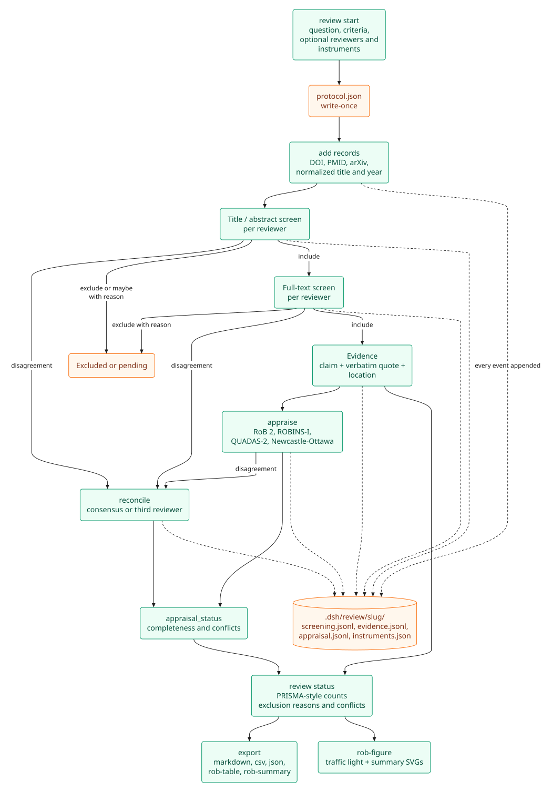
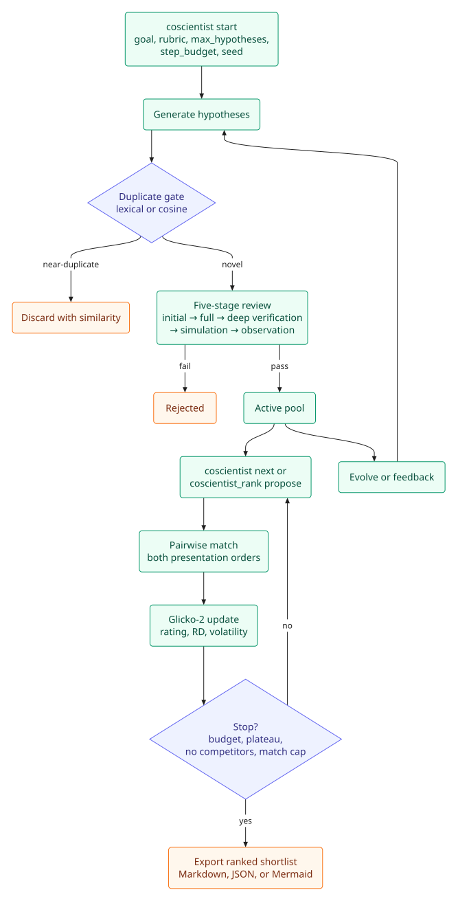

# Reviews, hypotheses, and research records

This page covers the local ledgers that keep work auditable past the context window: systematic reviews, meta-analysis, hypothesis tournaments, clinical and regulatory records, and dataset/venue/funder policy.

For limitation and prior-art triage, load `limitation-mining` and
`novelty-triage`. The `research_template` actions `limitation-mining`,
`subset-first-eval`, `ablation-plan`, `rebuttal-plan`,
`review-round-diff`, and `research-cycle` are prompt templates, not executors.
They connect existing ledgers without turning a generated hypothesis or a
lexical novelty reading into a scientific finding.

### Guided research cycle

`research_template action=get id=research-cycle slug=<slug> question=<question>`
returns a prompt that walks one human-directed path through the existing tools.
It starts nothing: the agent does one step, reports it, and stops for the
researcher. Status comes from the source ledgers (`provenance_audit rollup` is
the cross-ledger report); there is no second state machine, and missing records
are reported separately from `unknown`/`not_checked` states, never as a pass.

| Step | Existing tools | Approval needed before |
|---|---|---|
| 1. Scope | the brief, optional preregistration | nothing is run |
| 2. Prior art and hypotheses | search tools, PaperMemory, `coscientist`, `coscientist_verify novelty` | nothing is run; the researcher selects or rejects hypotheses |
| 3. Plan and baseline | `analysis_run plan`, `experiment_log start`, `dataset_get`, `data_profile` | nothing is run; missing inputs are listed |
| 4. Pilot or slice | `analysis_run run`, `experiment_log log`, optional `runpod_run`/`modal_run`/`vastai_run` | the exact command, data transfer, environment, and cost bound |
| 5. Compare and repeat | scoped `compare`/`best`, `replicates`, `branches` | nothing is run; no winning seed or significance claim |
| 6. Follow-up | `ablation`, optional `coscientist trace` | any new execution |
| 7. Draft and review | `provenance_audit`, `deep_review estimate`, `rebuttal` | a full review or any manuscript edit |
| 8. Export | `repro_package plan` | a draft deposit, which keeps its own explicit-confirmation flow |

Approval is action-specific: a general instruction to explore does not permit a
new command, upload, paid provisioning, or manuscript edit, and changed inputs
or a larger cost or scope need a fresh approval. The agent follows the host's
actual approval controls (`ask_user_question`); the template does not create a
durable approval record. Nothing here gates a turn: `ah_check` remains the only
blocking gate.

## Systematic reviews

`review` is a preset-only native tool — local, no key, no database — that keeps a systematic or scoping review auditable. State lives under `<cwd>/.dsh/review/<slug>/` as append-only JSONL event logs plus a write-once `protocol.json`; the current state is derived from the log, so concurrent subagent writes cannot corrupt it and overrides keep their history.



| Action | What it does |
|---|---|
| `start` | Question, databases, inclusion/exclusion criteria, date range, optional reviewer roster, risk-of-bias instruments, and an extraction template. Refuses to overwrite an existing review unless `resume: true`. |
| `add` | Records from a search tool's result array or a workspace JSON/JSONL file; deduplicates by DOI, PMID, arXiv ID, then normalized title+year, and logs every query in `search_log.jsonl`. |
| `screen` | `title_abstract` / `full_text` × `include` / `exclude` / `maybe`, per named reviewer. A full-text decision requires that reviewer's title/abstract include; exclude and maybe require a reason; re-screening requires `override: true` and replaces only that reviewer's event. With a declared roster, disagreements are reported as conflicts. |
| `evidence` | Only after a resolved full-text include; claim, verbatim quote, and location. The ledger stores the quote but does not verify it — PaperMemory `quote_check`/`trace` remains the verifier. |
| `extract` | One reviewer's structured extraction for an included record. A frozen template (`generic`, `pico`, `peco`, `diagnostic_accuracy`, `prognostic`, `qualitative`, or inline) defines required fields; `row_id` separates multiple outcomes/arms/comparisons. Field-level quotes are checked through PaperMemory when `paper` is supplied. |
| `extract_status` | Completeness per record/row/field, required-field gaps, field conflicts, and quote verification counts. |
| `appraise` | One risk-of-bias domain judgement per reviewer under a frozen instrument; quote and location required for decisive ratings (low/high, ROBINS-I low/critical, checklist yes/no); optional PaperMemory quote check; signalling answers stored as supporting detail. |
| `reconcile` | A consensus or third-reviewer decision over a screening, appraisal, or extraction disagreement, with a reason. The originals stay in the log. |
| `agreement` | Percent agreement and Cohen's κ (linear/quadratic weighted for ordinal appraisal scales, pairwise above two raters) per screening stage or appraisal domain. Human-vs-human is primary; AI pairs are separate. |
| `appraisal_status` | Per-instrument, per-record, per-domain completeness; missing reviewers; outstanding conflicts; appraisals outside the included population. |
| `status` | Records, query counts, PRISMA-style stage counts, per-reviewer counts and conflicts in dual mode, exclusion reasons, includes missing evidence. |
| `export` | `markdown` report skeleton, `csv` evidence table, `json` full ledger, `extraction-table`/`extraction-matrix` (Markdown or CSV), `extraction-json`, `prisma-flow` (SVG plus counts JSON), `grade-profile` (Markdown or CSV), `sof-table` (Markdown, CSV, or LaTeX), `rob-table`/`rob-summary` (Markdown or CSV), or `rob-figure` (two SVGs) under `exports/`; refuses to overwrite without `overwrite: true`. |

The tool never makes inclusion, extraction, appraisal, or consensus decisions — discovery stays in the search tools and every decision, value, and reason comes from the user or the stated criteria. Reviewer identities are typed `human:<name>` / `ai:<model>`; reviewer-less legacy events derive as `default`, so single-reviewer ledgers read as before. Extraction values are recorded, not inferred; missing required fields are counted, never filled; a field conflict is resolved only by a named `reconcile`. The `prisma-flow` export is labelled PRISMA-style and shows `not recorded` for missing counts rather than inventing zeroes. The `systematic-review-ledger` skill documents the workflow, and `risk-of-bias-appraisal` documents appraisal.

## Meta-analysis

`meta_analysis` is a preset-only native tool for pairwise synthesis. State lives under `<cwd>/.dsh/meta/<slug>/`: a write-once `protocol.json`, append-only `studies.jsonl` and `analyses.jsonl`, and `plots/` and `exports/`. The statistical work is in `python-helpers/meta_helper.py` (NumPy/SciPy); the ledger and protocol validation are in `meta-analysis.js` / `meta-analysis-store.js`.

| Action | What it does |
|---|---|
| `start` | Freeze the effect measure (`OR`, `RR`, `HR`, `IRR`, `MD`, `SMD`, `RD`, `ZR`), model (`fixed`/`random`), τ² method (`dl`/`pm`/`reml`), CI method (`normal`/`hartung_knapp`), and alpha. Refuses to overwrite unless `resume: true`. |
| `add` | Compute and append studies from raw 2×2, continuous, correlation, HR, diagnostic 2×2, or effect + CI/SE inputs. Duplicate ids are skipped; invalid studies are returned with reasons. |
| `effect_size` | Stateless conversion for one study; returns analysis-scale effect, SE, variance, display effect/CI, formula, and any zero-cell correction. |
| `pool` | Fixed or random pooling with the protocol methods; reports estimate, CI, weights, Q, df, p, I², H², τ², prediction interval, and warnings. A forest plot is written automatically. |
| `subgroup` | Pool within a metadata field and report the between-group Q test. Single-study groups are reported without pooling. |
| `meta_regression` | Method-of-moments residual τ², weighted least squares, normal or Hartung–Knapp CIs, Q_E, and a pseudo-R². Numeric covariates only. |
| `leave_one_out` | Refit without each study and report the change. |
| `publication_bias` | Egger's intercept test, Begg's rank correlation, and a funnel plot. Warns below 10 studies. Trim-and-fill is not implemented in this release. |
| `diagnostic` | 2×2 diagnostic studies; pools logit sensitivity and specificity separately, reports DOR, and writes a study-point SROC. Bivariate/HSROC is not implemented in this release. |
| `plot` | `forest`, `funnel`, or `sroc` SVG from the latest or named analysis. |
| `report` | Markdown methods/results skeleton with the recorded numbers. |
| `import_review` | Import complete rows from a review extraction table; conflicted, incomplete, outcome/measure-mismatched, or missing-effect/CI rows are skipped with reasons. Default field mapping matches the PICO template. |
| `status` / `list` / `show` / `export` | Ledger status, analysis index, one analysis, or `json`/`csv`/`report`/`forest`/`funnel`/`sroc` exports. |

The tool reports computed estimates, model assumptions, heterogeneity, and warnings. It never labels a result significant, effective, certain, or clinically recommended. The protocol is write-once; explicit per-analysis overrides are recorded in `analyses.jsonl`. Ratio measures are pooled on the log scale and displayed back-transformed. For generic ratio inputs, pass `log_effect`/`log_se` or an effect with a confidence interval; continuous measures accept an effect + SE or CI. A prediction interval needs at least three studies; Hartung–Knapp with two studies is very conservative.

The pairwise core is validated against the published BCG vaccine example: fixed-effect log RR = −0.43214 (SE 0.04057), DL random-effects = −0.71408 (SE 0.17866, τ² 0.30840), PM = −0.71497 (SE 0.18089, τ² 0.31808), and REML = −0.71453 (SE 0.17978, τ² 0.31325), with the subgroup Q-between matching the published example (Q = 1.946, p = 0.163). `scripts/test-meta-analysis.mjs` covers these values, effect-size conversions, plots, the ledger flow, diagnostic pooling, and review import. Load the `meta-analysis` skill for the workflow.

## GRADE certainty

GRADE lives inside the existing `review` ledger: `<cwd>/.dsh/review/<slug>/grade.json` is a write-once outcome definition and `grade.jsonl` is an append-only judgement log (`g0001`, …). The `grade-certainty` skill documents the workflow.

| Action | What it does |
|---|---|
| `grade_start` | Define outcomes/comparisons: id, name, importance, study count or ids, participants, effect/CI/measure, and notes. Refuses to overwrite unless `resume: true`. |
| `grade_judge` | Record one named reviewer's domain rating with a required reason. Downgrade domains: `risk_of_bias`, `inconsistency`, `indirectness`, `imprecision`, `publication_bias` (`not_serious`/`serious`/`very_serious`). Observational upgrade domains: `large_effect`, `dose_response`, `plausible_confounding` (`upgrade`/`not_applicable`). An optional quote needs a location and is checked through PaperMemory when `paper` is supplied. |
| `grade_overall` | Record a human overall certainty (`high`, `moderate`, `low`, `very_low`) with a reason. |
| `grade_status` | Per outcome: domain states, missing reviewers, conflicts, missing domains, a derived suggestion, and stored overalls. |
| `export` | `grade-profile` (Markdown/CSV) and `sof-table` (Markdown/CSV/LaTeX). |

The suggestion starts at high, subtracts one level for each `serious` and two for each `very_serious` downgrade domain, adds one for each `upgrade`, and maps the score to high/moderate/low/very low. It is **derived and not stored**; the stored overall is the human decision. With two or more declared reviewers, a domain is incomplete until every reviewer judges it, and differing ratings are a conflict. Differing overalls are also a conflict, and the SoF export shows `conflict` instead of choosing one. A stored overall that differs from the suggestion is flagged, never overwritten. Exports report recorded certainty judgements and never a quality, recommendation, or "high quality" verdict. `scripts/test-grade.mjs` covers single- and dual-reviewer flows, conflicts, missing reviewers, quote verification, overrides, and all three SoF formats.

## Risk-of-bias appraisal

`review appraise` records a reviewer's judgement for one instrument domain. Eleven instruments ship as paraphrased, versioned templates under `appraisal/<id>/<version>.json` with links to the official sources:

| Instrument | Study design | Domains | Judgements |
|---|---|---|---|
| RoB 2 (2019) | randomised trial | 5 + derived overall | low / some concerns / high |
| ROBINS-I v1 | non-randomised intervention | 7 + derived overall | low / moderate / serious / critical / no information |
| QUADAS-2 (2011) | diagnostic accuracy | 4 domains, 7 risk-of-bias/applicability cells | low / unclear / high |
| Newcastle-Ottawa | cohort or case-control | 3 star-count domains | 0–4, 0–2, 0–3; total reported as a count |
| AMSTAR 2 (2017) | systematic review of intervention | 16 item domains, critical items flagged in the notes | yes / partial yes / no |
| PROBAST (2019) | prediction model | 4 domains, 7 risk-of-bias/applicability cells | low / unclear / high |
| QUIPS (2011) | prognostic-factor cohort | 6 domains | low / unclear / moderate / high |
| SYRCLE (2014) | animal intervention | 6 domains including external validity | low / unclear / high |
| CASP cohort / case-control / qualitative | design-specific checklists | 9–10 consolidated questions | yes / can't tell / no |

The full instrument definition is frozen into `.dsh/review/<slug>/instruments.json` at `start` or on first use; a second version of the same instrument is rejected, so a running review cannot change its rubric. Evidence rules:

- `low`/`high` (RoB 2, QUADAS-2, PROBAST, SYRCLE), `low`/`moderate`/`high` (QUIPS), `low`/`critical` (ROBINS-I), and `yes`/`no` (AMSTAR 2, CASP) need a verbatim quote and location. With a PaperMemory `paper`, the quote is re-found through `papermemory_quote_check`. A quote absent from a resolved paper is rejected and not stored; a match only in the bibliography is rejected. If the paper cannot be resolved or the check fails, the event is stored `unverified` with the reason. Without `paper`, it is stored `unverified`.
- Signalling answers are supporting detail. The official answer-to-judgement algorithms are not implemented; the tool never converts an answer into a judgement.
- A declared reviewer roster is the appraisal panel: every declared reviewer must judge every domain before a record counts as complete, and `appraisal_status` lists the missing reviewers. Without a roster, the active appraisers on included records are the panel.
- The RoB 2 and ROBINS-I overall is derived from the resolved domains (any high → high; otherwise any some concerns → some concerns; ROBINS-I uses the worst domain, with no_information between moderate and serious). It is marked derived and never stored. An explicit `domain: "overall"` override requires a reason.
- QUADAS-2, Newcastle-Ottawa, AMSTAR 2, PROBAST, QUIPS, SYRCLE, and the CASP checklists have no derived overall; report the domain cells and the NOS star total. AMSTAR 2's official confidence rating counts critical flaws rather than taking a worst domain, and PROBAST, QUIPS, SYRCLE, and CASP discourage aggregate scores, so none of these derives one.

A disagreement is a first-class state: `appraisal_status` lists it, `reconcile` records the consensus or third-reviewer decision with a reason, and a later disagreeing appraisal reopens it. `agreement` computes percent agreement and κ with an approximate 95% CI, reports N and dropped ratings, and emits caveats for skewed marginals, small samples, and clipped intervals. Human κ never includes AI judgements; AI-vs-human and AI-vs-AI pairs are reported separately. For more than two human raters, agreement is pairwise; Fleiss' κ is not implemented.

`rob-figure` renders `rob-traffic-light.svg` and `rob-summary.svg` through `python-helpers/rob_figure.py`, which needs the helper environment (`cd python-helpers && uv sync`). The table and CSV name the reviewers behind each resolved row, the reviewer whose consensus decision resolved a disagreement, and the unverified-quote count; the figure note repeats all three, and AI reviewers keep their `ai:` prefix. The exports contain recorded judgements and completeness counts; they never say "low risk", "high quality", or "compliant". Load the `risk-of-bias-appraisal` skill for the full workflow.

## Deep research

### Chatbox task selector

Select **Deep Research** below the chatbox, enter a question, and use the normal Send button (or Enter). Selecting the chip alone spends nothing; clicking its main segment again clears the selection without clearing the question. The selected chip carries its own **Auto / Low / Medium / High** effort segment and a menu, mirroring the model control; the menu grows outside the composer rather than taking a separate toolbar slot. Effort maps to the existing engine settings, and the choice appears on the chip (`Deep Research | High ▾`) so the setting is visible before Send. No selection means ordinary Chat. Only Deep Research is enabled in this first phase; the shared catalogue reserves the other six task modes without exposing nonfunctional buttons.

The selector uses DSH's command-input hooks (`/research`) and the preset-scoped `academic-task` command, not a prompt prefix asking the model to choose a tool. The host validates the request and invokes `deep_research` through the tool-policy pipeline on the receiving session's model. Plan mode blocks admission and is checked again at execution. Phase 1 accepts a text question only; remove attachments rather than silently discarding them. Existing command/reference chips are not rewritten into plain text when selecting a task.

The selected chip is visibly active: it takes the theme primary fill and contrasting text, shows a check, and keeps the effort segment on the chip. After Send, a persistent receipt appears in the composer dock with the question, effort, job/run id, and a pointer to Background tasks; the command also returns an immediate notice. This covers the empty-session hero, which may not render the command transcript node until later. The receipt is dismissible and is cleared by the next submission. Background jobs shows the task and the engine's step-by-step research job; stopping the task forwards cancellation to the engine. An ambiguous Auto-effort request stays in the composer with the engine's clarification question: choose an explicit effort and send the unchanged question again. Submission failures preserve the draft and selection. A session-scoped request identity is retained in browser session storage until acknowledgment when storage is available, so retrying a lost acknowledgment does not start another costly run.

Task receipts live under `.dsh/tasks/<session-hash>/<request-id>.json` and refer to the existing research run rather than replacing its ledger. They record the submitted question, options, job/run ids, and terminal outcome. Reusing an accepted request id never restarts it, including after a host restart; a receipt's recorded `running` state is not proof that a live job survived. Inspect the referenced run with `deep_research action=status` before explicitly resuming interrupted work. Completed reports remain under `.dsh/deep-research/<run-id>/artifacts/final-report.md`. A blocked or failed run is not reported as a completed report.

`deep_research` runs the survey-to-report pipeline that `skills/deep-research`
describes, with the part prose cannot provide: durable state and enforced gates.
It is a preset tool, so it inherits this harness's retrieval and memory rather
than duplicating them — `literature_search` for discovery, PaperMemory for the
library of record, `integrity_check` for retraction flags, `review` for PRISMA
screening. The run ledger is the new thing, not a new search engine.

```text
deep_research action=start query="<the request, verbatim>" effort=medium run=true
deep_research action=status run_id=dr-0001
deep_research action=verify run_id=dr-0001
```

Nobody has to learn seven scale parameters to use it. `effort=low|medium|high`
sets pipeline depth, call and time budgets, full-text reading, and the web lane
together; omit it and the level is read from the request ("quickly" and "just
tell me" are low, "comprehensive" and "systematic review" are high) and reported
back with the phrases that decided it. A request that points both ways gets a
question instead of a run: `start` returns `needs_input` and spends nothing — no
run directory, no model call — until the caller answers. Explicit arguments still
win, and the chosen level is frozen into the manifest so a resume cannot drift.

What it guarantees:

- **The query is gospel.** Written once to `query.md`, hashed into the manifest,
  and re-checked before every step. A step working from a paraphrase fails with
  `query_drift` instead of quietly answering a different question.
- **Verification is tier-independent.** The light path is
  `decompose → sweep → draft → cite_check → polish`. A short run earns no
  exemption from the cite check.
- **Voice is counted, not copied.** `independence-cluster.js` groups records by
  DOI, exact or near title, and identical body across hosts — with the rule that
  two different DOIs are never merged, because a DOI names the work. The gate
  reports records and votes separately, so "several sources report" can be
  audited into "one release, four hosts".
- **After synthesis, patch only.** `applyHunks` refuses absent or ambiguous
  context, an oversized hunk, and a hunk count that would amount to a rewrite;
  those escalate as structural findings instead of being applied. A patched
  artifact cannot be overwritten at all — the store refuses it.
- **Resume is active-time and order-safe.** The wall-clock budget counts active
  execution segments, not idle hours while the host is down or a gate waits for
  a person; the status line reports both active and elapsed time. `from_step` is
  an explicit restart: it reruns the named step even when it is done, resets
  blocked steps at or after it, and does not walk backwards into earlier steps.
  A normal `resume` never skips a blocked or unfinished earlier step. `gate`
  without a `status` reads the latest verdicts; `show` reads a stored artifact,
  claims, findings, state, gates, query, or manifest; `revise` drops or replaces
  one claim's quote and re-verifies the replacement, appending a revision rather
  than editing the claims ledger; `patch` is the only supported way to repair a
  report and closes its `finding_id` only when every hunk applies. Never edit
  `.dsh/deep-research` files by hand.
- **The citation gate sees cluster ids and whole sentences.** A bracket token
  shaped like a cluster id (`c0242`) or an unknown `src-` id is a High citation
  finding, not an ignored label; the finding names the cluster's representative
  record. A sentence is judged as a citation set: if any readable co-citation
  supports it, a partial binding on another cited record does not block it.
  Cite-check samples up to 30 records and sends full abstracts (up to 2000
  characters), because a 400-character head produced false partials in a live
  run. A quote found verbatim in a stored abstract is `abstract`-supported, is
  disclosed as abstract-only, and is not a fabrication when a PDF conversion
  loses the span. A quote absent from the library, the fetched body, and the
  abstract remains `unsupported`; a truncated body with no match is
  `not_checked`.
- **The source cap is an ingestion cap.** A low-effort run stops storing at
  `max_sources`; the sweep reports how many records the cap dropped. A legacy
  corpus already over the cap is reported non-blocking, so it cannot strand the
  next reading step.
- **Findings belong to the report bytes they graded.** A patch makes the old
  citation/critic findings stale instead of letting them block forever; the ship
  gate reports `findings_current` and asks for a fresh `from_step=cite_check`
  (and `critics` when the text changed). Re-raising a fixed issue after a rerun
  is allowed; only currently open findings for the same report suppress duplicates.
- **A blocker is a human decision.** `blocked` step state halts both `run` and
  `resume`; only an explicit `from_step` resets it.
- **A pass never overclaims.** Each gate check is `pass`, `blocked`, or
  `not_checked`, and the result carries a caveat naming what could not be
  verified. Quote integrity needs `fetch_full_text: true`, because a span
  nothing read is unverified, not true.

Fetched bodies are cached content-addressed per run (`bodies/<src-id>.md`) so a
verbatim quote check is a local string comparison. That cache is disposable run
state; PaperMemory remains the store of record, and `deep_research` never writes
to it or to another ledger.

Untrusted text is fenced: every retrieved body entering a prompt is wrapped in
`<untrusted-source>` with a notice, and a page containing its own closing tag is
escaped so it cannot end its fence and resume as trusted instructions.

Ledger layout, step ids, gate ids, and error states:
`skills/deep-research/references/run-ledger.md`.

**Attribution.** The pipeline shape — one step per phase, the canonical query as gospel, tiers
and gears, patch-never-regenerate with per-hunk caps, the ship gate, independence clustering, and
untrusted-source fencing — is adapted from [hyperresearch](https://github.com/jordan-gibbs/hyperresearch)
(MIT), a Claude Code/Codex research harness. No upstream code is vendored: the implementation is
first-party JavaScript written against this plugin's own retrieval, ledger, and lock helpers, and
the step set, gate semantics, and verification seams differ from the upstream design. `NOTICE`
records the same.

## Hypothesis tournaments

`coscientist` and `coscientist_rank` are preset-only native tools — local state, no key, no database, no new dependency — for a ranked hypothesis shortlist that has to survive past this context window.

State lives under `<cwd>/.dsh/coscientist/<slug>/` as append-only `events.jsonl` / `matches.jsonl` logs plus a write-once `protocol.json`; the leaderboard is derived from the log, so a resumed session sees exactly the ratings it left behind, and concurrent subagent writes cannot corrupt it. It has the same shape as [Systematic reviews](#systematic-reviews), and the shared `.lock` implementation comes from there.



### `coscientist`

| Action | What it does |
|---|---|
| `start` | Goal, constraints, rubric, `max_hypotheses`, `step_budget`, `max_matches`, `seed`; defaults **5 hypotheses / 36 steps** — a ranked shortlist sized so two losses still leave three ideas competing, and a budget that lets the Elo plateau rule actually fire rather than ending on the cap. `max_matches` enforces an explicit user stop bound such as one match per pair. |
| `add` | Add a hypothesis; a near-duplicate is discarded with its similarity score, and a cap-reached add is discarded. |
| `review` | Five stages: `initial` → `full` → `deep_verification` → `simulation` → `observation`. Stages refuse to run out of order; a `fail` at `initial`/`full` rejects the hypothesis. |
| `safety` | Record a dual-use classification; the tool withholds it when the severity meets the threshold. |
| `status` | Ranked leaderboard plus limitation coverage (recorded, addressed by an active idea, sufficient, exhausted) and the selected champion. |
| `next` | Which task the scheduling policy samples now; it never samples a task the ledger cannot run and stops at the match cap. An `evolution` dispatch carries the failed and pruned `experiment_log` traces, so a mutation is constrained by what already failed. |
| `set_status` | Reject or release a withholding, always with a reason. |
| `lineage` | Hypothesis ancestry. |
| `design_protocol` | A protocol for testing the leading hypothesis. |
| `synthesize` | Combine compatible hypotheses. |
| `export` | `markdown` / `json` / `mermaid`, including the limitation set and the selected champion. |
| `graph` | Mermaid diagram of lineage, similarity, claim→paper support, prior-art references, and limitation coupling, written with `export format: mermaid` and rasterised by [`mermaid_render`](WRITING.md#mermaid-diagrams). |
| `priors` | Prior feedback, rejections, and withholdings from **other tournaments in this workspace**, ranked against the goal — read from their own logs, so nothing is duplicated and nothing can disagree with a ledger. |
| `embed` | Opt-in Gemini embeddings that switch the duplicate gate and similarity from lexical overlap to cosine, at upstream's 0.92 / 0.70 thresholds. `embed` is the only tournament call that needs a key or the network, and it reuses `GEMINI_API_KEY` from [Image generation](WRITING.md#image-generation). |
| `limitation` | Nested `limitation_action`: `add` (a numbered limitation record with the methodological flaw, the verbatim source quote span, why it limits the method, and at least two generic remedy families), `verify` (binary `sufficient` / `insufficient` reading under a round cap), or `status` (the coverage view). A refinement appends a new limitation; nothing is rewritten or deleted. |
| `trace` | Read-only traces from `experiment_log` ledgers, including failed and pruned runs, as evidence for evolution. Optionally narrow to one `experiment` slug or runs whose params name a hypothesis `id`. |
| `select` | Freeze an active champion for ablation and drafting. Compares tournament readings and recorded experiment traces across surviving candidates, stores its rationale, and pins the comparison with a SHA-256 evidence digest. |

`zvec-grep` cannot supply embeddings: `zg query --vector` embeds a search query and never returns a vector. That is why `coscientist embed` uses the Gemini endpoint the plugin already uses for images.

### `coscientist_rank`

| Action | What it does |
|---|---|
| `propose` | A pair that has never met first, then the most uncertain hypothesis against a similar one. Reports `pair_matches_played` and `unplayed_pairs_remaining`. |
| `record` | A judged pair, both presentation orders, judged sequentially with the same brief. |
| `compare` | Compare two hypotheses. |
| `similarity` | Report the measure behind a similarity score. |
| `feedback` | An experimental result as a reward. Pass `outcome` (`supports`, `refutes` or `inconclusive`) to state what it showed: that sets the direction (+1, −1, 0) and the optional 0–10 scores moderate it. Without `outcome` the direction is a keyword reading of `feedback_text`, which can misread negation ("did not improve ... no significant effect" scores as a draw), and the result carries a warning. The event records `outcome` and `reward_basis`. |
| `history` | Match history. |

### Ratings and decisions

Ratings are Glicko-2 (rating + RD + volatility), seeded from review scores and tightened by matches, with a zero-sum update per pair. Citation integrity applies a soft penalty rather than a veto, and an experimental result moves a rating only through `coscientist_rank feedback`.

Similarity always reports which measure produced it: a 0.70 lexical score and a 0.70 cosine are not the same claim, and a partially embedded pool is called **mixed** rather than blended.

The tools decide what the code decides:

- a near-duplicate `add` is discarded with its similarity score,
- a cap-reached `add` is discarded,
- review stages refuse to run out of order,
- a `fail` at `initial`/`full` rejects the hypothesis,
- only `active` hypotheses may compete,
- a verdict that follows the presentation order counts as a draw,
- `next` reports when to stop: step budget, no pair left to play, Elo plateau, or cap ranked.

### Limitations, traces, and grounded novelty

The tournament is also the home of the paper's limitation and selection records. No second ideation ledger was added; these are actions on the same append-only `events.jsonl`.

- **Limitation records** follow the paper's published artifact: a flat numbered list, each entry carrying the methodological flaw, the verbatim source quote span it is anchored to, why it limits the method, and **at least two remedy families** — generic options, not one chosen fix. The quote is checked against a hypothesis in the ledger or a workspace text file before the record is written, so a limitation cannot be a free-floating opinion. Sufficiency is binary `sufficient` / `insufficient`, and the loop is round-capped (default **16**, `CO_SCIENTIST_LIMITATION_ROUNDS`). The paper does not say what happens when the cap is spent; this implementation reports `exhausted` and leaves the decision with the scientist — it never converts an unfinished loop into an acceptance. A refinement is a **set append**: adding another limitation or another idea that addresses it, never editing or deleting an earlier entry.
- **Coupling is machine-checkable.** `add` takes `addresses_limitation`, the limitation must already exist, and `status`, `graph`, and both exports join ideas to limitations. The paper's seed artifacts tag each idea component "(Addressing Limitation k)" one-to-one; here the link is a stored id, not a parenthetical.
- **Traces read failures back into ideation.** `trace` reads `.dsh/experiments/*` — every run, with failed and pruned runs first — and an `evolution` dispatch from `next` carries the failed/pruned traces and their reasons. A run is **pruned** when its latest `experiment_log` verdict is `bad`; **failed** when it has neither metrics nor artifacts. Neither state is hidden.
- **Selection is evidence-bound.** `select` requires an active champion, records the candidates compared, and stores an evidence digest over their ratings, review scores, citation and novelty checks, and any experiment traces whose params name them. A later reader can tell what the selector saw without trusting the rationale alone. Selection is historical, not a gate: a later selection appends another record, and only `ah_check` blocks a turn.
- **Grounded novelty** is `coscientist_verify action=novelty`. It retrieves a small reference set (default **2**, the paper's only published number; maximum 10), stores each title/abstract, and pins the novelty reading to **verbatim quote spans** from those references. The formula is ours: `10 × (1 − max token coverage of the claim by any retrieved reference title/abstract)`. It is a lexical prior-art reading over a small retrieved set, not a literature verdict, and the paper specifies no formula, range, or threshold. A caller reading can be pinned instead; either way the lexical reading is stored beside it. When retrieval fails or returns no usable title, the record is `not_checked` with the reason and no score — never a guessed number.

Neither tool calls a model — the session does the reasoning, normally through `subagent`, so the cost of a tournament is debate matches. `coscientist_verify novelty` and `citations` reach Crossref; no other tournament action needs the network.

Hypotheses generated this way recombine published knowledge: they are not results, an unverified citation stays `[VERIFY]`, and a withheld dual-use idea stays withheld until the user releases it by name. The `co-scientist-tournament` skill carries the loop, the subagent briefs, and the budget defaults. For one round of ideation, use `generating-scientific-hypotheses` instead (see [Skills](SKILLS.md)).

Defaults and restart behavior for tournament settings are in [Configuration](CONFIGURATION.md#hypothesis-tournaments).

## Clinical and regulatory evidence

Two preset-only native tools cover records that are not journal literature:

- `clinicaltrials` — ClinicalTrials.gov API v2, free and keyless. `search` filters by `query` (free text), `condition`, `intervention`, `phase`, `status`, and `study_type`, returns normalized trials (NCT id, status, phase, enrollment, sponsor, conditions, interventions, endpoints, locations, `has_results`) and a `next_page_token`. `get` reads one NCT id; `include_results: true` adds posted outcome measures and adverse-event counts.
- `openfda` — openFDA, free and keyless with a low shared daily quota (`OPENFDA_API_KEY` raises it; a 429 means the quota is exhausted). One `search` action over an allowlisted endpoint: `drug/event`, `drug/enforcement`, `device/event`, `device/510k`, `drug/label`, or `food/event`. The openFDA search expression is passed through unchanged, records are compacted per endpoint, and every response carries the source query URL. A no-match search is an empty result, not an error.

Both are informational only — no medical or legal advice — and neither is a literature search: cite NCT ids/report numbers as registry evidence, not as peer-reviewed findings.

## Datasets and policy

- **`dataset_search`** — DataCite dataset discovery (`query`, `repository`, `year`, cursor paging) with DOI, title, creators, publisher, version, license, and landing URL. `get` reads one DOI; `files` lists file names/sizes/download URLs for Zenodo and Figshare DOIs and returns the landing URL for other repositories. Free, keyless, and no downloads. Optional `ZENODO_API_KEY`, `FIGSHARE_API_KEY`, and `DATACITE_API_KEY` are sent as auth headers when set (public data works without them).
- **`journal_policy`** — venue policy from DOAJ (listing, APC, license, OA start year; keyless) plus Sherpa Romeo (preprint/postprint/published permissions, embargo, conditions; needs `SHERPA_ROMERO_API_KEY`). Without the key the result is DOAJ-only with an explicit `key_not_set` note. An unknown journal is `not_found`, an ambiguous title returns candidate ISSNs, and a failed lookup is `unknown` — never reported as "not listed".
- **`funder_policy`** — OpenAlex funder identity (canonical name, alternate titles, country, award/works counts; keyless) plus Sherpa Juliet per-version OA policy (embargo, license, conditions) when `SHERPA_ROMERO_API_KEY` is set. Without the key it returns the identity and `key_not_set`; it never guesses a funder's policy.

These are compliance/discovery aids: cite dataset DOIs, never infer a license or APC, and treat policy output as compliance information rather than legal advice.

## Study planning

`power_analysis` is for designing a study before data exist. It runs locally (NumPy and SciPy; no key, no network) and never replaces a statistician on a complex design.

| Action | What it does |
|---|---|
| `power` | Solve for `n`, `power`, the smallest detectable `effect_size`, or `alpha`. Tests: one-sample, paired, and two-sample t (pooled or Welch), one- and two-proportion, one-way ANOVA, chi-square, correlation (Fisher z), multiple regression (f²), log-rank (events), equivalence (TOST) and non-inferiority for means. |
| `sensitivity` | The smallest effect a given n can detect at the stated power, or a power table over a grid of n and effect sizes. |
| `effect_size` | Convert between d, r, f, f², η², odds ratio, h, and w; compute them from means and SDs (with Hedges' g and an approximate interval), t, F, χ², or two proportions. |
| `correct` | Bonferroni, Holm, Hochberg, Benjamini–Hochberg, Benjamini–Yekutieli adjusted p-values, and the per-test alpha to plan with. |
| `simulate` | Monte-Carlo power for two groups (normal or heavy-tailed; Student, Welch, or Mann–Whitney), paired data, two proportions, cluster-randomised two-arm designs, and correlations. A `seed` is required so a run can be reproduced; the result carries its Monte-Carlo error. |
| `diagnostic_precision` | Cases (and total participants, given prevalence) needed to estimate a sensitivity or specificity to a chosen interval half-width. |

Rules the tool enforces:

- **An assumed effect size must say where it came from** (`effect_source`): `pilot`, `literature` (with `source_ref`, a DOI or PaperMemory id), `smallest_effect_of_interest`, or `convention`. A convention is accepted and labelled as one in the output; it is not evidence about the study.
- **No post-hoc power.** Power computed from the effect observed in the same study is refused with an explanation, because it is a function of the p-value. Use `sensitivity` or a confidence interval.
- **Round up, and show both.** The result gives the unrounded n, the integer n, and the power the integer n achieves. Dropout and clustering (design effect) are reported as a separate enrolment target, not folded into the analytic n.
- **Assumptions are echoed** in every result (test, tails, alpha, variance, allocation, method, software versions).

Closed-form results are checked against published reference values (Cohen's tables, G*Power, and the R `pwr` documentation) in `scripts/test-power.mjs`, and simulations are checked against the closed form within Monte-Carlo error. Two approximations are labelled in the output: the Welch degrees of freedom, and Schuirmann's TOST approximation (confirm a final equivalence design with `simulate`). The correlation test uses Fisher's z with the small-sample correction, which can differ from G*Power's exact test by one. The `power-and-sample-size` skill walks through the workflow.

## Pre-registration

`preregister` freezes a study plan before data collection under `.dsh/preregister/<slug>/`; the plan hash and every later version are write-once records. It is a ledger, not a registry submission.

| Action | What it does |
|---|---|
| `start` | Record title, question, design, sample size with its basis, hypotheses and directions, outcomes, exclusions, stopping rules, and analysis plan. A frozen plan can be edited only with `new_version: true` and a reason. |
| `import` | Copy fields from a `review` protocol, a `coscientist` design protocol, an `analysis_run` plan, a `causal_dag`, or a workspace JSON file. A `power_analysis` result is supplied as an object because that tool does not persist a result. Imports are snapshots, not re-derivations. |
| `freeze` | Validate required fields, hash the full plan, and write `versions/vN.json` plus a summary event. If data collection had started (`data_collected: true`), a reason is required and recorded. |
| `status` / `verify` | Status shows the latest frozen version, draft changes, sources, and missing fields. Verify re-hashes every version file and reports `verified`, `changed`, or `tampered`. |
| `export` | Markdown, JSON with OSF/AsPredicted-shaped fields, or PDF when LaTeX is available. Export is a document, not acceptance by a registry. |
| `submit` | Explicitly disabled: no OSF API is called, even with a token. Export and submit manually. |

The tool never invents a hypothesis, outcome, sampling basis, or analysis choice. Freezing does not make a prediction correct. Use the same slug in `ethics_protocol` and `dmp` to link conduct records.

## Causal DAGs

`causal_dag` stores a user-specified DAG under `.dsh/causal/<slug>/` and derives graph properties. It does not fit a model, estimate a causal effect, or claim that the assumptions are true.

| Action | What it does |
|---|---|
| `create` / `edit` | Nodes/edges with optional latent nodes, or DOT/Mermaid/edge-list text. Edits are versioned with a reason; a directed cycle is refused. |
| `analyze` | Treatment–outcome d-separation, minimal backdoor adjustment sets, front-door sets, collider/M-bias and adjustment warnings, instrument candidates, topological order, and local-Markov testable implications. `given` tests a conditioning set; `adjust_for` flags a proposed set. |
| `evalues` | VanderWeele E-value for RR/OR/HR, or an approximate standardized-effect conversion. The interval E-value uses the limit closest to the null. |
| `export` | Mermaid, DOT, edge list, or JSON. |

A minimal adjustment set is minimal by inclusion among the enumerated subsets under **this** graph; it is not automatically the best estimator. Instruments satisfy graph conditions only, not homogeneity/monotonicity assumptions. E-values are sensitivity aids, not evidence of robustness. Estimation belongs in `analysis_run` with an explicit plan.

## Randomization and DOE

`design` stores seeded schedules under `.dsh/design/<slug>/`. A seed is required, stored, and makes the schedule reproducible.

| Action | What it does |
|---|---|
| `randomize` | Simple, permuted-block, stratified, cluster, crossover, and minimization allocation; allocation ratios, block size, strata, sequences, washout, per-participant allocation codes, and arm-level blinding codes. |
| `balance` | Realized arm counts, numeric means/SDs and SMDs against the first arm, categorical shares, and flags at \|SMD\| > 0.1 or a 10% share difference. Only supplied covariates are assessed. |
| `doe` | Full factorial, fractional factorial with generators and aliasing, Plackett–Burman (8/12/16 runs), central composite, and Box–Behnken designs; coded matrices, defining relation/resolution, and seeded run order. |
| `export` | CSV, JSON, or Markdown. |

Codes are records, not allocation concealment, and `balance` is realized balance rather than a guarantee. DOE output states its assumed model and aliasing; it does not analyse a response. Write the design into `preregister` before collecting data.

## Ethics protocols and de-identification

`ethics_protocol` keeps an append-only protocol under `.dsh/ethics/<slug>/`; `deidentify` keeps masked scan and redaction records under `.dsh/deidentify/<slug>/`.

- `ethics_protocol` actions: `start`, `section`, `consent`, `check`, `status`, `export`. The checklist covers informed consent, risk/benefit, privacy, retention, sharing, compensation, incidental findings, vulnerable populations, GDPR/HIPAA themes, animal welfare, and institutional requirements. Statuses are `present`, `missing`, `manual_check`, and `not_applicable`. An approval reference is recorded, never verified or invented; institutional requirements always stay manual.
- `deidentify` actions: `scan`, `redact`, `report`, `verify` (plus `status`). Detection covers emails, phones, SSNs, MRNs, dates, ages over 89, addresses, URLs/IPs/MACs, account numbers, titled/labelled names, and user-supplied `terms`/`names`. Reports are masked and include offsets, line/column, and CSV/TSV column summaries. Custom terms are stored only as HMAC hashes keyed by a workspace-local `.dsh/deidentify/.term-key`, so pass them again to `redact`/`verify`. `redact` writes a separate file, applies per-type or per-column actions (`mask`, `type`, `hash`, `remove`, `drop`, `generalize`), and rescans the output. A scan with more than 1000 candidate matches is refused for redaction rather than producing a partial file. No reversible mapping is written.
- Detection is regex/heuristic and local: no model call, no network. A zero-match scan does not prove de-identification, and the tool does not certify HIPAA/GDPR compliance. A human must review every report, consent draft, and redacted file.

## Data-management plans

`dmp` drafts a plan under `.dsh/dmp/<slug>/` for `generic`, `nih_dms`, `nsf_dmp`, `horizon_europe`, `wellcome`, or `erc`. `start` records the project and template; `section` appends sections for data types/standards, storage, access, sharing/reuse, preservation, costs, roles, and ethics/legal constraints; `check` reports required sections and manual items; `export` writes Markdown or JSON. Linked `dataset_get`, `repro_package`, and `preregister` ledgers are counted by slug.

Templates are paraphrased concepts, not official funder forms. Repository availability, embargoes, costs, template versions, and institutional requirements are `manual_check`; the tool never invents a repository, embargo, or cost, and it does not submit a DMP.

## Grant budgets

`grant_budget` keeps an append-only input ledger and a stored computation under `.dsh/budget/<slug>/`:

- `start` records personnel (base salary, effort or person-months, required fringe rate, escalation), equipment, supplies, travel, publication, other, subawards, cost share, indirect rate, optional caps, and metadata.
- `compute` builds the multi-year table (personnel, categories, direct total, indirect base, indirect, total, cost share), per-person detail, flattened line items, a justification, and arithmetic/cap checks. A changed input makes the prior computation stale and `export` refuses it until recomputation.
- `export` writes CSV, Markdown, JSON, or XLSX (through `python-helpers/grant_budget.py`; CSV/JSON work without it).

Every rate and amount is user-supplied; a missing fringe or indirect rate is an error rather than a guessed zero. The checks cover arithmetic and the caps you supply, not funder allowability, eligibility, salary caps, or cost-share rules. The justification is assembled from your line-item labels and notes, and nothing is submitted.

## Related

- [Search](SEARCH.md) — discovery and publication status.
- [Writing](WRITING.md) — the writing oracle, citation, and figures.
- [Identity and audit tools](IDENTITY-AND-AUDIT-TOOLS.md) — grants, patents, OpenReview, author identity, statistical and figure audits.
- [Configuration](CONFIGURATION.md) — tournament and policy keys.
