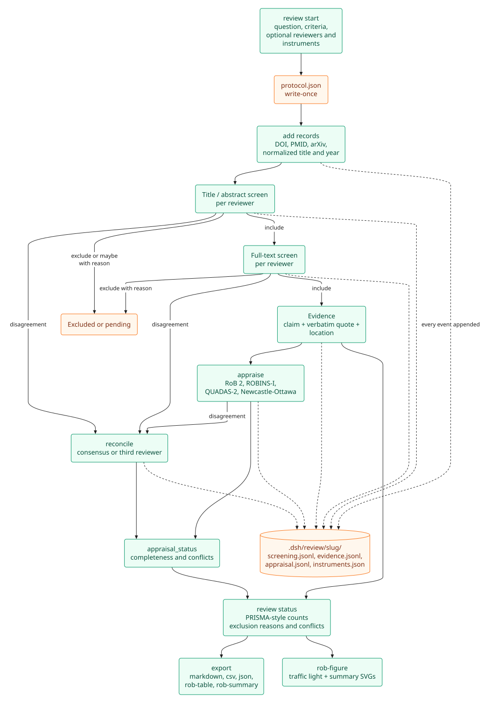
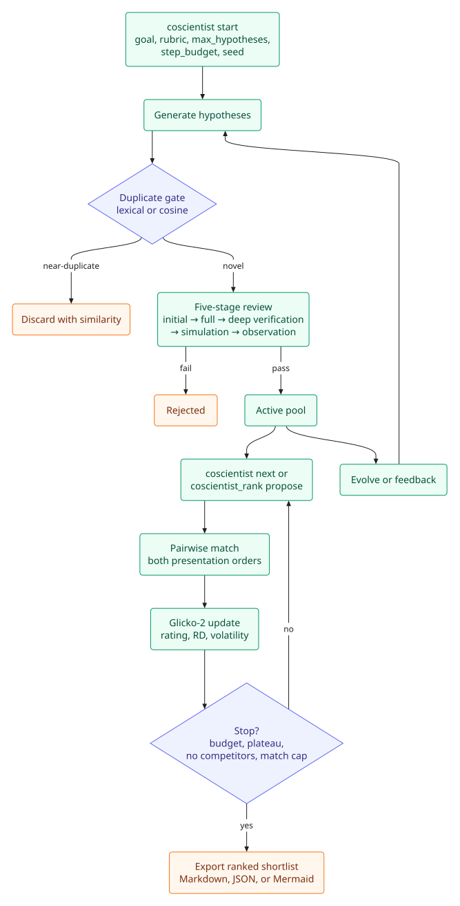

# Reviews, hypotheses, and research records

This page covers the local ledgers that keep work auditable past the context window: systematic reviews, meta-analysis, hypothesis tournaments, clinical and regulatory records, and dataset/venue/funder policy.

## Systematic reviews

`review` is a preset-only native tool — local, no key, no database — that keeps a systematic or scoping review auditable. State lives under `<cwd>/.dsh/review/<slug>/` as append-only JSONL event logs plus a write-once `protocol.json`; the current state is derived from the log, so concurrent subagent writes cannot corrupt it and overrides keep their history.

| Action | What it does |
|---|---|
| `start` | Question, databases, inclusion/exclusion criteria, date range, optional reviewer roster, risk-of-bias instruments, and an extraction template. Refuses to overwrite an existing review unless `resume: true`. |
| `add` | Records from a search tool's result array or a workspace JSON/JSONL file; deduplicates by DOI, PMID, arXiv ID, then normalized title+year, and logs every query in `search_log.jsonl`. |
| `screen` | `title_abstract` / `full_text` × `include` / `exclude` / `maybe`, per named reviewer. A full-text decision requires that reviewer's title/abstract include; exclude and maybe require a reason; re-screening requires `override: true` and replaces only that reviewer's event. With a declared roster, disagreements are reported as conflicts. |
| `evidence` | Only after a resolved full-text include; claim, verbatim quote, and location. The ledger stores the quote but does not verify it — PaperMemory `quote_check`/`trace` remains the verifier. |
| `extract` | One reviewer's structured extraction for an included record. A frozen template (`generic`, `pico`, `peco`, `diagnostic_accuracy`, `prognostic`, `qualitative`, or inline) defines required fields; `row_id` separates multiple outcomes/arms/comparisons. Field-level quotes are checked through PaperMemory when `paper` is supplied. |
| `extract_status` | Completeness per record/row/field, required-field gaps, field conflicts, and quote verification counts. |
| `appraise` | One risk-of-bias domain judgement per reviewer under a frozen instrument; quote and location required for decisive ratings (low/high, ROBINS-I low/critical, checklist yes/no); optional PaperMemory quote check; signalling answers stored as supporting detail. |
| `reconcile` | A consensus or third-reviewer decision over a screening, appraisal, or extraction disagreement, with a reason. The originals stay in the log. |
| `agreement` | Percent agreement and Cohen's κ (linear/quadratic weighted for ordinal appraisal scales, pairwise above two raters) per screening stage or appraisal domain. Human-vs-human is primary; AI pairs are separate. |
| `appraisal_status` | Per-instrument, per-record, per-domain completeness; missing reviewers; outstanding conflicts; appraisals outside the included population. |
| `status` | Records, query counts, PRISMA-style stage counts, per-reviewer counts and conflicts in dual mode, exclusion reasons, includes missing evidence. |
| `export` | `markdown` report skeleton, `csv` evidence table, `json` full ledger, `extraction-table`/`extraction-matrix` (Markdown or CSV), `extraction-json`, `prisma-flow` (SVG plus counts JSON), `grade-profile` (Markdown or CSV), `sof-table` (Markdown, CSV, or LaTeX), `rob-table`/`rob-summary` (Markdown or CSV), or `rob-figure` (two SVGs) under `exports/`; refuses to overwrite without `overwrite: true`. |

The tool never makes inclusion, extraction, appraisal, or consensus decisions — discovery stays in the search tools and every decision, value, and reason comes from the user or the stated criteria. Reviewer identities are typed `human:<name>` / `ai:<model>`; reviewer-less legacy events derive as `default`, so single-reviewer ledgers read as before. Extraction values are recorded, not inferred; missing required fields are counted, never filled; a field conflict is resolved only by a named `reconcile`. The `prisma-flow` export is labelled PRISMA-style and shows `not recorded` for missing counts rather than inventing zeroes. The `systematic-review-ledger` skill documents the workflow, and `risk-of-bias-appraisal` documents appraisal.

## Meta-analysis

`meta_analysis` is a preset-only native tool for pairwise synthesis. State lives under `<cwd>/.dsh/meta/<slug>/`: a write-once `protocol.json`, append-only `studies.jsonl` and `analyses.jsonl`, and `plots/` and `exports/`. The statistical work is in `python-helpers/meta_helper.py` (NumPy/SciPy); the ledger and protocol validation are in `meta-analysis.js` / `meta-analysis-store.js`.

| Action | What it does |
|---|---|
| `start` | Freeze the effect measure (`OR`, `RR`, `HR`, `IRR`, `MD`, `SMD`, `RD`, `ZR`), model (`fixed`/`random`), τ² method (`dl`/`pm`/`reml`), CI method (`normal`/`hartung_knapp`), and alpha. Refuses to overwrite unless `resume: true`. |
| `add` | Compute and append studies from raw 2×2, continuous, correlation, HR, diagnostic 2×2, or effect + CI/SE inputs. Duplicate ids are skipped; invalid studies are returned with reasons. |
| `effect_size` | Stateless conversion for one study; returns analysis-scale effect, SE, variance, display effect/CI, formula, and any zero-cell correction. |
| `pool` | Fixed or random pooling with the protocol methods; reports estimate, CI, weights, Q, df, p, I², H², τ², prediction interval, and warnings. A forest plot is written automatically. |
| `subgroup` | Pool within a metadata field and report the between-group Q test. Single-study groups are reported without pooling. |
| `meta_regression` | Method-of-moments residual τ², weighted least squares, normal or Hartung–Knapp CIs, Q_E, and a pseudo-R². Numeric covariates only. |
| `leave_one_out` | Refit without each study and report the change. |
| `publication_bias` | Egger's intercept test, Begg's rank correlation, and a funnel plot. Warns below 10 studies. Trim-and-fill is not implemented in this release. |
| `diagnostic` | 2×2 diagnostic studies; pools logit sensitivity and specificity separately, reports DOR, and writes a study-point SROC. Bivariate/HSROC is not implemented in this release. |
| `plot` | `forest`, `funnel`, or `sroc` SVG from the latest or named analysis. |
| `report` | Markdown methods/results skeleton with the recorded numbers. |
| `import_review` | Import complete rows from a review extraction table; conflicted, incomplete, outcome/measure-mismatched, or missing-effect/CI rows are skipped with reasons. Default field mapping matches the PICO template. |
| `status` / `list` / `show` / `export` | Ledger status, analysis index, one analysis, or `json`/`csv`/`report`/`forest`/`funnel`/`sroc` exports. |

The tool reports computed estimates, model assumptions, heterogeneity, and warnings. It never labels a result significant, effective, certain, or clinically recommended. The protocol is write-once; explicit per-analysis overrides are recorded in `analyses.jsonl`. Ratio measures are pooled on the log scale and displayed back-transformed. For generic ratio inputs, pass `log_effect`/`log_se` or an effect with a confidence interval; continuous measures accept an effect + SE or CI. A prediction interval needs at least three studies; Hartung–Knapp with two studies is very conservative.

The pairwise core is validated against the published BCG vaccine example: fixed-effect log RR = −0.43214 (SE 0.04057), DL random-effects = −0.71408 (SE 0.17866, τ² 0.30840), PM = −0.71497 (SE 0.18089, τ² 0.31808), and REML = −0.71453 (SE 0.17978, τ² 0.31325), with the subgroup Q-between matching the published example (Q = 1.946, p = 0.163). `scripts/test-meta-analysis.mjs` covers these values, effect-size conversions, plots, the ledger flow, diagnostic pooling, and review import. Load the `meta-analysis` skill for the workflow.

## GRADE certainty

GRADE lives inside the existing `review` ledger: `<cwd>/.dsh/review/<slug>/grade.json` is a write-once outcome definition and `grade.jsonl` is an append-only judgement log (`g0001`, …). The `grade-certainty` skill documents the workflow.

| Action | What it does |
|---|---|
| `grade_start` | Define outcomes/comparisons: id, name, importance, study count or ids, participants, effect/CI/measure, and notes. Refuses to overwrite unless `resume: true`. |
| `grade_judge` | Record one named reviewer's domain rating with a required reason. Downgrade domains: `risk_of_bias`, `inconsistency`, `indirectness`, `imprecision`, `publication_bias` (`not_serious`/`serious`/`very_serious`). Observational upgrade domains: `large_effect`, `dose_response`, `plausible_confounding` (`upgrade`/`not_applicable`). An optional quote needs a location and is checked through PaperMemory when `paper` is supplied. |
| `grade_overall` | Record a human overall certainty (`high`, `moderate`, `low`, `very_low`) with a reason. |
| `grade_status` | Per outcome: domain states, missing reviewers, conflicts, missing domains, a derived suggestion, and stored overalls. |
| `export` | `grade-profile` (Markdown/CSV) and `sof-table` (Markdown/CSV/LaTeX). |

The suggestion starts at high, subtracts one level for each `serious` and two for each `very_serious` downgrade domain, adds one for each `upgrade`, and maps the score to high/moderate/low/very low. It is **derived and not stored**; the stored overall is the human decision. With two or more declared reviewers, a domain is incomplete until every reviewer judges it, and differing ratings are a conflict. Differing overalls are also a conflict, and the SoF export shows `conflict` instead of choosing one. A stored overall that differs from the suggestion is flagged, never overwritten. Exports report recorded certainty judgements and never a quality, recommendation, or "high quality" verdict. `scripts/test-grade.mjs` covers single- and dual-reviewer flows, conflicts, missing reviewers, quote verification, overrides, and all three SoF formats.

## Risk-of-bias appraisal

`review appraise` records a reviewer's judgement for one instrument domain. Eleven instruments ship as paraphrased, versioned templates under `appraisal/<id>/<version>.json` with links to the official sources:

| Instrument | Study design | Domains | Judgements |
|---|---|---|---|
| RoB 2 (2019) | randomised trial | 5 + derived overall | low / some concerns / high |
| ROBINS-I v1 | non-randomised intervention | 7 + derived overall | low / moderate / serious / critical / no information |
| QUADAS-2 (2011) | diagnostic accuracy | 4 domains, 7 risk-of-bias/applicability cells | low / unclear / high |
| Newcastle-Ottawa | cohort or case-control | 3 star-count domains | 0–4, 0–2, 0–3; total reported as a count |
| AMSTAR 2 (2017) | systematic review of intervention | 16 item domains, critical items flagged in the notes | yes / partial yes / no |
| PROBAST (2019) | prediction model | 4 domains, 7 risk-of-bias/applicability cells | low / unclear / high |
| QUIPS (2011) | prognostic-factor cohort | 6 domains | low / unclear / moderate / high |
| SYRCLE (2014) | animal intervention | 6 domains including external validity | low / unclear / high |
| CASP cohort / case-control / qualitative | design-specific checklists | 9–10 consolidated questions | yes / can't tell / no |

The full instrument definition is frozen into `.dsh/review/<slug>/instruments.json` at `start` or on first use; a second version of the same instrument is rejected, so a running review cannot change its rubric. Evidence rules:

- `low`/`high` (RoB 2, QUADAS-2, PROBAST, SYRCLE), `low`/`moderate`/`high` (QUIPS), `low`/`critical` (ROBINS-I), and `yes`/`no` (AMSTAR 2, CASP) need a verbatim quote and location. With a PaperMemory `paper`, the quote is re-found through `papermemory_quote_check`. A quote absent from a resolved paper is rejected and not stored; a match only in the bibliography is rejected. If the paper cannot be resolved or the check fails, the event is stored `unverified` with the reason. Without `paper`, it is stored `unverified`.
- Signalling answers are supporting detail. The official answer-to-judgement algorithms are not implemented; the tool never converts an answer into a judgement.
- A declared reviewer roster is the appraisal panel: every declared reviewer must judge every domain before a record counts as complete, and `appraisal_status` lists the missing reviewers. Without a roster, the active appraisers on included records are the panel.
- The RoB 2 and ROBINS-I overall is derived from the resolved domains (any high → high; otherwise any some concerns → some concerns; ROBINS-I uses the worst domain, with no_information between moderate and serious). It is marked derived and never stored. An explicit `domain: "overall"` override requires a reason.
- QUADAS-2, Newcastle-Ottawa, AMSTAR 2, PROBAST, QUIPS, SYRCLE, and the CASP checklists have no derived overall; report the domain cells and the NOS star total. AMSTAR 2's official confidence rating counts critical flaws rather than taking a worst domain, and PROBAST, QUIPS, SYRCLE, and CASP discourage aggregate scores, so none of these derives one.

A disagreement is a first-class state: `appraisal_status` lists it, `reconcile` records the consensus or third-reviewer decision with a reason, and a later disagreeing appraisal reopens it. `agreement` computes percent agreement and κ with an approximate 95% CI, reports N and dropped ratings, and emits caveats for skewed marginals, small samples, and clipped intervals. Human κ never includes AI judgements; AI-vs-human and AI-vs-AI pairs are reported separately. For more than two human raters, agreement is pairwise; Fleiss' κ is not implemented.

`rob-figure` renders `rob-traffic-light.svg` and `rob-summary.svg` through `python-helpers/rob_figure.py`, which needs the helper environment (`cd python-helpers && uv sync`). The table and CSV name the reviewers behind each resolved row, the reviewer whose consensus decision resolved a disagreement, and the unverified-quote count; the figure note repeats all three, and AI reviewers keep their `ai:` prefix. The exports contain recorded judgements and completeness counts; they never say "low risk", "high quality", or "compliant". Load the `risk-of-bias-appraisal` skill for the full workflow.

## Hypothesis tournaments

`coscientist` and `coscientist_rank` are preset-only native tools — local state, no key, no database, no new dependency — for a ranked hypothesis shortlist that has to survive past this context window.

State lives under `<cwd>/.dsh/coscientist/<slug>/` as append-only `events.jsonl` / `matches.jsonl` logs plus a write-once `protocol.json`; the leaderboard is derived from the log, so a resumed session sees exactly the ratings it left behind, and concurrent subagent writes cannot corrupt it. It has the same shape as [Systematic reviews](#systematic-reviews), and the shared `.lock` implementation comes from there.

### `coscientist`

| Action | What it does |
|---|---|
| `start` | Goal, constraints, rubric, `max_hypotheses`, `step_budget`, `max_matches`, `seed`; defaults **5 hypotheses / 36 steps** — a ranked shortlist sized so two losses still leave three ideas competing, and a budget that lets the Elo plateau rule actually fire rather than ending on the cap. `max_matches` enforces an explicit user stop bound such as one match per pair. |
| `add` | Add a hypothesis; a near-duplicate is discarded with its similarity score, and a cap-reached add is discarded. |
| `review` | Five stages: `initial` → `full` → `deep_verification` → `simulation` → `observation`. Stages refuse to run out of order; a `fail` at `initial`/`full` rejects the hypothesis. |
| `safety` | Record a dual-use classification; the tool withholds it when the severity meets the threshold. |
| `status` | Ranked leaderboard. |
| `next` | Which task the scheduling policy samples now; it never samples a task the ledger cannot run and stops at the match cap. |
| `set_status` | Reject or release a withholding, always with a reason. |
| `lineage` | Hypothesis ancestry. |
| `design_protocol` | A protocol for testing the leading hypothesis. |
| `synthesize` | Combine compatible hypotheses. |
| `export` | `markdown` / `json` / `mermaid`. |
| `graph` | Mermaid diagram of lineage, similarity, and claim→paper support, written with `export format: mermaid` and rasterised by [`mermaid_render`](WRITING.md#mermaid-diagrams). |
| `priors` | Prior feedback, rejections, and withholdings from **other tournaments in this workspace**, ranked against the goal — read from their own logs, so nothing is duplicated and nothing can disagree with a ledger. |
| `embed` | Opt-in Gemini embeddings that switch the duplicate gate and similarity from lexical overlap to cosine, at upstream's 0.92 / 0.70 thresholds. `embed` is the only tournament call that needs a key or the network, and it reuses `GEMINI_API_KEY` from [Image generation](WRITING.md#image-generation). |

`zvec-grep` cannot supply embeddings: `zg query --vector` embeds a search query and never returns a vector. That is why `coscientist embed` uses the Gemini endpoint the plugin already uses for images.

### `coscientist_rank`

| Action | What it does |
|---|---|
| `propose` | A pair that has never met first, then the most uncertain hypothesis against a similar one. Reports `pair_matches_played` and `unplayed_pairs_remaining`. |
| `record` | A judged pair, both presentation orders, judged sequentially with the same brief. |
| `compare` | Compare two hypotheses. |
| `similarity` | Report the measure behind a similarity score. |
| `feedback` | An experimental result as a reward. |
| `history` | Match history. |

### Ratings and decisions

Ratings are Glicko-2 (rating + RD + volatility), seeded from review scores and tightened by matches, with a zero-sum update per pair. Citation integrity applies a soft penalty rather than a veto, and an experimental result moves a rating only through `coscientist_rank feedback`.

Similarity always reports which measure produced it: a 0.70 lexical score and a 0.70 cosine are not the same claim, and a partially embedded pool is called **mixed** rather than blended.

The tools decide what the code decides:

- a near-duplicate `add` is discarded with its similarity score,
- a cap-reached `add` is discarded,
- review stages refuse to run out of order,
- a `fail` at `initial`/`full` rejects the hypothesis,
- only `active` hypotheses may compete,
- a verdict that follows the presentation order counts as a draw,
- `next` reports when to stop: step budget, no pair left to play, Elo plateau, or cap ranked.

Neither tool calls a model — the session does the reasoning, normally through `subagent`, so the cost of a tournament is debate matches.

Hypotheses generated this way recombine published knowledge: they are not results, an unverified citation stays `[VERIFY]`, and a withheld dual-use idea stays withheld until the user releases it by name. The `co-scientist-tournament` skill carries the loop, the subagent briefs, and the budget defaults. For one round of ideation, use `generating-scientific-hypotheses` instead (see [Skills](SKILLS.md)).

Defaults and restart behavior for tournament settings are in [Configuration](CONFIGURATION.md#hypothesis-tournaments).

## Clinical and regulatory evidence

Two preset-only native tools cover records that are not journal literature:

- `clinicaltrials` — ClinicalTrials.gov API v2, free and keyless. `search` filters by `query` (free text), `condition`, `intervention`, `phase`, `status`, and `study_type`, returns normalized trials (NCT id, status, phase, enrollment, sponsor, conditions, interventions, endpoints, locations, `has_results`) and a `next_page_token`. `get` reads one NCT id; `include_results: true` adds posted outcome measures and adverse-event counts.
- `openfda` — openFDA, free and keyless with a low shared daily quota (`OPENFDA_API_KEY` raises it; a 429 means the quota is exhausted). One `search` action over an allowlisted endpoint: `drug/event`, `drug/enforcement`, `device/event`, `device/510k`, `drug/label`, or `food/event`. The openFDA search expression is passed through unchanged, records are compacted per endpoint, and every response carries the source query URL. A no-match search is an empty result, not an error.

Both are informational only — no medical or legal advice — and neither is a literature search: cite NCT ids/report numbers as registry evidence, not as peer-reviewed findings.

## Datasets and policy

- **`dataset_search`** — DataCite dataset discovery (`query`, `repository`, `year`, cursor paging) with DOI, title, creators, publisher, version, license, and landing URL. `get` reads one DOI; `files` lists file names/sizes/download URLs for Zenodo and Figshare DOIs and returns the landing URL for other repositories. Free, keyless, and no downloads. Optional `ZENODO_API_KEY`, `FIGSHARE_API_KEY`, and `DATACITE_API_KEY` are sent as auth headers when set (public data works without them).
- **`journal_policy`** — venue policy from DOAJ (listing, APC, license, OA start year; keyless) plus Sherpa Romeo (preprint/postprint/published permissions, embargo, conditions; needs `SHERPA_ROMERO_API_KEY`). Without the key the result is DOAJ-only with an explicit `key_not_set` note. An unknown journal is `not_found`, an ambiguous title returns candidate ISSNs, and a failed lookup is `unknown` — never reported as "not listed".
- **`funder_policy`** — OpenAlex funder identity (canonical name, alternate titles, country, award/works counts; keyless) plus Sherpa Juliet per-version OA policy (embargo, license, conditions) when `SHERPA_ROMERO_API_KEY` is set. Without the key it returns the identity and `key_not_set`; it never guesses a funder's policy.

These are compliance/discovery aids: cite dataset DOIs, never infer a license or APC, and treat policy output as compliance information rather than legal advice.

## Study planning

`power_analysis` is for designing a study before data exist. It runs locally (NumPy and SciPy; no key, no network) and never replaces a statistician on a complex design.

| Action | What it does |
|---|---|
| `power` | Solve for `n`, `power`, the smallest detectable `effect_size`, or `alpha`. Tests: one-sample, paired, and two-sample t (pooled or Welch), one- and two-proportion, one-way ANOVA, chi-square, correlation (Fisher z), multiple regression (f²), log-rank (events), equivalence (TOST) and non-inferiority for means. |
| `sensitivity` | The smallest effect a given n can detect at the stated power, or a power table over a grid of n and effect sizes. |
| `effect_size` | Convert between d, r, f, f², η², odds ratio, h, and w; compute them from means and SDs (with Hedges' g and an approximate interval), t, F, χ², or two proportions. |
| `correct` | Bonferroni, Holm, Hochberg, Benjamini–Hochberg, Benjamini–Yekutieli adjusted p-values, and the per-test alpha to plan with. |
| `simulate` | Monte-Carlo power for two groups (normal or heavy-tailed; Student, Welch, or Mann–Whitney), paired data, two proportions, cluster-randomised two-arm designs, and correlations. A `seed` is required so a run can be reproduced; the result carries its Monte-Carlo error. |
| `diagnostic_precision` | Cases (and total participants, given prevalence) needed to estimate a sensitivity or specificity to a chosen interval half-width. |

Rules the tool enforces:

- **An assumed effect size must say where it came from** (`effect_source`): `pilot`, `literature` (with `source_ref`, a DOI or PaperMemory id), `smallest_effect_of_interest`, or `convention`. A convention is accepted and labelled as one in the output; it is not evidence about the study.
- **No post-hoc power.** Power computed from the effect observed in the same study is refused with an explanation, because it is a function of the p-value. Use `sensitivity` or a confidence interval.
- **Round up, and show both.** The result gives the unrounded n, the integer n, and the power the integer n achieves. Dropout and clustering (design effect) are reported as a separate enrolment target, not folded into the analytic n.
- **Assumptions are echoed** in every result (test, tails, alpha, variance, allocation, method, software versions).

Closed-form results are checked against published reference values (Cohen's tables, G*Power, and the R `pwr` documentation) in `scripts/test-power.mjs`, and simulations are checked against the closed form within Monte-Carlo error. Two approximations are labelled in the output: the Welch degrees of freedom, and Schuirmann's TOST approximation (confirm a final equivalence design with `simulate`). The correlation test uses Fisher's z with the small-sample correction, which can differ from G*Power's exact test by one. The `power-and-sample-size` skill walks through the workflow.

## Related

- [Search](SEARCH.md) — discovery and publication status.
- [Writing](WRITING.md) — the writing oracle, citation, and figures.
- [Optional tools](OPTIONAL-TOOLS.md) — grants, patents, OpenReview, author identity, statistical and figure audits.
- [Configuration](CONFIGURATION.md) — tournament and policy keys.
