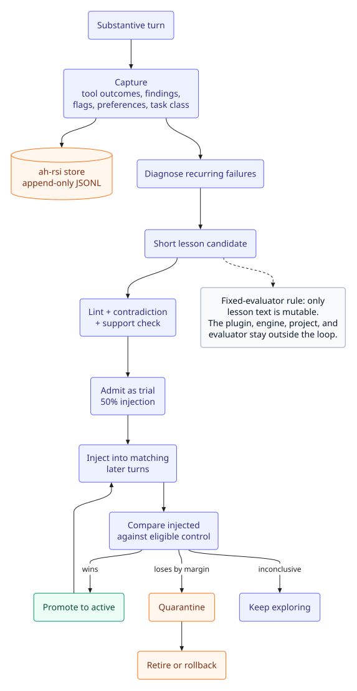

# Local recursive self-improvement (RSI)

System name: **OPAL** (Oracle-Preserving Autonomous Lessons). The implementation layer is also referred to as Local-RSI.

Status: implemented in v0.20.0. Local-only, autonomous, reversible. The loop
learns short lessons about how to do research work; it does not rewrite the
plugin or the evaluator.



Part of the [Academic Harness documentation](README.md). For the in-session tool and the offline CLI, see [Commands](#commands); for the writing engine that produces many of the signals, see [Writing](WRITING.md#academic-harness-engine).

## What it does

The academic preset captures structured outcome signals from every turn:

- tool errors, retries, and result sizes
- `ah` audit/check findings and gate handoffs
- citation, integrity, statistical, figure, and reproducibility flags
- explicit user preferences and correction markers
- task class (literature, hypothesis, experiment, data analysis, statistics,
  manuscript, grant, review response, reproducibility, data management)

It clusters recurring failures, turns each cluster into a short lesson using a
remedy catalogue, validates the lesson locally, and admits it automatically.
Accepted lessons are injected into later turns that match the same task class.
Trials are compared against eligible turns where the lesson was not injected;
the loop auto-promotes a winner, keeps exploring inconclusive lessons, and
quarantines or retires a lesson that loses. There is no author-approval step.

## Autonomy boundary

The mutable surface is lesson text in `$DSH_HOME/ah-rsi`. The following stay
outside the loop:

- plugin source, `prompt.js`, hooks, and tool registrations
- the vendored `ah` engine and its audit/check code
- project files, the paper ledger, snapshots, and protected paths
- the RSI evaluator, admission policy, benchmark manifests, and lint rules

This is the fixed-evaluator rule: the candidate cannot edit the thing that
grades it. Executable or oracle changes require normal development, review,
and release, not runtime self-modification.

## Plugin-layer scope

The plugin implements the seven core layers for lesson-level interpreted state:

| Layer | Status |
|---|---|
| Capture | Implemented: hooks, gate bus, structured outcomes |
| Experience store | Implemented: append-only JSONL, oracle manifest, risk metadata |
| Diagnosis/proposal | Implemented: signal clustering and remedy catalogue; learned proposer deferred |
| Frozen evaluator | Implemented for deterministic checks; formal production holdout deferred |
| Admission | Implemented: trial/control, caps, TTL, promotion, quarantine, retirement, rollback |
| Activation | Implemented for lessons: task-class injection, token budget, reached proxy; versioned skills deferred |
| Observability | Implemented: status, report, cost, reached, risk tiers, decisions, export, purge |

Risk tiers: T0 observe and T1 local lessons are implemented and autonomous. T2 local skills/policies are deferred. T3 global prompt/skill changes and T4 executable/evaluator changes are out of scope. The mutable surface remains lesson text.

## Loop

```text
turn -> capture -> episode signals -> diagnose -> lesson candidate
     -> lint / contradiction / support check -> admit (trial)
     -> inject into matching later turns -> compare injected vs control
     -> promote / keep / quarantine / retire -> repeat
```

Each turn records the injected token count, an oracle manifest (plugin, engine, prompt, hook, and audit hashes), and a reached-action proxy: a lesson is marked reached when its prescribed action tool is invoked in the same turn. Reached is not adherence; it is the cheapest available signal that the lesson's changed path was at least entered.

A new lesson starts as `trial` with a 50% injection probability. After at
least 5 injected and 3 control episodes, the loop compares success rates with
a margin derived from the standard error. Active lessons keep a 10% randomized
control sample (`active_control_rate`) so the same comparison can still detect
a regression; an active lesson that loses to control by the margin is
quarantined. Lessons that never beat control are retired after 12 injected and
6 control episodes. Explicit user preferences start `active` and are exempt
from statistical retirement; they end only when the user forgets or
contradicts them, and they are not held out as controls.

## Store

```text
$DSH_HOME/ah-rsi/              # override with AH_RSI_STORE
  config.json                  # mode, caps, exploration, TTL
  meta.json                    # last diagnosis
  lessons.jsonl                # append-only lesson snapshots
  episodes.jsonl               # one substantive turn per line
  events.jsonl                 # user turns, tools, injections, gates
  decisions.jsonl              # admit / reject / promote / quarantine / retire
  benchmarks/projects.jsonl    # real audit snapshots
  # episodes also carry injected_tokens, lesson_ids_reached, and an oracle manifest
  # lessons carry target, risk_tier, requires_release, and reached statistics
```

`lessons.jsonl` is append-only; the latest snapshot per id is current state.
All writes take a short directory lock so concurrent subagents cannot corrupt
the store. The store is local and never uploaded. Events keep hashes, counts, tool names, and
short structured signals; they do not keep full user messages or manuscript
text. Explicit preferences are stored as the lesson text the user
asked to remember.

## Task classes and remedies

The classifier is deterministic keyword scoring. The remedy catalogue covers:

| Signal | Typical lesson |
|---|---|
| `finding:NUM-*` | run `ah_sweep` and `ah_check` after a fact change |
| `finding:BIB-*` / `CITE-*` | resolve identifiers, run `integrity_check`, then `manuscript_citations` |
| `finding:STR-*` / `UNIT-*` | keep `%% @unit` anchors with their paragraphs; run `ah_units` |
| `finding:COH` | read the flagged clause against its source; T3 is advisory |
| `stat_flag` / `finding:STAT` | run `stat_audit`; report test, N, effect size, CI |
| `figure_flag` | run `figure_audit` before finalizing |
| `repo_flag` | run `repo_audit` and record the environment |
| `integrity:retracted` | never present a retracted paper as current evidence |
| `integrity:unknown` | report unknown; never treat it as clean |
| `error:latex_compile` | read the first LaTeX error; do not switch to raw `pdflatex` |
| `error:citation` | validate the bibliography before export |
| `retry:*` | read the error and correct inputs; do not repeat the call |
| `handoff:*` | audit once at the start; fix only findings your edits introduce |
| `task_failure:<class>` / `correction:<class>` | load the matching research workflow skill |

## Evaluation and honesty

`academic-harness-rsi benchmark synthetic` is a fast, deterministic test of the
pipeline: fixture episodes must produce the expected remedies, unsafe lessons
must be rejected, injection must format correctly, and the promotion/rollback
policy must fire.

`benchmark replay` reports observational statistics over captured episodes (including injected tokens and reached counts):
task-class success and quality, top signals, lesson injected/control rates,
recent decisions, and real audit snapshots. It does **not** establish causality.
The online injected-versus-control comparison is a local heuristic, not a
distribution-free PAC guarantee; small samples, correlated tasks, model drift,
and judge choice all limit it. Do not claim "RSI improved my research" from a
handful of turns. Use held-out or controlled evaluation before making that
claim.

`benchmark snapshot --project PATH` runs a real `ah audit` and records a
longitudinal baseline for a manuscript project. It stores finding counts and
gate state, not manuscript text.

`benchmark defects --project PATH` copies a real manuscript tree, injects four
known LaTeX defects (missing citation key, missing `\ref` target, duplicate
label, removed `%% @unit` anchor), runs the real `ah audit` on the copy, and
reports the new check ids plus whether the active/trial lessons cover them.
It tests the oracle and the remedy catalogue, not the model's ability to fix
the defects, and it never modifies the original project.

The system paper and corpus evaluation live in
[`paper/rsi-local/`](../paper/rsi-local/).

## Commands

```bash
academic-harness-rsi status
academic-harness-rsi report
academic-harness-rsi lessons --status active
academic-harness-rsi diagnose
academic-harness-rsi inject --task-class statistics
academic-harness-rsi feedback --text "Always cite primary sources"
academic-harness-rsi forget --id L...
academic-harness-rsi rollback --id L...
academic-harness-rsi benchmark synthetic
academic-harness-rsi benchmark replay
academic-harness-rsi benchmark defects --project ~/papers/my-paper
academic-harness-rsi benchmark snapshot --project ~/papers/my-paper
academic-harness-rsi export --out rsi-export.json
academic-harness-rsi purge --yes
```

Inside a DSH session, use the `ah_rsi` tool for status, report, lessons,
diagnose, forget, rollback, and injection preview. Explicit user preferences are captured
from the user's own message by the hook; `ah_rsi` deliberately has no feedback
action, so the model cannot invent a durable preference. The offline CLI
`feedback` command is the manual path and requires a durable cue (always,
never, from now on, remember, prefer, make sure, or an imperative do not/don't). `ah_rsi` is not author-gated because the
loop is autonomous; `ah_author` remains the gate for the writing oracle.

## Configuration

| Variable / field | Default | Meaning |
|---|---|---|
| `AH_RSI` | `auto` | `off`, `observe` (capture only), or `auto` (capture + inject + admit) |
| `AH_RSI_STORE` | `$DSH_HOME/ah-rsi` | local store path |
| `AH_RSI_EXPLORATION` | `0.5` | trial injection probability |
| `AH_RSI_CONTROL` | `0.1` | fraction of eligible active lessons held back as a control sample |
| `AH_RSI_MAX_LESSONS` | `12` | cap on active/trial/candidate lessons |
| `AH_RSI_MAX_TOKENS` | `600` | injection token budget |
| `AH_RSI_REMOTE` | `0` | opt-in remote veto judge; off by default |
| `AH_RSI_JUDGE_URL` | unset | OpenAI-compatible chat-completions URL for the remote judge |
| `AH_RSI_JUDGE_KEY` | unset | bearer token for the remote judge |
| `AH_RSI_JUDGE_MODEL` | `gpt-4o-mini` | model name sent to the remote judge |

`config.json` holds the same fields plus `min_evidence`, `min_sessions`,
`max_per_class`, `max_inject`, `diagnose_every`, and `lesson_ttl_days`.

## Privacy and safety

- Local-only by default; no network calls unless `AH_RSI_REMOTE=1`.
- The opt-in remote judge is veto-only, receives lesson text, task class, action, and evidence counts (never manuscript text), and fails open to the local decision.
- Remote judge failures are recorded in `remote_errors` but never block local learning or the writing loop.
- Events store hashes/counts and redacted snippets, not full messages.
- Learned text is linted: no prompt-injection phrases, secrets, URLs, shell
  commands, package installs, or instructions to weaken checks.
- Lessons are injected as a clearly marked plugin message, never as system or
  project rules, and never as evidence.
- The store can be exported or purged at any time.
- A lesson that appears to cause regressions is quarantined automatically and
  can be forgotten explicitly.

## Limits

- The judge is heuristic; it sees tool outcomes and corrections, not ground
  truth about research quality.
- Small local samples make promotion noisy; trial injection is intentionally
  exploratory.
- Task classes are keyword-based and will misclassify some requests.
- Cross-model transfer is not assumed; lessons are revalidated on use but are
  not yet scoped per model.
- Synthetic benchmarks test the learning pipeline, not the model's research
  ability.
- The loop cannot improve executable code, the audit engine, or the evaluator
  by design.
