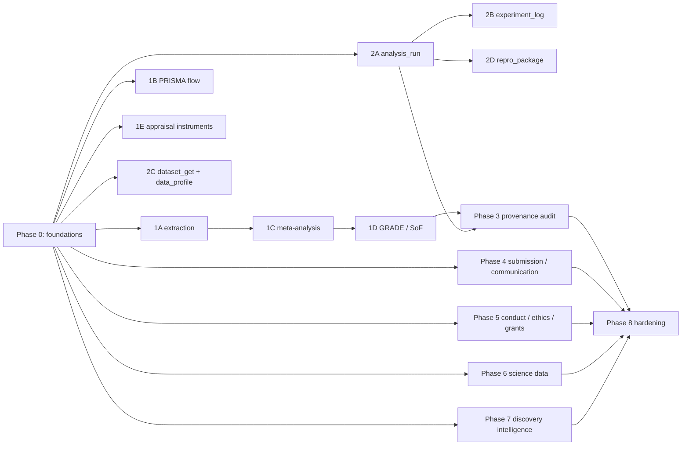

# Scientific Harness expansion plan

Status: **Phases 0, 1A–1E, 2A–2D, 3, and 4A–4F implemented**; Phases 0–3 were verified end-to-end through the DSH Web UI and released as **v0.34.0**; Phase 4 is released as **v0.35.0**; Phases 5–8 pending · baseline **v0.33.0**.

Implementation note: Phase 0 added `ledger-kit.js`, `provenance.js`, `schemas/`, and `scripts/helpers/test-workspace.mjs`. Phase 1A added `review extract`, `extract_status`, field-level extraction reconcile, built-in/inline templates, `row_id` rows, and extraction exports. Phase 1B added `review export format=prisma-flow` with a dependency-free `python-helpers/prisma_flow.py`. Phase 1C added `meta_analysis` with effect-size conversion, fixed/random DL/PM/REML pooling, normal/HK CIs, heterogeneity, subgroup/meta-regression, leave-one-out, Egger/Begg/funnel diagnostics, diagnostic-accuracy pooling, forest/funnel/SROC plots, and `import_review`. Phase 1C deviations: trim-and-fill, network meta-analysis, dose-response, and bivariate/HSROC diagnostic models remain deferred; diagnostic accuracy is univariate logit pooling. Phase 1D added `grade_start`, `grade_judge`, `grade_overall`, and `grade_status` to `review`, plus `grade-profile` and `sof-table` exports; the derived suggestion is never stored. Phase 1E added the AMSTAR 2, PROBAST, QUIPS, SYRCLE, and CASP instrument templates. Phases 2A–2D added `analysis_run`, `experiment_log`, `dataset_get`, `data_profile`, and `repro_package`. Phase 3 added `provenance_audit` (`provenance-audit.js`, `provenance-store.js`); its deviations are recorded in §6. Phase 4A added `submission_pack` (`submission-pack.js`, `submission-store.js`): plan/build/status/export with journal-requirement checks, manuscript citations, reporting evidence, `numbers_audit`, figure metadata, statements, a hashed manifest, and a reproducible zip. Phase 4B added `journal_search` `action=match` and custom CSL loading in `citation` (`style_file`/`style_url`, cached under `.dsh/styles/`). Phase 4C added `manuscript_diff` (latexdiff/Markdown diff, changed blocks, direct OOXML extraction of DOCX tracked changes/comments and Zotero fields, response-letter skeleton). Phase 4D added `presentation_build` (posters, Beamer, optional python-pptx, PDF/PNG, QA checklist). Phase 4E extended `python-helpers/stat_audit.py` with a `numbers` mode and added `numbers_audit`. Phase 4F added `authorship` (`authorship.js`, `authorship-store.js`). Phase 4 deviations: PowerPoint generation uses a small `python-pptx` helper rather than an existing skill script (the slides skills do not ship a deck generator); journal match does not call `journal_policy` per result (policy stays a separate tool); generic response letters are built from recorded change ids, while an `ah_review` id delegates to the engine's own response letter; table/text checks match only unambiguous labels, and GRIMMER remains unimplemented. Phases 5–8 are unchanged.

This document is the implementation roadmap for the gaps identified after v0.33.0. It is deliberately written in dependency order so each phase can ship on its own. Phases 0–3 are the core sequence; phases 4–7 are mostly independent after Phase 0 and can be reordered by demand; Phase 8 is continuous hardening.

The plan follows the rules already used by `review`, `reporting_check`, `deep_review`, and the `ah_*` engine:

> The model proposes. The tool verifies. The human decides.

Nothing in this plan should introduce a secret source of truth, a hidden decision, or an unverifiable verdict.

---

## 1. What this plan adds

The harness already covers discovery, paper memory, citation, LaTeX writing, reporting checklists, risk-of-bias appraisal, hypothesis tournaments, remote compute, and a local RSI loop. It stops at four boundaries:

1. **Synthesis.** A review can screen and appraise, but it cannot extract structured data, pool effects, rate certainty, or draw a PRISMA flow diagram.
2. **Reproducible analysis.** Skills describe the discipline; no native tool records an analysis run, its environment, its inputs, or its outputs.
3. **Provenance across ledgers.** PaperMemory, `ah_*`, `review`, `reporting_check`, `deep_review`, `notebook`, and `scientific_result` each keep excellent local state, but there is no cross-ledger audit.
4. **The submission and conduct edges.** The harness can compile a manuscript; it cannot package a submission, diff a revision, build a poster, freeze a preregistration, or size a grant budget.

The additions are grouped into nine phases:

| Phase | Theme | Main additions | Depends on |
|---|---|---|---|
| 0 | Shared foundations | Ledger helpers, IDs, schemas, test fixtures, shipping checklist | — |
| 1 | Systematic review synthesis | `review extract`, PRISMA flow, `meta_analysis`, GRADE/SoF, appraisal instruments | 0 |
| 2 | Reproducible analysis and data | `analysis_run`, `experiment_log`, `dataset_get`, `data_profile`, `repro_package` | 0 |
| 3 | Cross-ledger provenance | `provenance_audit` | 0, 1, 2 (read-only; can start earlier with partial data) |
| 4 | Submission and communication | `submission_pack`, `journal_search match`, `manuscript_diff`, `presentation_build`, `numbers_audit`, `authorship` | 0 (4A also benefits from 1D/2D) |
| 5 | Study conduct, ethics, grants | `preregister`, `causal_dag`, `design`, `ethics_protocol`, `deidentify`, `dmp`, `grant_budget` | 0 |
| 6 | Scientific data connectors | `science_source` adapters, `chem_toolkit`, `seq_toolkit`, `structure_toolkit` | 0 |
| 7 | Discovery and research intelligence | `literature_watch`, `citation_network`, `trial_registry_search`, `grey_literature_search`, `paper_artifacts`, `paper_recommend`, `citation audit`, clinical/regulatory signals | 0 |
| 8 | Hardening and adoption | Cross-platform, offline mode, sandboxing, evaluation suite, skill routing, performance, security review | all |

### Suggested implementation order

If you implement only the highest-value path:

1. **Phase 0** — foundations.
2. **Phase 1A + 1B** — structured extraction and PRISMA flow. These reuse the existing review ledger and close an obvious workflow gap immediately.
3. **Phase 1C + 1D** — meta-analysis and GRADE. This is the largest single addition; ship it separately.
4. **Phase 2A + 2C** — analysis runs, dataset download, data profiling.
5. **Phase 3** — provenance audit.
6. Choose Phase 4A (submission pack) or Phase 5A (preregistration) based on user demand.

Phases 6 and 7 can run in parallel with 4 and 5 once Phase 0 is stable.

### Phase dependency graph



---

## 2. Shared design rules

Every phase must follow these rules. They are not optional; they are what makes the harness trustworthy.

1. **Native, preset-only unless stated.** New academic tools are mounted in `presets/academic-harness/agent.cordis.yml` and generated into `cordis.patch.yml`. Bundle-level tools stay limited to the existing general-purpose surface.
2. **Action-multiplexed.** Prefer one tool with a clear `action` enum over many near-duplicate tools. Extend `review`, `citation`, `journal_search`, `openfda`, and `clinicaltrials` where the state already belongs there.
3. **Append-only state.** Protocols are write-once; events and runs are append-only. Corrections are new events with a reason. Derived state is computed from the log.
4. **Workspace-confined paths.** Every read and write resolves through `workspace-path.js`/`resolveWorkspacePath`; reject symlink and `..` escapes. New store helpers must use the same rule.
5. **Content hashes and provenance.** Every stored artifact gets a SHA-256; every run, export, and generated document records `tool`, `version`, `created_at`, inputs, outputs, and hashes.
6. **Evidence, not opinion.** A positive claim needs a verbatim quote, a stored result, or a recorded human judgement. A missing value is `unknown`/`not_recorded`, never inferred.
7. **No automatic verdicts.** GRADE certainty, risk of bias, inclusion, authorship order, journal fit, and submission readiness are human decisions. Tools may derive a suggestion and show the rule, but the recorded decision is human-owned.
8. **No external side effects without confirmation.** No manuscript, grant, or patent submission; no Zenodo/OSF/ClinicalTrials deposit; no email. Deposit actions require an explicit `confirm: true`, a token, and a preview.
9. **Local-first and key-optional.** No new key is required to boot or to use a local tool. Network sources report `key_missing`, `provider_blocked`, or `not_supported` rather than failing the session.
10. **Do not bypass access controls.** No paywall bypass, bot-challenge bypass, Google Scholar/PubPeer scraping, or bulk harvesting. If a source has no stable API, use `agent-browser` with user consent or leave it out.
11. **Additive compatibility.** Existing ledgers, actions, formats, and prompt behavior keep working. New fields are optional; new formats are additional.
12. **Prompt restraint.** New prompt sections are short (typically 4–8 bullets) and hand off detail to a skill. The prompt is already large; do not duplicate skill content.
13. **Shipping checklist.** Every new tool ships with: implementation, store/helper, preset row, package `exports`/`files`, prompt section, skill, `docs/TOOLS.md` row, guide section, `CHANGELOG.md` entry, golden test, and (if networked) a fixture/live-test note.

---

## 3. Phase 0 — shared foundations

**Goal.** Make the later phases cheap and consistent without refactoring existing tools.

### 0.1 Deliverables

| Deliverable | Purpose |
|---|---|
| `ledger-kit.js` | Shared helpers for new ledgers: append JSONL with lock, write-once JSON, stable stringify, SHA-256 of files/JSON, short hashes, CSV/Markdown escaping, export-with-overwrite-refusal, path assertion. Existing tools may adopt it later; do not refactor them in this phase. |
| `provenance.js` | ID and link conventions shared by Phase 3 and later tools: `paper:`, `quote:`, `unit:`, `claim:`, `record:`, `run:`, `result:`, `review:`, `prereg:`. |
| `schemas/` | Lightweight JSON examples (not a schema runtime) for extraction templates, analysis plans, run manifests, preregistrations, and submission manifests. Validate with explicit JS functions in the stores. |
| `scripts/helpers/test-workspace.mjs` | Temp-workspace fixture, fake `exec`, fake fetch, file assertions, cleanup. Optional for existing tests; required for new ones. |
| Shipping checklist | Add a reusable section to `docs/DEVELOPMENT.md` or this plan; each phase references it. |
| Test matrix | Add a table later in this document (§17) and keep it current. |

### 0.2 ID conventions

Use these prefixes consistently:

| Prefix | Owner | Example |
|---|---|---|
| `r0001` | review record | existing `review` ledger |
| `x0001` | extraction event | new Phase 1A |
| `m` / `ma` | meta-analysis study / analysis | Phase 1C |
| `run-` | analysis run | Phase 2A |
| `exp-` | experiment | Phase 2B |
| `ds-` | dataset download | Phase 2C |
| `prov-` | provenance report | Phase 3 |
| `sub-` | submission pack | Phase 4A |
| `pre-` | preregistration | Phase 5A |
| `dd-` | de-identification report | Phase 5D |
| `watch-` | watch | Phase 7A |
| `net-` | citation network | Phase 7B |

Content hashes are `sha256:<hex>`; display hashes are the first 16 hex characters. A link is only valid if both ends exist in their owner ledger. Missing ends are `unknown`, not inferred.

### 0.3 Files and wiring

New:

- `ledger-kit.js`
- `provenance.js`
- `schemas/` (examples only)
- `scripts/helpers/test-workspace.mjs`

Modified:

- `package.json` — export the two new modules.
- `docs/DEVELOPMENT.md` — link this plan and document the helper.
- `docs/README.md` — add this plan under Reference.

### 0.4 Acceptance

- `node scripts/test-ledger-kit.mjs` covers append/lock/write-once/hash/escape.
- Existing test suite passes unchanged.
- No existing ledger file format changes.
- A new tool can be scaffolded from the checklist in under an hour.

**Effort.** 3–5 engineering days.

---

## 4. Phase 1 — systematic review synthesis stack

This phase completes the review lifecycle:

```text
search → add → screen → extract → appraise → synthesize → GRADE → PRISMA flow/SoF → export
```

The existing ledger keeps screening, evidence, appraisal, agreement, and conflicts. Phase 1 adds the missing middle and end.

### 4.1 Phase 1A — structured data extraction (`review extract`)

**Goal.** Turn an included study into a structured row that can feed a meta-analysis, an evidence table, or a GRADE summary of findings. The existing `evidence` action stores a claim, quote, and location; it does not store PICO fields, sample size, effect estimates, or multiple outcomes/timepoints.

#### Actions

| Action | Behaviour |
|---|---|
| `start` | Existing action gains optional `extraction_template`: a built-in id (`generic`, `pico`, `peco`, `diagnostic_accuracy`, `prognostic`, `qualitative`) or an inline field list. Freeze the template into `extraction_template.json` on first use. |
| `extract` | Record one reviewer's extraction for one included record: `id`, `values`, `quotes` (field → quote/location), `paper`, `notes`, `override`. |
| `extract_status` | Completeness per record, per reviewer, and per field; unresolved field conflicts; records with no extraction. |
| `reconcile` | Existing action gains `scope: "extraction"` and `field`; record a consensus or third-reviewer value with a reason; originals stay. |
| `export` | New formats `extraction-table` (Markdown/CSV), `extraction-json`, and `extraction-matrix` (one row per study × outcome). |

#### Template contract

```json
{
  "template": "pico",
  "version": 1,
  "frozen_at": "2026-01-01T00:00:00Z",
  "fields": [
    { "id": "population", "label": "Population", "type": "text", "required": true },
    { "id": "intervention", "label": "Intervention", "type": "text", "required": true },
    { "id": "comparator", "label": "Comparator", "type": "text", "required": true },
    { "id": "outcome", "label": "Outcome", "type": "text", "required": true },
    { "id": "timepoint", "label": "Timepoint", "type": "text", "required": false },
    { "id": "design", "label": "Design", "type": "enum", "options": ["RCT", "cohort", "case-control", "cross-sectional", "other"], "required": true },
    { "id": "n", "label": "Sample size", "type": "number", "required": true },
    { "id": "effect", "label": "Effect estimate", "type": "number", "required": false },
    { "id": "effect_measure", "label": "Effect measure", "type": "enum", "options": ["OR", "RR", "HR", "MD", "SMD", "RD"], "required": false },
    { "id": "ci_low", "label": "CI lower", "type": "number", "required": false },
    { "id": "ci_high", "label": "CI upper", "type": "number", "required": false },
    { "id": "notes", "label": "Notes", "type": "text", "required": false }
  ]
}
```

#### Extraction event

```json
{
  "event": "extract",
  "extraction_id": "x0001",
  "record_id": "r0001",
  "reviewer": "human:alice",
  "values": {
    "population": "Adults with ...",
    "n": 412,
    "effect": 0.74,
    "effect_measure": "RR",
    "ci_low": 0.61,
    "ci_high": 0.90
  },
  "quotes": {
    "effect": { "quote": "RR 0.74 (95% CI 0.61–0.90)", "location": "Results, p. 4" }
  },
  "paper": "pm:...",
  "at": "2026-01-01T00:00:00Z"
}
```

#### Guardrails

- Never infer a field. Missing is `not_reported`, `not_applicable`, or `unknown`, and is counted as missing.
- Every effect estimate should carry a quote when `paper` is supplied; a quote that cannot be re-found is stored `unverified` with the reason, not silently accepted.
- Support multiple outcomes, timepoints, arms, and comparisons via `outcome_id`, `timepoint`, `arm`, and `comparison` fields; do not collapse them.
- Support direction/coding explicitly (`direction: "lower_is_better"` or a signed effect); never guess.
- Store original values and converted values separately; a conversion records the formula and source.
- Dual extraction is field-level: two reviewers can disagree on `n` while agreeing on `effect`; `reconcile` resolves only the field.
- No automatic conversion between effect measures. Use `meta_analysis effect_size` explicitly.
- Extraction is allowed only after a resolved full-text include, same as `evidence`.

#### Files

- `review-store.js` — template freeze/read, append extraction events, derive extraction status/conflicts, export tables.
- `review.js` — actions, parameters, rendering; extend `reconcile` and `export`.
- `prompt.js` — a short `### Structured extraction` subsection under `## Systematic reviews`.
- `skills/systematic-review-ledger/SKILL.md` — extraction workflow and field-level reconcile.
- `docs/RESEARCH.md` — actions and contracts.
- `docs/TOOLS.md` — update the `review` row.
- `scripts/test-review-extract.mjs` — new.
- `scripts/test-review-store.mjs` — extend.

#### Acceptance

- A template freezes on first use; a second different template is rejected. Start a new review for a different template.
- Two reviewers can extract the same record; conflicts are listed per field; `reconcile` resolves one field while preserving both originals.
- A missing required field is counted, not filled.
- A fabricated quote is rejected or stored `unverified` with a reason; an accepted quote is re-found in PaperMemory.
- `extraction-table` has one row per study × outcome; missing fields are blank and counted.
- Existing review actions and exports are unchanged.

**Effort.** 1–1.5 weeks.

---

### 4.2 Phase 1B — PRISMA flow diagram (`review export prisma-flow`)

**Goal.** Generate a publication-ready PRISMA-style flow diagram from the counts already in the ledger, without hand-drawing it.

#### Behaviour

- New `export` format `prisma-flow` writes `exports/prisma-flow.svg`, `exports/prisma-flow.json`, and optionally `exports/prisma-flow.png`.
- Counts come from `deriveStatus()` and `search_log.jsonl`:
  - records identified per database/source,
  - duplicates removed,
  - records screened and excluded with reasons,
  - full-text assessed and excluded with reasons,
  - included studies,
  - studies included in meta-analysis (when a linked `meta_analysis` exists),
  - ongoing/awaiting classification counts when recorded.
- Missing fields render as `not recorded` and are listed in a warning block; they are never fabricated.
- The JSON sidecar contains the exact counts, source queries, ledger hash, and timestamp; the SVG is reproducible from that JSON.

#### Guardrails

- Label the output **"PRISMA-style flow based on recorded ledger events"**; do not claim PRISMA compliance.
- Every box shows its count and its provenance (which ledger keys produced it).
- If a count is absent, show `not recorded`, not `0`.
- Excluded reasons are grouped exactly as recorded; no consolidation without a mapping table.

#### Files

- `python-helpers/prisma_flow.py` — JSON in, SVG/PNG out; matplotlib is already a helper dependency.
- `review-store.js` — `exportPrismaFlow`.
- `review.js` — `format: "prisma-flow"`.
- `docs/RESEARCH.md`, `docs/TOOLS.md`, `scripts/test-prisma-flow.mjs`.
- Optional `docs/diagrams/review-synthesis.mmd` and rendered SVG.

#### Acceptance

- Counts match `review status` exactly.
- A missing stage is `not_recorded`, not `0`.
- The SVG contains the ledger hash and timestamp.
- Overwrite refusal works like existing exports.
- The JSON sidecar can regenerate the SVG byte-for-byte.

**Effort.** 3–5 days.

---

### 4.3 Phase 1C — meta-analysis (`meta_analysis`)

**Goal.** A deterministic, auditable pairwise meta-analysis engine that consumes extracted review data and produces pooled estimates, heterogeneity, publication-bias diagnostics, and plots.

This is the largest single tool in the plan. Ship pairwise meta-analysis first; network meta-analysis and dose-response are later sub-phases.

#### Tool and scope

- New preset-only tool: `meta_analysis`.
- State: `<cwd>/.dsh/meta/<slug>/`.
  - `protocol.json` — write-once: question, outcome, effect measure, model, τ² estimator, CI method, alpha, subgroup plan, notes.
  - `studies.jsonl` — append-only study inputs.
  - `analyses.jsonl` — append-only computed analyses.
  - `plots/` — forest/funnel/SROC SVG/PNG.
  - `exports/` — CSV/JSON/Markdown.
- No key, no network, local Python helper.
- Can be used standalone or imported from a `review` extraction table.

#### Actions

| Action | Behaviour |
|---|---|
| `start` | Freeze the protocol: `slug`, `question`, `outcome`, `effect_measure`, `model` (`fixed`/`random`), `tau2_method` (`dl`/`reml`/`pm`), `ci_method` (`normal`/`hartung_knapp`), `alpha`, `subgroups`, `notes`. |
| `add` | Add studies with either a computed effect (`effect`, `se` or `ci`) or raw data (`binary` 2×2 or `continuous` means/SD/n). Deduplicates by study id/DOI. |
| `effect_size` | Convert/compute effect sizes: 2×2 → OR/RR/RD; means/SD → MD/SMD (Hedges' g); correlation → Fisher z; diagnostic 2×2 → sensitivity/specificity/DOR; HR with CI → log HR/SE. |
| `pool` | Fixed- or random-effects pooling with the protocol's method; outputs pooled estimate, CI, weights, Q, df, p, I², H², τ², prediction interval. |
| `subgroup` | Pool by a categorical field; test for subgroup differences. |
| `meta_regression` | Mixed-effects meta-regression on covariates; Knapp–Hartung; report R² analog and residual heterogeneity. |
| `leave_one_out` | Influence diagnostics; report each omitted-study estimate. |
| `publication_bias` | Egger's test; funnel-plot data; trim-and-fill when eligible. Warn when k < 10. |
| `diagnostic` | Bivariate/HSROC model for sensitivity/specificity; SROC curve; DOR. Warn when k is small. |
| `plot` | `forest`, `funnel`, `sroc`; SVG/PNG; labels, weights, heterogeneity annotation. |
| `report` | Methods/results skeleton with the actual numbers; no interpretation beyond the numbers. |
| `import_review` | Read a review extraction table, map fields to effects, refuse missing/incompatible fields and list them. |
| `status` / `list` / `show` / `export` | Ledger state and CSV/JSON/Markdown exports. |
| `network` (later) | Network meta-analysis; separate sub-phase, not in the first release. |
| `dose_response` (later) | Dose-response meta-analysis; separate sub-phase. |

#### Minimum input contract

```json
{
  "studies": [
    { "id": "S1", "label": "Smith 2020", "effect": 0.41, "se": 0.12, "n": 120, "rob": "some_concerns" },
    { "id": "S2", "label": "Lee 2021", "effect": 0.28, "ci_low": 0.05, "ci_high": 0.51, "n": 88 }
  ]
}
```

Raw binary/continuous forms are accepted by `add`/`effect_size`; the converted effect and its formula are stored alongside the original input.

#### Guardrails

- At least 2 studies to pool; warn below 5; publication-bias methods require k ≥ 10 unless the user explicitly overrides with a warning.
- Never pool different effect measures silently. Require one measure per analysis; conversions are explicit and logged.
- Never choose a model implicitly. `model` is required in the protocol; fixed and random results can both be reported.
- Report heterogeneity and the prediction interval, not just the pooled p-value.
- No automatic "significant", "effective", or certainty wording. Report numbers and method.
- Zero-cell corrections and continuity corrections must be stated and stored.
- Duplicate study ids/overlapping cohorts are flagged, not merged silently.
- REML convergence is reported; if it fails, return an error, not a fallback estimate.
- `publication_bias` output carries reporting-bias caveats; it is not proof of bias.
- `diagnostic` warns when k is too small for a stable bivariate model.
- All outputs echo the effect measure, model, τ² method, CI method, alpha, software/helper versions, and input hash.
- No network meta-analysis or dose-response in the first release; they require separate validation.

#### Statistical validation

Use fixtures derived from published examples with independently computed reference values (R `metafor`/RevMan or a second implementation):

- binary OR/RR fixed and random (DL and REML),
- continuous MD/SMD,
- Hartung–Knapp CIs,
- Q, I², τ², prediction interval,
- Egger/trim-and-fill,
- a diagnostic 2×2 example,
- zero-cell and missing-SE refusals.

Tolerance: 1e-6 for closed-form fixed effect; 1e-4 for iterative REML; 0.01 for plotted coordinates.

#### Files

- `meta-analysis.js`
- `meta-analysis-store.js`
- `python-helpers/meta_helper.py`
- `python-helpers/pyproject.toml` — add `statsmodels` (and `pandas` if not already added in Phase 2).
- `skills/meta-analysis/SKILL.md`
- `prompt.js` — a short `## Meta-analysis` section.
- `docs/RESEARCH.md`, `docs/TOOLS.md`, `docs/CONFIGURATION.md` if keys are ever added.
- `scripts/test-meta-analysis.mjs`
- `package.json` exports/files; preset row; generated `cordis.patch.yml`.

#### Acceptance

- Published-example fixtures match reference pooled estimates/heterogeneity within tolerance.
- `import_review` refuses missing/incompatible fields and lists them.
- A changed protocol is rejected unless a new version is started with a reason.
- Forest/funnel/SROC plots contain the expected rows/points and no clipped labels at realistic sizes.
- Refusal cases return actionable errors.
- No network call is made.

**Effort.** 3–4 weeks for the pairwise core; +2 weeks for diagnostic accuracy; network meta-analysis and dose-response are separate 4–6 week efforts.

---

### 4.4 Phase 1D — GRADE and summary-of-findings (`review grade`)

**Goal.** Record certainty judgements and produce an evidence profile and summary-of-findings table. GRADE is judgement-heavy, so the tool records human judgements and never invents a certainty rating.

#### Actions

| Action | Behaviour |
|---|---|
| `grade_start` | Define outcomes/comparisons; freeze `grade.json` (write-once). |
| `grade_judge` | Per outcome and domain (`risk_of_bias`, `inconsistency`, `indirectness`, `imprecision`, `publication_bias`): rating (`not_serious`, `serious`, `very_serious`), reason, optional quote/location; observational upgrades (`large_effect`, `dose_response`, `plausible_confounding`) are recorded separately. |
| `grade_overall` | Record a human certainty (`high`, `moderate`, `low`, `very_low`) with a reason. The tool shows the standard derivation as a suggestion; the human value is what is stored. |
| `grade_status` | Missing domains/outcomes; unreviewed suggestions; conflicts. |
| `export` | `grade-profile` (Markdown/CSV) and `sof-table` (Markdown/CSV/LaTeX). |

#### Guardrails

- No automatic certainty. A suggestion may be derived, but it is labelled **suggested** and requires a human `overall`.
- `serious`/`very_serious` requires a reason; a quote/location is required when the judgement rests on study evidence.
- Do not allow `high` certainty when a domain is recorded serious without an explicit override and reason.
- The SoF table reports study count, participants, effect, certainty, and comments; it never says "high quality" or "recommended".
- GRADE is versioned/cited; paraphrased prompts link to the official source; official wording is not bundled.

#### Files

- `review-store.js` — grade state and derivation.
- `review.js` — actions, `export` formats, rendering.
- `python-helpers/grade_tables.py` — optional SoF LaTeX/CSV formatter.
- `skills/evidence-synthesis/SKILL.md` or `skills/grade-certainty/SKILL.md`.
- `docs/RESEARCH.md`, `docs/TOOLS.md`.
- `scripts/test-grade.mjs`.

#### Acceptance

- A serious/very-serious rating without a reason is rejected.
- The suggestion follows the recorded rules; the stored overall is the human value.
- The SoF table counts match the included studies and outcomes.
- Exports never contain a compliance or recommendation label.
- Existing review exports are unchanged.

**Effort.** 1–1.5 weeks.

---

### 4.5 Phase 1E — additional appraisal instruments

> **Status: implemented (v0.34.0).** AMSTAR 2, PROBAST, QUIPS, SYRCLE, and consolidated CASP cohort/case-control/qualitative templates ship under `appraisal/`; JBI was left out (optional in this plan) because its checklists are design-specific and curation-heavy — a later increment can add variants under the same template contract.

**Goal.** Extend the existing `review appraise` library beyond RoB 2, ROBINS-I, QUADAS-2, and NOS.

Add versioned, paraphrased instruments:

| Instrument | Use |
|---|---|
| AMSTAR 2 | systematic reviews of interventions |
| PROBAST | prediction-model studies |
| QUIPS | prognostic-factor studies |
| SYRCLE | animal studies |
| CASP | qualitative, cohort, case-control, and diagnostic checklists (choose the applicable variant) |
| JBI | optional; design-specific critical-appraisal checklists |

Each instrument ships as `appraisal/<id>/<version>.json` with domains, judgements, signalling questions, source link, and a paraphrase. Extend `appraisal.js` derivation only where the official instrument defines it; otherwise report domain judgements without an overall.

#### Acceptance

- Template validation rejects unknown domains/judgements.
- Completeness and agreement work with the existing reviewer model.
- Exports use the existing `rob-table`/`rob-summary`/`rob-figure` paths where the instrument fits; otherwise a domain table.
- Official wording is not bundled; source links are present.

**Effort.** 1–2 weeks depending on the number of instruments.

---

## 5. Phase 2 — reproducible analysis and data layer

**Goal.** Turn the existing reproducibility skills into native, auditable runs. `notebook` and `scientific_result` record findings; this phase records the analysis that produced them.

### 5.1 Phase 2A — `analysis_run`

> **Status: implemented (v0.34.0).** Environment capture is done in JavaScript (interpreter probe, node/os/git) rather than a new `env_capture.py`; notebook execution shells out to jupyter nbconvert or papermill. Network-off is a recorded convention (`no_proxy=*`), not a firewall.

**Scope.** Preset-only. Local-first. No key. Uses the host's existing execution permission model; it is not a privilege escalation path.

#### Actions

| Action | Behaviour |
|---|---|
| `plan` | Create/freeze an analysis plan for a slug: question, hypotheses, data inputs, variables, primary/secondary outcomes, methods, alpha/corrections, missing-data rules, exclusions, stopping rules, software, seed, sensitivity analyses. |
| `run` | Execute a Python/R/shell script or a Jupyter notebook with the frozen plan; capture stdout/stderr, exit code, duration, environment, git commit, input/output hashes, and artifacts. |
| `status` / `list` / `show` | Ledger state and run details. |
| `diff` | Compare two runs or a run against the current plan: changed inputs, env, outputs, exit code. |
| `export` | Run report Markdown/JSON with plan, manifest, logs, environment, artifacts, and a "reproducibility evidence, not a guarantee" note. |

#### Run manifest

```json
{
  "run_id": "run-20260101T000000Z-a1b2c3",
  "slug": "primary-analysis",
  "plan_hash": "sha256:...",
  "command": "uv run python analysis/main.py",
  "kind": "python",
  "seed": 42,
  "inputs": [{ "path": "data/raw.csv", "sha256": "..." }],
  "outputs": [{ "path": "results/table1.csv", "sha256": "..." }],
  "environment": {
    "python": "3.13.x",
    "packages": "environment/python-freeze.txt",
    "r": null,
    "node": "v26.x",
    "os": "Linux ...",
    "git_commit": "..."
  },
  "exit_code": 0,
  "duration_ms": 12345,
  "stdout": "runs/<id>/stdout.log",
  "stderr": "runs/<id>/stderr.log",
  "artifacts": ["results/table1.csv", "results/figure1.pdf"]
}
```

#### Guardrails

- The plan is frozen at the first `run`. Changing it requires `new_version: true` plus a reason; the old plan and runs stay.
- Inputs and outputs are hashed. Output paths outside the workspace are rejected.
- A nonzero exit code is recorded, not treated as success. A timeout kills the process and records the signal.
- Do not forward ambient secrets. The environment is an allowlist plus explicit `env` values; redact anything key-like in logs.
- Network access is off by default for scientific runs; `network: true` must be explicit and recorded.
- The tool does not interpret the result. It returns a compact summary and a notebook entry; the agent calls `scientific_result` when appropriate.
- A copied notebook output is not evidence; the manifest is.

#### Notebook execution

`kind: "notebook"` runs `jupyter nbconvert --execute` or `papermill` when available, with a clear `not_installed` error otherwise. Outputs are saved under `runs/<id>/artifacts/`; the executed notebook is stored with a hash.

#### Files

- `analysis-run.js`
- `analysis-store.js`
- `python-helpers/env_capture.py` — Python/package/OS/git environment snapshot.
- `prompt.js` — a short `## Reproducible analysis` section after `## Scientific results`.
- `skills/reproducible-analysis/SKILL.md`
- `docs/WORKSPACE.md` or a new `docs/ANALYSIS.md`; `docs/TOOLS.md`.
- `scripts/test-analysis-run.mjs`.
- `package.json` exports/files; preset row.

#### Acceptance

- Plan freeze/versioning works; runs are immutable.
- A changed plan without `new_version` is refused.
- Input/output hashes and env snapshot are present.
- A path escape is rejected.
- A timeout and a nonzero exit are recorded distinctly.
- A notebook entry links the run and artifacts.
- No secret value appears in the stored logs.

**Effort.** 2–3 weeks.

---

### 5.2 Phase 2B — `experiment_log`

**Goal.** A structured run registry for experiments that are not a single pre-registered analysis: hyperparameter sweeps, simulations, pilot batches, and model comparisons. It complements the narrative notebook.

#### Actions

| Action | Behaviour |
|---|---|
| `start` | Create an experiment: name, question, config schema, metric definitions, notes. |
| `log` | Append a run: params, metrics, artifacts, seed, git commit, environment, notes, parent run. |
| `compare` | Table/plot of metrics across runs; best per metric; missing values shown. |
| `best` | Best run by an explicit metric (never an implicit "best model"). |
| `link` | Link a run to a notebook entry, `scientific_result`, paper, or analysis run. |
| `export` | CSV/JSON/Markdown; optional MLflow-compatible JSON. |

#### Guardrails

- "Best" is always by a named metric and direction; no automatic scientific claim.
- Missing metrics are blank, not zero.
- Do not deduplicate runs automatically; a rerun is a new run.
- Artifacts are hashed and confined to the workspace.
- Data leakage checks belong to `data_profile`, not here.

**Files.** `experiment-log.js`, `experiment-store.js`, skill `experiment-tracking`, docs, `scripts/test-experiment-log.mjs`, package/preset wiring.

**Effort.** 1–1.5 weeks.

---

### 5.3 Phase 2C — `dataset_get` and `data_profile`

#### `dataset_get`

**Goal.** Download a dataset DOI/URL with provenance. `dataset_search` is deliberately search-only; this is the explicit download layer.

| Action | Behaviour |
|---|---|
| `get` | Resolve a DOI through DataCite/Zenodo/Figshare metadata; return files and licenses without downloading. |
| `download` | Download selected files into `data/<slug>/`; verify checksum when provided; record DOI, version, license, landing page, retrieval time, and hashes. |
| `verify` | Re-hash local files and compare with the manifest. |
| `status` | Downloads, sizes, licenses, missing checksums. |

Guardrails: workspace confinement; size limits; no auth leakage; no deposit/mint; unknown license is flagged, not guessed; a checksum mismatch marks the file `verification_failed` and keeps it for inspection.

#### `data_profile`

**Goal.** Profile a local scientific data file before analysis: schema, quality, and leakage risks.

Inputs: CSV/TSV/Parquet/Arrow/Excel/JSON/JSONL; optional `target`, `split`, `id_columns`, `max_rows`.

Outputs:
- row/column counts and dtypes,
- missingness, unique counts, ranges, top categories,
- duplicate rows/columns, constant columns, high-cardinality columns,
- potential ID/date columns,
- target balance,
- split overlap (duplicate rows across train/test),
- leakage heuristics (target-correlated IDs, dates, post-outcome fields),
- small-cell counts for categorical quasi-identifiers,
- a Markdown/JSON report and a data dictionary.

Guardrails: local-only; sample large files and say so; report `not_checked` rather than implying safety; no PHI claim.

**Files.** `dataset-get.js`, `data-profile.js`, `python-helpers/data_profile.py`, `python-helpers/pyproject.toml` (add `pandas`, `openpyxl`), skill `reproducible-analysis` or `data-profiling`, docs `docs/WORKSPACE.md`/`docs/ANALYSIS.md`, tests `scripts/test-dataset-get.mjs`, `scripts/test-data-profile.mjs`.

**Effort.** 1–2 weeks.

---

### 5.4 Phase 2D — `repro_package`

> **Status: implemented (v0.34.0) except OSF.** Deposit is Zenodo-only (draft, confirm-gated); OSF deposit and `OSF_TOKEN` were left out. `ro_crate.py` was unnecessary — RO-Crate/CFF/codemeta are generated in JavaScript and tested for parseability.

**Goal.** Build a reproducibility package for a paper, analysis, or experiment: environment, code/data manifest, container spec, metadata, and a reader-facing README.

#### Actions

| Action | Behaviour |
|---|---|
| `plan` | Inventory inputs: analysis/experiment IDs, data DOIs/paths, manuscript, repo, license, authors, funder, output directory. |
| `build` | Write the package (see below) without uploading anything. |
| `verify` | Re-hash the package and report changed/missing files. |
| `status` | Package contents and readiness. |
| `deposit` | Optional: Zenodo/OSF upload and DOI minting. Requires `confirm: true`, a token, and a preview; disabled by default. |

#### Package contents

- `manifest.json` — files, sizes, roles, SHA-256, source.
- `environment/` — Python freeze/`uv.lock`, R `sessionInfo`/`renv.lock`, Node version, OS, container spec.
- `Dockerfile` or `apptainer.def` — generated, not built by default.
- `README.md` — run order, expected outputs, data availability, license, citation.
- `CITATION.cff`, `codemeta.json`.
- `ro-crate-metadata.json` (RO-Crate 1.1) and optional PROV-JSON.
- `checksums.sha256`.
- Data references or download instructions; copy data only with `include_data: true`.

#### Guardrails

- No deposit without explicit confirmation; no secrets in the package; no data copied by default.
- Unknown license/citation metadata is flagged for the author.
- The package is evidence of reproducibility, not a guarantee that the result is correct.
- RO-Crate/PROV output is validated for parseability, not semantic completeness.

**Files.** `repro-package.js`, `repro-package-store.js`, `python-helpers/ro_crate.py` (optional), skill `reproducible-analysis`, docs, `scripts/test-repro-package.mjs`, settings keys only if deposit is implemented (`OSF_TOKEN`; `ZENODO_API_KEY` exists).

**Effort.** 2–3 weeks; +1 week for deposit.

---

## 6. Phase 3 — cross-ledger provenance audit (`provenance_audit`)

> **Status: implemented (v0.34.0) and verified end-to-end.** Delivered as
> `provenance-audit.js` + `provenance-store.js` with all seven actions, indexed
> from `review` (records, screening, evidence, extraction, appraisal, GRADE),
> `reporting_check`, `deep_review`, `notebook`, `meta_analysis`, plus the Phase 2
> ledgers (`analysis_run`, `experiment_log`, `dataset_get`) and Academic Harness
> cited-clause sidecars. A throwaway DSH profile linking this tree booted the Web
> UI, and a live agent turn on a fixture workspace reproduced the packaged
> index exactly (22 nodes / 19 edges; claims `no_link` 3, `not_checked` 1,
> `stale` 2, with the AH stale claim showing its old and new source hashes).
> That run also fixed one gap: tool output now includes node ids so a follow-up
> `impact` call can use them. Deviations from this section:
>
> - The cache is keyed by an audit **name** (`.dsh/provenance/<audit>/index.json`)
>   rather than a content hash, matching every other ledger in the harness; the
>   `index_hash` of the built graph is recorded inside it and echoed by every
>   action.
> - AH is read from the documented claim sidecars (`claims/*.yaml`, path taken
>   from `ah.yaml`) plus the bound passage's own file hash and quote — not from
>   `ah_state`/`ah_claims` subprocess output, and never from `.ah/ledger.sqlite`.
>   Unit authorship stays with `ah_provenance`. The sidecar reader parses YAML,
>   so `yaml` became a direct dependency. Only an `ah.yaml` in the session
>   workspace itself is read, so no ancestor project outside the workspace is.
> - `scientific_result` and `preregister` are reported as `unknown` with their
>   reason, as §6.1 anticipated; no persisted result record was added in Phase 2A.
> - Live PaperMemory verification is opt-in (`verify_quotes: true`) so the default
>   index stays local and fast; without it, the stored `quote_check` statuses are
>   the evidence. `papermemory_get`/`trace` are not called.
> - `export` covers Markdown, CSV, JSON, GraphML, and Mermaid (no separate SVG).
> - Verification is `scripts/test-provenance-audit.mjs` plus the live DSH Web UI
>   run described above.

**Goal.** Answer the question the existing ledgers cannot answer together:

> Which manuscript claims, review inclusions, or hypothesis claims lack verified support, and what is the exact provenance of the ones that have it?

This is **read-only**. It creates no new source of truth and does not "revive" PaperMemory's old entity-graph leg. It joins existing ledgers by their existing IDs and hashes.

### 6.1 Data sources

| Source | What is read | How |
|---|---|---|
| `ah_*` project | units, claims, facts, sources, snapshots | via the AH engine's `ah_state`/`ah_inventory`/`ah_claims`/`ah_provenance` surface or exported state; do not parse undocumented internals |
| PaperMemory | paper, quote, claim, citation | via the PaperMemory CLI/MCP (`get`, `quote_check`, `trace`, `list`, `claim`); do not read SQLite directly |
| `review` | records, screening, evidence, appraisals, extraction | `review-store.js` read functions |
| `reporting_check` | verdicts and evidence | `reporting-store.js` read functions |
| `deep_review` | comments, claims, citations | `.dsh/deep-review/<key>/review.json`, `meta.json` |
| `notebook` | entries and links | JSONL |
| `scientific_result` | result cards | add a persisted result record in Phase 2A if needed; otherwise link via notebook/artifacts |
| `meta_analysis` | pooled results and included studies | Phase 1C store |
| `preregister` | frozen plan and deviations | Phase 5A store |

### 6.2 Actions

| Action | Behaviour |
|---|---|
| `index` | Build/refresh a read-only index for a workspace/manuscript/review; cache under `.dsh/provenance/<hash>/index.json`. |
| `coverage` | Counts of claims/units/quotes/appraisals by state, per ledger and overall. |
| `unsupported` | Claims/units with no verified evidence; distinguish `no_link`, `unverified`, `stale`, `not_found`, `not_checked`. |
| `stale` | Quotes/evidence that no longer match their source; manuscript/plan hashes that changed. |
| `unverified` | Evidence/appraisals stored without PaperMemory verification or a human signature. |
| `impact` | A paper/quote → which manuscript units, review records, hypotheses, or results depend on it. |
| `export` | Markdown/CSV/JSON and optional GraphML/Mermaid. |

### 6.3 Guardrails

- Never infer support from co-occurrence, citation proximity, or an LLM guess.
- A missing ledger is `unknown`, not "unsupported".
- A stale quote is reported with the old/new hash and location.
- `supported` requires an explicit stored link or a verified `quote_check`/`trace` result.
- The tool writes only its own cache/report; it never edits source ledgers.
- Graph export is a view, not a new database.

### 6.4 Files

- `provenance-audit.js`
- `provenance-store.js` (read-only index/cache)
- `skills/provenance-audit/SKILL.md`
- `prompt.js` — a short `## Provenance audit` section under `## Academic Harness`.
- `docs/WORKSPACE.md` or a new `docs/PROVENANCE.md`; `docs/TOOLS.md`.
- `scripts/test-provenance-audit.mjs`.

### 6.5 Acceptance

- No writes to source ledgers; a write-attempt test fails.
- `unsupported` distinguishes all five states.
- A missing review/AH/PaperMemory source yields `unknown` with a reason.
- A changed manuscript hash marks dependent evidence stale.
- GraphML/Mermaid export parses and contains only indexed nodes/edges.

**Effort.** 2–3 weeks.

---

## 7. Phase 4 — submission and communication

The writing side currently stops at compile. Phase 4 packages, checks, and communicates the result.

### 7.1 Phase 4A — `submission_pack`

**Goal.** Assemble a journal-ready submission bundle from a manuscript and the journal's requirements, with every check recorded.

#### Actions

| Action | Behaviour |
|---|---|
| `plan` | Read the manuscript, target journal, and requirements; produce a checklist of limits, required statements, and figure specs. Missing requirements are `manual_check`. |
| `build` | Build the bundle: manuscript PDF, figures, supplementary, cover letter, highlights, graphical abstract, statements, checklist, manifest, zip. |
| `status` | What is ready, missing, or manual-check. |
| `export` | Copy/zip the bundle; never submit. |

#### Checks

- word count, abstract limit, reference count, figure/table limits (when known),
- figure format/DPI/color mode/size and journal-specific naming,
- citation style via `citation` (custom CSL in Phase 4B),
- `manuscript_citations` for missing/unused/duplicate keys and undefined refs,
- `reporting_check status` for guideline evidence,
- `numbers_audit` for statistical reporting consistency (Phase 4E),
- required statements: data availability, code availability, funding, COI, ethics, author contributions, AI use,
- suggested reviewers only from user-provided/public records; never invented.

#### Guardrails

- No submission API, no email, no journal portal login.
- Unknown requirements are `manual_check`, not silently passed.
- Cover letters/highlights are drafts requiring author approval; no fabricated claims.
- Figure conversion preserves aspect ratio and records the transformation.
- The manifest hashes every file; the zip is reproducible from the manifest.

**Files.** `submission-pack.js`, `submission-store.js`, `skills/submission-package/SKILL.md`, `docs/WRITING.md`, `docs/TOOLS.md`, `scripts/test-submission-pack.mjs`, package/preset wiring.

**Effort.** 2–3 weeks.

---

### 7.2 Phase 4B — journal fit and custom CSL

#### `journal_search match`

Add a `match` action to the existing `journal_search` tool:

- input: title, abstract, keywords, article type, constraints (OA, max APC, indexation, deadline);
- use existing OpenAlex/DOAJ/Crossref metrics and `journal_policy`;
- rank venues with a rationale, scope evidence, APC/OA, and missing metrics;
- label fit as advisory; never guarantee acceptance;
- predatory-venue signals (DOAJ listing, publisher membership, ISSN, APC transparency) are reported as **signals** with a manual-check flag.

#### Custom CSL styles

Extend `citation` with `style_file`/`style_url`:

- load a CSL style from a workspace file or URL, cache under `.dsh/styles/`, validate it, and use it for formatting;
- keep the fixed styles as defaults; no network in tests;
- reject malformed/untrusted styles with a clear error.

**Files.** `journal-search.js`, `citation.js`, `citation-format.js`, `docs/SEARCH.md`, `docs/WRITING.md`, tests.

**Effort.** ~1 week.

---

### 7.3 Phase 4C — `manuscript_diff`

**Goal.** Produce a real revision diff and feed the response letter, without silently editing either version.

#### Actions

| Action | Behaviour |
|---|---|
| `diff` | `latexdiff` two `.tex` versions → `diff.tex` + compiled PDF; Markdown diff for `.md`. |
| `changes` | Extract changed units/blocks into `changes.md`/JSON. |
| `docx` | Extract tracked changes and comments from `.docx` using the existing `docx` skill scripts; preserve Zotero fields. |
| `letter` | Build a response-letter skeleton from `ah_review` items + real changed units; never invent a change. |

#### Guardrails

- Diff only; no edits to either source.
- `latexdiff` comes from TeX Live; if missing, return `not_installed`.
- A response item must point to a real diff hunk or a recorded manuscript change.
- DOCX handling preserves comments/tracked changes; no normalization that drops fields.

**Files.** `manuscript-diff.js`, `skills/manuscript-revision/SKILL.md` or extend `ah-revise-from-review`, `docs/WRITING.md`, `scripts/test-manuscript-diff.mjs`.

**Effort.** 1–2 weeks.

---

### 7.4 Phase 4D — `presentation_build`

**Goal.** Build posters and slides from a paper/outline with the existing `latex-posters` and `scientific-slides` skills, and return artifacts plus a visual-QA checklist.

#### Actions

| Action | Behaviour |
|---|---|
| `poster` | Choose a template (`beamerposter`, `tikzposter`, `baposter`), fill sections/figures, compile PDF/PNG. |
| `slides` | Choose Beamer or PowerPoint structure, fill slides, compile/export. |
| `status` | Build artifacts, warnings, missing figures. |
| `qa` | Return a checklist for `subagent_vision` (text overflow, figure legibility, consistent labels); the tool does not claim the visual check passed. |

#### Guardrails

- Reuse existing skills/templates; do not duplicate design guidance.
- No invented results/figures; use manuscript artifacts.
- A successful compile is not a visual pass; the prompt delegates the visual check to `subagent_vision`.
- PowerPoint generation uses the existing skill scripts; if a dependency is missing, return `not_installed`.

**Files.** `presentation-build.js`, `skills/scientific-slides`/`latex-posters` links, `docs/WRITING.md`, `scripts/test-presentation-build.mjs`.

**Effort.** 1–2 weeks.

---

### 7.5 Phase 4E — `numbers_audit`

**Goal.** Extend statistical reporting checks across a manuscript: text, tables, figures, and flow counts.

#### Checks

- recompute p-values from test statistics/df where possible,
- check CI/test-statistic/estimate consistency,
- check N consistency across abstract, methods, results, tables, and CONSORT flow,
- check percentages sum and denominators,
- check rounding and impossible values,
- check effect sizes/units,
- check table ↔ text consistency where values can be matched,
- report `not_checked` for values that cannot be recomputed.

#### Guardrails

- Conservative matching; ignore dates, references, equations, and ranges that look numeric.
- No claim of statistical validity; report what was recomputed and what was not.
- Reuse `python-helpers/stat_audit.py` and the existing manuscript readers (`.tex`, `.md`, `.txt`, `.docx`, PDF via `pdf_to_markdown`).
- Optional integration with `ah_inventory` numbers; do not duplicate AH's number inventory.

**Files.** `numbers-audit.js`, `python-helpers/stat_audit.py` (extend), `skills/numbers-audit/SKILL.md`, docs, `scripts/test-numbers-audit.mjs`.

**Effort.** 2–3 weeks.

---

### 7.6 Phase 4F — `authorship`

**Goal.** A CRediT/ICMJE contribution ledger for author statements and submission metadata.

#### Actions

| Action | Behaviour |
|---|---|
| `start` | Create an authorship record for a manuscript/project. |
| `add` | Add an author: name, affiliation, ORCID, corresponding flag, contributions. |
| `credit` | Assign CRediT roles per author. |
| `icmje` | Record the four ICMJE criteria per author, with notes. |
| `statement` | Generate an author-contributions/CRediT statement and a COI/funding checklist. |
| `export` | Markdown/CSV/JSON. |

#### Guardrails

- Never decide authorship order or who qualifies; record human decisions.
- No invented affiliations/ORCIDs; unknown is blank.
- Conflicts and disagreements are recorded, not resolved automatically.
- Link to `author_lookup` (optional) only for verification, not inference.

**Files.** `authorship.js`, `authorship-store.js`, `skills/authorship-credit/SKILL.md`, docs, `scripts/test-authorship.mjs`.

**Effort.** 3–5 days.

---

## 8. Phase 5 — study conduct, ethics, and grants

### 8.1 Phase 5A — `preregister`

**Goal.** Freeze a study plan before data collection and export a preregistration document.

#### Actions

| Action | Behaviour |
|---|---|
| `start` | Question, design, sample, hypotheses, outcomes, exclusions, stopping rules, analysis plan. |
| `import` | Pull from `power_analysis`, `coscientist design_protocol`, `review` protocol, and `causal_dag`. |
| `freeze` | Hash the full plan, timestamp it, and write a write-once record. |
| `status` / `verify` | Show the frozen version; detect any change. |
| `export` | Markdown/PDF/JSON; OSF/AsPredicted-compatible fields. |
| `submit` | Optional OSF submission with token and `confirm: true`; disabled by default. |

#### Guardrails

- Freeze before data collection. If the user says data exist, warn and require a reason; record it.
- Any post-freeze edit is a new version with a reason; the old version stays.
- No invented hypotheses, outcomes, or analysis choices.
- Export is a document, not a guarantee of acceptance by a registry.

**Files.** `preregister.js`, `preregister-store.js`, `skills/preregistration/SKILL.md`, `docs/RESEARCH.md`, `docs/CONFIGURATION.md` (`OSF_TOKEN` if deposit), `scripts/test-preregister.mjs`.

**Effort.** 1–2 weeks.

---

### 8.2 Phase 5B — `causal_dag`

**Goal.** Make causal assumptions explicit and compute identification-relevant graph properties.

#### Actions

| Action | Behaviour |
|---|---|
| `create` / `edit` | Nodes/edges with labels; import/export DOT, Mermaid, edge list. |
| `analyze` | d-separation, backdoor/front-door adjustment sets, minimal sufficient adjustment, collider/M-bias warnings, instrument candidates, testable implications. |
| `evalues` | E-value for RR/OR/HR with CI; standardized-effect caveats for continuous outcomes. |
| `export` | Mermaid/DOT/GraphML/SVG. |

#### Guardrails

- The DAG is user-specified; the tool does not claim a causal effect from observational data.
- Show the criterion used for every adjustment set; no hidden defaults.
- A collider/M-bias warning is advisory, not a proof.
- E-values are sensitivity aids, not evidence of robustness.
- No automatic model fitting; estimation stays in `analysis_run` with explicit code.

**Files.** `causal-dag.js`, `causal-store.js`, `python-helpers/causal_helper.py` (networkx), `skills/causal-dag/SKILL.md`, docs, `scripts/test-causal-dag.mjs`.

**Effort.** 1.5–2 weeks.

---

### 8.3 Phase 5C — `design` (randomization and DOE)

**Goal.** Generate reproducible randomization schedules and design matrices.

#### Actions

| Action | Behaviour |
|---|---|
| `randomize` | Simple, block, stratified, cluster, crossover, and minimization schedules; seed; arms; block size; strata; allocation codes; blinding codes. |
| `balance` | Balance table/diagnostics for realized allocation. |
| `doe` | Full/fractional factorial, Plackett–Burman, central composite, Box–Behnken; design matrix; aliasing; run sheet. |
| `export` | CSV/JSON/Markdown. |

#### Guardrails

- Deterministic with seed; the seed is required and stored.
- No PHI; participant identifiers are user-supplied codes.
- `balance` reports realized balance, not a guarantee of balance.
- DOE outputs state the assumed model and aliasing; no automatic analysis.
- Randomization is not a substitute for allocation concealment; the tool records codes, not clinical workflow.

**Files.** `design.js`, `design-store.js`, `python-helpers/design_helper.py` (numpy/scipy; optional `pyDOE3`), `skills/experimental-design/SKILL.md`, docs, `scripts/test-design.mjs`.

**Effort.** 1–2 weeks for randomization; +2–3 weeks for DOE.

---

### 8.4 Phase 5D — `ethics_protocol` and `deidentify`

#### `ethics_protocol`

**Goal.** Draft an ethics/IRB protocol and consent forms from structured inputs, with a checklist against Helsinki/Common Rule/GDPR/HIPAA concepts.

Actions: `start`, `section`, `consent`, `check`, `export`.

Guardrails: templates, not legal advice; institution-specific requirements are `manual_check`; no invented approvals or ethics numbers; link to `preregister`.

#### `deidentify`

**Goal.** Detect and redact PHI/PII in text/tabular files with a reviewable report.

Actions: `scan`, `redact`, `report`, `verify`.

Detection: names, dates, ages >89, MRN, SSN, phone, email, address/geolocation, IP/URLs, device IDs, account numbers, rare identifiers; regex + heuristics first, optional Presidio/spaCy extra.

Guardrails:
- Local-only by default; no external model call unless explicitly configured.
- Advisory, not a HIPAA/GDPR compliance guarantee.
- No reversible mapping by default; if requested, require an explicit encrypted mapping path and a warning.
- Preserve offsets for text; column-level actions for tables (drop, hash, generalize, redact).
- A human must review the detection report.

**Files.** `ethics-protocol.js`, `deidentify.js`, `python-helpers/deidentify.py`, templates under `ethics/` or `skills/research-ethics/`, `skills/research-ethics/SKILL.md`, docs, tests.

**Effort.** 2–3 weeks.

---

### 8.5 Phase 5E — `dmp` and `grant_budget`

#### `dmp`

**Goal.** Generate a funder-specific data management plan from structured inputs.

- Templates: NIH DMS, NSF DMP, Horizon Europe, Wellcome, ERC, generic.
- Sections: data types, standards/metadata, storage, access, sharing, preservation, costs, roles, ethics/legal constraints.
- Export Markdown/DOCX/PDF/JSON; link to `dataset_get`/`repro_package`.
- Guardrails: no compliance guarantee; unknown requirements are `manual_check`; no invented repository/embargo.

#### `grant_budget`

**Goal.** Build a multi-year budget and justification with explicit rates and arithmetic checks.

- Personnel (salary, fringe, escalation), equipment, supplies, travel, publication, indirect costs, subawards, cost share.
- Multi-year tables; caps/rate validation; budget justification; CSV/XLSX/PDF export.
- Guardrails: require institution/funder rates; no invented rates or eligibility; no submission.

**Files.** `dmp.js`, `grant-budget.js`, `skills/grant-budget/SKILL.md`, templates, docs, tests.

**Effort.** ~2 weeks.

---

## 9. Phase 6 — scientific data connectors and toolkits

**Goal.** Extend the harness from literature discovery to scientific databases and local domain computation.

### 9.1 `science_source` registry

One multiplexed preset-only tool, `science_source`, with adapters rather than one tool per database.

#### Actions

| Action | Behaviour |
|---|---|
| `catalog` | List sources, capabilities, auth, rate limits, and configured/not-set state. |
| `search` | Source-specific query with common normalization. |
| `get` | Fetch one record by source id. |
| `fetch` | Fetch a raw record/URL with size/type limits. |
| `resolve` | Resolve identifiers across sources where a stable mapping exists. |

#### Adapter contract

```js
{
  id: 'uniprot',
  name: 'UniProt',
  baseUrl: 'https://rest.uniprot.org',
  auth: null,
  rateLimit: '...',
  capabilities: ['search', 'get'],
  async search(params, deps) { /* ... */ },
  async get(id, deps) { /* ... */ },
  normalize(record) { /* ... */ }
}
```

Adapters live under `science-sources/` and are exported in `package.json` for community extension. Each adapter reports `source`, `id`, `url`, `retrieved_at`, `license`, and `provenance`; raw payloads are optional and size-limited.

Initial adapters (pick 3–5 for the first release):

- UniProt (proteins)
- RCSB PDB (structures)
- AlphaFold DB (predicted structures)
- PubChem (compounds)
- ChEMBL (bioactivity)
- NCBI Gene / Ensembl (genes)
- GEO (expression datasets; E-utilities)
- Reactome (pathways)

Defer sources with licensing restrictions or unstable APIs; no bot-challenge bypass.

### 9.2 Local toolkits

| Tool | Purpose | Helper |
|---|---|---|
| `chem_toolkit` | SMILES/SDF validation, standardization, descriptors, similarity, substructure, conformers | RDKit (already a helper dependency) |
| `seq_toolkit` | sequence stats, translation, ORF finding, primer Tm, pairwise alignment, optional BLAST | Biopython (new helper dependency) |
| `structure_toolkit` | PDB/mmCIF chains, ligands, contacts, superposition | gemmi (already a helper dependency) |
| `astro_toolkit` (optional) | FITS headers/statistics, WCS, coordinates | astropy (new optional dependency) |

Guardrails: local computation only unless a `network` flag is set; no invented results; each output records input hashes and tool versions; large structures/files are sampled with an explicit note.

**Files.** `science-source.js`, `science-sources/*.js`, `chem-toolkit.js`, `seq-toolkit.js`, `structure-toolkit.js`, helpers, `skills/science-data/SKILL.md`, `docs/SCIENCE-DATA.md`, tests.

**Effort.** 3–4 weeks for the registry + 3 adapters; each additional adapter 2–4 days; toolkits 1–2 weeks each.

---

## 10. Phase 7 — discovery and research intelligence

### 10.1 Phase 7A — `literature_watch`

**Goal.** Saved searches and citation alerts that survive the session.

| Action | Behaviour |
|---|---|
| `add` | Save a watch: name, sources, query, filters, since, frequency, notes. |
| `list` / `remove` | Manage watches. |
| `run` | Run one or all watches through the existing search tools; dedupe against `seen.json`. |
| `digest` | Markdown digest of new records, grouped by watch, with why-matched and links; optionally write a notebook entry. |
| `status` | Last run, new counts, errors. |

Guardrails: no automatic PaperMemory ingestion; no auto-email; a failed source is reported per watch; scheduling is manual in the MVP (optional DSH automation later); every record links to its source query.

**Files.** `literature-watch.js`, `literature-watch-store.js`, `skills/research-monitoring/SKILL.md`, docs, tests.

**Effort.** 1–2 weeks.

---

### 10.2 Phase 7B — `citation_network`

**Goal.** Build and analyze citation graphs around seed papers.

| Action | Behaviour |
|---|---|
| `build` | Seed papers/DOIs; direction (`cites`/`cited_by`/`both`); depth; limits; source (OpenAlex/S2/OpenCitations). |
| `metrics` | Degree, PageRank, betweenness, connected components; co-citation and bibliographic coupling where the data supports it. |
| `clusters` | Community detection (Louvain) with labels. |
| `path` | Shortest citation path between two papers. |
| `export` | GraphML, CSV, Mermaid, optional SVG. |

Guardrails: citation counts are not quality; report source and retrieval date; no author-disambiguation claim; limit graph size and report truncation; no scraping.

**Files.** `citation-network.js`, `python-helpers/citation_network.py` (networkx), skill, docs, tests.

**Effort.** 2–3 weeks.

---

### 10.3 Phase 7C — `trial_registry_search`

**Goal.** Search trial/review registries beyond ClinicalTrials.gov.

- Registries: WHO ICTRP, EU CTR, ISRCTN, PROSPERO (review protocols), ClinicalTrials.gov (existing `clinicaltrials`).
- Use stable APIs where available; if only HTML, use `agent-browser` with user consent, not a hardcoded scraper.
- Normalize: registry id, title, status, phase, enrollment, sponsor, conditions, interventions, outcomes, locations, dates, results link.
- Deduplicate across registries by title/NCT/DOI; no automatic linkage without an explicit match.
- Add `clinicaltrials compliance` as an optional action: registration date vs start date, results posting, FDAAA/ICMJE signals (advisory, not legal advice).

**Files.** `trial-registry.js`, adapters, skill, docs, tests.

**Effort.** 1–2 weeks.

---

### 10.4 Phase 7D — grey literature and regional sources

**Goal.** Make systematic-review searches credible beyond the English journal indexes.

Add source adapters where a stable API/OAI-PMH endpoint exists:

- SciELO, LILACS/BVS (Latin America),
- J-STAGE (Japan),
- ERIC (education; free API),
- Embase, CINAHL, PsycINFO (keyed),
- OpenGrey/GreyLit, WHO IRIS, World Bank OKR, OECD iLibrary,
- thesis repositories (OATD, EThOS/NDLTD) where APIs exist.

Each source gets a `database_catalog` entry, capability flags, key field, rate limit, and a fixture test. If a source requires a bot challenge or has no stable API, leave it out or use `agent-browser` with consent.

**Files.** `domain-search.js`/`literature-search.js` adapters, `academic-databases.js`, `settings-keys.js`, docs `SEARCH.md`, tests `test-domain-sources.mjs`/`test-academic-search-parity.mjs`.

**Effort.** 2–3 weeks, incremental per source.

---

### 10.5 Phase 7E — `paper_artifacts`

**Goal.** Extract data/code/accession links and availability statements from a paper, then verify them.

- Inputs: PaperMemory paper, DOI, or full text.
- Extract: URLs, DOIs, repository links (Zenodo, Figshare, OSF, Dryad, GitHub, Dataverse), accessions (GEO, SRA, ENA, PDB, GenBank, PRIDE, MassIVE), data/code availability statements.
- Verify: HEAD/GET with timeout/size limits; repository detection; status codes; license when available; no download (use `dataset_get`).
- Guardrails: a link in a paper is not proof it resolves; report status; no invented links; no paywall bypass.

**Files.** `paper-artifacts.js`, skill, docs `PAPERS.md`, tests.

**Effort.** ~1 week.

---

### 10.6 Phase 7F — `paper_recommend`

**Goal.** Recommend related papers from a seed paper, library, or claim set.

- Sources: Semantic Scholar recommendations, OpenAlex related works, local library similarity.
- Deduplicate against the existing library; explain why (shared references/concepts/venue); no auto-ingest.
- Guardrails: recommendations are not evidence; label source/date; no citation count as quality.

**Files.** `paper-recommend.js`, tests.

**Effort.** ~1 week.

---

### 10.7 Phase 7G — `citation audit`

**Goal.** A batch reference audit for a manuscript or `.bib` file.

Extend `citation` with `audit`:

- DOI validity and metadata match (title/year/venue/authors) against Crossref,
- retraction/expression-of-concern status through `integrity_check`,
- duplicate and uncited entries,
- missing required fields,
- style validation,
- per-reference status and suggested fix.

Guardrails: no claim-support verification; a valid DOI does not prove the cited claim; a retracted reference is flagged with the notice DOI; unknown is `unknown`, not "clean".

**Files.** `citation.js`, `citation-format.js`, `integrity-check.js`, tests.

**Effort.** ~1 week.

---

### 10.8 Phase 7H — clinical/regulatory signals (optional)

Extend `openfda` with a disproportionality `signal` action:

- 2×2 counts from drug/event queries; PRR, ROR, IC (BCPNN) with confidence intervals; minimum-count thresholds.
- Caveats: reporting bias, duplicate reports, confounding, not causality; no safety verdict.

Extend `clinicaltrials` with a `compliance` action:

- registration date vs study start, results posting, FDAAA 801/ICMJE signals; advisory only.

**Files.** `openfda.js`, `clinicaltrials.js`, `python-helpers/pv_signal.py`, docs, tests.

**Effort.** 1–2 weeks.

---

## 11. Phase 8 — hardening, scale, and adoption

This phase is continuous; it starts once the first expansion tool ships.

### 11.1 Cross-platform

- Validate path handling, process spawn, venv discovery, and Docker/Apptainer detection on macOS and Windows.
- Add a CI matrix or at least a documented manual matrix.
- Keep Linux as the reference platform until the matrix is green.

### 11.2 Offline and sensitive-data mode

- An explicit offline mode that fails network tools with `offline` and uses cached metadata where safe.
- Local model routes (Ollama/vLLM) documented for sensitive data; no data leaves the machine by default.
- Secret redaction in logs and exports; audit trail for external calls.

### 11.3 Sandboxing

- `analysis_run` and toolkits use the host permission model; optional container/remote execution for untrusted code.
- No privilege escalation; explicit network flag; resource limits.

### 11.4 Evaluation suite

- End-to-end scenarios: SR with extraction/meta/GRADE/PRISMA; reproducible analysis; provenance audit; submission pack; preregistration; science-source query.
- Golden outputs where deterministic; rubric-based review where judgement is involved.
- Regression tests for prompt markers and tool registration.

### 11.5 Skill routing and prompt hygiene

- 757 skills is a catalog, not a menu; add metadata/search to route a task to the right skill.
- Keep prompt sections short; test prompt size and marker regressions.
- Remove/merge stale or duplicate skills only with a migration note.

### 11.6 Performance and scale

- Stream large JSONL ledgers; paginate lists; cap graph sizes; sample large data files.
- Index PaperMemory/quotes through the existing CLI, not by scanning the DB.
- Benchmark 10k-record review ledgers and 1k-run experiment logs.

### 11.7 Security and privacy review

- Path traversal/symlink tests for every new file-writing tool.
- SSRF/URL validation for `science_source`, `dataset_get`, `paper_artifacts`.
- Command-injection tests for `analysis_run`/toolkits.
- PHI handling and de-identification limitations documented.
- No secret leakage in manifests, logs, or exports.

**Effort.** Ongoing; schedule a dedicated hardening release after Phase 3 and again after Phase 7.

---

## 12. Quick-win map

These are low-effort, high-value items. They are already included in the phases above; this table is for scheduling.

| Quick win | Phase | Effort |
|---|---|---|
| PRISMA flow SVG/JSON | 1B | 3–5 days |
| Structured extraction templates | 1A | 1–1.5 weeks |
| `dataset_get` with checksum | 2C | 3–5 days |
| Custom CSL style loading | 4B | 2–3 days |
| `latexdiff` revision action | 4C | 3–5 days |
| `journal_search match` | 4B | ~1 week |
| `paper_artifacts` | 7E | ~1 week |
| `literature_watch` MVP | 7A | ~1 week |
| `trial_registry_search` | 7C | 1–2 weeks |
| `citation audit` | 7G | ~1 week |
| openFDA signal detection | 7H | ~1 week |
| Preregistration export | 5A | 3–5 days |
| Authorship/CRediT ledger | 4F | 3–5 days |

---

## 13. Definition of done for every new tool

A tool is not done until all of these are true:

- [ ] Registered in the correct scope (preset or bundle) with a clear name and action enum.
- [ ] Store/helper is append-only or write-once; no in-place edits; lock/derivation follows the existing ledger pattern.
- [ ] All file reads/writes are workspace-confined and size-limited.
- [ ] Errors use explicit states (`key_missing`, `not_found`, `not_supported`, `provider_blocked`, `not_recorded`, `unknown`, `unverified`, `stale`, `manual_check`) instead of invented values.
- [ ] Output has a compact renderer; no huge payloads in the tool result.
- [ ] Prompt section is short and routes detail to a skill.
- [ ] Skill exists or an existing skill is updated; no duplicated workflow text.
- [ ] `docs/TOOLS.md` row and the relevant guide section are updated.
- [ ] `docs/CONFIGURATION.md` lists any new keys; keys are optional.
- [ ] `CHANGELOG.md` entry is written.
- [ ] `package.json` exports/files, preset row, and generated `cordis.patch.yml` are updated.
- [ ] Unit/tool tests and a golden surface test pass; network tests are fixture-based and live tests are opt-in.
- [ ] No breaking change to existing actions, formats, ledgers, or prompt behavior.
- [ ] Security review covers path escapes, secrets, URLs, and command execution.

---

## 14. Release shape

Phases can ship independently. Suggested releases (version numbers are placeholders):

| Release | Contents |
|---|---|
| 0.34.0 | Phase 0 + 1A + 1B |
| 0.35.0 | Phase 1C (pairwise meta-analysis) |
| 0.36.0 | Phase 1D + 1E |
| 0.37.0 | Phase 2A + 2C |
| 0.38.0 | Phase 2B + 2D |
| 0.39.0 | Phase 3 |
| 0.40.0 | Phase 4A + 4B + 4C |
| 0.41.0 | Phase 4D + 4E + 4F |
| 0.42.0 | Phase 5A + 5B + 5C |
| 0.43.0 | Phase 5D + 5E |
| 0.44.0 | Phase 6 |
| 0.45.0 | Phase 7 |
| 0.46.0 | Phase 8 hardening release |

Keep each release small enough to validate live in the DSH web UI, not just in unit tests.

---

## 15. Non-goals

These remain out of scope unless explicitly revisited:

- No native Zotero tool. The `pyzotero`/`docx-editor-zotero` skills remain; a one-way import can be proposed separately.
- No plagiarism/Turnitin/iThenticate integration.
- No paywall bypass.
- No publisher submission APIs (Editorial Manager, ScholarOne).
- No ELN/LIMS integration (Benchling, LabArchives) beyond existing skills.
- No Covidence/Rayyan integration.
- No Google Scholar/PubPeer/ResearchGate scraping.
- No automatic manuscript, grant, or patent submission.
- No automatic claim-support verdict from `integrity_check`; that remains PaperMemory + Scite + human review.
- No automatic certainty/quality/compliance verdict from GRADE, risk-of-bias, reporting, or submission tools.
- No claim that `deidentify` makes a dataset HIPAA/GDPR compliant.
- No network meta-analysis or dose-response in the first meta-analysis release; they are separate, validated sub-phases.
- No new general web/literature search providers; Phase 7 adds only SR-specific, grey, trial, or regional sources with stable access.

---

## 16. Risk register

| Risk | Impact | Mitigation |
|---|---|---|
| Meta-analysis math error | High | Validate against independent reference implementations; fixture goldens; statistical reviewer; no default model; show assumptions. |
| Over-automation / false certainty | High | Human-owned judgements; no automatic quality/compliance labels; explicit `suggested` vs `recorded`; quote/reason requirements. |
| PHI/PII leakage | High | Local-only de-identification; no external calls by default; human review; no compliance claim; redaction report. |
| Data loss | High | Append-only/write-once; no destructive edits; export/backup; path confinement. |
| Dependency bloat | Medium | Reuse helper venv; lazy imports; optional extras; document new packages. |
| External API instability / anti-bot | Medium | Adapters; `key_missing`/`provider_blocked` states; fixture tests; no bypass. |
| Tool sprawl / prompt bloat | Medium | Action-multiplexed tools; short prompt sections; skills for detail. |
| Scope creep | High | Phase gates; non-goals; ship independently; no phase bundles unrelated tools. |
| Performance on large ledgers | Medium | Streaming JSONL; pagination; caps; sampling; benchmarks. |
| Cross-platform breakage | Medium | Path helpers; CI matrix; Linux-first documentation; test on macOS/Windows. |
| User misunderstanding of outputs | High | Explicit caveats, source/date labels, `unknown` states, no guarantees. |
| Secret leakage in logs/manifests | High | Env allowlist; redaction; no ambient secrets; tests. |

---

## 17. Test matrix

| Area | Fixture tests | Live/opt-in | Notes |
|---|---|---|---|
| Review extraction/PRISMA | Yes | No | Temp workspace; count/golden SVG |
| Meta-analysis | Yes | No | Reference values; tolerance checks |
| GRADE/SoF | Yes | No | Truth table; export counts |
| Appraisal instruments | Yes | No | Template validation; derivation |
| `analysis_run` | Yes | No | Fake script/notebook; timeout/exit/env |
| `experiment_log` | Yes | No | Append/compare/aggregation |
| `dataset_get` | Yes | Yes | Local HTTP fixture; live DOI opt-in |
| `data_profile` | Yes | No | Missingness/duplicates/leakage fixtures |
| `repro_package` | Yes | No | Manifest/verify/RO-Crate parse |
| `provenance_audit` | Yes | No | Fake ledgers; read-only assertion |
| `submission_pack` | Yes | No | Fixture manuscript/journal requirements |
| `journal_search match` | Yes | Yes | Metrics fixture; live opt-in |
| `manuscript_diff` | Yes | No | TeX/Markdown/DOCX fixtures |
| `presentation_build` | Yes | No | Template compile if TeX available |
| `numbers_audit` | Yes | No | Consistent/inconsistent manuscripts |
| `authorship` | Yes | No | CRediT/ICMJE export |
| `preregister` | Yes | No | Freeze/hash/version/export |
| `causal_dag` | Yes | No | Known DAG adjustment sets/E-values |
| `design` | Yes | No | Seeded randomization/balance/DOE |
| `ethics_protocol`/`deidentify` | Yes | No | Synthetic PHI; no compliance claim |
| `dmp`/`grant_budget` | Yes | No | Arithmetic/caps/export |
| `science_source` | Yes | Yes | Adapter fixtures; live opt-in |
| Toolkits | Yes | No | Small molecule/sequence/structure fixtures |
| `literature_watch` | Yes | Yes | Fake search; live opt-in |
| `citation_network` | Yes | No | Small graph metrics/path/export |
| `trial_registry_search` | Yes | Yes | Fixture records; live opt-in |
| Grey/regional sources | Yes | Yes | Fixtures; live opt-in |
| `paper_artifacts` | Yes | Yes | Fake URL checker; live opt-in |
| `paper_recommend` | Yes | Yes | Fixture records; live opt-in |
| `citation audit` | Yes | Yes | Fixture references; live DOI opt-in |

---

## 18. Settings keys to add

Only add keys when the corresponding action ships. All are optional.

| Key | Phase | Purpose |
|---|---|---|
| `OSF_TOKEN` | 5A / 2D | OSF preregistration/deposit (optional) |
| `ZENODO_API_KEY` | 2D | already exists; used only for deposit |
| `EMBASE_API_KEY` | 7D | Embase search (optional) |
| `CINAHL_API_KEY` | 7D | CINAHL search (optional) |
| `PSYCINFO_API_KEY` | 7D | PsycINFO search (optional) |
| `ERIC_API_KEY` | 7D | ERIC (if keyed; check current API) |
| `MATERIALS_PROJECT_API_KEY` | 6 | optional Materials Project adapter |
| `NASA_ADS_TOKEN` / `ADS_API_TOKEN` | 7D | ADS already exists for astronomy |

Do not add a key for a source that can be used keyless unless the key materially raises limits or unlocks required fields.

---

## 19. New Python helper dependencies

Add only when the phase ships:

| Dependency | Phase | Why |
|---|---|---|
| `statsmodels` | 1C | meta-regression/diagnostic models |
| `pandas`, `openpyxl` | 2C | data profiling/Excel |
| `networkx` | 5B / 7B | DAG/citation graph metrics |
| `biopython` | 6 | sequence toolkit |
| `astropy` | 6 (optional) | FITS/astronomy toolkit |
| `pyDOE3` | 5C (optional) | DOE design matrices |
| `presidio-analyzer`/`spacy` | 5D (optional) | optional NER for de-identification |

Existing helpers already include numpy, scipy, matplotlib, rdkit, gemmi, pyarrow, pillow, and related decoders.

---

## 20. Open decisions

Record the decision before starting the phase.

1. **Meta-analysis tool boundary.** Recommendation: a separate `meta_analysis` tool with `import_review`; it has its own protocol/plots and can be used outside a review.
2. **GRADE placement.** Recommendation: `review grade` actions, because GRADE is per review outcome and shares reviewer state.
3. **`analysis_run` scope.** Recommendation: preset-only; use the host permission model; remote execution stays in `modal_run`/`runpod_run`/`vastai_run` initially.
4. **Deposit behavior.** Recommendation: `repro_package build` only in the first release; `deposit` is a separate gated action with `confirm: true`.
5. **Provenance integration.** Recommendation: use existing CLI/tool/store APIs; do not parse PaperMemory SQLite or AH internals directly.
6. **Science source shape.** Recommendation: one `science_source` tool with adapters; keep literature search tools separate.
7. **Data profiling dependency.** Recommendation: pandas/openpyxl for usability; sample large files.
8. **De-identification scope.** Recommendation: regex/heuristics first, optional Presidio; never claim compliance; local-only.
9. **Literature watch scheduling.** Recommendation: manual `run`/`digest` in the MVP; optional DSH automation later.
10. **Cross-platform timing.** Recommendation: keep Linux-first, but run a macOS/Windows pass before Phase 6; do not claim support until the matrix is green.

---

## 21. References to consult

- PRISMA 2020 statement and flow diagram.
- Cochrane Handbook for Systematic Reviews of Interventions.
- GRADE Handbook and GRADEpro evidence-table conventions.
- RoB 2, ROBINS-I, QUADAS-2, Newcastle–Ottawa, AMSTAR 2, PROBAST, QUIPS, SYRCLE, CASP.
- ICMJE recommendations and CRediT taxonomy.
- NIH Data Management and Sharing Policy; NSF DMP requirements; Horizon Europe DMP template.
- RO-Crate 1.1 and W3C PROV.
- FAIR principles.
- OSF, Zenodo, DataCite, and repository APIs.

Use paraphrased prompts and link to official sources; do not bundle official checklist wording unless the license clearly permits it. Record any adapted skill or checklist in `NOTICE`.

---

## 22. First three releases in one sentence each

- **0.34.0:** `review extract` + PRISMA flow turn the existing review ledger into a complete screening-to-report workflow.
- **0.35.0:** `meta_analysis` adds pooling, heterogeneity, publication-bias diagnostics, and forest/funnel plots with validated math.
- **0.36.0:** GRADE/SoF + more appraisal instruments make certainty and study quality auditable.

If those three land, the harness can run a full systematic review from search to a summary-of-findings table without leaving the workspace.
