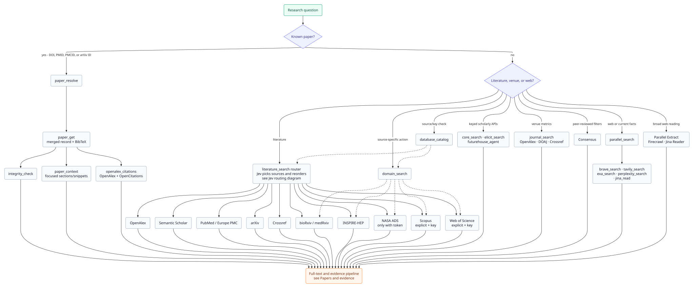
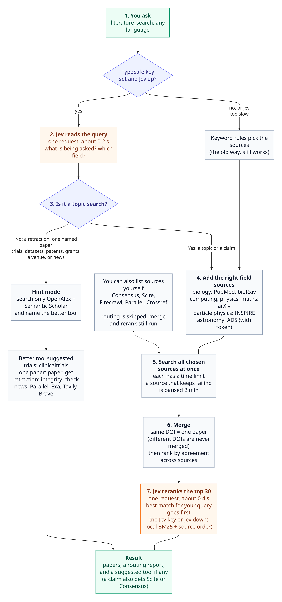

# Search and discovery

Academic Harness separates **discovery** (what exists), **orientation** (what a paper is about), and **evidence** (what a stored paper actually says). This page covers discovery: literature databases, web indexes, and the MCP connectors. For the rest of the loop, see [Papers and evidence](PAPERS.md).

## MCP connectors

Two literature/web MCP servers are wired into the `academic-harness` preset and surface as `mcp__firecrawl__*` and `mcp__scite__*` tools:

| Connector | Key | Without it |
|---|---|---|
| [Firecrawl](https://firecrawl.dev) — `mcp__firecrawl__firecrawl_scrape`, `mcp__firecrawl__firecrawl_search`, `mcp__firecrawl__firecrawl_parse` | `FIRECRAWL_API_KEY` (required) | Connector stays disabled without the key. The server also serves a paper index (`firecrawl_research_search_papers`, `_read_paper`, `_related_papers`, `_inspect_paper`); `literature_search` can use it directly as `sources=firecrawl`. |
| [Scite](https://scite.ai) — Smart Citations, retraction/correction checks, evidence datasets (patents, clinical trials, grants, drug safety, …) | `SCITE_API_KEY` (required) | Connector stays disabled. |

`SCITE_API_KEY` is an `mcp`-scoped key from [scite.ai/users/me/api](https://scite.ai/users/me/api) — Scite's own documented non-interactive path for MCP clients, sent as a bearer token to `https://api.scite.ai/mcp` (no OAuth or token exchange). Scite also offers an OAuth flow, but only for its first-party ChatGPT/Claude plugin and other interactive clients — not relevant here.

MCP connector keys need a `dsh` restart; the native REST tools below do not. See [Configuration](CONFIGURATION.md#when-a-change-takes-effect).

## Jev source routing

`literature_search` in auto mode always runs OpenAlex and Semantic Scholar, then adds domain sources. With a TypeSafe key (`TYPESAFE_API_KEY`, set under Settings → Academic Harness API keys) [Jev](https://docs.typesafe.ai) decides which; without one, or if Jev fails, the keyword rules decide. Nothing else changes: explicit `sources` always win, and `routing: "rules"` keeps a query off TypeSafe.

One request asks Jev a yes/no question per source (`jev-1.14.0`, pinned so thresholds do not drift) and code applies the policy:

| Source | Added when |
|---|---|
| PubMed / Europe PMC | the topic is medicine or the life sciences, probability ≥ 0.7 |
| arXiv | physics, maths, computing, ML or engineering, or such methods applied elsewhere, ≥ 0.7 |
| INSPIRE-HEP | high-energy, nuclear or astroparticle physics, ≥ 0.7 |
| bioRxiv / medRxiv | a life-science topic **and** an explicit ask for preprints, both ≥ 0.7 |
| NASA ADS | astronomy, ≥ 0.7, and only when `ADS_API_TOKEN` is set |

Jev never selects Crossref, DOAJ, publisher members, Scopus, Web of Science, Springer or IEEE; those stay explicit-only. Because it reads meaning rather than keywords it also routes non-English queries (tried: Spanish, French, German, Chinese, Japanese) and does not send "fuel cell" or "drug policy" to PubMed.

The result reports what happened: `routing` is `{engine: "jev", model, ms, probabilities, borderline}` or `{engine: "rules", reason}` with the reason being `no_key`, `rules_requested`, `timeout`, `auth_failed`, `rate_limited`, `http_<status>`, `network_error`, or `malformed_response`. `borderline` lists sources that scored between 0.3 and 0.7: shown, never acted on.

The same request also asks ten intent questions about what the query is really for. When one fires at ≥ 0.7 the result carries `suggested_tools`, naming the first usable tool for that intent:

| The query asks for… | Suggested tool |
|---|---|
| clinical trial registrations | `clinicaltrials` |
| datasets | `dataset_search` |
| patents | `patent_search` (needs `PATENTSVIEW_API_KEY`) |
| funding | `grant_search` |
| where to publish | `journal_search` |
| evidence restricted by study design | `consensus_search`, else `elicit_search` (keyed) |
| one named paper (title, DOI, arXiv ID) | `paper_get` |
| news, prices, products, companies, regulation, how-to: not scholarly material | `parallel_search`, else `exa_search`, `tavily_search`, `brave_search` (whichever is keyed), else the built-in `web_search` |
| whether a claim is supported or disputed | `mcp__scite__*` (Scite connector), else `consensus_search` (keyed) |
| whether a paper was retracted, corrected, or has an expression of concern | `integrity_check` (native, keyless) |

A keyed tool is suggested only if its key is set, and one tool named by two intents is listed once. Routing deliberately does not choose between Consensus and Parallel (they complement each other; the agent is told to use both) or decide when to scrape a URL (the presence of a URL decides that, not a model).

### Hierarchy: topic search or something else?

The same single Jev request answers two levels, and code applies them in order. **Level 1**: is the query really a topic search? If Jev is at least 0.9 sure it is a retraction check, one named paper, a trial, dataset, patent, grant or venue question, or news/product/regulation material, `literature_search` goes into **hint mode**: it searches only the always-on OpenAlex and Semantic Scholar and points to the right tool (PubMed, arXiv and the other domain sources would only add noise to "price of an Nvidia GPU" or a bare DOI). The result says `routing.mode: "hint_only"`, what triggered it (`gated_by`) and what was skipped. `claim_check` and `study_design` never trigger it: those are still topic searches. **Level 2**: for a topic search, pick domain sources as above. **Level 3**: inside a hint, the first usable tool wins (web: Parallel, Exa, Tavily, Brave, then the built-in web search; claim: Scite, then Consensus).

**Failure behaviour.** The call has a 1.5 s deadline and no retries. After a failure Jev is skipped for 60 s (10 min after a rejected key), so an outage or a bad key never slows every search. Repeated queries in a session are cached. `deep_research` routes each sub-query the same way. `literature_watch add` routes once and stores the sources, so a watch's seen-ledger stays comparable between runs; with no key the watch stays on auto rules.

**Privacy.** Query text is sent to `api.typesafe.ai`. TypeSafe states that Jev is not trained on customer requests and offers zero data retention to enterprise customers (see its [Legal page](https://docs.typesafe.ai/legal)). If a query should not leave the machine, pass `routing: "rules"` or leave the key unset. **Cost.** About 850 input tokens per query at $0.042 per million tokens: roughly $0.04 per thousand searches.

### Pre-registered test of the hierarchy

Written and hashed before any Jev call: 50 topic queries and 45 non-paper asks, with the keyword rules as the opponent. Labels are the author's; the 55 topic queries include 5 claim questions.

| | Keyword rules | Jev (independent hints and sources) | Jev (hierarchy) |
|---|---|---|---|
| Exactly the right domain-source set, 55 topic queries | 26 (47%) | 53 (96%) | 53 (96%) |
| Wasted extra-source calls on the 40 non-paper queries | 15 calls, 15 queries | 28 calls, 26 queries | **2 calls, 2 queries** |
| Topic queries that lost a source to the gate | | | 0 of 55 |

Paired on the source sets, Jev was right and the rules wrong on 29 queries, the reverse on 2 (exact McNemar p = 4.6e-7). The 40 wasted calls under "Jev flat" is the problem the hierarchy exists to fix: independent routing added PubMed or arXiv to a retraction question and to a bare DOI.

**This test cannot compare hints.** The keyword baseline scored 45/45, as did Jev, because the author wrote the queries and the regexes together. A second test used 148 queries written by an independent agent that never saw the baseline, which stayed frozen:

| | Keyword baseline | Jev |
|---|---|---|
| Recognises what is being asked, 108 asks | 43 (40%) | **102 (94%)** |
| ...of which non-English, 27 queries | 1 (4%) | **26 (96%)** |
| False alarm on an ordinary topic search, 40 queries | 0 | 0 |
| Right hint among all hints fired | 93% (46 fired) | 76% (134 fired) |
| Non-paper asks switched to hint mode / topic queries wrongly switched | | 77 of 96 (80%) / 0 of 52 |

Paired, Jev was right and the baseline wrong on 59 queries and the reverse on none (p = 3.5e-18). Jev's lower hint precision is mostly *secondary* hints: 24 of its 32 extra hints were `not_scholarly` alongside the specific intent (a funding call, a patent or a trial registry is not scholarly literature either), and 8 were `claim_check` or `specific_paper` alongside a retraction question. A query could therefore get two tool suggestions. Afterwards the generic `not_scholarly` hint is dropped when a specific one fires: hint precision 73% to 89% on these 148 queries (the rule was derived from them, so treat that as optimistic) and 75% to 82% on the 95 pre-registered queries, with recall unchanged (94% and 100%). Misses were mostly venue questions (3 of 12) and bare author-and-title references.

**What these tests do not show.** Final-list quality: an earlier replay that scored the merged top 10 with a model judge found Jev routing no better than the keyword rules (86% against 91% relevant) because PubMed adds weak results; the hierarchy removes the cases where that happened on non-paper queries but I have not re-measured topic-query lists. Labels in the first test are the author's, and the second test's labels are the instruction the independent agent was given, which is single-intent by construction.

### How it was evaluated

Labels come from OpenAlex indexing and field metadata and from PubMed-derived benchmark phrasing (SciFact, NFCorpus), not from Jev or from hand labelling. The model was queried once per query with thresholds fixed in advance (0.7).

| Check | Keyword rules | Jev |
|---|---|---|
| Biomedical benchmark phrasing routed to PubMed (120 queries) | 48 | 116 |
| arXiv-hosted papers routed to arXiv (104) | 18% | 97% |
| High-energy-physics papers routed to INSPIRE (45) | 7% | 89% |
| Life-science query that asks for preprints routed to bioRxiv (70, fresh sample) | 49% | 97% |
| Non-biology fields wrongly sent to PubMed (156) | n/a | 2 (1.3%) |
| Health, humanities, business fields sent to arXiv (159) | n/a | 7 (4.4%), mostly genuine ML papers |
| Natural-phrasing queries that get a tool hint (120) | n/a | 0 (new `not_scholarly` flags 3 of 40 recorded NFCorpus rows: an organisation and a consumer product) |
| SciFact claims recognised as claims to check (40) | n/a | 100% (60/60 in the exploratory run) |
| News, prices, products, regulation recognised as non-scholarly (25, **hand-written**) | n/a | 100% |
| Scholarly topics sent to web search (25, **hand-written**) | n/a | 0% |
| Real retraction questions recognised (8, **hand-written**) | n/a | 100% (3 of the 8 scored only after the question was fixed) |

The bioRxiv gate was first tied to PubMed's score, found to miss plant biology and ecology, and changed to its own life-science question; its row above is from a fresh sample drawn after that change. Median latency 205 ms, p95 308 ms, 0 failures in 758 calls. Limits to know: paper titles stand in for queries, so "is this paper indexed in X" under-measures precision (a physics paper not on arXiv still belongs on an arXiv search); labels for PubMed are noisy in both directions; and none of this measures how well the results serve *your* queries. `scripts/test-jev-routing-eval.mjs` replays 270 recorded answers in CI (no key needed) and fails if a threshold or gate regresses; `JEV_LIVE=1` re-asks Jev for a sample and fails if its decisions drift from the recording.

## Relevance rerank

Merging decides *which* papers are in the list; the rerank decides their *order*. With a TypeSafe key (Jev), `literature_search` takes the top 30 merged candidates, sends the query and each candidate's title and abstract (up to 1,200 characters) to Jev in one request, and lists the candidates by Jev's probability that a researcher who typed the query would want to read the paper. Ties keep the fused (RRF) order. Each paper carries `relevance`; `routing.rerank` reports the engine, latency and pool size. With no key (or if Jev fails) a local BM25 ranking fused with the source order is used instead (see *Without a Jev key* below). `rerank: "off"` keeps the plain fused order; `"bm25"` forces the local ranking; `"cohere"` uses Cohere Rerank instead (needs `COHERE_API_KEY`).

It is skipped in hint mode (a retraction or news query has no topical relevance to rank), for fewer than 5 candidates, with `routing: "rules"`, and for network engines when Jev is slow or unavailable (its own 4 s deadline and 60 s breaker; the local ranking takes over and the reason is reported). With `routing: "rules"` nothing is sent to any service, and only the local ranking runs. It sends the query and public abstracts to `api.typesafe.ai` (Jev) or `api.cohere.com` (Cohere), whichever engine runs (Cohere only when requested). Cost is about 10k input tokens per search (about $0.0004) and about 0.4 s.

**Evidence.** Human-labelled retrieval sets, BM25 top-30 candidate pools, one fixed question wording written before the first run, 300 queries each, paired bootstrap:

| Set | BM25 order | Jev order | Difference (95% CI) |
|---|---|---|---|
| SciFact nDCG@10 | 0.663 | 0.757 | +0.094 (+0.065, +0.125) |
| NFCorpus nDCG@10 | 0.314 | 0.367 | +0.053 (+0.038, +0.069) |

Recall@10 rose from 0.787 to 0.849 (SciFact) and 0.154 to 0.168 (NFCorpus). Fusing BM25 and Jev ranks (RRF) gained less than Jev alone (+0.053, +0.037), so Jev's score is the primary key. As a hard filter it loses recall: a 0.5 cut kept 8% (SciFact) and 22% (NFCorpus) of candidates and dropped 17% and 22% of the relevant ones, which is why it only reorders.

**Jev against Cohere Rerank.** The same BM25 top-30 pools, the same title-plus-abstract text, first 100 queries of each set, Cohere `rerank-v3.5` with its default settings:

| Set (100 queries) | BM25 | Jev | Cohere | Cohere minus Jev (95% CI) |
|---|---|---|---|---|
| SciFact nDCG@10 | 0.724 | 0.803 | 0.786 | -0.017 (-0.059, +0.025) |
| NFCorpus nDCG@10 | 0.342 | 0.395 | 0.372 | -0.023 (-0.041, -0.006) |

(BM25 is the benchmark's starting order, used because the test sets are plain text corpora. That is separate from the local BM25 fallback described below.) Both beat BM25. Jev is level with Cohere on SciFact and ahead on NFCorpus (Cohere better on 13 queries, worse on 30, tied on 57). Averaging their ranks (RRF) did no better than Jev alone (-0.001 and -0.003). So `rerank: "auto"` uses Jev when a TypeSafe key is set and otherwise keeps the fused source order (it does not fall back to Cohere); `rerank: "cohere"` is the explicit opt-in. Cohere answered in about 0.3 s. Limits: 100 queries per set, one document format, one Cohere model, a trial key; the Jev question wording was fixed before any of this data was scored, and neither engine was tuned afterwards. Cohere's scores order results but are not calibrated (a clearly relevant paper can score 0.4), so `relevance` is only comparable within one search.

**On live merged lists.** 36 topic queries through the real tool (OpenAlex, Semantic Scholar and Jev-chosen PubMed, arXiv, INSPIRE), pool of up to 30. A separate model that never saw Jev or the ordering rated every paper in either top 10 (0 not relevant, 1 related, 2 directly relevant), blind to which order it came from. On the 31 queries with complete labels: nDCG@10 0.790 fused, 0.930 reranked (+0.140, 95% CI +0.102 to +0.179); papers rated 2 in the top 5: 77% to 92%; the rerank was better on 26 queries, worse on none, equal on 5 (all 36 queries: +0.127, better on 30, worse on 1). Jev's mean score was 0.94 on papers the judge rated 2 and 0.26 on those it rated 0. The judge was lenient (75% of judged slots got a 2), and nDCG here is measured against the best ordering of the judged papers, so it shows ordering quality, not recall of papers neither list contained.

**Without a Jev key.** `bm25-rank.js` scores the same top 30 candidates locally (BM25, k1 1.2, b 0.75, title counted twice, abstract capped at 1,200 characters, light stemming and stop-word removal, nothing tuned on the data), and `literature_search` fuses that ranking with the source order by reciprocal rank (k = 60). There is no key, no network call and no cost, and it takes a few milliseconds. Papers carry no `relevance` (the fused score is not a probability). When the query shares no terms with any candidate (for example a non-English query against English abstracts) it does nothing and the source order stands. Measured on the same 36 live lists with all four orderings' top-10 papers rated blind in a single pass (nDCG@10): plain source order 0.836, BM25 alone 0.843 (+0.007, CI -0.028 to +0.042, so no gain), BM25 fused with source order 0.863 (+0.027, CI +0.005 to +0.051; better on 20 queries, worse on 7, same on 9), Jev 0.974 (+0.138, CI +0.096 to +0.184; better on 26, worse on none). The fusion variant was fixed before scoring and BM25 alone was the only other variant tried. The gain is small and lexical: it cannot see synonyms. Jev is much better where a key is available.

**Limits.** The benchmark pools come from BM25 over a fixed corpus. SciFact queries are claims and NFCorpus queries are video titles, not typical literature queries. Records without an abstract are judged on the title alone. Rerank only reorders the candidates the sources returned; it cannot recover a paper that no source found.

## How results are merged

`literature_search` (and `deep_research`, and `literature_watch`) send one query to several sources and then turn their lists into one. In plain terms:

1. **Every source's result is converted to the same record**: title, authors, year, abstract, and every identifier it knows (DOI, PMID, PMCID, arXiv ID, OpenAlex ID, Semantic Scholar ID, and so on).
2. **Two records are the same paper when they share an identifier.** The DOI is the strongest, and a PMID or arXiv ID counts too. A subtitle difference does not matter if the DOI matches.
3. **Titles are a fallback, and a careful one.** Two records with the same normalised title and year (or a long title of six or more words when one side has no year) are merged, *unless* they carry two different published DOIs. Two journals' "Editorial" are two papers. Before 0.46 they were merged and the second DOI silently lost.
4. **A preprint and its published version are one paper.** The published DOI is shown and the preprint DOI is kept in `preprint_dois`, so nothing is lost. An arXiv paper with no journal version gets arXiv's own DOI (`10.48550/arxiv.<id>`), which is deterministic.
5. **Fields are filled from whoever has them.** The longest abstract, the highest citation count and the fullest author list win; a source's extras (Scite's supporting/contrasting counts, Consensus's takeaway) are kept. Each paper lists every source that found it in `sources`.
6. **Ranking is reciprocal-rank fusion.** A source gives a paper `1/(60 + rank)`, and a paper's score is the sum over sources, so one found high by several sources outranks one found once. Sources that are the same index seen twice count once: Crossref and its `publisher:*` member searches share a single vote.

Where a title matches but the DOIs differ, both papers are kept and each lists the other under `same title, different DOI`.

## Scholarly sources that need a key

These four are not in auto mode (each is a metered service, and `deep_research` can issue dozens of queries). Name them in `sources` to include them; they merge with everything else as above. All four return a DOI.

| Source | Key | What it adds | DOI |
|---|---|---|---|
| `consensus` | `CONSENSUS_API_KEY` | A one-line takeaway, study type, journal quartile, citation count; ~1 request/second | on every result |
| `scite` | `SCITE_API_KEY` | How many citing statements **support**, **contrast** or merely **mention** the paper (`scite`) | on every result |
| `firecrawl` | `FIRECRAWL_API_KEY` | Semantic (natural-language) search over PubMed, PubMed Central, bioRxiv, medRxiv and arXiv | in the index's id list; arXiv-only papers get arXiv's DOI |
| `parallel` | `PARALLEL_API_KEY` | General web search kept to papers | **Parallel returns no DOI field.** The DOI is read from the result's URL when the URL carries one (about a quarter of results); an arXiv or PubMed URL still supplies an arXiv or PubMed id, so those results merge with the other sources. Pages that are neither on a scholarly host nor carry such an id (news, blogs) are dropped. A DOI that appears only in a page's excerpt is never used: it is usually a reference, not the page itself. |

`open_access_only` skips `parallel` and `firecrawl` with a warning, because their records carry no open-access flag. Firecrawl and Scite are called over their MCP servers with the same keys as the agent-facing connectors, but read per call, so a key saved in Settings works without a restart for `literature_search`.

## Parallel

`parallel_search` is the native Parallel search tool: a REST call to `POST /v1/search` (`x-api-key` auth). It requires `PARALLEL_API_KEY` and a **`mode` on every call**. Reading a specific URL is `parallel_extract`, not search.

Pass `objective`, 1–5 keyword `search_queries`, and `mode`:

| Mode | Latency | Best for |
|---|---|---|
| `turbo` | ~250ms | Simple fact lookups, current numbers, high-volume pre-filtering. English and Japanese queries only. |
| `fast` | ~700ms | Recommended default for most agent loops (interactive lookup, tool-calling). |
| `basic` | ~1s | Longer excerpts per source; 2–3 high-quality queries. Same mode the MCP search tool always uses. |
| `advanced` | ~3s | Multi-hop retrieval for literature surveys, deep research, code-review background. |

The system prompt steers the agent to use **both** `consensus_search` and `parallel_search` (`basic` or `advanced`) for peer-reviewed literature, `fast` only for ordinary non-literature lookups. A Settings-changed `PARALLEL_API_KEY` takes effect on the next `parallel_search` call, with no restart.

`parallel_extract` (same key) is the native URL-reading path: 1–20 URLs with focused excerpts, or full content when `full_content` is true. Use it or `mcp__firecrawl__firecrawl_scrape` (needs `FIRECRAWL_API_KEY`) after a search has produced URLs.

## Consensus

[Consensus](https://consensus.app) is a native `consensus_search` tool (not an MCP connector) over its `GET /v1/search` REST API — plain `x-api-key` auth, no OAuth. Requires `CONSENSUS_API_KEY` (the tool returns a clear error, not a disabled connector, when unset).

It supports the API's full filter set: study type, year/month range, sample size, journal quartile (SJR), citation count, study duration, domain, country, publisher, open-access/preprint/human/controlled/clinical-guideline flags, and pagination.

## Academic databases

The keyless-by-default database tools, plus `integrity_check`, cover the open bibliographic backbones:

| Tool | Source | Key | Notes |
|---|---|---|---|
| `openalex_search` | [OpenAlex](https://openalex.org) | `OPENALEX_API_KEY` optional | 300M+ CC0 works; `filter`, `query`, and `group_by`. Keyless 10 RPS, keyed 30 RPS; semantic queries 1 RPS. |
| `s2_search` | [Semantic Scholar](https://www.semanticscholar.org/product/api) | `S2_API_KEY` optional | `relevance`, `bulk` (1,000/page), and ~500-word `snippet` modes; TLDRs and OA PDFs. Serialized at 1 RPS. |
| `pubmed_search` | Europe PMC / PubMed | `NCBI_API_KEY`, `NCBI_EMAIL` optional | Europe PMC JSON by default (no key, MeSH support); `source: "ncbi"` uses E-utilities at 3 RPS (10 with a key). `preprints: true` restricts to Europe PMC preprints (SRC:PPR). |
| `arxiv_search` | [arXiv](https://info.arxiv.org/help/api/) | none | Fielded `ti:` / `au:` / `abs:` / `cat:` queries; serialized to one request every 3 s per arXiv's terms. |
| `crossref_lookup` | [Crossref](https://www.crossref.org/documentation/retrieve-metadata/rest-api/) | `CROSSREF_MAILTO` optional | Canonical DOI metadata; the polite pool uses `CROSSREF_MAILTO`, falling back to `UNPAYWALL_EMAIL`. |
| `integrity_check` | Crossref relationships + OpenAlex flags | `OPENALEX_API_KEY` optional | Retraction / expression-of-concern / correction status for a DOI or an exact title. |

Two further tools work across them:

- `openalex_citations` walks forward (`citations`), backward (`references`), or `both` citation edges. Accepts a DOI, PMID, PMCID, arXiv ID, or OpenAlex ID. When OpenAlex has no edges and a DOI exists, it falls back to OpenCitations Index v2; those edges carry DOI/OCI/date metadata and explicit placeholder titles, not invented titles.
- `paper_resolve` converts between DOI, PMID, PMCID, arXiv ID, OpenAlex ID, Semantic Scholar ID, and source-specific INSPIRE/ACL/bibcode/Scopus/WoS/Wikidata identifiers. Use it before citing when results came from more than one database, so the same paper is not cited twice under different IDs.

All of these are native REST tools — no MCP mount and no restart requirement. Shared record normalization and per-provider rate limiting live in `search-normalize.js` and `search-http.js`.

## Journal and venue search

`journal_search` discovers journals and venues and merges them by ISSN/title across OpenAlex `/sources`, DOAJ v4 journals, and Crossref journals. It returns OpenAlex's `2yr_mean_citedness`, h-index, i10-index, works/citation counts, APC, OA/DOAJ status, DOAJ licenses, publisher, ISSNs, homepage, and topics. Use `journal_policy` when the question is self-archiving or OA policy rather than discovery or metrics.

Optional keyed enrichment adds Elsevier Serial Title CiteScore/SJR/SNIP (`SCOPUS_API_KEY`, optional `ELSEVIER_INSTTOKEN`) and WoS JCR JIF/JCI/quartile/percentile (`WOS_API_KEY`). Unset keys are skipped; a configured key that fails adds a warning without failing the whole search. These keyed tiers are implemented but intentionally not part of the automated or live test suite.

### Venue fit (`action: "match"`)

`journal_search` also ranks venues for a manuscript. Inputs are `title`, `abstract`, `keywords`, `article_type`, and `constraints` (`oa`, `max_apc_usd`, `indexation: [doaj, scopus, wos]`, `deadline`). The tool runs the same OpenAlex/DOAJ/Crossref discovery pipeline, then scores each venue on keyword/topic/title overlap plus the returned citation metrics. Each result carries:

- an advisory `fit` label (`strong_scope_evidence`, `moderate_scope_evidence`, `weak_scope_evidence`, or `insufficient_scope_evidence`) and the rationale behind it;
- `missing` data (citation metrics, APC, DOAJ status, indexation, scope evidence);
- `venue_signals` for manual due diligence — DOAJ listing, recognized Crossref publisher, ISSN, APC transparency, homepage — always with `manual_check: true`.

Constraints filter only on known values. Unknown OA/APC/indexation is reported as missing, not silently passed. Fit never guarantees acceptance; DOAJ listing is not a quality verdict; use `journal_policy` for self-archiving terms and read the current author guidelines.

## Merged paper lookup and BibTeX

`paper_get` resolves one DOI, arXiv ID, PMID, PMCID, OpenAlex ID, S2 ID, source-specific identifier, or title into a merged record. It fans out across OpenAlex, Semantic Scholar, Crossref, Europe PMC, and arXiv where the identifier allows it, fills an OA URL through Unpaywall/OpenAlex when available, and returns a canonical BibTeX entry. The entry order is DOI content negotiation → arXiv `/bibtex` → INSPIRE → Semantic Scholar `citationStyles.bibtex` → deterministic synthesis, with `bibtex_source` naming the tier. It does not download files or write to PaperMemory.

`citation` remains the formatting/export/validation tool. Its `identifier` input resolves one DOI/arXiv/INSPIRE/title to BibTeX before formatting; use `paper_get` when you need the whole merged record.

Title lookups can be ambiguous: `paper_get` prefers an exact normalized-title match and returns the top-ranked candidate with a warning when no exact match exists.

## Full-text context

`paper_context` returns focused sections and snippets for one paper without downloading it. Its free tiers are Semantic Scholar ~500-word snippets scoped to the paper's S2 ID, arXiv LaTeXML HTML, NCBI PMC BioC JSON, and PubTator3 BioC JSON. Keyed publisher tiers (Wiley TDM PDF, Elsevier ScienceDirect FULL, Springer JATS) sit before the final OA-PDF tier; they are skipped when their key is absent and are intentionally not automated-tested. The last tier fetches the OA PDF through the same SSRF-checked path as `paper_download` and converts it with pdf-inspector; scanned PDFs are reported, not OCR'd by default.

`focus_query` ranks sections/snippets, `max_chars` caps the excerpt, and `include_pdf: false` skips the PDF tier. When nothing can be extracted, the tool returns the abstract/TLDR plus a `no_full_text` warning instead of inventing content. It never writes a PDF or ingests into PaperMemory: use `paper_download` to save and ingest, `pdf_to_markdown` for a local PDF, and `paper_fold` for map-first whole-paper reading.

## Publisher-scoped search

`literature_search` accepts `sources=publishers` plus a `publishers` array. This uses publisher Crossref member deposits keylessly, so it works without a Scopus/WoS/IEEE subscription for Wiley, Elsevier, Springer Nature, IEEE, Taylor & Francis, SAGE, OUP, CUP, ACM, ACS, APS, IOP, RSC, MDPI, Frontiers, and PLOS. The separate `springer` and `ieee` sources use the publishers' native APIs and require `SPRINGER_API_KEY`/`IEEE_API_KEY`. Scopus and Web of Science remain the keyed citation indexes.

## Database catalog

`database_catalog` lists the runtime sources, capabilities, rate limits, key field, and fronting tool. It reports key fields only as configured/not set and never returns key values. Use it to choose a source or explain why a keyed source is unavailable.

## Domain sources

`literature_search` adds these sources to the router; `domain_search` exposes the source-specific actions that a generic query cannot express. ACL Anthology and Wikidata are `domain_search` only.

| Source | Router source | `domain_search` actions | Key | Notes |
|---|---|---|---|---|
| bioRxiv / medRxiv | `biorxiv` | `browse`, `doi`, `published` | none | Keyword discovery goes through Europe PMC (`SRC:PPR` + publisher filter); the bioRxiv API provides date/category browse and published-version lookup. |
| ACL Anthology | — | `record` | none | No public search API; router coverage comes through Semantic Scholar/OpenAlex, with direct BibTeX/PDF lookup by ACL ID. |
| INSPIRE-HEP | `inspire` | `record`, `citations`, `references`, `texkey`, `bibtex` | none | High-energy physics; 15 requests in a 5-second window per IP. |
| NASA ADS | `ads` | `record`, `citations`, `references`, `export`, `metrics` | `ADS_API_TOKEN` | Auto-selected for astronomy only when the token exists; daily quota applies. |
| Scopus | `scopus` | `record`, `author`, `cited_by` | `SCOPUS_API_KEY` | Explicit-only; access follows institutional IP/VPN. Records are metadata-only and marked `licence: restricted`. |
| Web of Science | `wos` | `record`, `cited_by` | `WOS_API_KEY` | Explicit-only; Starter has a low daily quota and limited cited-by fields. Records are metadata-only and marked `licence: restricted`. |
| Wikidata | — | `resolve` | none | Entity search and claims for ORCID/ROR/ISSN/DOI; no free-form SPARQL. |

Keyed sources make no request when their key is unset: they return `key_missing` naming the Settings field. Scopus and Web of Science are never auto-selected; ADS is auto-selected for astronomy only when `ADS_API_TOKEN` is present. ADS/Scopus/WoS quota headers are surfaced as `quota_remaining` when the provider returns them.

### Publication integrity

`integrity_check` reports publication status for a DOI (or an exact title): `retracted`, `expression_of_concern`, `corrected`, `clean`, `unknown`, or `not_found`, with the notice DOI for each signal.

- A registry that could not be queried produces `unknown` and names the failing source — a failed lookup is never presented as `clean`.
- PubPeer has no public API, so the tool returns its URL instead of scraping it.
- Status is not claim support: whether a paper backs a statement stays with PaperMemory `quote_check`/`trace` and Scite.
- OpenAlex's keyless budget is shared per network, so an `unknown` with `openalex: OpenAlex API error 401` means the budget is exhausted — set `OPENALEX_API_KEY`.

## The literature router

`literature_search` is the router for one-shot discovery:

- **Auto mode** runs OpenAlex + Semantic Scholar, adds PubMed for biomedical queries, arXiv for preprint/CS/physics queries, INSPIRE for high-energy physics, and bioRxiv/medRxiv when a biomedical query asks for preprints. ADS is added for astronomy only when `ADS_API_TOKEN` is set.
- **Explicit sources** include Crossref, preprints, bioRxiv, INSPIRE, ADS, DOAJ, publisher Crossref deposits (`sources=publishers` with a `publishers` alias array), Scopus, Web of Science, Springer, and IEEE. Scopus/Web of Science/Springer/IEEE are never auto-selected and return `key_missing` without their key; `publishers` is keyless.
- It deduplicates across providers and fuses their rankings with reciprocal-rank fusion, so a paper found high in two indexes outranks one found once.
- Coverage is the top-N relevance slice per source, not exhaustive; use the source-specific tools afterward for filters, citation trails, or pagination.
- Scopus/Web of Science records are metadata-only; abstracts and full text are not stored.

The system prompt steers discovery to `openalex_search` + `s2_search`, with `pubmed_search` / `arxiv_search` / `domain_search` added by domain, `journal_search` for venue selection/metrics, `paper_get` for one merged record, `paper_context` for focused evidence, and `consensus_search` / `parallel_search` for their distinct filters and web excerpts.

## Additional sources

| Tool | Key | Notes |
|---|---|---|
| `core_search` | `CORE_API_KEY` optional | CORE's 450M+ open-access records across repositories; keyless is capped at ~10 requests/minute. `include_fulltext` returns the stored full text inline (large; off by default) and requires a key. |
| `elicit_search` | `ELICIT_API_KEY` (Pro+) | 138M+ papers or ClinicalTrials.gov; study-type, year, journal-quartile, and retraction filters. 100 requests/minute per IP, then a 5-minute block, so calls are serialized and not retried. |
| `futurehouse_agent` | `FUTUREHOUSE_API_KEY` (from [platform.edisonscientific.com](https://platform.edisonscientific.com/profile)) | FutureHouse (now Edison Scientific) Crow/Falcon/Owl agents on PaperQA3: `quick_search`, `deep_search` (high reasoning), and `precedent_search`. `action=start` returns a task ID; poll `action=status` in a later turn; `cancel` is available. |

CORE works without a key. Elicit requires a Pro plan or above. FutureHouse tasks can take minutes, so the tool never blocks: start, then poll. The FutureHouse platform now runs at `api.platform.edisonscientific.com`; the key is the Edison Scientific API key.

## Web indexes

`brave_search` (requires `BRAVE_API_KEY`) is an independent-index web fallback for general queries when `parallel_search` is unavailable or when independent coverage matters. It is not a literature index.

Four more native web tools are available per key:

| Tool | Key | Notes |
|---|---|---|
| `tavily_search` | `TAVILY_API_KEY` | AI-native chunks, topic modes (general/news/finance), domain/time filters, optional answer. |
| `exa_search` | `EXA_API_KEY` | Neural/entity search; `lite` uses cached snapshots and never fetches live pages; optional text/highlights/summary. |
| `perplexity_search` | `PERPLEXITY_API_KEY` | Raw ranked results (not synthesized answers), with country/domain/language/date filters. |
| `jina_read` | `JINA_API_KEY` optional | URL/PDF → Markdown (`read`) or Jina web search (`search`). Keyless Reader is 20 RPM; search requires a key. |

None of these is a literature index; the system prompt steers papers to the academic database tools.

## From search to full text

`paper_download` is the bridge from a search result to a stored paper. Given a DOI it tries Unpaywall first (when `UNPAYWALL_EMAIL` is set), then OpenAlex's publisher open-access PDF, Europe PMC open-access links, CORE repository downloads, and arXiv when the DOI is a `10.48550/arXiv.*` DOI. An `arxiv_id` or a direct `url` also works, and a direct URL is tried first.

When no open-access PDF is found, it returns a plain "paywalled" result listing every source tried (with the landing-page URL) rather than an error — the agent is steered to report that honestly instead of inferring the paper's content from a search snippet. The response is checked against the PDF magic bytes before being saved, so a login/CAPTCHA page returned instead of the real file surfaces as a clear error rather than a corrupt "PDF."

A successful download is ingested into PaperMemory. Ingest failure does not fail the download. See [Papers and evidence](PAPERS.md#download-a-paper) for the full pipeline.

## What is keyless

| Works without a key | Needs a key |
|---|---|
| OpenAlex (reduced budget), Semantic Scholar (reduced rate), PubMed/Europe PMC, arXiv, Crossref (polite pool email optional), bioRxiv/medRxiv, INSPIRE-HEP, ACL Anthology, Wikidata, OpenCitations, DOAJ, publisher Crossref deposits, `journal_search`'s free sources, `paper_get`'s free sources, `paper_context`'s free tiers, `database_catalog`, `literature_search`'s keyless sources, `domain_search`'s keyless actions, `paper_resolve`, `paper_download` (open-access fallbacks; `UNPAYWALL_EMAIL` recommended), `paper_fold` local levels, PaperMemory, notebook, `fold_text`, `citation`, `review`, `coscientist`, `clinicaltrials`, openFDA (low shared quota), DataCite, CORE (base; full text needs a key), ORCID (public reads; token optional), TextFold local levels | Parallel, Firecrawl, Scite, Consensus, Brave, Tavily, Exa, Perplexity (search), Elicit, FutureHouse, Sherpa Romeo/Juliet, PatentsView, Jina search, Gemini (images/embeddings), **NASA ADS**, **Scopus**, **Web of Science**, **Springer/JATS**, **IEEE Xplore**, **Wiley TDM**, **Elsevier Serial/ScienceDirect**, Modal, Runpod, Vast.ai |

Keyed journal/full-text enrichments are implemented but intentionally not part of the automated or live test suite: Elsevier Serial Title/ScienceDirect (`SCOPUS_API_KEY`, optional `ELSEVIER_INSTTOKEN`), WoS JCR (`WOS_API_KEY`), Wiley TDM (`WILEY_TDM_TOKEN`), Springer (`SPRINGER_API_KEY`), and IEEE (`IEEE_API_KEY`). Unset keys are skipped; configured-but-failing keys add warnings.

See [Configuration](CONFIGURATION.md) for the exact field names and restart behavior.
