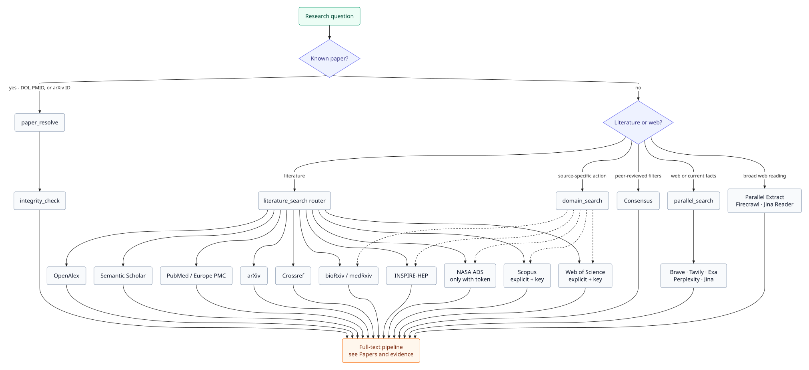

# Search and discovery

Academic Harness separates **discovery** (what exists), **orientation** (what a paper is about), and **evidence** (what a stored paper actually says). This page covers discovery: literature databases, web indexes, and the MCP connectors. For the rest of the loop, see [Papers and evidence](PAPERS.md).

## MCP connectors

Three literature/web MCP servers are wired into the `academic-harness` preset and surface as `mcp__parallel__*`, `mcp__firecrawl__*`, and `mcp__scite__*` tools:

| Connector | Key | Without it |
|---|---|---|
| [Parallel](https://parallel.ai) — `mcp__parallel__web_search` (search fallback, always `basic`) and `mcp__parallel__web_fetch` (read a URL) | `PARALLEL_API_KEY` (required) | Connector stays disabled. The key is always sent as a Bearer token so MCP calls are not on the anonymous rate limit. |
| [Firecrawl](https://firecrawl.dev) — `firecrawl_scrape`, `firecrawl_search`, `firecrawl_parse` | `FIRECRAWL_API_KEY` (required) | Connector stays disabled. Only these three tools are exposed; paper-index tools are not advertised. |
| [Scite](https://scite.ai) — Smart Citations, retraction/correction checks, evidence datasets (patents, clinical trials, grants, drug safety, …) | `SCITE_API_KEY` (required) | Connector stays disabled. |

`SCITE_API_KEY` is an `mcp`-scoped key from [scite.ai/users/me/api](https://scite.ai/users/me/api) — Scite's own documented non-interactive path for MCP clients, sent as a bearer token to `https://api.scite.ai/mcp` (no OAuth or token exchange). Scite also offers an OAuth flow, but only for its first-party ChatGPT/Claude plugin and other interactive clients — not relevant here.

MCP connector keys need a `dsh` restart; the native REST tools below do not. See [Configuration](CONFIGURATION.md#when-a-change-takes-effect).

## Parallel

`parallel_search` is the **primary** Parallel search tool: a native REST call to `POST /v1/search` (`x-api-key` auth). It requires `PARALLEL_API_KEY` and a **`mode` on every call**. `mcp__parallel__web_search` is the same search job locked to `basic` — the agent is steered to use it only if `parallel_search` is missing or errors. `mcp__parallel__web_fetch` is for reading a specific URL, not for search.

Pass `objective`, 1–5 keyword `search_queries`, and `mode`:

| Mode | Latency | Best for |
|---|---|---|
| `turbo` | ~250ms | Simple fact lookups, current numbers, high-volume pre-filtering. English and Japanese queries only. |
| `fast` | ~700ms | Recommended default for most agent loops (interactive lookup, tool-calling). |
| `basic` | ~1s | Longer excerpts per source; 2–3 high-quality queries. Same mode the MCP search tool always uses. |
| `advanced` | ~3s | Multi-hop retrieval for literature surveys, deep research, code-review background. |

The system prompt steers the agent to use **both** `consensus_search` and `parallel_search` (`basic` or `advanced`) for peer-reviewed literature, `fast` only for ordinary non-literature lookups, and `mcp__parallel__web_search` only as a fallback when `parallel_search` is unavailable. A Settings-changed `PARALLEL_API_KEY` takes effect on the next `parallel_search` call; the MCP connector still needs a `dsh` restart.

`parallel_extract` (same key) is the native URL-reading path: 1–20 URLs with focused excerpts, or full content when `full_content` is true. Use it, `mcp__parallel__web_fetch`, or `mcp__firecrawl__firecrawl_scrape` (needs `FIRECRAWL_API_KEY`) after a search has produced URLs.

## Consensus

[Consensus](https://consensus.app) is a native `consensus_search` tool (not an MCP connector) over its `GET /v1/search` REST API — plain `x-api-key` auth, no OAuth. Requires `CONSENSUS_API_KEY` (the tool returns a clear error, not a disabled connector, when unset).

It supports the API's full filter set: study type, year/month range, sample size, journal quartile (SJR), citation count, study duration, domain, country, publisher, open-access/preprint/human/controlled/clinical-guideline flags, and pagination.

## Academic databases

Five keyless-by-default native tools cover the open bibliographic backbones:

| Tool | Source | Key | Notes |
|---|---|---|---|
| `openalex_search` | [OpenAlex](https://openalex.org) | `OPENALEX_API_KEY` optional | 300M+ CC0 works; `filter`, `query`, and `group_by`. Keyless 10 RPS, keyed 30 RPS; semantic queries 1 RPS. |
| `s2_search` | [Semantic Scholar](https://www.semanticscholar.org/product/api) | `S2_API_KEY` optional | `relevance`, `bulk` (1,000/page), and ~500-word `snippet` modes; TLDRs and OA PDFs. Serialized at 1 RPS. |
| `pubmed_search` | Europe PMC / PubMed | `NCBI_API_KEY`, `NCBI_EMAIL` optional | Europe PMC JSON by default (no key, MeSH support); `source: "ncbi"` uses E-utilities at 3 RPS (10 with a key). `preprints: true` restricts to Europe PMC preprints (SRC:PPR). |
| `arxiv_search` | [arXiv](https://info.arxiv.org/help/api/) | none | Fielded `ti:` / `au:` / `abs:` / `cat:` queries; serialized to one request every 3 s per arXiv's terms. |
| `crossref_lookup` | [Crossref](https://www.crossref.org/documentation/retrieve-metadata/rest-api/) | `CROSSREF_MAILTO` optional | Canonical DOI metadata; the polite pool uses `CROSSREF_MAILTO`, falling back to `UNPAYWALL_EMAIL`. |
| `integrity_check` | Crossref relationships + OpenAlex flags | `OPENALEX_API_KEY` optional | Retraction / expression-of-concern / correction status for a DOI or an exact title. |

Two further tools work across them:

- `openalex_citations` walks forward (`citations`) and backward (`references`) citation edges. Accepts a DOI, PMID, or OpenAlex ID.
- `paper_resolve` converts between DOI, PMID, arXiv ID, OpenAlex ID, and Semantic Scholar ID. Use it before citing when results came from more than one database, so the same paper is not cited twice under different IDs.

All eight are native REST tools — no MCP mount and no restart requirement. Shared record normalization and per-provider rate limiting live in `search-normalize.js` and `search-http.js`.

### Publication integrity

`integrity_check` reports publication status for a DOI (or an exact title): `retracted`, `expression_of_concern`, `corrected`, `clean`, `unknown`, or `not_found`, with the notice DOI for each signal.

- A registry that could not be queried produces `unknown` and names the failing source — a failed lookup is never presented as `clean`.
- PubPeer has no public API, so the tool returns its URL instead of scraping it.
- Status is not claim support: whether a paper backs a statement stays with PaperMemory `quote_check`/`trace` and Scite.
- OpenAlex's keyless budget is shared per network, so an `unknown` with `openalex: OpenAlex API error 401` means the budget is exhausted — set `OPENALEX_API_KEY`.

## The literature router

`literature_search` is the router for one-shot discovery:

- **Auto mode** runs OpenAlex + Semantic Scholar, adds PubMed for biomedical queries and arXiv for preprint/CS/physics queries, and accepts explicit sources including Crossref.
- It deduplicates across providers and fuses their rankings with reciprocal-rank fusion, so a paper found high in two indexes outranks one found once.
- Coverage is the top-N relevance slice per source, not exhaustive; use the source-specific tools afterward for filters, citation trails, or pagination.

The system prompt steers discovery to `openalex_search` + `s2_search`, with `pubmed_search` / `arxiv_search` added by domain, and keeps `consensus_search` / `parallel_search` for their distinct filters and web excerpts.

## Additional sources

| Tool | Key | Notes |
|---|---|---|
| `core_search` | `CORE_API_KEY` optional | CORE's 450M+ open-access records across repositories; keyless is capped at ~10 requests/minute. `include_fulltext` returns the stored full text inline (large; off by default) and requires a key. |
| `elicit_search` | `ELICIT_API_KEY` (Pro+) | 138M+ papers or ClinicalTrials.gov; study-type, year, journal-quartile, and retraction filters. 100 requests/minute per IP, then a 5-minute block, so calls are serialized and not retried. |
| `futurehouse_agent` | `FUTUREHOUSE_API_KEY` (from [platform.edisonscientific.com](https://platform.edisonscientific.com/profile)) | FutureHouse (now Edison Scientific) Crow/Falcon/Owl agents on PaperQA3: `quick_search`, `deep_search` (high reasoning), and `precedent_search`. `action=start` returns a task ID; poll `action=status` in a later turn; `cancel` is available. |

CORE works without a key. Elicit requires a Pro plan or above. FutureHouse tasks can take minutes, so the tool never blocks: start, then poll. The FutureHouse platform now runs at `api.platform.edisonscientific.com`; the key is the Edison Scientific API key.

## Web indexes

`brave_search` (requires `BRAVE_API_KEY`) is an independent-index web fallback for general queries when `parallel_search` is unavailable or when independent coverage matters. It is not a literature index.

Four more native web tools are available per key:

| Tool | Key | Notes |
|---|---|---|
| `tavily_search` | `TAVILY_API_KEY` | AI-native chunks, topic modes (general/news/finance), domain/time filters, optional answer. |
| `exa_search` | `EXA_API_KEY` | Neural/entity search; `lite` uses cached snapshots and never fetches live pages; optional text/highlights/summary. |
| `perplexity_search` | `PERPLEXITY_API_KEY` | Raw ranked results (not synthesized answers), with country/domain/language/date filters. |
| `jina_read` | `JINA_API_KEY` optional | URL/PDF → Markdown (`read`) or Jina web search (`search`). Keyless Reader is 20 RPM; search requires a key. |

None of these is a literature index; the system prompt steers papers to the academic database tools.

## From search to full text

`paper_download` is the bridge from a search result to a stored paper. Given a DOI it tries Unpaywall first (when `UNPAYWALL_EMAIL` is set), then OpenAlex's publisher open-access PDF, Europe PMC open-access links, CORE repository downloads, and arXiv when the DOI is a `10.48550/arXiv.*` DOI. An `arxiv_id` or a direct `url` also works, and a direct URL is tried first.

When no open-access PDF is found, it returns a plain "paywalled" result listing every source tried (with the landing-page URL) rather than an error — the agent is steered to report that honestly instead of inferring the paper's content from a search snippet. The response is checked against the PDF magic bytes before being saved, so a login/CAPTCHA page returned instead of the real file surfaces as a clear error rather than a corrupt "PDF."

A successful download is ingested into PaperMemory. Ingest failure does not fail the download. See [Papers and evidence](PAPERS.md#download-a-paper) for the full pipeline.

## What is keyless

| Works without a key | Needs a key |
|---|---|
| OpenAlex (reduced budget), Semantic Scholar (reduced rate), PubMed/Europe PMC, arXiv, Crossref (polite pool email optional), `literature_search`'s keyless sources, `paper_resolve`, `paper_download` (open-access fallbacks; `UNPAYWALL_EMAIL` recommended), `paper_fold` local levels, PaperMemory, notebook, `fold_text`, `citation`, `review`, `coscientist`, `clinicaltrials`, openFDA (low shared quota), DataCite, CORE (base; full text needs a key), DOAJ, TextFold local levels | Parallel, Firecrawl, Scite, Consensus, Brave, Tavily, Exa, Perplexity (search), Elicit, FutureHouse, Sherpa Romeo/Juliet, PatentsView, ORCID (optional), Jina search, Gemini (images/embeddings), Modal, Runpod |

See [Configuration](CONFIGURATION.md) for the exact field names and restart behavior.
