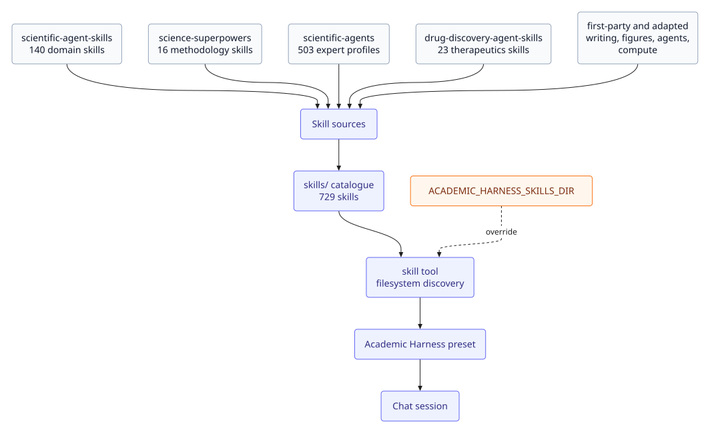

# Skills

Academic Harness bundles **743 skills** in `skills/`. They are shipped with the plugin, seeded for filesystem discovery, and loaded through DSH's `skill` tool — no separate checkout or setup.

## What is in the catalogue

Scientific skills are vendored into `skills/` from open-source catalogues, bundled with the plugin like the specialist briefs. See [NOTICE](../NOTICE) for exactly what was changed vs. each source.

| Source | Count | What it covers |
|---|---|---|
| [`scientific-agent-skills`](https://github.com/K-Dense-AI/scientific-agent-skills) | 140 domain skills | Chemistry, genomics/bioinformatics, imaging, statistics, ML, writing, and more |
| [`science-superpowers`](https://github.com/K-Dense-AI/science-superpowers) | 16 research-discipline/methodology skills | Question framing, pre-registration, verification-before-claiming, red-team review, … |
| [`scientific-agents`](https://github.com/K-Dense-AI/scientific-agents) | 503 profession-specific expert-reasoning skills | Accelerator-physicist, zoologist, actuarial-scientist, … — converted from AGENTS.md profiles |
| [`drug-discovery-agent-skills`](https://github.com/K-Dense-AI/drug-discovery-agent-skills) | 23 small-molecule/protein-therapeutics skills | Autodock Vina, retrosynthesis, protein-binder design, … |
| [`claude-scientific-writer`](https://github.com/K-Dense-AI/claude-scientific-writer) | 1 adapted skill | `docx-editor-zotero` — edit `.docx` files without breaking Zotero citations |
| [`agentic-data-scientist`](https://github.com/K-Dense-AI/agentic-data-scientist) | 1 adapted skill | `agentic-data-science-pipeline` — plan/review/implement/verify/reflect loop for large multi-stage tasks |
| [`karpathy`](https://github.com/K-Dense-AI/karpathy) | 1 adapted skill | `hyperparameter-optimization` — pre-registered, verify-before-claiming search loop for tuning a DL/LLM model |
| [`figures4papers`](https://github.com/ChenLiu-1996/figures4papers) | 1 adapted skill | `scientific-figure-making` — publication matplotlib house style + helpers for bars/trends/heatmaps |
| [`diagram-design`](https://github.com/cathrynlavery/diagram-design) | 1 vendored skill | `diagram-design` — 39 editorial HTML+SVG diagram types; no Mermaid slop |
| First-party, distilled from Gottweis et al. / Ghareeb et al. 2026 | 1 skill | `generating-scientific-hypotheses` — literature-grounded hypothesis generation: search-checked novelty, ranked falsifiable cards (see [NOTICE](../NOTICE)) |
| [`Paper2Agent`](https://github.com/jmiao24/Paper2Agent) | 3 vendored skills | `paper2agent` (router), `paper2skill`, and `paper2mcp` — turn a paper and/or its code repo into a reviewed paper skill and a tested FastMCP server. See [Paper agents](PAPERS.md#paper-agents-paper2agent) |
| [`Supervisor-Skills`](https://github.com/HKUSTDial/Supervisor-Skills) | 12 research-lifecycle skills | Idea evaluation, paper planning and drafting, polishing, figure design, Draw.io reconstruction, pre-submission review, rebuttal guidance, deep research, benchmark papers, and the Vibe Research workflow. Licences are mixed: six CC BY 4.0, five CC BY-NC-SA 4.0 (non-commercial), one MIT — see [NOTICE](../NOTICE) |
| Local, adapted from Wikipedia's "Signs of AI writing" | 1 adapted skill | `remove-ai-signs` — density-based prose style editing: AI-ish vocabulary clusters, formulaic rhythm, hedging boilerplate; preserves meaning, numbers, and citations. A style pass, not a detector-evasion tool |

The remaining 39 are first-party workflow, tool, notebook, compute, and specialist-brief skills; the total on disk is 743.

## Workflow and tool skills

| Skill | What it is for |
|---|---|
| `academic-harness` | Router for the writing engine |
| `ah-write-unit`, `ah-plan-section`, `ah-fix-findings`, `ah-audit-section`, `ah-revise-from-review` | The writing engine's unit-level workflows; see [Writing](WRITING.md#academic-harness-engine) |
| `ah-rsi` | Inspecting and steering the local RSI loop; see [RSI](RSI.md) |
| `academic-harness-notebook` | Lab-notebook discipline for research sessions; see [Lab notebook](WORKSPACE.md#lab-notebook) |
| `systematic-review-ledger` | Full `review` tool workflow; see [Systematic reviews](RESEARCH.md#systematic-reviews) |
| `co-scientist-tournament` | The tournament loop, subagent briefs, and budget defaults; see [Hypothesis tournaments](RESEARCH.md#hypothesis-tournaments) |
| `power-and-sample-size` | Study-planning workflow for `power_analysis`; see [Study planning](RESEARCH.md#study-planning) |
| `papermemory` | The PaperMemory workflow; see [Paper memory](PAPERS.md#paper-memory) |
| `zvec-grep` | Install, index, and routing details for workspace search; see [Workspace search](WORKSPACE.md#workspace-search) |
| `agent-browser` | Driving a real browser through the agent-browser CLI; see [Browsing the web](AGENTS.md#browsing-the-web) |
| `runpod`, `modal`, `vastai` | The rest of each CLI: Serverless, volumes, secrets, Hub templates, GPU availability, Vast.ai bids/volumes; see [Remote compute](COMPUTE.md#beyond-the-tools) |
| `paper2agent`, `paper2skill`, `paper2mcp` | Turning a paper or repo into a skill and an MCP server; see [Paper agents](PAPERS.md#paper-agents-paper2agent) |
| `remove-ai-signs` | Style editing for machine-sounding prose; it does not evade detection or remove provenance |
| `scientific-figure-making`, `diagram-design`, `generating-scientific-hypotheses` | Figure and ideation workflows; see [Writing](WRITING.md#figures) and [Research](RESEARCH.md) |
| `deep-research`, `idea-evaluator`, `tech-paper-template`, `benchmark-paper-template`, `intro-drafter`, `paper-writer`, `paper-polish`, `figure-designer`, `drawio-reconstruction`, `pre-submission-reviewer`, `rebuttal-guidance`, `vibe-research-workflow` | Supervisor-Skills paper lifecycle; see [Writing](WRITING.md#supervisor-skills-paper-lifecycle) and the [vendor source](../vendor/supervisor-skills/SOURCE.txt) |

The remaining specialist briefs are single-purpose skills for the `subagent` tool — abstract-writer, citation-checker, code-reviewer, data-validator, experiment-designer, paper-agent-builder, statistical-reviewer, and the rest of the roster listed in the system prompt.

Each Supervisor-Skills entry carries a **Routing in Academic Harness** section that names the skill or tool to use when a task crosses a stage boundary. The related existing skills carry a reciprocal note, so the catalogue hands off instead of duplicating work.

## Loading a skill

The agent calls the `skill` tool with a skill name when a task matches. Skills are also discoverable through the preset's filesystem skill row, and are seeded on first install.

To use a different catalogue instead, set `ACADEMIC_HARNESS_SKILLS_DIR` (or keep a `~/scientific-agent-skills/skills` checkout). The old `RESEARCHCRAFT_SKILLS_DIR` name is still honored as a fallback. The override applies to the Academic Harness preset, whose `skill-filesystem` row reads it.

## Attribution

Skills are vendored or adapted from several open-source catalogues; [NOTICE](../NOTICE) records exactly what was copied, renamed, or adapted from each. The plugin itself is MIT (see [LICENSE](../LICENSE)). The Supervisor-Skills bundle is mixed-license: six skills are CC BY 4.0, five are CC BY-NC-SA 4.0 (non-commercial, share-alike), and `drawio-reconstruction` is MIT; those terms apply to those skill files, not to the plugin as a whole. See [vendor/supervisor-skills/SOURCE.txt](../vendor/supervisor-skills/SOURCE.txt).
