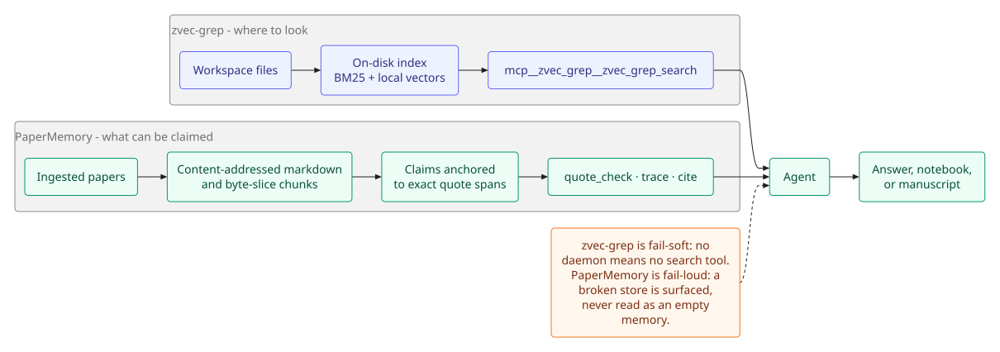

# Workspace, notebook, and folding

This page covers the tools that work on the local workspace: semantic search, the living notebook, terminal finding cards, reply folding, prompt templates, and scientific file inspection.



## Workspace search

[zvec-grep](https://github.com/zvec-ai/zvec-grep) (`zg`) is the local-first hybrid search layer on the Academic Harness preset: BM25 + vectors over an on-disk index, exposed as `mcp__zvec_grep__zvec_grep_search`.

Exact words, quotes, identifiers, filenames, regexes, and exhaustive hit lists stay on the preset's native `grep` / `glob` (`@deepseek-ai/dsh-tool-fs-search`). Open-web and literature search stay on the academic database tools (`literature_search`, `openalex_search`, `s2_search`, `pubmed_search`, `arxiv_search`, `crossref_lookup`), Parallel, Consensus, Firecrawl, and Scite — zg is **workspace-only**.

### Install and daemon

You do **not** install `zg` yourself. The first time the Academic Harness preset mounts after `dsh plugin add`, the plugin:

1. runs `npm install --prefix ~/.dsh/zvec-grep @zvec/zvec-grep@^0.2.2`,
2. starts `zg server on` (the loopback daemon),
3. mounts search over Streamable HTTP at `http://127.0.0.1:7999/mcp` — no second restart.

That first start can take several minutes (npm, then the ~130 MB Potion model). Later starts reuse `~/.dsh/zvec-grep`, **upgrade it if the bundled copy is older than 0.2.2**, and start the daemon again. Stopping `dsh` runs `zg server off`, so the daemon does not stay up in the background. Override with `ZVEC_GREP_CLI` if you already have a `zg` binary you want to keep.

If install or the daemon fails, the rest of the preset still loads and the search tool is absent (a warning is logged). The plugin talks to the daemon over HTTP (DSH's MCP client is Streamable HTTP), not `zg server --stdio`. zvec-grep 0.2.2+ also fixes the stdio heartbeat race ([zvec-grep#106](https://github.com/zvec-ai/zvec-grep/issues/106)); HTTP remains the mount used here.

### Indexing is opt-in

Settings → Academic Harness API keys → **Index at session start** defaults to **No**.

- **No (default):** a new chat does not index. You can still type "index this workspace" in the chat, and whenever semantic search would help the agent asks first (and only indexes if you say yes).
- **Yes:** opening an Academic Harness session indexes **that workspace** in the background if no index exists yet (`zg index --embedding local/potion-retrieval-32m`, local, no API key).

While an index runs — from session start or from chat — the UI shows a **progress bar with estimated time** in Settings and in the session header, and **Cancel** is always available. There is **no timeout**. Existing indexes are left alone (no silent rebuild/drop). Home directory and `/` are not indexed. Indexes live in `<cwd>/.zvec-grep/`; the model cache is `~/.zvec-grep/models` (~130 MB once).

`zvec_index action=start` accepts an `exclude` array of zg `-g` globs (for example `["!tmp/**", "!*.log"]`). PaperMemory runtime paths under the index root — the store directory's `corpus/`, `*.db*` (SQLite + WAL/SHM), `evidence/`, and `PAPERMEMORY_EVIDENCE_DIR` — are excluded automatically. Still prefer a `PAPERMEMORY_DB` outside the indexed workspace; the automatic exclusions cover the accidental case. Exclusions apply when a job starts: if an index for the same root is already running, `action=start` joins it with its original globs rather than restarting.

### Fail-soft, unlike PaperMemory

zg is **fail-soft**, PaperMemory is **fail-loud**.

- If the zg install or daemon fails, semantic search is simply absent and a warning is logged. That says nothing about PaperMemory, which surfaces its own startup failure and 14-tool drift. Never read a missing zg tool as missing memory.
- Paper markdown in the workspace is indexed by zg for *discovery*; evidence for claims, numbers, and quotations always comes from PaperMemory (`cite`, `quote_check`, `trace`, `get`).
- Ingest stores a separate corpus copy, so keep the workspace file for zg and review — do not delete it after ingest.

### Manual indexing

```sh
# only if you want to index by hand or pick a different local model
zg index --embedding local/potion-retrieval-32m    # default — papers / notes / mixed
zg index --embedding local/potion-code-16m-v2      # smaller (~65 MB model), code-heavy trees
zg status --check-ready
```

Every MCP call needs an **absolute** `root` (the session working directory). Relative paths fail. The native `zvec_index` tool (`start` / `status` / `cancel`) is what the agent uses instead of shelling out to `zg index`.

### Configuration

| Setting / env | What it does |
|---|---|
| `ZVEC_GREP_AUTO_INDEX` | `yes` / `no`. Index this workspace when an Academic Harness session opens. Default `no`. Live for the next session (no restart). |
| `ZVEC_GREP_EMBEDDING` | Default model id for *new* indexes. Unset means `local/potion-retrieval-32m`. Existing indexes keep their stored model. Restart `dsh` after changing — the next start brings up a fresh daemon with the new value. |
| `ZVEC_GREP_API_KEY` | **Not used** with the default local Potion models. Only if you opt into a remote (Qwen) embedding provider. |
| `ZVEC_GREP_CLI` | Absolute path to `zg` or to `@zvec/zvec-grep`'s `dist/cli/index.js`. Env only. |

The loopback daemon under `~/.zvec-grep/daemon/` is started with the Academic Harness preset and stopped when `dsh` exits. You do not need `zg server off` by hand. Install, index, and routing details for the agent are in the bundled `zvec-grep` skill (`skills/zvec-grep`).

## Lab notebook

`notebook` keeps a running JSONL log per session at `<cwd>/.dsh/notebook/<sessionId>.jsonl`:

- `action: "log"` for a hypothesis/method/observation/decision/note,
- `action: "read"` to recall it,
- `action: "export"` to render it to Markdown, or to a `.zip` bundling that Markdown with every artifact file the entries link to (`export_format: "zip"`).

A subagent the top-level agent delegates to runs in its own DSH session, but its `notebook` calls resolve to the **same** file as its ancestor's — the tool walks the session's delegation lineage (`session.header.parentSession`) back to the root, so a specialist's findings land in the one shared notebook rather than a file nobody reads.

Use `notebook` for the running log on the way to a finding. Use `scientific_result` for the terminal finding.

## Scientific results

`scientific_result` is a structured, schema-validated card for a *terminal* finding — a results table (`kind: "table"`) or a statistical-test summary (`kind: "statistical_test"`) — with up to 20 linked workspace-relative artifacts (`role`: figure/table/script/report/data/log).

Use it once you have a concrete finding to report; use `notebook` for the running log on the way there. It has no separate storage — the call and its result are already part of the session transcript.

## Reply folding

`fold_text` folds long Markdown without a model call or network. It only deletes: the surviving words are the words that were written, so a fold never paraphrases or adds a claim.

| Level | What remains |
|---|---|
| `full` | the text as written |
| `brief` | the first one or two sentences of each paragraph, one per list item |
| `points` | the first sentence of each paragraph and list item |
| `outline` | headings plus the first sentence under each (and an opening paragraph before the first heading); falls back to `points` when there are no headings |
| `gist` | the first sentence |

### In the chat

A completed reply long enough to fold shows a **Read folded:** row under the turn, with Full / Brief / Points / Outline / Gist. Choosing a level opens a folded panel below the reply; the original message stays above it and is never replaced.

- The row is additive — it is a `conversation.chat.turnTail` contribution, not a replacement for the assistant renderer — and it appears only when the fold hides at least a quarter of the reply.
- Tool output and reasoning are not folded.
- The last chosen level is remembered in the browser.
- **Open in sidebar** opens the same reply in the right dock as a larger reading pane. The pane has its own level buttons (Full shows all of the reply's prose there), keeps the selected level, and is a session view: after a page reload, reopen it from the row. Opening another reply updates the same tab. The inline row remains the primary view.

### Boundaries

- A text under about 80 words, or one where a fold would hide less than a quarter, comes back unchanged (`folded: false`).
- Code blocks and tables are kept at `brief` and `points`, dropped at `outline` and `gist`; a code block longer than eight lines becomes a one-line marker.
- CJK text is measured by reading effort, and Chinese/Japanese stops (`。！？`) end sentences without a following space.
- Use it on a long report, note, or reply before handing the text to another tool. Pass `write_to` to save the folded Markdown in the workspace instead of returning it inline.
- The Academic Harness preset also asks the model to lead with the point in each paragraph (the separate `academic-harness-response-shape` prompt section); that makes the folds read better but is not required — the tool deletes prefixes either way.

## Workflow templates

`research_template` browses (`action: "list"`, filterable by `category`/`query`) and retrieves (`action: "get"`, with `values` filling `{placeholder}` tokens) a catalogue of ~330 one-click research-task prompt templates across 22 disciplines, ported from Academic Harness's own template library.

It is a different tool from DSH's `workflow` (Rhai multi-agent scripts); the Academic Harness preset mounts both, so they cannot share a name.

## Scientific file inspection

`sci_inspect` summarizes SMILES/MOL/SDF, PDB/CIF, mzML and other mass-spec formats, npy/npz/parquet/hdf5, TIFF/NIfTI/DICOM, and h5ad files by shelling out to the bundled Python helpers under `python-helpers/`.

Set up the helper venv once (needs [uv](https://docs.astral.sh/uv/)):

```sh
cd python-helpers && uv sync
```

The tool finds `python-helpers/.venv` automatically. Override with `ACADEMIC_HARNESS_HELPERS_DIR` (a different helpers checkout) or `ACADEMIC_HARNESS_PYTHON` (a specific interpreter); the old `RESEARCHCRAFT_HELPERS_DIR`/`RESEARCHCRAFT_PYTHON` names are still honored as fallbacks.

## Related

- [Papers and evidence](PAPERS.md) — PaperMemory and paper reading.
- [Search](SEARCH.md) — literature and web discovery.
- [Agents](AGENTS.md) — delegation and browsing.
- [Configuration](CONFIGURATION.md) — index and model settings.
