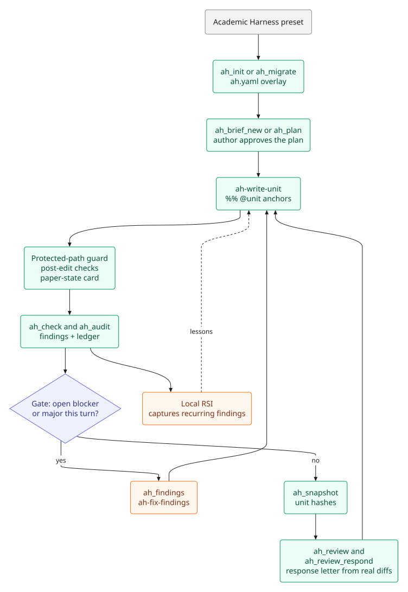

# Writing, citation, and figures

This page covers the writing side: the Academic Harness engine for long LaTeX documents, bibliography formatting and consistency, compilation, and the figure toolchain.

For stored review-round comparisons use the `review-round-diff` research
template; for evidence-linked replies use `rebuttal-plan` and
`rebuttal-experiments`. Templates never start a new review without approval,
and the writing engine remains authoritative for its own response letter.



## Academic Harness engine

The Academic Harness engine (vendored at `vendor/academic-harness`; see [the engine notes](ACADEMIC-HARNESS-ENGINE.md)) is the writing oracle for long academic LaTeX documents: literature reviews, journal and conference papers, grant proposals, theses, and rebuttals.

A paper has no compiler. The engine inventories every number, citation, unit, and declared claim, then a **gate** closes only when this turn introduced no open blocker or major. Unchanged units keep the verdicts they already had.

### Stable findings: checking the checker

A fix loop only converges when the same text gives the same findings. `ah_audit stability_runs=5` (CLI: `ah stability --runs 5`, or `ah audit --stability 5`) runs the checks five times on the unchanged text without touching the ledger and reports, per tier, the findings per run and the minimum fingerprint overlap, every finding that appeared in some runs but not all (`unstable`), and open ledger findings whose cause is `UNEXPLAINED`. The verdict is `stable`, `unstable` (exit 2 from `audit`), or `input-changed` when a file changed during the runs.

It also counts paragraphs with no `%% @unit` anchor. Such a paragraph is keyed by a hash of its text, so any edit to it re-keys every finding it carries and the ledger reports them as fixed and new at once. Run `ah_units` (`ah units sync`) before relying on the ledger; the post-edit hook does this for edits made through the agent.

### Reading TeX: what the scanner understands

The engine does not run TeX to read a document. One static scanner (`ah/tex/scan.py`) finds every citation, reference, label and input for every check, and a differential test compiles small projects with `latexmk` and compares its answers with what TeX actually did (`tests/test_tex_oracle.py`, 20 cases; it runs where TeX is installed and is skipped elsewhere).

| Read as TeX does | Constructs |
|---|---|
| Inputs | `\input{f}` and `\input f`, `\include`, `\subfile`, `\import` / `\subimport` (inputs inside an imported file resolve against its directory), `\InputIfFileExists` (a missing file is not an error) |
| Citations | `\cite` and the natbib and biblatex families (`\citep`, `\textcite`, `\footcite`, `\Cite`, `\supercite`, ...), multi-cites (`\cites{a}{b}`, `\parencites(see)[p. 2]{a}[b]{c}`), `\nocite{..}` and `\nocite{*}` (in the bibliography on purpose, so not "never cited") |
| References | `\ref`, `\eqref`, `\autoref`, `\cref` / `\Cref`, `\vref`, `\pageref`, `\nameref`, `\labelcref`, ranges (`\crefrange{a}{b}`), `\hyperref[label]{..}` |
| Labels | `\label{..}` and `label=` in the options of `lstlisting`, `minted`, `\lstinputlisting` |
| Not markup | `%` comments, `\iffalse ... \fi` and the dead branch of `\iftrue ... \else ... \fi`, the `comment` environment, `\verb`, the bodies of `verbatim`, `lstlisting`, `minted`, `alltt`. A `\fi` inside a comment or a listing ends nothing |
| Wrapper macros | `\newcommand{\figref}[1]{Fig.~\ref{#1}}` (also `\def\x#1{..}`): the *uses* carry the keys, so `\figref{fig:a}` is a reference to `fig:a`, and `\sect{intro}` over `\input{sections/#1}` reads `sections/intro`. The placeholder in the definition is never a citation, label or file |
| The end of the document | `\end{document}` in a file read through `\input` or `\include` ends the document: later inputs and the text after it never reach the page (`TEX-09`). `\subfile` and projects that load `standalone` handle their own end |

What it does not do, and says so: a path built from a macro or a parameter (`\input{sections/\chapter}`) is `TEX-06` (info), never guessed, and the files it loads are not audited. A wrapper macro with an optional first argument, a wrapper that calls another wrapper, macros defined in a `.sty` or class file, and conditionals other than `\iffalse` / `\iftrue` are not expanded. Files excluded by `\includeonly` are still audited (their labels still resolve in TeX through the `.aux`). A command used without the package that defines it (natbib's `\citep` under biblatex) is a TeX error that `audit --build` reports, not something the scanner can see.

Measured on 20 real manuscripts compiled from copies (originals untouched): against TeX's own record the scanner agrees on the files read 20 of 20, citations 19, labels 19 and undefined references 20. The exceptions are a manuscript that cites with `\citep` under biblatex (TeX recorded none) and a label a package generates. Its text covers 93.6% to 99.5% (median 98%) of the distinct words in each PDF once the rendered bibliography and code listings are set aside; what remains is hyphenation, math macros (`\kmax`), `\today` and author blocks. The old scanner raised 19 false blocker `TEX-02` findings on this set; they are gone. The text of a document and the PDF are two views, and a paragraph produced by a macro (a `\newcommand` whose body is prose) is read only where it is written.

### The build: pages, overfull boxes, missing glyphs

`ah build` and `ah audit --build` compile the view and read the log. `TEX-01` (blocker) is a TeX error mapped to its paragraph; `TEX-04` (minor) is one overfull-box finding per paragraph ("the text runs 45pt into the margin at worst"), keyed without a line number so it survives edits above it; `TEX-07` (minor) lists characters missing from the font, which print as blanks; `TEX-08` (major) fires when the page count exceeds `build: {max_pages: N}` in `ah.yaml`. The page count is also printed by `ah build`.

A box is tied to a paragraph by the line it starts on and the first words TeX prints after the warning. The open-file stack in the log is only a hint: TeX reports the last paragraph of an included file after that file's closing parenthesis, so the stack names the parent. When two paragraphs match equally the box stays a document-level `TEX-04` instead of being guessed. A build is opt-in and is not part of `ah done`; a page limit is checked when you build.

### Frozen registry lookups

Crossref and OpenAlex answers drive the reference findings (`citation action=audit`, `integrity_check`). Asked again each time, a timeout, a rate limit or a quiet upstream edit changes the findings while the manuscript is the same. Both tools now read through a lookup snapshot, `.ah/cache/lookups.json` in the workspace:

- A definitive answer (found, or "no such DOI") is stored and reused. The same bibliography gives the same findings until you refresh.
- A failed lookup is never stored. With nothing stored it comes back as the failure it was, which the audit already reports as `unverified`, never as a problem and never as a pass. With an earlier answer stored, the earlier answer is used, so an outage cannot change a verdict.
- A new fetch happens for a reference not seen before, for an answer older than `lookup_max_age_days` (default 30; 0 never expires), or when you pass `refresh_lookups: true`. A refresh that fails keeps the earlier answer.
- The result says how old the data is: `lookup.asof`, and a "Lookups: registry data as of …" line in the audit output. `integrity_check` adds `data_as_of`.

Keep the 30-day default in mind for retractions: a paper retracted last week is not seen until the entry is refreshed. Pass `refresh_lookups` before submitting. The snapshot holds public registry metadata only; contact addresses and API keys are not part of a key or stored.

### External checks in the ledger (tier TX)

`numbers_audit`, `figure_audit` and the citation audit need SciPy, Pillow or the network, so they run outside the engine; `reporting_check` keeps its verdicts in its own store. Left there, their results had no check IDs, no fingerprints and no baseline: two runs could not be compared. `ah_external` runs them on what the project would audit and writes `.ah/external/<tool>.json`; `ah_audit external=use` (CLI `ah audit --external`) reads those files as tier TX, so they get the same ledger states, causes and gate as every other finding. `external=run` does both in one call.

| Tool | Checks | Default level |
|---|---|---|
| `numbers_audit` (all prose files read as one manuscript) | STAT-01 p-value vs statistic · STAT-02 GRIM · STAT-03 sample size, flow, percentage · STAT-04 confidence interval · STAT-05 table vs text | minor |
| `figure_audit` (raster figures the document includes) | FIG-01 low DPI · FIG-02 near-duplicate · FIG-03 no DPI metadata · FIG-04 unreadable | minor · minor · info · major |
| `citation` audit (each `.bib`) | CIT-01 retracted · CIT-02 invalid or unregistered DOI · CIT-03 concern or correction · CIT-04 metadata differs from the registry · CIT-05 duplicate, incomplete or does not format · CIT-06 could not be verified | blocker · major · major · minor · minor · info |
| `reporting_check` (recorded verdicts of each reporting-guideline check) | RPT-01 item recorded as not reported or partial · RPT-02 a recorded quote is no longer in the manuscript · RPT-03 item not assessed yet, or an absence claim older than the latest edit | minor · major · info |

The tools report candidates for human review, so the statistical and figure checks start at minor and cannot block. A project promotes one in `ah.yaml` (`levels: {STAT-01: major}`) once it has seen how precise it is on its own text. The citation audit's lookups go through the [snapshot](#frozen-registry-lookups). Unreferenced bibliography entries stay with BIB-05, not here.

A result is trusted only while every file it was computed from has the hash it was run on, and the set of files is still the set the project would audit. Otherwise the tool's findings stay open in the ledger (not fixed by their absence) and one **EXT-00** (major) says the result is out of date, unreadable, or that a tool listed under `external: {required: [...]}` in `ah.yaml` was never run. Fix it by running `ah_external` again, not by editing around it. Hashes are taken before a tool runs, so an edit made while it runs shows up as stale. A re-run that finds something new is recorded with cause `evidence-changed`; one that went stale because the text changed, `text-changed`.

`numbers_audit` is run once on all prose files joined into one manuscript (comments stripped, files in project order), so a total that must agree across sections, such as N in Methods against N in Results, or a subgroup larger than the total, is compared across files. Each finding is mapped back to its own file and line; a finding about several places (different totals) is attributed to the first mention. `reporting_check` is read, never re-judged: the engine plans each check under `<project root>/.dsh/reporting/` whose manuscript is a file in the project, and the check manifest, its verdict log and the manuscript are the inputs, so recording a verdict or editing the manuscript makes the stored result stale. Only a quote that no longer verifies is RPT-02 (a fact about the text, major); an absence claim made before the latest edit is RPT-03 (a prompt to judge again, info), because every edit would otherwise block until each claim was re-judged.

Limits: a run of `numbers_audit` without SciPy is a failure, not an empty result. `reporting_check` stores are only found under the project root, and PaperMemory-paper manuscripts are not part of the project. The verdicts are an agent's recorded judgments with verified quotes, not a compliance statement; RPT-01 starts at minor for that reason. Stability (`ah stability`) does not re-run the external tools; their stored results do not change between runs by construction.

### The frozen rubric (tier TR)

#### Reliability, OpenCode and Claude Code as verifiers (rule set 1.9.0 and later)

Only a verified `yes` or valid `no` resolves a paragraph/criterion pair. `unclear`,
`unverifiable`, failed calls and exhausted budgets remain **unresolved**. They
carry earlier findings rather than marking them fixed. An admitted unresolved
pair makes completion INCOMPLETE unless an existing failure already makes it
FAIL. An admitted defect matters even at info. Unadmitted criteria stay advisory.
Admission scoring refuses unresolved labels instead of treating them as negatives.

Uncertain semantic answers are cached so replay does not spend again. To ask
again deliberately, use `ah rubric run --judge --retry-unresolved --judge-limit 10`
(or `retry_unresolved: true` on the native rubric/audit/done tool). `--no-cache`
still reruns all selected pairs. `judge_limit` limits actual backend invocations,
including quote-correction attempts, across workers. Reports retain known token
totals and `usage_complete`; unknown usage is not evidence of zero cost.
Pi transport retries must be `0` (now the default); rerun failed pairs explicitly
instead of hiding extra requests inside one budgeted invocation. Provider-side
retries outside the adapter's visibility cannot be counted by the engine.

Verifier evidence now uses a versioned fingerprint of the complete effective
configuration: backend, route/provider/model, inference settings and command
arguments/revision. Display labels are not cache keys. Old cache keys are not
reused; old admissions require remeasurement under protocol 2, not an automatic
conversion. Admissions changing model, endpoint, question or protocol are shown
as invalidated. Re-admission remains the author's decision. Command admission
also requires an explicit model and adapter revision.

For OpenCode V2, configure the **same explicit model** in both places:

```yaml
verifier:
  backend: command
  model: openai/gpt-6.1-sol # example: select an available model explicitly
  revision: opencode-v1
  response_format: json-v1
  timeout: 200
  cmd: [python3, -m, ah.verifier.opencode, --model, openai/gpt-6.1-sol]
```

Run using the installed engine's Python, or set `PYTHONPATH` to this checkout's
`vendor/academic-harness`. The adapter reads the prompt from stdin, uses a fresh
temporary OpenCode project and a one-step tool-denied verifier, and parses text,
usage and terminal status from OpenCode JSON events. It never selects DeepSeek
implicitly. OpenCode owns authentication; no key belongs in `ah.yaml`. This is
a verifier bridge, **not** native OpenCode host enforcement of protected paths
or author approvals. Temperature control is not claimed for this command route.
Project/global OpenCode instructions may still supplement the verifier context.

For **Claude Code** as the verifier, use the same `json-v1` command route with the full model id (an alias such as `sonnet` is refused, because the answer would change when the alias moves):

```yaml
verifier:
  backend: command
  model: claude-sonnet-5-5
  revision: claude-v1
  response_format: json-v1
  timeout: 200
  cmd: [python3, -m, ah.verifier.claude, --model, claude-sonnet-5-5]
```

Each prompt is one `claude -p` call in safe mode, in an empty directory, with no tools, MCP servers, hooks, CLAUDE.md or session file. Only a finished one-turn answer from exactly that model is accepted; anything else is an error and is never cached. Claude Code exposes no temperature, so a re-run can answer differently: the route is repeatable through the verdict cache, not through the model. Models differ, and the difference reaches completion: on 84 (criterion, paragraph) pairs from real manuscripts, GPT-6.1-sol and Sonnet 5.5 agreed on 83, Haiku 5.5 and Sonnet 5.5 on 79; Haiku answered `unclear` on 4 pairs (each would leave an admitted criterion INCOMPLETE) and gave one `yes` the other two rejected. That is agreement between models, not accuracy; admission against your own labels is still the only measure.

Plain-text command backends remain supported with unknown token usage. An
opt-in `json-v1` adapter returns
`{version: 1, model: "…", text: "…", usage: {input: 12, output: 3}}`, with optional
`error`; a mismatched model or malformed envelope is an error, not a verdict.

**Recovery:** preserve old `.ah` history. After upgrading, run a bounded fresh
rubric audit on a copy (`--judge --judge-limit N`), then arrange independent
labelling and author re-admission as needed. A prior falsely fixed defect may
reopen as a regression; history is not rewritten. Old logs do not necessarily
contain enough evidence to identify every falsely fixed decision automatically.

A free-form review asks the model what it notices, so it notices something different each time. A rubric criterion is the opposite: one question, written down, with a version, asked about one paragraph. `ah_audit rubric=true` reports the verdicts already cached (no model calls); `ah_audit judge=true` also asks the model about paragraphs that have none. `ah_rubric` lists, runs and makes labelling sheets for individual criteria.

What makes the answer repeatable:

- **The question is a file.** Defaults ship with the profile (`core` for all prose, `empirical` for methods and results, `grant` for proposals); a project adds or rewords criteria in `rubric/*.yaml` and switches ones off with `criteria: {off: [...]}` in `ah.yaml` (`criteria:` also sets `files`, default `rubric/*.yaml`, `workers`, default 4, and `min_words`, default 12: shorter paragraphs are skipped). A criterion is `{id: RUB-NAME, version, level, question, quote_pattern, scope: {files, kinds, min_words}}`. `quote_pattern` is optional: a regular expression the words a "yes" quotes must match, so a verdict that quotes unrelated words (the model drifting from "universal wording" to any strong claim) is `unverifiable` and never a finding. It asks about a **defect** ("yes" = the problem is present), because only a defect has words to quote. Omissions (a missing section or statement) stay with profile rules, which are exact.
- **A failure must quote the paragraph.** A "yes" counts only if its quote is found in the paragraph (case and whitespace normalised, at least 8 characters per piece). The model gets one corrected retry; a "yes" with no real quote is `unverifiable` and never becomes a finding.
- **The verdict is cached** on (prompt version, criterion hash, paragraph hash, verifier fingerprint). Unchanged text is never asked twice with the same effective verifier, and a re-run returns the same answer by construction. Editing one paragraph asks about that paragraph only. A transport error or an unparseable reply is not cached, so it is asked again next time.
- **Not being able to decide is not a fix.** A (criterion, paragraph) pair with no resolving verdict (no model allowed, no cached answer, an error, budget exhaustion, unclear or unverifiable) carries its existing finding. Only a verdict of "no" on that in-scope paragraph closes it automatically.

**Levels and admission.** Every criterion reports at **info** and cannot gate until the author has measured it. `ah_rubric action=sheet` lists the paragraphs in scope with their hashes; you label each `yes` (defect present) or `no`; `ah_author action=rubric-admit id=RUB-NAME file=labels.yaml` (CLI: `ah rubric admit RUB-NAME --labels labels.yaml --yes`) runs the model over them and records the agreement in `rubric/admissions.yaml`. Defaults: at least 20 usable labels with at least 5 of each kind, Cohen's kappa at least 0.6 and precision at least 0.8, because a gate that flags text the author considers fine is worse than none. Labels whose paragraph was edited since are skipped, not trusted. An admission is evidence about **this question and this model**: reword the question or change the model and it is void, and the criterion drops back to info (a carried finding too). Without `--yes` the command only reports whether the thresholds are met. `rubric/**` is a protected path, so an agent cannot edit criteria, labels or admissions to admit its own check.

New findings are `RUB-01` (cause `evidence-changed` when the model's first verdict on unchanged text arrives, `text-changed` after an edit, `rubric-changed` after a criterion edit) and `RUB-02` for a malformed criteria file.

Limits: the model is only asked about one paragraph at a time, so a defect that spans paragraphs is invisible to it. The `http` backend sends temperature 0; the `pi` backend cannot set it, and with `--no-cache` any backend's non-determinism shows as `evidence-changed`. A cache entry requires the same verifier fingerprint, so changing a model or route re-judges the affected evidence and voids incompatible admissions. Judging sends paragraph text to whichever backend `verifier:` names; `data_policy` applies as it does to the claim verifier. A command backend can itself make network calls: a local subprocess is not proof that its model runs locally. The shipped criteria are starting points, not validated instruments: nothing is admitted until you measure it on your own text.

### Format and consistency rules (ACR-*, FMT-*)

Asked to "check the formatting", a reviewer notices something different each time. These fourteen rules are the part of that job with an exact answer. They read the paragraphs of the LaTeX source (comments gone; citations, references, maths and code spans replaced by a placeholder, never deleted, so removing them cannot make two words look adjacent) and need no model.

| Check | Flags |
|---|---|
| ACR-01 | an acronym used before its definition, or defined twice (a second definition in the abstract is expected). A definition is "long form (ABC)" or "ABC (long form)" whose words spell the acronym, by initials or by letters inside them ("Antimicrobial resistance (AMR)", "eXplainable AI (XAI)"); captions count |
| ACR-03 | an acronym used in prose but never defined. Not flagged: identifiers and compounds (`PRF-03`, `CTX-M`, cryo-EM), code spans, a few hundred common terms and file formats, `acronyms_known`, a word in a cited work's title (BERT, MIMIC), a word followed by a name noun ("the STAIR paper", "FRED database", "RTX GPUs"), one that only appears beside a citation, and one that only appears in tables or figures. It still cannot tell jargon from a name (genes, tools, organisations), so it is the noisiest rule: see the evidence below |
| ACR-02 | an acronym that is defined and never used again |
| FMT-01 | a number and an unambiguous unit (`ms`, `GB`, `kHz`, ...) separated by an ordinary space, so they can break across a line; write `5~ms` or `\SI{5}{ms}` |
| FMT-02 | both `%` and the word "percent" |
| FMT-03 | plain `\cite` mixed with `\citep`/`\citet`, or different from the declared style |
| FMT-04 | a parenthetical citation before the full stop in some places and after it in others (a narrative citation, "Smith et al. \cite{x} showed", is neither) |
| FMT-05 | a figure or table with no `\label`, never referred to, or (if declared) appearing before it is first mentioned |
| FMT-06 | sentence-case and title-case headings mixed within a heading level (short headings and those with proper nouns cannot be told apart and are left alone) |
| FMT-07 | US and UK spelling mixed (`color`/`colour`, `normalize`/`normalise`, `modeling`/`modelling`, ...) |
| FMT-08 | a repeated word ("the the"; "that that" and "had had" are allowed) |
| FMT-09 | one term written in several forms (`dataset`, `data set`, `data-set`; `email`/`e-mail`), or a glossary term with `variants:` (forms the glossary lists as `banned` stay COH-01's) |
| FMT-10 | `e.g.,` with the comma in some places and without in others |
| FMT-11 | a sentence longer than `sentence_max_words` (default 60) |

Two kinds of rule. A **fact about one place** (a repeated word, a long sentence). A **consistency rule over the document** (spelling, `%`, citation commands, `e.g.,`): which form is right is the author's choice, so the rule flags the *minority* form, the one that disagrees with the rest (on a tie, the one that appeared later). Declare the form and it flags whatever departs from it. Settings live under `style.format` in `ah.yaml` (or a profile's defaults): `cite: natbib|cite|any`, `percent: symbol|word|any`, `spelling: us|uk|any`, `heading_case: sentence|title|any`, `eg_comma: yes|no|any`, `sentence_max_words`, `figure_refs_before`, `acronyms_known: [...]`, `acronym_redefine_in: [globs]`.

**Every one ships at info.** They appear in `ah_audit` and the ledger, but not in the agent's post-edit note and not in the gate, so a low-precision hint never makes an agent rewrite text that was fine. Promote one for your document with `levels: {FMT-08: minor}` in `ah.yaml`, or silence it with `off`. `ah_precision` (CLI `ah precision`) is how to decide: for each rule it counts the findings you **fixed** (the text changed and the finding went away) against those you **waived** (you said the text was fine), gives a precision estimate, and says "consider promoting" only after at least 10 decisions at 0.9 or better. That is your evidence, on your text.

Everything is read in **document order**: from each main file through every `\input` in the order it appears, so an acronym defined in a section that is input first counts as defined first, whatever the file names say. Paragraphs written in the main file itself (often the abstract and introduction), tables and figures, and headings are read too. A heading is not a unit, so a finding about a heading (FMT-06, or an acronym first seen in one) is attached to the first paragraph after it, at the heading's line.

What is and is not evidence here. The rules ship with labelled fixture cases, one that must fire and one that must stay silent per behaviour; I wrote both the rules and the cases, so they are regression evidence, not accuracy. The accuracy evidence comes from real documents read finding by finding against their source:

- **Tuning documents.** A copy of `paper/rsi-local` and three of the author's research proposals were used to find false positives, which were then fixed: check identifiers, cited systems, run-in headings, `\cite` mixed with narrative `\citet` (normal natbib usage, no longer flagged), definitions inside captions or the main file that were not being read, uses inside tables, and "Antimicrobial resistance (AMR)"-style definitions. On the three proposals, before those fixes, 39 of 86 findings were right; scores measured after fixing on the same documents would not be honest, so none are given.
- **Held out.** With the rules frozen, two further proposals that had not been opened gave 45 findings, checked against the source: **25 right (56%)**. FMT-05 6 of 6, ACR-02 4 of 4, FMT-07 1 of 1, FMT-09 1 of 1, ACR-01 3 of 3, and ACR-03 10 of 30. Every wrong finding was ACR-03: names (genes such as KRAS, tools, databases, hardware brands) and two definitions it could not parse ("area under the ROC curve (AUC)", "leave-one-cancer-type-out (LOCO)"). That is why "never defined" is its own check: ACR-01 can be promoted while ACR-03 stays advisory. Five documents from one author are a small sample, and the rules that never fired there (FMT-01, -02, -04, -06, -08, -10, -11 in held-out text) have no held-out evidence at all.

### Free reviews are exploratory: promote a recurring comment to a rule

`deep_review`, `peer-reviewer` and `pre-submission-reviewer` ask a model what it notices, so a re-run raises different points (on one unchanged manuscript a second `deep_review` closed 9 findings and opened 6). In an `ah.yaml` project they are labelled **exploratory, never gating**: they never decide what is left, only `ah_check` findings do. They are still useful as a source of candidates, and this is how a candidate becomes something the checks run every time.

- **Triage.** `ah_triage` (CLI `ah triage`) tags each comment from a stored `deep_review` round (`source=deep_review`), an imported `ah_review` (`review=<id>`; `ah review import` also tags the items as it imports them) or a list you give: `covered-by:<check>` (a check fires on the paragraph the comment quotes *and* shares a word with the comment, for example the matched phrase), `same-unit:<check>` (a check fires on that paragraph but the link is not evident: read it, do not assume it is the same point) or `exploratory` (nothing fires there, or the passage could not be found; a comment that quotes nothing is always exploratory). It reads no model and gives the same tags for the same inputs. The tag is a lookup, not a judgement that the check really addresses the comment.
- **Propose.** `ah_rule_propose` (CLI `ah rule propose`) turns one comment into a draft: `kind=pattern` (a regular expression, finding `PRM-01`) or `kind=criterion` (a yes/no question for the frozen rubric, finding `RUB-01`). The proposal needs the comment, the exact words it is about (`span`, found in the manuscript when compared as words, so a quote copied from a PDF still matches), a reason a program can decide it, and for a pattern a message and optional negative examples. Before the author sees it the engine compiles the pattern, refuses one that can match empty text or repeats a repeated group, requires it to match the sentence the comment points at (the positive fixture, taken from the manuscript), requires it not to match your negative examples, and refuses one that fires on more than a fifth of the paragraphs (at least three) as noise. It prints where the pattern fires today. A proposal checks nothing.
- **Accept.** Only the author accepts (`ah_author action=accept id=PRM-NAME`, CLI `ah rule accept PRM-NAME --yes`, or `reject`). A pattern goes to `rules/promoted.yaml` with its fixtures and where it came from; a criterion goes to `rubric/promoted.yaml` and reports at info until it is admitted like any other criterion. Both directories are protected from agents. An accepted pattern reports at `info` unless its entry says otherwise or `levels:` in `ah.yaml` does; raising a level is the author's edit.
- **From then on** `PRM-01` finds the pattern in every run, line-move independent, with a cause of `rubric-changed` for its first appearance in the ledger. `PRM-02` (major) reports a promoted rules file that cannot be read, or a rule whose own fixture no longer holds; a broken rule is not half-applied. `ah rule test` runs the fixtures and shows where each rule fires.

What this does not do: it does not decide whether a comment is *right*, only whether a program can recognise the thing it names. Most review comments (an argument that is weak, a missing baseline) cannot be recognised by a pattern; they stay exploratory. A pattern is checked against one sentence and your negative examples, not against a labelled corpus, so a promoted pattern is a lead with a recorded origin, at `info`, until the author has watched it for a while (`ah_precision checks=["PRM-*"]` shows fixed against waived for it, as for the format rules). Never run another free review only to see whether the fixes worked; the ledger answers that.

### Done: one answer (`ah_done`)

Five reports are too many to read, and "no blockers" is not an answer if the run never looked at the external tools or asked the rubric anything. `ah_done` (CLI `ah done`; every `ah audit` report also ends with it, and the paper-state card shows it) folds the tiers into **pass**, **fail** or **incomplete**, with the component that decides:

| Component | Fails when | Not checked when |
|---|---|---|
| `findings` | an open finding at a blocking level (blocker and major by default), in any tier but EXT-00 | |
| `rubric` | an open finding from an **admitted** criterion, at any level (the old gate only sees the criterion's level) | an admitted criterion has paragraphs with no verdict, or the run did not read the rubric |
| `external` | an external result is stale, unreadable or required-and-missing (EXT-00) | results exist (or are required) but the run did not read them |
| `unexplained` | a new finding has no cause (a harness fault; needs the ledger) | |
| `lookups` | the oldest answer in `.ah/cache/lookups.json` is older than `done.lookups_max_age_days` (default 30, 0 = never), or the file is unreadable | no registry lookups are recorded |

**fail** if any component fails; otherwise **incomplete** if a component that matters was not checked; otherwise **pass**. A component is "required" when it has something to check (admitted criteria exist, external results exist or are listed in `external.required`) or is named in `done.require: [external, rubric, lookups]` in `ah.yaml`. `ah done` reads the rubric (cached verdicts) and the external results by itself when the project has them; it asks the model only with `judge=true`. Exit codes: 0 pass, 1 fail, 3 incomplete. A report narrowed to some files (`ah_check files=...`) carries no answer: a part cannot say the whole is done.

What it does not mean: pass says the code tiers found nothing blocking, every admitted criterion was asked and found nothing, the external results are current for this text and the registry answers are recent. It does not say the science is right, that unadmitted criteria or advisory rules are satisfied, or that a free review would raise nothing.

Migration and audit JSON include input-graph coverage: roots, audited files,
supporting TeX, unreachable files, unresolved literal inputs and cycles.
`appendix/` and arbitrary included prose directories are no longer silently
dropped when a project also has `sections/`. `UNIT-04` (major) reports included
prose outside `tex.prose`; `UNIT-03` still reports substantial prose in an
unparsed build root. Dynamic TeX inputs remain a static-analysis limit. Profile
selection is heuristic: inspect it and use `--profile` explicitly when needed.
The state card now reads cached rubric and external results like `ah done`,
without model calls, including carried findings.

**The stop gate** now reads the same tiers: the baseline, the post-edit note and the stop check include the external results when the project has them (tier TX) and the rubric from cached verdicts (only an admitted criterion can then show a finding above info). Set `gate: {judge_touched: true}` (with a `verifier:` backend) and the stop check also judges the files this turn changed against the admitted criteria, so model calls are bounded by what the agent touched and cached verdicts. EXT-00 is left out of the stop gate: any edit makes a stored external result stale and the agent cannot run those tools from the hook, so staleness is reported by `ah_done` instead. Unadmitted rubric hints (info) are not put in post-edit notes.

### Which hosts enforce the guard, and what it stops

The paper-state card, the protected-path guard, the post-edit check and the stop gate are one engine (`ah hook userprompt|pre|post|stop`) behind three host adapters: **Claude Code** (settings from `ah hooks-config`), **DSH** (this plugin, with native approval prompts through `ah_author`) and **Pi**. **OpenCode has no host adapter.** `ah.verifier.opencode` lets an OpenCode model answer rubric questions, but OpenCode does not call the guard, does not stop on the gate and does not ask for author approvals; do not treat an OpenCode session as protected.

An agent's shell cannot, whatever the host: write a protected path (evidence, state, the definition of facts and rules, and the host's own hook settings `.claude/settings.json`), by redirect or by command, though it can read them (`cat facts/facts.yaml 2>&1`); do an author's act (waive a finding, accept or reject a fact or a rule, approve a brief, plan or disclosure, verify a claim, decline a review item, set or fill provenance, admit a criterion, `migrate --force`, anything with `--yes`); or answer the engine's "type yes" through a terminal (`script`, `unbuffer`, `expect`, `pty.spawn`; a terminal's `isatty()` cannot tell a person from a program). The agent asks instead with `ah finding decide`, and the author decides outside the agent (in a terminal, with `! ah finding waive ... --yes` in Claude Code, or `ah_author` in DSH). If the engine itself fails (a typo in `ah.yaml`), `pre` denies Write, Edit and Bash with the reason, reads still work, and the other hooks fail open; `AH_NO_ENFORCE=1` turns enforcement off.

This is a speed bump for a cooperative agent, not a sandbox: a shell can still do what the guard does not read (a script that builds a protected path at run time). The guard stops mistakes and shortcuts; where an act must be a person's, use the host's own approval (DSH `ah_author`) or run the agent in a sandbox.

Verified in real sessions, not only unit tests (`scripts/claude-host-test`, Claude Code 2.1.319): headless scenarios with Haiku 5.5 and Sonnet 5.5, and the terminal UI driven through tmux (14 checks) with Haiku 5.5. Held: a protected edit and a shell append are denied and the file is byte-identical; the author's acts are denied with the reason; an edit that adds an unbound number gets the post-edit note, the Stop hook blocks and re-enters the model, the model hands the finding to the author and the gate stops steering; Claude Code's own approval dialog still appears for an allowed edit ("No" leaves the file untouched); a protected edit gets no dialog at all; and the author waives the finding from inside the session with `!`. Not run: DSH and Pi sessions in this pass (the shared engine code is covered by the tests, and the DSH adapter by `scripts/test-academic-harness.mjs`).

### Installation and activation

You do **not** install Pi, and you do not install Academic Harness into DSH. The engine is part of this plugin (`vendor/academic-harness`). Where that tree should live long-term is an [open decision](ACADEMIC-HARNESS-ENGINE.md).

On first mount the plugin prepares a local `.venv` next to that vendored tree (via `uv`, or `python -m venv` + pip) **in the background**, so plugin installation and the web UI are not blocked; an `ah_*` call or interceptor triggered before preparation finishes waits for it. Interceptors (paper-state card, protected-path guard, post-edit check, gate) are inactive outside a directory tree with `ah.yaml`, so ordinary Academic Harness sessions are unchanged. Override with `ACADEMIC_HARNESS_CLI` or `AH_CMD`; `ACADEMIC_HARNESS_SKIP_INSTALL=1` skips creating the plugin-local venv.

### Tools

| Tool | Who | What it does |
|---|---|---|
| `ah_profile` / `ah_init` / `ah_migrate` | anyone | List document types; scaffold a new project; overlay `ah.yaml` on an existing LaTeX tree (dry-run first; apply needs `confirm`) |
| `ah_state` / `ah_inventory` / `ah_check` / `ah_audit` / `ah_config` / `ah_catalogue` | anyone | Paper-state card; coverage counts; cheap checks; full audit with ledger; project config; check catalogue |
| `ah_external` | anyone | Run numbers_audit, figure_audit and the citation audit on the project and store their findings (`.ah/external/`) so `ah_audit external=use` gives them IDs and ledger states; `plan`, `status` |
| `ah_precision` | anyone | For the format rules (ACR-*, FMT-*): findings you fixed against findings you waived, a precision estimate per rule, and whether there are enough decisions to consider promoting one. Read-only |
| `ah_done` | anyone | Pass, fail or incomplete for the whole document, with each deciding component (see "Done: one answer"). Updates the ledger like `ah_audit`; `judge=true` asks the model about admitted criteria with no verdict |
| `ah_triage` / `ah_rule_propose` | anyone | Tag free-review comments `covered-by` / `same-unit` / `exploratory` against the existing checks; draft a rule (a pattern or a rubric criterion) from a comment. A proposal checks nothing until the author accepts it |
| `ah_rubric` | anyone | The frozen rubric (tier TR): `list` criteria, `run` them (with `judge` the model is asked about paragraphs with no cached verdict), `sheet` a labelling sheet. Admitting a criterion is `ah_author action=rubric-admit` |
| `ah_units` / `ah_fact` / `ah_bind` / `ah_fact_propose` / `ah_sweep` | anyone | Sync `%% @unit` anchors; list/build/check facts; suggest number→fact bindings; propose a new fact; find every use of a value |
| `ah_source` / `ah_source_search` / `ah_claims` / `ah_claims_sync` / `ah_claims_bind` | anyone | Register/list sources; quote-located passages; claim sidecars; bind a claim to a source or fact |
| `ah_pack` / `ah_brief_new` / `ah_plan` | anyone | Evidence pack before drafting; draft a brief; propose an outline (author approves) |
| `ah_build` / `ah_findings` / `ah_decision_request` | anyone | Compile with errors mapped to units; list ledger findings; hand a finding to the author |
| `ah_review` / `ah_review_set` / `ah_review_respond` / `ah_snapshot` | anyone | Import/list reviewer items; map units; response letter from real diffs; save/diff unit snapshots |
| `ah_provenance` / `ah_disclosure` | anyone | Who wrote each unit; draft an AI-use statement (author approves) |
| `ah_rsi` | anyone | Inspect/steer the local self-improvement loop: status, report, lessons, diagnose, forget, rollback, inject preview. Records reached activation, token cost, oracle manifest, and risk tier. No approval gate. |
| `ah_author` | you | Waive, accept/reject a fact or a proposed rule, approve a brief or plan, verify a claim, decline a review item, fill provenance, approve a disclosure. DSH asks you to confirm. |

### Skills

The engine ships six workflow skills:

- `academic-harness` — router
- `ah-write-unit`
- `ah-plan-section`
- `ah-fix-findings`
- `ah-audit-section`
- `ah-revise-from-review`

### Workflow

In a project directory:

1. Pick the Academic Harness preset.
2. `ah_init` (new) or `ah_migrate` (existing tree).
3. Write through `ah-write-unit`. The gate keeps the agent on this turn's findings.

T3 (does this cited clause match the source) is advisory and never a gate. Optional model backends in `ah.yaml` are `http` (OpenAI-compatible, including local Ollama) or `command`. The engine's unused `pi` backend is not required.

## Deep review scores are advisory

`deep_review action=score` is an automated reviewer's reading of a stored round, not a venue decision. It makes one bounded model call and returns `soundness`, `originality`, `clarity`, and `significance` on a declared scale; each dimension must cite stored comment ids, and a dimension without a citation is `not_checked`. Read it with `show section=score` and treat a low number as a prompt to inspect the cited comments, not as a reason to rewrite prose until the number rises.

The same reviewer can be `held_out` or `in_distribution`. The default is held out; when a prior round's rubric or report guided the revision, pass `rubric_round` to the next `review` so the tool records the honest kind. A held-out reading is the one to quote when both exist. `DEEP_REVIEW_DEFAULT_RUBRIC`, `DEEP_REVIEW_MAX_ROUNDS`, and `DEEP_REVIEW_COST_CEILING_USD` set the rubric/scale and the review budget; none of them keys a gate, and only `ah_check` blocks. Do not present the score as an acceptance probability, a venue prediction, or a target to optimize.

## Supervisor-Skills paper lifecycle

The bundled [Supervisor-Skills](https://github.com/HKUSTDial/Supervisor-Skills) suite adds 12 stage-specific skills for general paper work outside an `ah.yaml` project:

| Stage | Skill |
|---|---|
| Survey and landscape | `deep-research` |
| Idea vetting | `idea-evaluator` |
| Structure | `tech-paper-template`, `benchmark-paper-template` |
| Drafting | `intro-drafter`, `paper-writer` |
| Polishing | `paper-polish` |
| Figures | `figure-designer`, `drawio-reconstruction` |
| Pre-submission audit | `pre-submission-reviewer` |
| Rebuttal strategy | `rebuttal-guidance` |
| AI-assisted workflow | `vibe-research-workflow` |

Each skill carries a **Routing in Academic Harness** section that names the existing skill or tool to use when a task crosses a stage boundary: `peer-reviewer` for a simulated referee report, `manuscript-editor` for an adversarial edit, `literature-researcher` for a short synthesis, `remove-ai-signs` for the AI-tone scan, `scientific-figure-making`/`diagram-design` for rendering, and the `ah-*` tools inside an `ah.yaml` project.

Inside an `ah.yaml` project, the Academic Harness engine remains authoritative for drafting, coverage, and the gate: use its `ah_*` tools and `ah-*` skills, and do not run a second drafting workflow over the same manuscript. `deep-research` and `idea-evaluator` are still useful upstream; `rebuttal-guidance` supplies strategy while `ah_review`/`ah_review_respond`/`ah-revise-from-review` handle the manuscript-backed review loop. `rebuttal-guidance` does not write final rebuttal prose: draft it only from the author's evidence and manuscript.

The suite is self-contained in `skills/`, but it refers to the upstream handbook chapters for deeper reading; the handbook is not bundled. Licences are mixed (CC BY 4.0, CC BY-NC-SA 4.0, and MIT for `drawio-reconstruction`) — see [NOTICE](../NOTICE) and the [vendor source](../vendor/supervisor-skills/SOURCE.txt).

## References and citation

`citation` is a preset-only native tool — local, no key — with five actions:

- `format` renders a bibliography in APA (default), Vancouver, Harvard, IEEE, Chicago author-date, or MLA, with optional in-text markers.
- `bibtex` / `ris` export from CSL-JSON records, existing BibTeX/RIS text, or DOIs (Crossref content negotiation).
- `validate` reports missing fields, duplicate DOIs/keys, and invalid DOIs; `check_dois: true` checks each DOI against Crossref (identity only, not claim support). A DOI whose title cannot be compared is listed as unverified, never as passed.
- `audit` checks a bibliography as a batch: DOI validity, Crossref title/year/venue/first-author match, retraction/concern/correction status, duplicates, uncited entries, and style fit, with per-reference `problem` / `review` / `unverified` / `no_issues_found`. A check that cannot run is `unverified`: a title, venue, or author that cannot be compared lexically (a non-Latin name normalizes to nothing) is reported as such, never counted as a match or invented as a mismatch.
- `repair` re-audits and grounds each metadata mismatch (`doi_not_registered`, `invalid_doi`, `title_mismatch`, `year_mismatch`, `venue_mismatch`, `first_author_mismatch`) through DOI and title lookup. A grounded record is accepted only when its title matches the cited paper: a bare substring of a short title is not a match — the shorter title must carry at least 3 tokens, or 2 non-stopword tokens, otherwise the ≥ 0.6 token-overlap test alone decides — and a pair whose titles cannot be compared lexically never passes (an exact string comparison is the only fallback). When the cited record carries a registered DOI, a title-only match must additionally be corroborated by the first author, the year, or the venue, and the corroboration is recorded in the sidecar; an uncorroborated or containment-only acceptance does not end the search, so a later identifier (usually the DOI) can supersede it, and every refusal is reported with its reason. It writes a **new** `.bib` plus a `.repair.json` sidecar; the input is never edited, an unresolved record is reported rather than guessed, and a retracted record is reported, not rewritten (a correction or expression of concern does not block a metadata repair). The new `.bib` is re-serialized from parsed records, so fields the exporter cannot represent may be dropped, and two entries sharing a citation key are separated on write by a suffix: the sidecar reports the key actually emitted (`grounded_key`, `key_preserved: false`, and why), and the summary tells you to re-check the manuscript's `\cite{...}` keys. The original file remains the reference for those fields.

The audit vocabulary is the plugin's own (`problem`, `review`, `unverified`, `no_issues_found`); the `HALLUCINATED` / `MISMATCH` labels belong to the vendored review engine and are not produced by `citation`. Repair is therefore keyed on the audit's finding codes, never on those labels. `repair` needs `output_path` for the new `.bib` and refuses to write over the input; `overwrite: true` replaces an earlier repaired file. Use it when an audit reports a wrong or unregistered DOI or a metadata mismatch, then re-run `audit` on the repaired file.

The IEEE, Chicago author-date, and MLA CSL styles are vendored under `styles/` (CC BY-SA 3.0; see [styles/README.md](../styles/README.md)). Set `CROSSREF_MAILTO` or `UNPAYWALL_EMAIL` for the Crossref polite pool.

For a journal style that is not built in, pass `style_file` (a workspace-relative `.csl`) or `style_url` (http/https) to `format`. The style is validated for the CSL namespace and minimum structure, then registered for that call. URL styles are cached under `.dsh/styles/`; local/private hosts are refused. Do not combine `style` with `style_file`/`style_url`.

Use `citation` for the final bibliography. To pull a paper into the workspace and store citable evidence, use `paper_download` (open-access only) and PaperMemory — a reference in a manager is not verified evidence, so claims still need `papermemory_quote_check` / `papermemory_trace`.

### Manuscript ↔ bibliography consistency

`manuscript_citations` checks the manuscript against the bibliography. Pass a `.tex` or Pandoc `.md` file (and optionally `bib_path`; for LaTeX the `.bib` is discovered from `\bibliography{...}` / `\addbibresource{...}`).

It reports:

- keys cited but missing from the `.bib`,
- entries never cited,
- duplicate bibliography keys,
- for LaTeX: undefined `\ref` targets and duplicate `\label`s.

`\nocite{*}` suppresses unused-entry reporting. It is local and deterministic, does not reformat citations, and rejects `.docx` because Word citation fields cannot be inspected reliably.

## Reporting checklists

`reporting_check` is a preset-only native tool for the question a journal checklist actually asks: does this manuscript report the items the guideline requires? It is not a peer review and it never returns a compliance verdict. State lives under `<cwd>/.dsh/reporting/<slug>/` as a write-once `check.json`, an append-only `verdicts.jsonl`, and exports.

| Action | What it does |
|---|---|
| `list` | Guidelines, versions, study designs, item counts, and official source links. |
| `suggest` | Candidate guidelines from study-design cues, with the matched terms shown. It never selects one. |
| `start` | Open a check for a workspace manuscript (`.tex`, `.md`, `.txt`, `.docx`, `.pdf`) or a PaperMemory paper; snapshot the manuscript hash. `resume: true` continues an existing check. |
| `items` | The checklist with current verdicts; filter by `unassessed`, `assessed`, `failing`, `stale`, or one verdict. |
| `candidates` | Ranked passages for one item from section heuristics and the item's cue terms. A reading aid, not a decision. |
| `judge` | Record `reported`, `partial`, `not_reported`, or `not_applicable` with evidence. |
| `status` | Counts, unassessed items, stale evidence, and quotes that no longer match the current manuscript. |
| `export` | Markdown table, CSV, or a LaTeX supplementary table, with the guideline source link. |

The first set covers CONSORT 2010, STROBE 2007, PRISMA 2020, PRISMA-S 2021, PRISMA-ScR 2018, ARRIVE 2.0, TRIPOD+AI 2024, CARE 2013, and STARD 2015. Each checklist is versioned JSON under `checklists/<id>/<version>.json`; item ids follow the published numbering, and every prompt is a paraphrase linked to the official wording. The official text is not bundled.

Evidence rules the tool enforces:

- `reported` and `partial` need a verbatim quote. The tool re-reads the manuscript and re-finds the quote after whitespace normalisation; a quote that does not appear is rejected and not stored. For LaTeX, commands are masked for matching but offsets and line numbers stay against the original file.
- `not_reported` is a claim of absence and needs `searched` terms or sections. It is stored as advisory.
- `not_applicable` needs a reason so a reader can challenge it.
- Re-judging an item needs `override: true` and a reason; both events stay in the log.
- When the manuscript changes, `status` re-verifies quotes. Quotes that no longer match become stale, and an absence claim is marked stale because it must be rechecked. Re-judge with a new event rather than editing the ledger.

If the manuscript is a `.tex` file in an `ah.yaml` project, an evidence location also carries the `%% @unit` id from the engine's anchors (read-only; the check does not run `ah units sync`). A PaperMemory id snapshots the stored text; the export says the source was indexed chunks, and OCR-flagged pages may be missing.

Exports say **N of M items have verified evidence**, with unassessed and stale counts. They contain the guideline's source link and the paraphrased prompts. They never say "compliant", "ready for submission", or "meets CONSORT". The model proposes and the tool verifies; the author decides. Load the `reporting-guidelines` skill for the item-batch and subagent workflow.

## Submission and communication

The writing side ends with a compiled manuscript. These tools close the submission edge without taking any action on the journal's behalf.

### Submission package

`submission_pack` has four actions:

| Action | What it does |
|---|---|
| `plan` | Read the manuscript and journal requirements, then record limits, figure specs, citation consistency, reporting-check evidence, numerical candidates, required statements, required sections, suggested reviewers, and the manuscript PDF. Unknown requirements are `manual_check`, never a pass. |
| `build` | Copy or compile the PDF and sources, figures, supplementary files, author-supplied statements, cover letter, highlights, graphical abstract, checklist, and a SHA-256 manifest into `.dsh/submission/<slug>/packs/<pack-id>/`; write a zip that is reproducible from the manifest. |
| `status` | Latest plan and every pack with failed, missing, and manual checks. |
| `export` | Copy the zip or bundle directory to a workspace path. It does not submit. |

Inputs that matter: `manuscript`, optional `manuscript_pdf`, `bib`, `journal`, `requirements` (`word_limit`, `abstract_limit`, `reference_limit`, `figure_limit`, `table_limit`, `figure_dpi`, `figure_formats`, `figure_naming` regex, `figure_max_width_mm`, `figure_max_height_mm`, `color_mode`, `citation_style`, `citation_style_file`, `citation_style_url`, `required_statements`, `required_sections`, `suggested_reviewers_limit`), `figures`, `supplementary`, `statements`, `suggested_reviewers`, and `reporting`.

- `numbers_audit` candidates enter the plan as a `manual_check`; the pack does not resolve them.
- Cover letter and highlights are placeholders unless the author supplies them. No claim is generated.
- Suggested reviewers are only the user's entries, with their source recorded.
- Raster figures are checked through the local figure helper for format/DPI/color mode; vector figures stay manual.
- A `pass` means the local check succeeded. The manifest says `ready_to_upload` only when no failed, missing, **or manual** checks remain.

Load the `submission-package` skill before building a real bundle.

### Journal fit

`journal_search` `action: "match"` ranks venues for a manuscript:

- input: `title`, `abstract`, `keywords`, `article_type`, and `constraints` (`oa`, `max_apc_usd`, `indexation`, `deadline`);
- it queries the existing OpenAlex/DOAJ/Crossref pipeline and combines topic/keyword overlap with returned metrics;
- each venue carries a rationale, missing data, and advisory fit label;
- DOAJ listing, publisher membership, ISSN, APC transparency, and homepage are reported as **due-diligence signals** with a manual-check flag.

Fit is advisory and cannot guarantee acceptance. Use `journal_policy` for OA/self-archiving terms and read the current author guidelines.

### Revision diffs and response letters

`manuscript_diff` handles revise-and-resubmit work without editing either source:

- `diff` — `latexdiff` for two `.tex` files (with optional compiled PDF) or a unified diff for `.md`/`.txt`; missing `latexdiff` returns `not_installed` and writes nothing.
- `changes` — changed blocks with ids (`ch-001`, …), hashes of both versions, and `changes.json` / `changes.md`.
- `docx` — tracked insertions/deletions, comments, and Zotero/CSL field text from `word/document.xml`; the document is not rewritten.
- `letter` — with `review: <ah-review-id>`, the Academic Harness engine builds the letter from real unit changes; otherwise pass `items` with `change_ids` that must resolve in `changes.json`. An item marked addressed without a hunk is flagged and returned in `unresolved`.

Load the `manuscript-revision` skill.

### Reviewer response ledger

`rebuttal` is an advisory coverage ledger under `<cwd>/.dsh/rebuttal/<slug>/`: imported reviewer points, the supplementary tasks planned for them, the runs linked to those tasks, and the author's own answers and declines. It makes no network call (all openreview data is supplied by the caller), never runs or creates an experiment (it links existing `experiment_log` runs or hashed `analysis_run` runs by id), never edits a manuscript, and never writes reviewer prose.

| Action | What it does |
|---|---|
| `import` | One source per call: a stored `deep_review` round (by store key or manuscript path, `deep_review_round` selects the ladder entry), `ah_review` items from an `ah.yaml` project, or `openreview` reviews the session already has (`reviews` / `reviews_path` — passing `forum_id` is refused on purpose). Each point keeps its reviewer identity (`ai` from the round model, `unattributed` for engine items, `human` from openreview signatures) and `evaluator_kind` (`held_out`/`in_distribution`, declared or inferred, or not applicable). The first import writes the round definition (`rebuttal.json`, write-once); re-imports dedupe by source + native id and report payload drift instead of rewriting history. Deep-review native ids are round-scoped, so a later round's positional points arrive as separate rows and are paired by wording at coverage time rather than merged into the first round's row. |
| `plan` | A supplementary task stub for one point: dataset, one baseline arm (`reproduced` or `reported`, never mixed), metric with direction, replicate count from a supplied `power_analysis` result (stored verbatim) or a declared basis, and an expected evidence type. Total stubs are capped by `REBUTTAL_MAX_TASKS` (default 20), re-derived inside the lock on every plan. |
| `link` | A task to an existing `experiment_log` run (metrics read live by id, never copied) or a hashed `analysis_run` run with a caller-supplied `reading`. Each link pins a SHA-256 digest of the whole linked run, so later re-reads report `verified`, `drifted`, or `unreadable`. |
| `respond` | The author's own answer to a point, citing link ids and recorded `manuscript_diff` change ids pinned to the recorded version pair. |
| `decline` | Records a decline the author already made. With `ah_item` it is verified against the engine's live `declined` status — run `ah_author action=decline` first; without one it is stored as an author-recorded decline, always labelled unverified. The tool never declines a point itself. |
| `coverage` | One of five states per point — `answered`, `answered_asserted`, `declined_verified`, `declined_recorded`, `unaddressed` — with tasks, links, verdicts, digest states, and (given a newer `deep_review` round) which points closed. |
| `draft` | A response-letter skeleton (Markdown or LaTeX) that cites only recorded hunks and linked artifacts, plus the `items` array for `manuscript_diff action=letter` and the `ah_review_respond` handoff. The full letter is kept under `drafts/`; an optional caller-supplied `out` path receives the full text too. |
| `export` | `report.md`, `rebuttal.json`, or `coverage.csv` under `exports/`. |
| `status` | The whole ledger read back: sources, cap and remaining stubs, digest counts, answers and declines by verification path, coverage totals, and artifact state. |

Inputs that matter: `slug` and one of `deep_review_key`/`deep_review_round`, `ah_review`, or `reviews`/`reviews_path` (+ `reviews_fetched_at`, the caller's verbatim note of when the data was fetched — the ledger cannot know it); then `point_id` with `dataset`, `baseline_ref`, `metric` and direction, `replicates` with `replicates_basis` or a `power` object, and `evidence`; `task_id` with `experiment_slug`/`experiment_run_id` or `analysis_slug`/`analysis_run_id` plus `reading`; `response` with `link_ids` and `change_slug`/`change_ids`; `reason` with `ah_item` or `declined_by`; `supersedes` to overwrite a live answer or decline. Severity labels are per source and never comparable across sources; use `kind` plus the source's own label instead of a cross-source rank.

**Deliberate divergence, stated plainly.** Coverage, not outcome, is what this ledger reports. The paper's Rebuttal Planner instantiates `N_t` supplementary experiments and integrates their results into the manuscript with no performance gate at all. This tool never computes `N_t`, never instantiates an experiment, and caps planned stubs with `REBUTTAL_MAX_TASKS` in Settings instead. A supplementary result that fails to help is still recorded and still reportable: an `experiment_log` verdict of `bad`/`engineer`, a `spec_drift` state, a drifted digest, and a non-zero `analysis_run` exit appear beside the point they were run for, and they never reduce coverage. Nothing here gates a turn — only `ah_check` blocks.

**Unresolved is not unanswered.** `answered` means the active answer cites evidence that exists — a cited link present in its ledger in any digest state, or a change id that resolves in its pinned `changes.json`; an answer whose citations resolve nowhere is `answered_asserted`, not dropped back to `unaddressed`. `draft` lists such ids under `unresolved` and flags `EVIDENCE STALE` for drifted links or version pairs: the flag is what to fix, and the point never reopens itself.

Inside an `ah.yaml` project the engine remains authoritative for item status and the response letter; `coverage` is this ledger's own reading over the engine state, and a divergence is surfaced as a warning, never resolved silently — an ah item that reads `addressed` with response text in the engine while its point is `unaddressed` here prints a warning telling the author to record the answer in the ledger or treat the engine as the source of truth. `rebuttal-guidance` stays on the strategy side of that line: it matches reviewer mindsets and plans per-concern responses; this ledger keeps the evidence-linked record. Neither produces the other's deliverable.

Handoffs are built in, not improvised: `draft` returns the `manuscript_diff` items array (each item starts `open` or `declined` until a response is recorded; a recorded response becomes `addressed` only where a recorded hunk resolves and matches its pinned version pair, `rebuttal` otherwise, and the items are grouped per revision slug when more than one is cited), and for every `ah_review` point an `ah_review_respond` entry — the engine builds the letter from the review snapshot diff, response text is recorded with `ah_review_set`, and declines come only from `ah_author action=decline`.

Closing the loop is a fresh review: after the revision, run a new `deep_review` round and pass its key and round to `coverage`. Points imported from `deep_review` are paired against that round with the engine's own match keys, so each such row reads `closed`, `still_present`, or `variance_only`; points from `ah_review` or `openreview` read `not_compared` because there is no matching engine round. A closed finding is a lead, not proof the criticism was resolved, and when the compared round has the same manuscript bytes as an imported one, everything that moved is reviewer variance. `deep_review compare` remains the round-to-round reading; the ledger's closing reading applies the same pairing over the imported points. Load the `rebuttal-experiments` skill.

### Numbers audit

`numbers_audit` reads `.tex`, `.md`, `.txt`, `.docx`, or `.pdf` and reports candidates:

- p-values recomputed from reported test statistics and df;
- p-values outside `[0, 1]` or reported as exactly 0;
- reversed/zero-width confidence intervals, and estimates outside their own interval;
- non-positive ratio measures;
- total N inconsistency across sections, subgroup `n` above the total, and flow counts that increase;
- fraction/percentage mismatches and percentages outside 0–100;
- label-matched table-versus-text values.

It ignores references, citations, equations, and years in its targeted patterns. Values it cannot recompute or match are listed under `not_checked`. `grim: true` adds the mean-consistency check. It never calls the statistics valid or the authors dishonest. Load the `numbers-audit` skill.

### Posters and slides

`presentation_build` works from explicit `sections` or a manuscript:

- `poster` — `tikzposter` (default), `beamerposter`, or `baposter`; sections and figure files are filled into blocks; compiled PDF plus PNG preview when `pdftoppm` is available.
- `slides` — Beamer by default, or PowerPoint (`engine: "pptx"`) when `python-pptx` is installed in the helper environment.
- `status` — builds, artifacts, missing figures, compile failures.
- `qa` — a visual-QA checklist and rendering command. Render the pages and inspect them with `read_image` on an image-capable model; the tool never claims the visual check passed.

Empty sections become explicit placeholders; no result or figure is generated. The design guidance lives in `latex-posters` and `scientific-slides`; load the `presentation-build` routing skill.

### Authorship and credit

`authorship` keeps an append-only record under `.dsh/authorship/<slug>/`:

- `start` creates a write-once record;
- `add` records an author, affiliation, ORCID, corresponding flag, email, and a user-supplied position (omit it if order is undecided);
- `credit` records CRediT roles;
- `icmje` records the four criteria as true, false, or unknown;
- `statement` writes Markdown plus a JSON sidecar and lists unresolved items;
- `export` writes Markdown, CSV, or JSON under `exports/`.

It never decides author order or qualification and never invents an affiliation, ORCID, funding source, or conflict. Duplicate positions, duplicate ORCIDs, and changed role/criteria sets are reported as disagreements, not resolved. Load the `authorship-credit` skill.

## LaTeX

`latex_compile` compiles a `.tex` file to PDF: `latexmk` when it's on `PATH` (handles bibtex/biber automatically), otherwise a `pdflatex`/`xelatex`/`lualatex` fallback with a bibtex/biber pass when the source needs one. Requires a TeX Live (or similar) install. Compiles run with `latexmk -norc` and the fallback passes `-no-shell-escape`, so a workspace `.latexmkrc` or shell-escape directive is not executed; a build that needs either must be run by the author outside the tool.

For layout auditing, the agent can render PDF pages to images with `pdftoppm -png -r 150 file.pdf page` (poppler, usually present with TeX Live) and inspect them with `read_image`; `read_image` only accepts PNG/JPEG/WebP/GIF and requires an image-capable model.

## Figures

The system prompt steers the agent to pick a figure tool by content, not by habit, and to load the matching skill before drawing:

| Content | Tool | Rule |
|---|---|---|
| **Numeric data** (plots, charts, distributions, trends) | `scientific-figure-making` skill | Real matplotlib over real computed data, house-style helpers, PNG+PDF export. Never `image_generate` and never fabricated values. Named journals also load `scientific-visualization` for column widths. |
| **Structural diagrams** (architecture, pipelines, flowcharts, method schematics, CONSORT, trees, timelines) | `diagram-design` skill | Self-contained HTML+SVG editorial diagrams (one accent, no shadows, orthogonal connectors). Not Mermaid rounded boxes, not `image_generate`. For a paper or compiled PDF the agent also exports PNG/SVG. |
| **Conceptual illustrations** with no defined structure and no real numbers | `image_generate` | Conceptual schematics, diagrams, and illustrations. Not quantitative plots. Always the first tool tried for an image; if it fails (missing key, provider error, no image), the agent falls back to `mermaid_render` and labels the result as a Mermaid fallback. |
| **Git-diffable Markdown diagram** explicitly requested | `mermaid_render` | Mermaid source → SVG with Pele, in-process. Also the standing fallback renderer whenever `image_generate` cannot run. |

For paper-level figure strategy, load `figure-designer` before choosing a renderer: it selects the Motivated Example, Solution Overview, or Results figure and audits layout and labelling. To rebuild an existing reference image, paper figure, or screenshot as editable Draw.io, load `drawio-reconstruction`. Neither replaces `scientific-figure-making` for real data or `diagram-design` for editorial SVG.

This documentation itself uses `mermaid_render` via Pele for the diagrams under `docs/assets/diagrams/`; regenerate them with `npm run docs:diagrams`.

### Image generation

`image_generate` writes conceptual schematics, diagrams, and illustrations to the workspace — not quantitative plots (those should be real Python/matplotlib output over real data).

- **Default (Gemini):** set `GEMINI_API_KEY` (Settings or env). Model defaults to `gemini-2.5-flash-image` ("nano banana"); pick a different one from the **Image model** dropdown in Settings → Academic Harness API keys (`gemini-3.1-flash-image` "nano banana 2", `gemini-3-pro-image` "nano banana pro", or a custom model id), or set `IMAGE_MODEL` (env). Unlike the API-key fields, the dropdown applies immediately on selection — no Save button, and no restart needed.
- **OpenAI-compatible Images API instead:** set `IMAGE_PROVIDER=openai`, `IMAGE_MODEL` (Settings or env), `IMAGE_BASE_URL` (env) plus `IMAGE_API_KEY` (env; also accepted as a Gemini override).
- **Fallback when it can't run:** if `image_generate` fails — unconfigured `GEMINI_API_KEY`, provider error, or no image returned — the agent does not drop the figure. It writes the figure as Mermaid and renders it with `mermaid_render` (Pele), noting in chat that this is a Mermaid fallback and how to enable image generation. Numeric plots are exempt: real values stay matplotlib, never a Mermaid stand-in.

### Mermaid diagrams

`mermaid_render` turns Mermaid source into SVG with [Pele](https://github.com/obsidianmd/pele) (MIT, from the Obsidian team) — synchronous and in-process, so no browser, no headless Chrome, and no `mmdc`/mermaid-cli install. It covers every diagram type built into Mermaid 12.1.0: flowchart, sequence, class, state, ER, pie, gantt, gitGraph, mindmap, timeline, journey, xychart, quadrant, requirement, C4, sankey, block, packet, kanban, architecture, radar, treemap, info, agentflow, usecase, railroad, treeView, Venn, Cynefin, Wardley, swimlane, Ishikawa, and event modeling.

- `mermaid` — the source. A fenced ` ```mermaid ` block is accepted and unwrapped.
- `path` — optional `.svg` path to write (must stay inside the workspace). Written files have Pele's `--pele-*` CSS variables flattened to their literal fallback colors, because Inkscape, `rsvg-convert`, and CairoSVG do not resolve CSS variables and would otherwise rasterize the file to a blank image. Omit `path` for inline SVG, which keeps the variables so a page can re-skin it.
- `font_size`, `padding`, `max_width` — layout knobs; the diagram re-lays-out rather than stretching.

A parse failure comes back as `syntax` / `semantic` / `unsupported-diagram` / `limit` with the offending line, column, and snippet, so the source can be corrected and retried. This renders Mermaid as Mermaid — a publication-quality scientific figure still goes through `diagram-design`, which redraws a Mermaid source as an editorial SVG.

Verified against Pele's own 761-example upstream corpus: every valid example renders, and the malformed ones come back as typed errors rather than crashing. Known limits of the Node path, all inherited from Pele's browser-only resolvers:

- **External icon sets** — a node written as `(fa:bug)` or `(si:react)` renders as an empty box, because resolving those names needs an `icons` callback backed by icon data. Pele's ~40 built-in shapes (`cloud`, `database`, `server`, `disk`, …) render correctly.
- **Math** — `$$…$$` and `$…$` stay literal text; typesetting needs a `math` (KaTeX) resolver.
- **HTML in labels** — tags are stripped, not escaped, so `"<script>x</script>"` draws as `x` and `""` draws as an empty node. Harmless in the output (no raw markup or handlers ever reach the SVG), but the label text is lost.
- **Emoji** — the characters are in the SVG text nodes; whether they rasterize depends on the fonts available to whatever opens the file.
- **External references** — `https:` image and link URLs are embedded as-is, so a rendered SVG can trigger a request when opened. `data:`, `file:`, and `javascript:` are rejected by Pele for both images and click links.

## Related

- [Live test plan for the writing compiler](WRITING-LIVE-TEST.md) — what to look for when running phases 0–6 for real.
- [Papers and evidence](PAPERS.md) — PDFs, PaperMemory, and paper agents.
- [Research](RESEARCH.md) — reviews, hypothesis tournaments, and policy records.
- [Workspace](WORKSPACE.md#scientific-results) — `scientific_result` cards and the notebook.
- [Configuration](CONFIGURATION.md) — citation and model keys.
