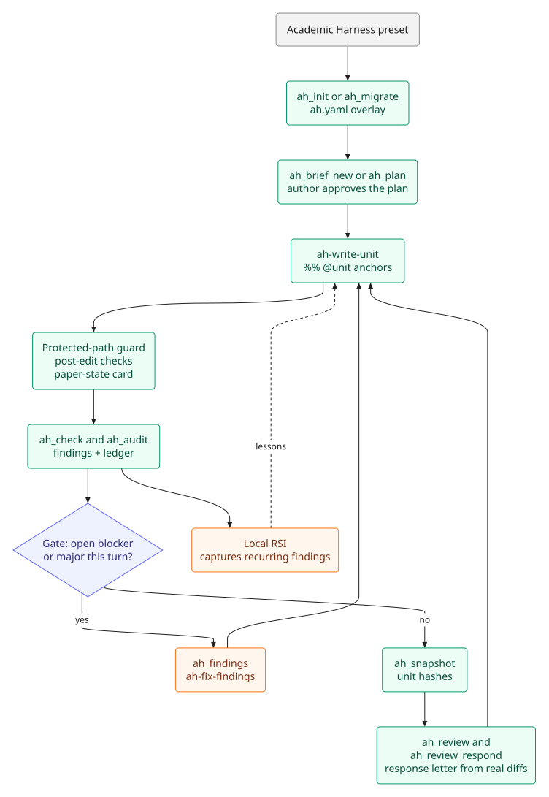

# Writing, citation, and figures

This page covers the writing side: the Academic Harness engine for long LaTeX documents, bibliography formatting and consistency, compilation, and the figure toolchain.



## Academic Harness engine

The Academic Harness engine (vendored at `vendor/academic-harness`; see [the engine notes](ACADEMIC-HARNESS-ENGINE.md)) is the writing oracle for long academic LaTeX documents: literature reviews, journal and conference papers, grant proposals, theses, and rebuttals.

A paper has no compiler. The engine inventories every number, citation, unit, and declared claim, then a **gate** closes only when this turn introduced no open blocker or major. Unchanged units keep the verdicts they already had.

### Installation and activation

You do **not** install Pi, and you do not install Academic Harness into DSH. The engine is part of this plugin (`vendor/academic-harness`). Where that tree should live long-term is an [open decision](ACADEMIC-HARNESS-ENGINE.md).

On first mount the plugin prepares a local `.venv` next to that vendored tree (via `uv`, or `python -m venv` + pip) **in the background**, so plugin installation and the web UI are not blocked; an `ah_*` call or interceptor triggered before preparation finishes waits for it. Interceptors (paper-state card, protected-path guard, post-edit check, gate) are inactive outside a directory tree with `ah.yaml`, so ordinary Academic Harness sessions are unchanged. Override with `ACADEMIC_HARNESS_CLI` or `AH_CMD`; `ACADEMIC_HARNESS_SKIP_INSTALL=1` skips creating the plugin-local venv.

### Tools

| Tool | Who | What it does |
|---|---|---|
| `ah_profile` / `ah_init` / `ah_migrate` | anyone | List document types; scaffold a new project; overlay `ah.yaml` on an existing LaTeX tree (dry-run first; apply needs `confirm`) |
| `ah_state` / `ah_inventory` / `ah_check` / `ah_audit` / `ah_config` / `ah_catalogue` | anyone | Paper-state card; coverage counts; cheap checks; full audit with ledger; project config; check catalogue |
| `ah_units` / `ah_fact` / `ah_bind` / `ah_fact_propose` / `ah_sweep` | anyone | Sync `%% @unit` anchors; list/build/check facts; suggest number→fact bindings; propose a new fact; find every use of a value |
| `ah_source` / `ah_source_search` / `ah_claims` / `ah_claims_sync` / `ah_claims_bind` | anyone | Register/list sources; quote-located passages; claim sidecars; bind a claim to a source or fact |
| `ah_pack` / `ah_brief_new` / `ah_plan` | anyone | Evidence pack before drafting; draft a brief; propose an outline (author approves) |
| `ah_build` / `ah_findings` / `ah_decision_request` | anyone | Compile with errors mapped to units; list ledger findings; hand a finding to the author |
| `ah_review` / `ah_review_set` / `ah_review_respond` / `ah_snapshot` | anyone | Import/list reviewer items; map units; response letter from real diffs; save/diff unit snapshots |
| `ah_provenance` / `ah_disclosure` | anyone | Who wrote each unit; draft an AI-use statement (author approves) |
| `ah_rsi` | anyone | Inspect/steer the local self-improvement loop: status, report, lessons, diagnose, forget, rollback, inject preview. Records reached activation, token cost, oracle manifest, and risk tier. No approval gate. |
| `ah_author` | you | Waive, accept/reject a fact, approve a brief or plan, verify a claim, decline a review item, fill provenance, approve a disclosure. DSH asks you to confirm. |

### Skills

The engine ships six workflow skills:

- `academic-harness` — router
- `ah-write-unit`
- `ah-plan-section`
- `ah-fix-findings`
- `ah-audit-section`
- `ah-revise-from-review`

### Workflow

In a project directory:

1. Pick the Academic Harness preset.
2. `ah_init` (new) or `ah_migrate` (existing tree).
3. Write through `ah-write-unit`. The gate keeps the agent on this turn's findings.

T3 (does this cited clause match the source) is advisory and never a gate. Optional model backends in `ah.yaml` are `http` (OpenAI-compatible, including local Ollama) or `command`. The engine's unused `pi` backend is not required.

## References and citation

`citation` is a preset-only native tool — local, no key — with four actions:

- `format` renders a bibliography in APA (default), Vancouver, Harvard, IEEE, Chicago author-date, or MLA, with optional in-text markers.
- `bibtex` / `ris` export from CSL-JSON records, existing BibTeX/RIS text, or DOIs (Crossref content negotiation).
- `validate` reports missing fields, duplicate DOIs/keys, and invalid DOIs; `check_dois: true` checks each DOI against Crossref (identity only, not claim support).

The IEEE, Chicago author-date, and MLA CSL styles are vendored under `styles/` (CC BY-SA 3.0; see [styles/README.md](../styles/README.md)). Set `CROSSREF_MAILTO` or `UNPAYWALL_EMAIL` for the Crossref polite pool.

Use `citation` for the final bibliography. To pull a paper into the workspace and store citable evidence, use `paper_download` (open-access only) and PaperMemory — a reference in a manager is not verified evidence, so claims still need `papermemory_quote_check` / `papermemory_trace`.

### Manuscript ↔ bibliography consistency

`manuscript_citations` checks the manuscript against the bibliography. Pass a `.tex` or Pandoc `.md` file (and optionally `bib_path`; for LaTeX the `.bib` is discovered from `\bibliography{...}` / `\addbibresource{...}`).

It reports:

- keys cited but missing from the `.bib`,
- entries never cited,
- duplicate bibliography keys,
- for LaTeX: undefined `\ref` targets and duplicate `\label`s.

`\nocite{*}` suppresses unused-entry reporting. It is local and deterministic, does not reformat citations, and rejects `.docx` because Word citation fields cannot be inspected reliably.

## LaTeX

`latex_compile` compiles a `.tex` file to PDF: `latexmk` when it's on `PATH` (handles bibtex/biber automatically), otherwise a `pdflatex`/`xelatex`/`lualatex` fallback with a bibtex/biber pass when the source needs one. Requires a TeX Live (or similar) install.

For layout auditing, the agent can render PDF pages to images with `pdftoppm -png -r 150 file.pdf page` (poppler, usually present with TeX Live) and delegate them to `subagent_vision`; `read_image` only accepts PNG/JPEG/WebP/GIF.

## Figures

The system prompt steers the agent to pick a figure tool by content, not by habit, and to load the matching skill before drawing:

| Content | Tool | Rule |
|---|---|---|
| **Numeric data** (plots, charts, distributions, trends) | `scientific-figure-making` skill | Real matplotlib over real computed data, house-style helpers, PNG+PDF export. Never `image_generate` and never fabricated values. Named journals also load `scientific-visualization` for column widths. |
| **Structural diagrams** (architecture, pipelines, flowcharts, method schematics, CONSORT, trees, timelines) | `diagram-design` skill | Self-contained HTML+SVG editorial diagrams (one accent, no shadows, orthogonal connectors). Not Mermaid rounded boxes, not `image_generate`. For a paper or compiled PDF the agent also exports PNG/SVG. |
| **Conceptual illustrations** with no defined structure and no real numbers | `image_generate` | Conceptual schematics, diagrams, and illustrations. Not quantitative plots. |
| **Git-diffable Markdown diagram** explicitly requested | `mermaid_render` | Mermaid source → SVG with Pele, in-process. |

This documentation itself uses `mermaid_render` via Pele for the diagrams under `docs/assets/diagrams/`; regenerate them with `npm run docs:diagrams`.

### Image generation

`image_generate` writes conceptual schematics, diagrams, and illustrations to the workspace — not quantitative plots (those should be real Python/matplotlib output over real data).

- **Default (Gemini):** set `GEMINI_API_KEY` (Settings or env). Model defaults to `gemini-2.5-flash-image` ("nano banana"); pick a different one from the **Image model** dropdown in Settings → Academic Harness API keys (`gemini-3.1-flash-image` "nano banana 2", `gemini-3-pro-image` "nano banana pro", or a custom model id), or set `IMAGE_MODEL` (env). Unlike the API-key fields, the dropdown applies immediately on selection — no Save button, and no restart needed.
- **OpenAI-compatible Images API instead:** set `IMAGE_PROVIDER=openai`, `IMAGE_MODEL` (Settings or env), `IMAGE_BASE_URL` (env) plus `IMAGE_API_KEY` (env; also accepted as a Gemini override).

### Mermaid diagrams

`mermaid_render` turns Mermaid source into SVG with [Pele](https://github.com/obsidianmd/pele) (MIT, from the Obsidian team) — synchronous and in-process, so no browser, no headless Chrome, and no `mmdc`/mermaid-cli install. It covers every diagram type built into Mermaid 12.1.0: flowchart, sequence, class, state, ER, pie, gantt, gitGraph, mindmap, timeline, journey, xychart, quadrant, requirement, C4, sankey, block, packet, kanban, architecture, radar, treemap, info, agentflow, usecase, railroad, treeView, Venn, Cynefin, Wardley, swimlane, Ishikawa, and event modeling.

- `mermaid` — the source. A fenced ` ```mermaid ` block is accepted and unwrapped.
- `path` — optional `.svg` path to write (must stay inside the workspace). Written files have Pele's `--pele-*` CSS variables flattened to their literal fallback colors, because Inkscape, `rsvg-convert`, and CairoSVG do not resolve CSS variables and would otherwise rasterize the file to a blank image. Omit `path` for inline SVG, which keeps the variables so a page can re-skin it.
- `font_size`, `padding`, `max_width` — layout knobs; the diagram re-lays-out rather than stretching.

A parse failure comes back as `syntax` / `semantic` / `unsupported-diagram` / `limit` with the offending line, column, and snippet, so the source can be corrected and retried. This renders Mermaid as Mermaid — a publication-quality scientific figure still goes through `diagram-design`, which redraws a Mermaid source as an editorial SVG.

Verified against Pele's own 761-example upstream corpus: every valid example renders, and the malformed ones come back as typed errors rather than crashing. Known limits of the Node path, all inherited from Pele's browser-only resolvers:

- **External icon sets** — a node written as `(fa:bug)` or `(si:react)` renders as an empty box, because resolving those names needs an `icons` callback backed by icon data. Pele's ~40 built-in shapes (`cloud`, `database`, `server`, `disk`, …) render correctly.
- **Math** — `$$…$$` and `$…$` stay literal text; typesetting needs a `math` (KaTeX) resolver.
- **HTML in labels** — tags are stripped, not escaped, so `"<script>x</script>"` draws as `x` and `""` draws as an empty node. Harmless in the output (no raw markup or handlers ever reach the SVG), but the label text is lost.
- **Emoji** — the characters are in the SVG text nodes; whether they rasterize depends on the fonts available to whatever opens the file.
- **External references** — `https:` image and link URLs are embedded as-is, so a rendered SVG can trigger a request when opened. `data:`, `file:`, and `javascript:` are rejected by Pele for both images and click links.

## Related

- [Papers and evidence](PAPERS.md) — PDFs, PaperMemory, and paper agents.
- [Research](RESEARCH.md) — reviews, hypothesis tournaments, and policy records.
- [Workspace](WORKSPACE.md#scientific-results) — `scientific_result` cards and the notebook.
- [Configuration](CONFIGURATION.md) — citation and model keys.
