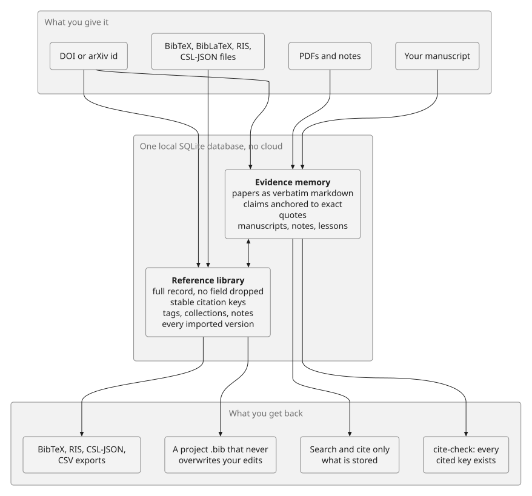
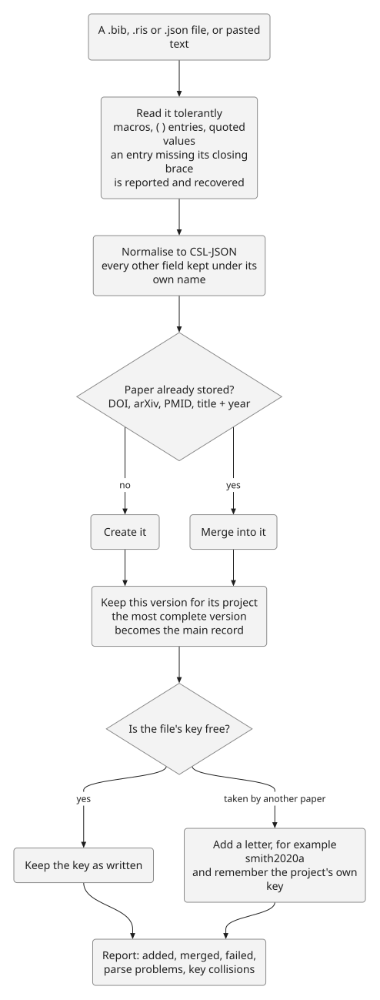
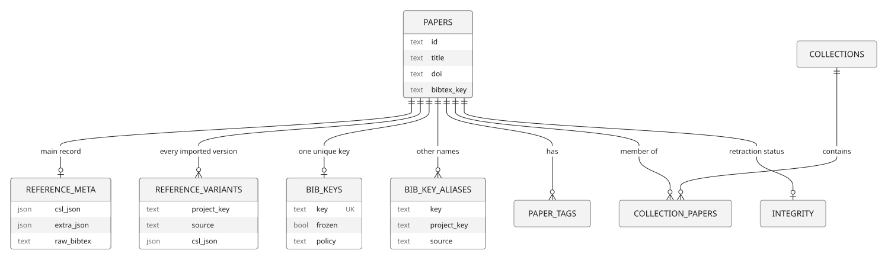
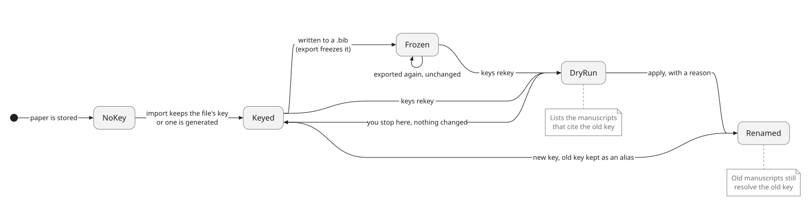
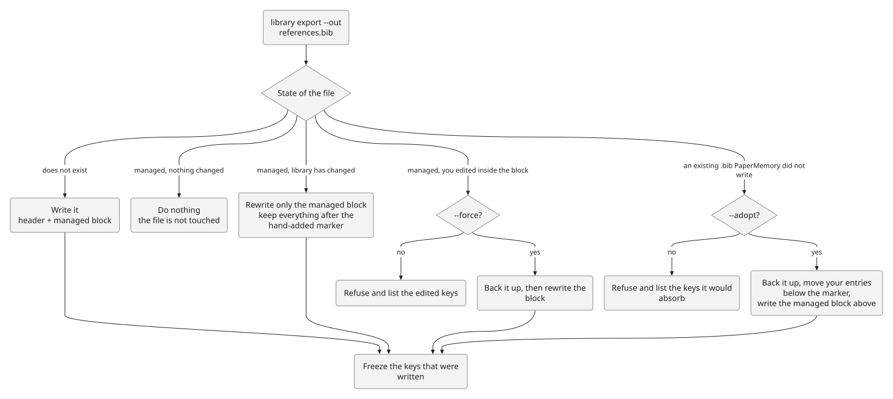
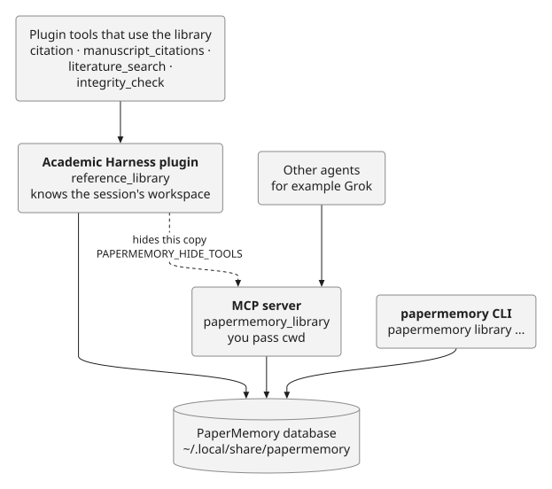

# PaperMemory

[](https://github.com/raktim-mondol/papermemory/actions/workflows/ci.yml)
[](https://github.com/raktim-mondol/papermemory/releases)
[](LICENSE)
[](https://www.python.org/downloads/)

**A local memory and reference manager for people (and AI agents) who read and write papers.** It remembers what a paper actually says, so you can quote it and cite it without inventing anything, and it keeps your bibliography clean: every reference stored in full, every citation key stable, and your project `.bib` files in sync with the library.

Everything lives in one SQLite file on your machine. No cloud, no account, no dependencies beyond Python's standard library (`pypdf` is optional, for PDFs).



## The two halves

| | **Evidence memory** | **Reference library** |
|---|---|---|
| Question it answers | "What does this paper say, and can I quote it?" | "What is this reference, what do I call it, and where is it used?" |
| Stores | The paper as verbatim markdown, claims anchored to exact quotes, manuscripts, notes, lessons | The full bibliographic record, citation keys, tags, collections, every imported version |
| Guarantees | A claim without a quote that exists in the paper is refused. `cite` returns nothing rather than a made-up key | No field is dropped on import. A key never changes by itself. Your hand edits are never overwritten |
| Added in | 0.1 – 0.2 | **0.3** |

They share one database, so a paper you read and a reference you cite are the same record.

## Install

```bash
pip install "papermemory[pdf] @ git+https://github.com/raktim-mondol/papermemory.git"
papermemory init
```

Editable checkout: `pip install -e '.[pdf]'`. Install `pypdf` separately if you skipped the extra.

The database is `~/.local/share/papermemory/papermemory.db`. Override it with `PAPERMEMORY_DB` or `PAPERMEMORY_DATA_DIR`.

### Upgrading from 0.2.x

0.3.0 adds the reference library and changes the database schema (2000 → 2100). It is additive: nothing existing is altered, and no existing citation key changes. Take a backup, then migrate once:

```bash
papermemory backup      # works on an old database too
papermemory migrate     # needs the database to be idle (close other papermemory processes)
papermemory init
```

A database that still needs migrating is refused with `migration-required` rather than being read wrongly, and an older binary refuses a migrated one (`schema-too-new`).

## Five-minute tour

```bash
# 1. Read a paper: it becomes searchable, quotable evidence
papermemory ingest paper.pdf --doi 10.1038/s41592-024-02201-0 --project thesis
papermemory ingest --arxiv 1706.03762 --project thesis

# 2. Bring in the references you already have
papermemory library import refs.bib --project thesis       # also .ris and CSL-JSON

# 3. Look around
papermemory library list tag:ml year:2020.. has:pdf
papermemory library get vaswani2017attention

# 4. Write: find something to cite, and check the manuscript
papermemory cite "attention-based multiple instance learning"
papermemory cite-check thesis

# 5. Keep the project bibliography in sync with the library
papermemory library export --cited-only thesis --out references.bib --cwd .
papermemory library doctor --cwd .
```

### Which command do I want?

| I want to... | Use |
|---|---|
| Remember a paper so I can quote it | `ingest` (PDF, markdown, DOI, arXiv id, or a whole manuscript folder) |
| Find a paper to cite for a statement | `cite` (an empty result means: do not invent one) |
| Make sure every `\cite{}` in my manuscript exists | `cite-check` |
| Import a `.bib`, `.ris`, or CSL-JSON file | `library import` |
| Group and label references | `library tag`, `library collection`, `library note` |
| Write or refresh a project `.bib` | `library export --out` (it protects your edits) |
| Export RIS, CSL-JSON, or CSV | `library export --format ris` (or `csl-json`, `csv`) |
| Rename a citation key safely | `library keys rekey` (dry run first) |
| Find and merge duplicate references | `library dedupe`, then `library merge` |
| Check my library for problems | `library doctor`, `library keys check` |

## Evidence memory

| Need | Coding memory | PaperMemory |
| --- | --- | --- |
| Identity | files, functions, PRs | papers (title, authors, year, venue, DOI, arXiv, bibtex key) |
| Evidence | stack traces, diffs | claims with quoted evidence, page/section, verified/unverified |
| Graph | imports, callers | cites / extends / contradicts / uses-method |
| Writing | commit messages | manuscripts, section word counts, contributions, terminology, reviewer comments |
| Integrity | tests pass | cite-check: every in-text key exists; never cite unverified or invented papers |
| Recap | "what did we code" | venue, citation style, section status, citation gaps |

PaperMemory keeps the useful [agentmemory](https://github.com/rohitg00/agentmemory) ideas (hybrid search, typed graph, confidence, lifecycle, MCP, agent skills) and replaces the coding ontology with an academic one.

```bash
# A writing project (LaTeX tree with references.bib + sections/)
papermemory ingest ~/journal_paper_writing --kind manuscript --project scandy

# Read a paper
papermemory ingest paper.pdf --project scandy
papermemory ingest paper.pdf --doi 10.1038/s41592-024-02201-0 --project scandy
papermemory ingest notes.md --pdf-path paper.pdf --project scandy
papermemory ingest --arxiv 1706.03762 --project scandy
papermemory ingest --doi 10.1038/s41592-024-02201-0
papermemory ingest paper.pdf --cwd ~/my-paper     # project from ah.yaml or manuscripts.root_path

papermemory search "spoil shear strength"
papermemory paper simmons2004shear
papermemory understand simmons2004shear --save
papermemory cite "attention-based multiple instance learning"
papermemory cite-check scandy
papermemory recap --project scandy

papermemory remember "Use Elsevier Harvard author-date for SCANDY" --concepts scandy,citation-style --project scandy
papermemory lesson "Never invent a citation. If cite returns nothing, say so." --concepts citations
```

`--json` is accepted before or after the subcommand, for agents and scripts.

`--cwd` resolves the ingest project the way an agent would: the nearest `ah.yaml` ancestor, then a manuscript whose `root_path` matches, else `unassigned`. An explicit `--project` wins over `--cwd` and is slugified (`"My Paper"` becomes `my-paper`).

## Reference library

### How a reference gets in



```bash
papermemory library import refs.bib --project thesis   # BibTeX / BibLaTeX
papermemory library import export.ris                  # RIS (EndNote-style and publisher exports)
papermemory library import items.json                  # CSL-JSON
papermemory library import refs.bib --dry-run          # report only, write nothing
papermemory library get smith2020 --project thesis     # the full record, its key, and its aliases
```

- **Nothing is dropped.** The record is stored as CSL-JSON plus every field CSL has no place for (`mrnumber`, `eprint`, `pdf`, ...) under its own name, plus the original BibTeX entry verbatim. In a test on 5,800 real entries, 89% had at least one field (pages, volume, URL, ...) that the older eight-column table would have lost.
- **A tolerant reader.** It understands `@string` macros, `#` concatenation, `{}` and `()` entries, quoted values, month macros, and braced corporate authors. An entry that is missing its closing brace is reported and recovered; it can no longer swallow the next entry.
- **Same paper, many files.** Re-importing merges by DOI, arXiv id, PMID, or title and year. Every imported version is kept; the most complete one is the main record; and a project export reproduces *that project's own* entries.
- **Keys from your files are kept as written.** If a *different* paper already owns the key, the newcomer gets a letter suffix and your project's own key is remembered, so `cite-check` still resolves it.
- Existing `papers.bibtex_key` values are never changed by the migration.

<details>
<summary>The tables behind it</summary>



`papers` is unchanged from 0.2. The library adds `reference_meta`, `reference_variants`, `bib_keys`, `bib_key_aliases`, `paper_tags`, `collections`, `collection_papers`, and `integrity`. JSONL export and restore include them (`pm-2.1`; older `pm-2` exports still restore).

</details>

### Tags, collections, notes, and queries

```bash
papermemory library tag add "ml,to-read" smith2020 lee2021       # tags are lower-cased and hyphenated
papermemory library tag list year:2020..                         # tags with counts, within a filter
papermemory library collection create thesis --title "Thesis refs" --project thesis --bib-path references.bib
papermemory library collection create chapter-1 --parent thesis  # one level of nesting
papermemory library collection add chapter-1 smith2020 lee2021
papermemory library collection reorder chapter-1 lee2021         # listed papers first, the rest keep their order
papermemory library collection show thesis                       # includes papers of child collections in filters
papermemory library note add smith2020 "Baseline is in section 4"
papermemory library note edit NOTE_ID "..."                      # the old text is kept, marked superseded
papermemory library list tag:ml year:2020..2024 has:pdf '!tag:skip' graph --sort year --desc --limit 20
```

Filters: `tag: collection: project: year:(2021 | 2020..2024 | 2020.. | ..2019) author: venue: title: key: doi: arxiv: has:(pdf|fulltext|doi|abstract|notes|key|tags) verified:(yes|no) integrity:(status|unchecked)`; plain words must all appear in the title, abstract, authors, venue, DOI, key, tags, or notes. `-` or `!` negates a filter (use `!` on the command line). An unknown field is an error, never a silent no-op. Results are keyset-paged with `total_count` and `--cursor`; `--sort added|year|title|key`.

Deleting a collection or a tag never deletes a paper. Tags and notes are searched by `papermemory search --kind paper`. All edits are audited (`papermemory log`).


### Citation keys




```bash
papermemory library keys check                         # report problems; changes nothing
papermemory library keys assign                        # give every paper without a key one
papermemory library keys freeze smith2020 --label export:references.bib
papermemory library keys rekey smith2020 --to smith2020gnn            # dry run: shows manuscripts that cite it
papermemory library keys rekey smith2020 --to smith2020gnn --apply --reason "clearer name"
```

- **Template.** Default `{family}{year}{titleword}` (same as the Academic Harness `citation` tool). Tokens: `{family} {year} {titleword} {doi} {arxiv}`. Set `PAPERMEMORY_KEY_TEMPLATE` or pass `--template`. A record with neither author nor year falls back to its DOI, then its arXiv id. Keys are ASCII, safe for BibTeX, and never start with a digit.
- **Stable.** A key is set once and never changes by itself; keys from your files are kept as written. `freeze` marks a key as relied on (exports do this automatically). Only `rekey` changes a key, needs a reason, and keeps the old key as a library-wide alias so manuscripts that still cite it keep resolving in `cite-check`.
- **Honest checks.** `keys check` reports missing keys, unsafe characters (spaces, commas, non-ASCII), mismatches with `papers.bibtex_key`, template drift on *generated* keys only (imported keys are never "drift"), and project aliases that shadow another paper's key.


### Writing a bibliography




```bash
papermemory library export --all                                  # print BibTeX
papermemory library export tag:ml year:2020.. --format biblatex --out refs/ml.bib --cwd .
papermemory library export --cited-only thesis --out references.bib --cwd .   # exactly what the manuscript cites
papermemory library export --collection chapter-1 --format ris --out ch1.ris --cwd .
papermemory library export --all --out references.bib --cwd . --check          # in_sync | out_of_date | hand_edited | not_managed | missing
papermemory library dedupe                                        # candidate duplicate groups; nothing is merged
papermemory library merge keep2020 dup2020                        # field-level preview (add --apply --reason "...")
papermemory library doctor --cwd .                                # library health: evidence, not a verdict
```

- **Formats:** `bibtex` (classic types), `biblatex`, `ris`, `csl-json`, `json`, `csv`. Entries are sorted by key with a fixed field order, so exports diff cleanly in git. Values come from the original BibTeX entry when there is one (accents and case-protection braces survive); otherwise from the CSL record, escaped. Unmapped fields and local file paths (`pdf`, `file`) stay out unless `--fields all` (paths never).
- **Scopes:** a filter, `--collection`, `--project`, `--cited-only MANUSCRIPT` (uses the keys the manuscript actually cites and reports cited keys the library lacks), or `--all`. Nothing is exported by accident.
- **A project's own version.** The library keeps every imported version of a paper (`reference_variants`) and picks the most complete as canonical. A project export reproduces that project's own entries and keys; `--variant canonical` writes the library record instead.
- **Managed `.bib`.** Output has a header and begin/end markers. Re-exporting rewrites only the managed block and keeps whatever you put after the `hand-added` marker. A file that is already in sync is not touched. If you edit inside the managed block, export refuses (`hand_edited`) unless `--force`; an existing `.bib` that PaperMemory did not write needs `--adopt`. Both keep a timestamped backup. `--out` must stay inside the workspace (`--cwd`), and other formats never overwrite an existing file without `--force`.
- **Frozen keys.** Exporting freezes the keys it writes; only `keys rekey` changes them afterwards.
- **Duplicates.** `dedupe` groups papers by title, year, and first author, recognises a preprint and its published version, and does not flag siblings in a series ("Part one/two"), notices ("Addendum:"), or yearly items ("News from X") as duplicates. `merge` is a dry run until `--apply --reason`; it moves documents, claims, tags, collections, notes, keys, and variants, and fills gaps from the dropped record.
- **Doctor.** Missing required fields per entry type, unsafe or missing keys, unverified DOIs, duplicate groups, papers flagged retracted or corrected (and whether a manuscript still cites them), and, with `--cwd`, whether each collection-bound `.bib` is in sync. A paper never integrity-checked is reported as unknown, not clean.


## Using it from an agent



```bash
papermemory mcp
```

Stdio framing is auto-detected: newline-delimited JSON (current TypeScript MCP SDK, DeepSeek Harness, recent Grok) and LSP `Content-Length` headers (older clients). Replies use the same framing as the first inbound message.

Wire into Grok:

```toml
[mcp_servers.papermemory]
command = "papermemory"
args = ["mcp"]
```

Tools: `papermemory_search`, `papermemory_ingest`, `papermemory_get`, `papermemory_cite`, `papermemory_cite_check`, `papermemory_remember`, `papermemory_claim`, `papermemory_recap`, `papermemory_lesson`, and the others listed by `papermemory tools`.

`papermemory_ingest` accepts `path` together with `doi` / `title` / `pdf_path`, so a local PDF and a later markdown conversion merge onto one verified record.

The reference library is one more tool, `papermemory_library`, with an `action` argument (`list get resolve import export tag collection note keys dedupe merge doctor set_integrity`). Reads change nothing; anything hard to undo is a dry run unless `apply` (with a `reason`), `force`, or `adopt` is set. Paths must stay inside the allowed roots, and export paths inside `cwd`.

An MCP server is one process with one fixed working directory, so a host that knows each session's workspace can offer the library its own way and hide this copy with `PAPERMEMORY_HIDE_TOOLS=papermemory_library`. The Academic Harness plugin does exactly that with a native `reference_library` tool.

A new paper gets a library record when it is ingested, and a key as soon as it has enough metadata to build a good one (an author, DOI, or arXiv id, and a real title). Others are keyed on request or on first export.

## Common questions

**Does it change my `.bib` files?** Only the ones you point `library export --out` at, and only the managed block inside them. Text you write after the `hand-added` marker is kept. If you edit inside the managed block, export refuses unless you pass `--force`, and it keeps a backup either way.

**What if two projects use the same key for different papers?** Both work. The library keeps keys unique, and remembers each project's own key as an alias, so each manuscript still resolves its own.

**Will renaming a key break my old manuscripts?** No. `keys rekey` shows the manuscripts that cite the old key first, needs a reason to apply, and keeps the old key working as an alias.

**Is a paper that was never checked for retraction "fine"?** No. It is reported as *unknown*. `integrity` results are recorded by whatever runs the check (the Academic Harness `integrity_check` does), and `doctor` lists retracted or corrected papers that a manuscript still cites.

**Does anything leave my machine?** Only DOI and arXiv lookups you ask for. The library itself is local.

## Citation rules (non-negotiable)

1. Only cite papers that are in PaperMemory.
2. Prefer `verified=1` (DOI or arXiv lookup succeeded). BibTeX-only records are tagged `UNVERIFIED`.
3. If `cite` returns nothing, do not invent a key, title, year, or DOI.
4. Run `cite-check` before treating a manuscript section as finished.

## Why not just install agentmemory?

Use agentmemory for coding sessions. Use PaperMemory for papers. They can coexist. Pushing PDFs through coding-session hooks would store tool traces, not claims, and would not stop hallucinated citations.

## Development

```bash
pip install -e '.[pdf,dev]'
pytest                      # 205 tests, no network
```

The diagrams in this README are Mermaid sources in `docs/diagrams/`, rendered to the committed SVGs in `docs/assets/diagrams/` with [Pele](https://github.com/obsidianmd/pele) (no browser needed):

```bash
npm install --no-save pele
node scripts/build-diagrams.mjs
```

## Docs

[Changelog](CHANGELOG.md) · [Releases](https://github.com/raktim-mondol/papermemory/releases)
